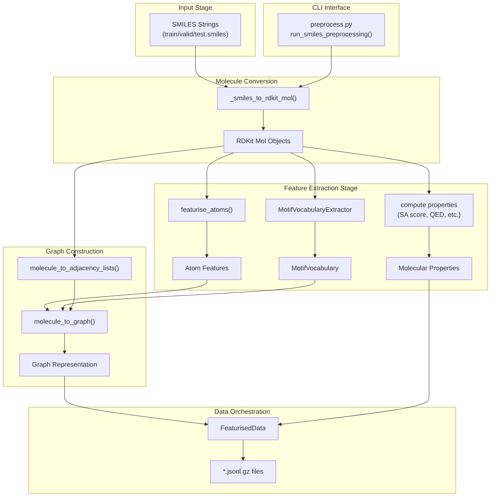
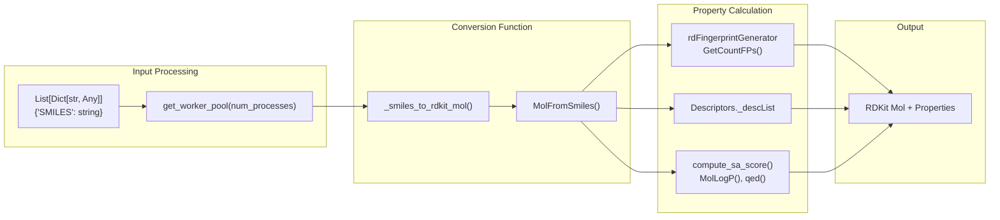
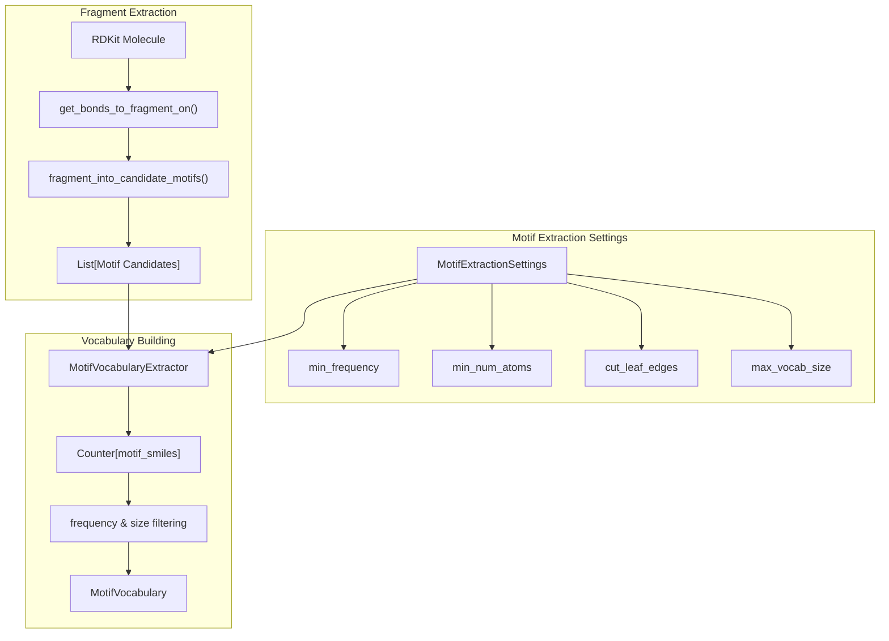
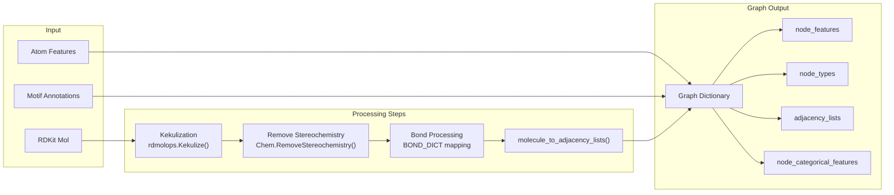

<!-- source: DeepWiki mcp.deepwiki.com · repo microsoft/molecule-generation · page 3.2 Preprocessing Pipeline · fetched 2026-10-26 -->

# Preprocessing Pipeline

<details>
<summary>Relevant source files</summary>

The following files were used as context for generating this wiki page:

- [molecule_generation/chem/molecule_dataset_utils.py](molecule_generation/chem/molecule_dataset_utils.py)
- [molecule_generation/chem/motif_utils.py](molecule_generation/chem/motif_utils.py)
- [molecule_generation/cli/preprocess.py](molecule_generation/cli/preprocess.py)

</details>


The preprocessing pipeline transforms raw SMILES strings into featurized molecular graphs suitable for training MoLeR models. This includes converting SMILES to RDKit molecules, extracting atom features, identifying molecular motifs, creating graph representations, and computing molecular properties. The pipeline produces both intermediate featurized data and final generation traces for model training.

For information about input data formats, see [Input Data Formats](#3.1). For details on how preprocessed data becomes training datasets, see [Dataset Creation](#3.3).

## Pipeline Overview

The preprocessing pipeline follows a multi-stage approach, with each stage building upon the previous one's outputs:



**Sources:** [molecule_generation/chem/molecule_dataset_utils.py:125-347](), [molecule_generation/cli/preprocess.py:208-331]()

## SMILES to Molecule Conversion

The first stage converts SMILES strings into RDKit molecule objects using parallel processing for efficiency:



The `_smiles_to_rdkit_mol` function [molecule_generation/chem/molecule_dataset_utils.py:627-679]() handles the conversion with optional property calculation. Key steps include:

- **SMILES parsing**: Uses `MolFromSmiles()` to create RDKit molecule objects
- **Fingerprint generation**: Computes Morgan fingerprints using `rdFingerprintGenerator.GetCountFPs()`
- **Descriptor calculation**: Iterates through `Descriptors._descList` to compute all available RDKit descriptors
- **Molecular properties**: Calculates SA score, cLogP, molecular weight, QED, and Bertz complexity

The function uses `copy.deepcopy()` on the RDKit molecule to avoid pickling issues during parallel processing.

**Sources:** [molecule_generation/chem/molecule_dataset_utils.py:519-589](), [molecule_generation/chem/molecule_dataset_utils.py:627-703]()

## Atom Featurization

Atom featurization converts each atom in a molecule into numerical feature vectors using configurable feature extractors:

| Component | Purpose | Implementation |
|-----------|---------|----------------|
| `AtomFeatureExtractor` | Base class for atom feature extraction | Abstract interface |
| `AtomTypeFeatureExtractor` | Categorical atom type features | Maps atoms to type indices |
| `get_default_atom_featurisers()` | Default feature extractor set | Provides standard atom features |

The `featurise_atoms` function [molecule_generation/chem/molecule_dataset_utils.py:385-450]() processes all atoms in a molecule:

```python
# Core featurization loop
for atom_id, atom in enumerate(mol.GetAtoms()):
    atom_symbol = get_atom_symbol(atom)
    atom_features = [
        atom_featuriser.featurise(atom) 
        for atom_featuriser in atom_feature_extractors
    ]
    atom_features = np.concatenate(atom_features).astype(np.float32)
    all_atom_features.append(atom_features)
```

The function returns a `NodeFeatures` named tuple containing:
- `real_valued_features`: List of numpy arrays with continuous features
- `categorical_features`: Optional list of categorical class IDs
- `num_categorical_classes`: Total number of categorical classes

**Sources:** [molecule_generation/chem/molecule_dataset_utils.py:48-54](), [molecule_generation/chem/molecule_dataset_utils.py:385-450]()

## Motif Processing

Motif processing identifies recurring molecular fragments and builds a vocabulary for motif-based generation:



The motif extraction process [molecule_generation/chem/motif_utils.py:71-134]() works by:

1. **Bond identification**: `get_bonds_to_fragment_on()` finds bonds that connect rings to non-ring structures
2. **Fragmentation**: `fragment_into_candidate_motifs()` breaks the molecule at selected bonds
3. **Canonicalization**: Uses `Chem.CanonicalRankAtoms()` to assign symmetry classes to atoms
4. **Vocabulary building**: `MotifVocabularyExtractor` counts motif occurrences across the dataset

The resulting `MotifVocabulary` maps SMILES strings to integer IDs and stores the extraction settings used.

**Sources:** [molecule_generation/chem/motif_utils.py:11-37](), [molecule_generation/chem/motif_utils.py:71-134](), [molecule_generation/chem/motif_utils.py:137-212]()

## Graph Conversion

The graph conversion stage transforms RDKit molecules into structured graph representations suitable for neural networks:



The `molecule_to_graph` function [molecule_generation/chem/molecule_dataset_utils.py:453-516]() produces a dictionary with:

- **`adjacency_lists`**: List of edge lists for each bond type (single, double, triple)
- **`node_types`**: String atom symbols for each node
- **`node_features`**: Continuous feature vectors for each atom
- **`node_categorical_features`**: Optional categorical class IDs when using motifs

Bond types are mapped using the `BOND_DICT` constant [molecule_generation/chem/molecule_dataset_utils.py:45]():
```python
BOND_DICT = {"SINGLE": 0, "DOUBLE": 1, "TRIPLE": 2}
```

**Sources:** [molecule_generation/chem/molecule_dataset_utils.py:356-382](), [molecule_generation/chem/molecule_dataset_utils.py:453-516]()

## Property Calculation

The pipeline computes various molecular properties and descriptors for downstream analysis:

| Property Type | Functions | Purpose |
|---------------|-----------|---------|
| **Fingerprints** | `rdFingerprintGenerator.GetCountFPs()` | Structural similarity comparison |
| **RDKit Descriptors** | `Descriptors._descList` | Standard molecular descriptors |
| **Drug-likeness** | `qed()`, `MolLogP()` | ADMET properties |
| **Complexity** | `compute_sa_score()`, `BertzCT()` | Synthetic accessibility |

The properties are calculated in `_smiles_to_rdkit_mol` [molecule_generation/chem/molecule_dataset_utils.py:662-670]():

```python
datapoint["properties"] = {
    "sa_score": compute_sa_score(rdkit_mol),
    "clogp": MolLogP(rdkit_mol),
    "mol_weight": ExactMolWt(rdkit_mol), 
    "qed": qed(rdkit_mol),
    "bertz": BertzCT(rdkit_mol),
}
```

The SA (Synthetic Accessibility) score computation [molecule_generation/chem/molecule_dataset_utils.py:687-703]() dynamically loads the RDKit contrib module for more sophisticated scoring.

**Sources:** [molecule_generation/chem/molecule_dataset_utils.py:643-670](), [molecule_generation/chem/molecule_dataset_utils.py:681-703]()

## Data Orchestration

The `FeaturisedData` class [molecule_generation/chem/molecule_dataset_utils.py:156-240]() orchestrates the entire preprocessing pipeline:

```mermaid
classDiagram
    class FeaturisedData {
        +train_data: Iterable[Dict]
        +valid_data: Iterable[Dict]  
        +test_data: Iterable[Dict]
        +atom_feature_extractors: List[AtomFeatureExtractor]
        +motif_vocabulary: MotifVocabulary
        +len_train_data: int
        +len_valid_data: int
        +len_test_data: int
        +__init__()
    }
    
    class "compute_smiles_dataset_metadata()" {
        +mol_data: Iterable
        +atom_feature_extractors: Optional
        +motif_vocabulary: Optional
        +returns: Tuple[extractors, vocabulary]
    }
    
    class "featurise_mol_data()" {
        +mol_data: Iterable
        +atom_feature_extractors: List
        +motif_vocabulary: Optional
        +yields: Dict[str, Any]
    }
    
    FeaturisedData --> "compute_smiles_dataset_metadata()"
    FeaturisedData --> "featurise_mol_data()"
```

The initialization process:

1. **Metadata computation**: `compute_smiles_dataset_metadata()` [molecule_generation/chem/molecule_dataset_utils.py:56-122]() builds atom feature extractors and motif vocabulary
2. **Data featurization**: `featurise_mol_data()` [molecule_generation/chem/molecule_dataset_utils.py:125-153]() applies featurization to each dataset split
3. **Lazy evaluation**: Data is processed on-demand using iterators for memory efficiency

The main entry point `featurise_smiles_datapoints()` [molecule_generation/chem/molecule_dataset_utils.py:242-346]() handles parallel processing and temporary file caching.

**Sources:** [molecule_generation/chem/molecule_dataset_utils.py:156-240](), [molecule_generation/chem/molecule_dataset_utils.py:56-122](), [molecule_generation/chem/molecule_dataset_utils.py:242-346]()

---

