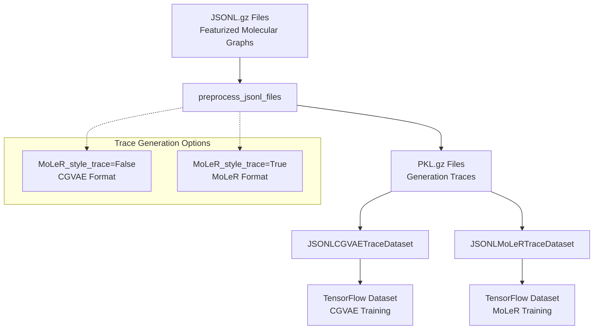
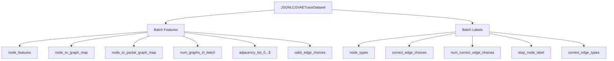
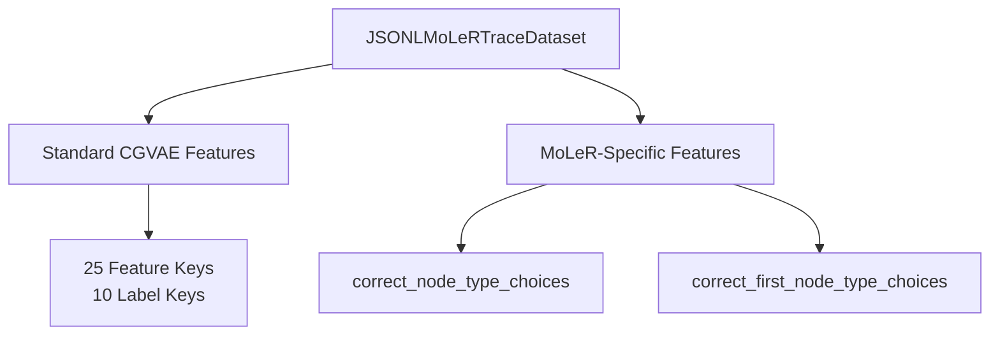

<!-- source: DeepWiki mcp.deepwiki.com · repo microsoft/molecule-generation · page 3.3 Dataset Creation · fetched 2026-10-26 -->

# Dataset Creation

<details>
<summary>Relevant source files</summary>

The following files were used as context for generating this wiki page:

- [molecule_generation/test/dataset/test_jsonl_cgvae_trace_dataset_preprocessing.py](molecule_generation/test/dataset/test_jsonl_cgvae_trace_dataset_preprocessing.py)
- [molecule_generation/test/dataset/test_jsonl_moler_trace_dataset_preprocessing.py](molecule_generation/test/dataset/test_jsonl_moler_trace_dataset_preprocessing.py)

</details>


This document covers the creation of training datasets from preprocessed molecular data. Dataset creation transforms featurized molecular graphs into training-ready datasets for MoLeR and CGVAE models, generating generation traces and organizing data for efficient model training. For information about the initial preprocessing of SMILES data into featurized graphs, see [Preprocessing Pipeline](#3.2).

## Overview

The dataset creation process converts preprocessed molecular graphs stored in JSONL format into specialized training datasets containing generation traces. The system supports two distinct dataset formats optimized for different model architectures: CGVAE traces and MoLeR traces. Each format captures the step-by-step molecule generation process as training sequences.

## Dataset Creation Pipeline

The dataset creation pipeline transforms featurized molecular data through multiple stages to produce training-ready datasets:



**Dataset Creation Flow**
Sources: [molecule_generation/test/dataset/test_jsonl_cgvae_trace_dataset_preprocessing.py:54-59](), [molecule_generation/test/dataset/test_jsonl_moler_trace_dataset_preprocessing.py:54-59]()

## Dataset Types and Classes

The system provides two primary dataset classes, each optimized for specific model architectures:

| Dataset Class | Purpose | Trace Style | Target Models |
|---------------|---------|-------------|---------------|
| `JSONLCGVAETraceDataset` | CGVAE model training | `MoLeR_style_trace=False` | Conditional Graph VAE |
| `JSONLMoLeRTraceDataset` | MoLeR model training | `MoLeR_style_trace=True` | MoLeR VAE/Generator |

### CGVAE Dataset Structure

The `JSONLCGVAETraceDataset` creates training data for the Conditional Graph VAE architecture:



**CGVAE Dataset Structure**
Sources: [molecule_generation/test/dataset/test_jsonl_cgvae_trace_dataset_preprocessing.py:108-129]()

### MoLeR Dataset Structure

The `JSONLMoLeRTraceDataset` extends the CGVAE structure with additional features for MoLeR training:



**MoLeR Dataset Extensions**
Sources: [molecule_generation/test/dataset/test_jsonl_moler_trace_dataset_preprocessing.py:131-134]()

## Data Processing Functions

### Core Processing Functions

The dataset creation process relies on several key functions from the preprocessing pipeline:

| Function | Module | Purpose |
|----------|--------|---------|
| `featurise_smiles_datapoints` | `molecule_dataset_utils` | Convert SMILES to featurized graphs |
| `save_data` | `preprocessing_utils` | Save featurized data to JSONL.gz |
| `write_jsonl_gz_data` | `preprocessing_utils` | Write compressed JSONL data |
| `preprocess_jsonl_files` | `preprocess` | Generate training traces from graphs |

### Trace Generation Process

The `preprocess_jsonl_files` function converts featurized molecular graphs into generation traces:

```python
preprocess_jsonl_files(
    jsonl_directory=input_path,
    output_directory=output_path,
    tie_fwd_bkwd_edges=True,
    MoLeR_style_trace=True  # or False for CGVAE
)
```

Sources: [molecule_generation/test/dataset/test_jsonl_cgvae_trace_dataset_preprocessing.py:54-59](), [molecule_generation/test/dataset/test_jsonl_moler_trace_dataset_preprocessing.py:54-59]()

## File Organization and Structure

### Directory Structure

The dataset creation process produces organized directory structures for different data folds:

```
output_directory/
├── train_0/
│   └── train_0.pkl.gz
├── valid_0/
│   └── valid_0.pkl.gz
└── test_0/
    └── test_0.pkl.gz
```

Sources: [molecule_generation/test/dataset/test_jsonl_cgvae_trace_dataset_preprocessing.py:61-65](), [molecule_generation/test/dataset/test_jsonl_moler_trace_dataset_preprocessing.py:61-65]()

### Data Fold Management

The system uses `DataFold` enumeration to manage training, validation, and test splits:

| Data Fold | Purpose | Behavior |
|-----------|---------|----------|
| `DataFold.TRAIN` | Model training | Repeats indefinitely during training |
| `DataFold.VALIDATION` | Hyperparameter tuning | Fixed size, no repetition |
| `DataFold.TEST` | Final evaluation | Fixed size, no repetition |

Sources: [molecule_generation/test/dataset/test_jsonl_cgvae_trace_dataset_preprocessing.py:91-99](), [molecule_generation/test/dataset/test_jsonl_moler_trace_dataset_preprocessing.py:91-99]()

## Dataset Loading and Usage

### Dataset Initialization

Both dataset classes follow a consistent initialization pattern:

```python
# Get default hyperparameters
params = JSONLMoLeRTraceDataset.get_default_hyperparameters()

# Create dataset instance
dataset = JSONLMoLeRTraceDataset(params)

# Load preprocessed data
dataset.load_data(
    data_path, 
    folds_to_load={DataFold.TRAIN, DataFold.VALIDATION, DataFold.TEST}
)
```

Sources: [molecule_generation/test/dataset/test_jsonl_moler_trace_dataset_preprocessing.py:69-76]()

### TensorFlow Dataset Integration

The dataset classes provide seamless integration with TensorFlow training pipelines:

```python
with dataset.get_context_managed_tf_dataset(DataFold.TRAIN) as train_data:
    tf_dataset_iterator = iter(train_data.tf_dataset)
    batch = next(tf_dataset_iterator)
    features, labels = batch
```

Sources: [molecule_generation/test/dataset/test_jsonl_cgvae_trace_dataset_preprocessing.py:104-109](), [molecule_generation/test/dataset/test_jsonl_moler_trace_dataset_preprocessing.py:104-109]()

## Dataset Properties and Validation

### Standard Properties

Both dataset types provide consistent property interfaces:

| Property | CGVAE Value | MoLeR Value | Description |
|----------|-------------|-------------|-------------|
| `num_edge_types` | 4 | 4 | Forward/backward edges + self-loops |
| `node_feature_shape` | (29,) | (29,) | Atom feature vector dimensions |

Sources: [molecule_generation/test/dataset/test_jsonl_cgvae_trace_dataset_preprocessing.py:79-86](), [molecule_generation/test/dataset/test_jsonl_moler_trace_dataset_preprocessing.py:79-86]()

### Batch Structure Validation

The system validates that batched data contains all required features and labels for training. CGVAE batches contain 25 feature keys and 10 label keys, while MoLeR batches include additional node type prediction labels.

Sources: [molecule_generation/test/dataset/test_jsonl_cgvae_trace_dataset_preprocessing.py:108-129](), [molecule_generation/test/dataset/test_jsonl_moler_trace_dataset_preprocessing.py:108-139]()

---

