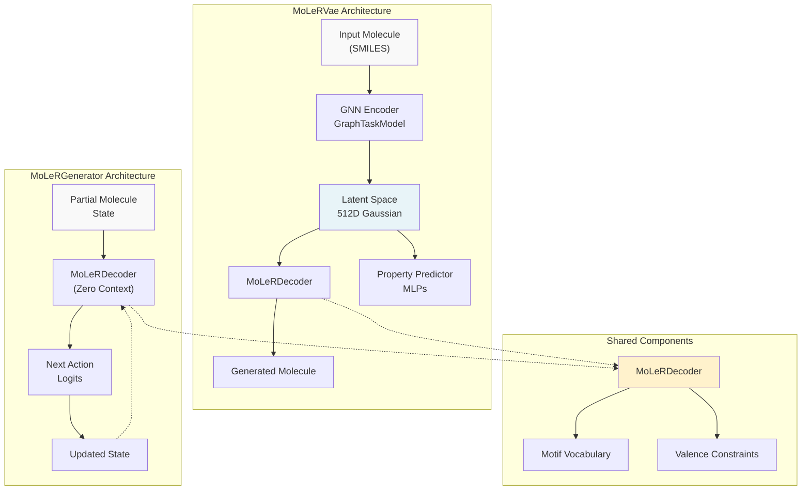
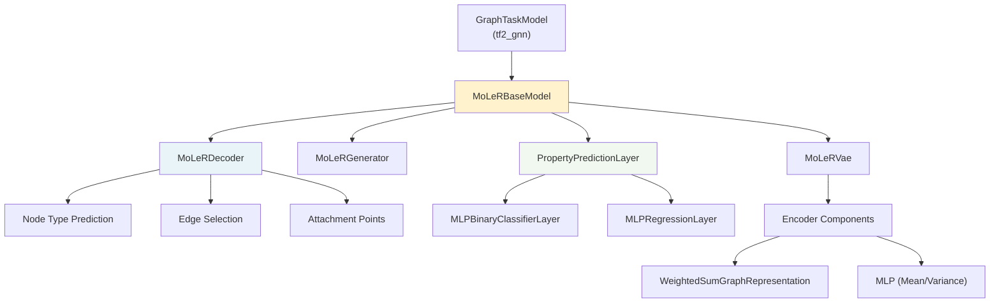
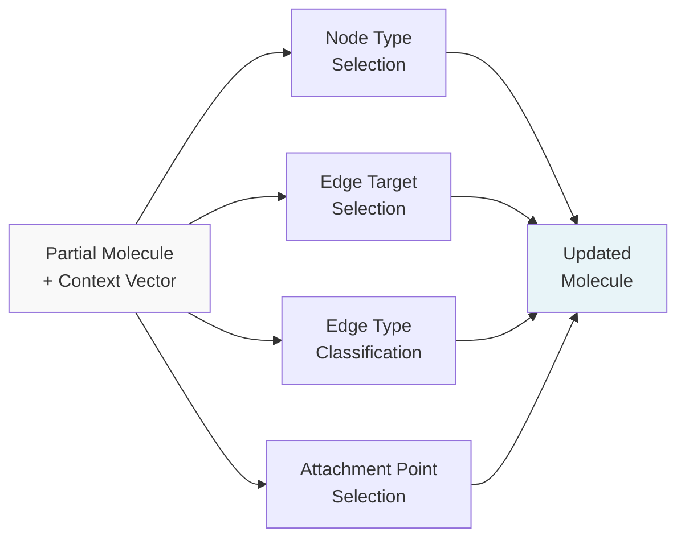

<!-- source: DeepWiki mcp.deepwiki.com · repo microsoft/molecule-generation · page 4 Model Architecture · fetched 2026-10-26 -->

# Model Architecture

<details>
<summary>Relevant source files</summary>

The following files were used as context for generating this wiki page:

- [molecule_generation/models/moler_base_model.py](molecule_generation/models/moler_base_model.py)
- [molecule_generation/models/moler_generator.py](molecule_generation/models/moler_generator.py)
- [molecule_generation/models/moler_vae.py](molecule_generation/models/moler_vae.py)

</details>


This document provides a high-level overview of the MoLeR (Molecule Learning Representation) model architectures implemented in this codebase. It covers the core design principles, architectural variants, and key components that enable molecule generation and manipulation through deep learning.

For detailed information about training these models, see [Training Models](#5). For using trained models in applications, see [Inference & Generation](#6).

## Overview

The MoLeR system implements two main architectural variants that share common components but serve different use cases:

- **MoLeRVae**: A variational autoencoder that maps molecules to a continuous latent space, enabling interpolation and targeted generation
- **MoLeRGenerator**: An autoregressive model that directly generates molecules without explicit latent representations

Both architectures are built around a shared decoder component that generates molecules step-by-step using graph neural networks.

## Architecture Variants



**Sources:** [molecule_generation/models/moler_vae.py:45-53](), [molecule_generation/models/moler_generator.py:15-21](), [molecule_generation/models/moler_base_model.py:18-19]()

## Class Hierarchy



**Sources:** [molecule_generation/models/moler_base_model.py:18](), [molecule_generation/models/moler_vae.py:45](), [molecule_generation/models/moler_generator.py:15]()

## Data Flow Architecture

The following diagram shows how data flows through the MoLeR models from input to output:

```mermaid
flowchart LR
    subgraph "Input Processing"
        SMILES["SMILES String"] --> RDKIT["RDKit Molecule"]
        RDKIT --> GRAPH["Graph Representation<br/>(nodes + edges)"]
        GRAPH --> FEATURES["Node Features<br/>+ Categorical Features"]
    end
    
    subgraph "Model Processing"
        FEATURES --> CHOICE{Model Type}
        
        CHOICE -->|VAE| ENC["GNN Encoder<br/>compute_final_node_representations"]
        ENC --> NODE2GRAPH["Nodes to Graph<br/>WeightedSumGraphRepresentation"]
        NODE2GRAPH --> SAMPLE["Latent Sampling<br/>compute_latent_molecule_representations"]
        
        CHOICE -->|Generator| ZERO["Zero Vector<br/>(no encoder)"]
        
        SAMPLE --> DECODE["MoLeRDecoder"]
        ZERO --> DECODE
        
        DECODE --> LOGITS["Action Logits<br/>(node/edge/attachment)"]
    end
    
    subgraph "Output Generation"
        LOGITS --> ACTIONS["Generation Actions"]
        ACTIONS --> MOL_OUT["Output Molecule"]
        
        SAMPLE --> PROP_PRED["Property Prediction<br/>MLPs"]
        PROP_PRED --> PROPERTIES["Molecular Properties"]
    end
    
    style CHOICE fill:#f9f9f9
    style DECODE fill:#fff2cc
    style SAMPLE fill:#e8f4f8
```



**Sources:** [molecule_generation/models/moler_vae.py:225-321](), [molecule_generation/models/moler_generator.py:26-57](), [molecule_generation/models/moler_base_model.py:199-224]()

## Key Components

### MoLeRBaseModel

The `MoLeRBaseModel` class provides shared functionality for both architectural variants:

| Component | Purpose | Key Methods |
|-----------|---------|-------------|
| `MoLeRDecoder` | Core generation logic | `_get_decoder_output()` |
| Training utilities | Loss computation, metrics | `_compute_decoder_loss_and_metrics()` |
| Hyperparameter management | Default configurations | `get_default_hyperparameters()` |
| Step counter | Training progress tracking | `_train_step_counter` |

**Sources:** [molecule_generation/models/moler_base_model.py:59-121]()

### Latent Space Configuration

The MoLeRVae supports multiple latent sampling strategies controlled by the `latent_sample_strategy` parameter:

| Strategy | Description | Use Case |
|----------|-------------|----------|
| `passthrough` | No noise added | Deterministic encoding |
| `per_graph` | Shared noise per input graph | Consistent variations |
| `per_partial_graph` | Independent noise per partial graph | Maximum diversity |

**Sources:** [molecule_generation/models/moler_vae.py:240-249](), [molecule_generation/models/moler_vae.py:300-319]()

### Decoder Architecture

The `MoLeRDecoder` generates molecules through sequential decision-making:



**Sources:** [molecule_generation/models/moler_base_model.py:199-224]()

## Model Outputs

### MoLeRVaeOutput

The VAE model produces structured outputs containing both generation logits and latent representations:

```python
@dataclass
class MoLeRVaeOutput:
    graph_representation_mean: tf.Tensor
    graph_representation_log_variance: tf.Tensor
    node_type_logits: tf.Tensor
    first_node_type_logits: tf.Tensor
    edge_candidate_logits: tf.Tensor
    edge_type_logits: tf.Tensor
    attachment_point_selection_logits: Optional[tf.Tensor]
    predicted_properties: Dict[str, tf.Tensor]
```

**Sources:** [molecule_generation/models/moler_vae.py:22-32]()

### MoLeRGeneratorOutput

The Generator model produces action logits for direct molecule construction:

```python
@dataclass
class MoLeRGeneratorOutput(MoLeRDecoderOutput):
    first_node_type_logits: tf.Tensor
```

**Sources:** [molecule_generation/models/moler_generator.py:10-13]()

## Configuration and Hyperparameters

Both models inherit base hyperparameters from `MoLeRBaseModel` with variant-specific extensions:

### Core Parameters

| Parameter | Default | Purpose |
|-----------|---------|---------|
| `latent_repr_size` | 512 | Dimensionality of latent space |
| `learning_rate` | 0.001 | Training learning rate |
| `gradient_clip_value` | 0.5 | Gradient clipping threshold |

### VAE-Specific Parameters

| Parameter | Default | Purpose |
|-----------|---------|---------|
| `gnn_hidden_dim` | 64 | GNN layer dimensions |
| `gnn_num_layers` | 12 | Number of GNN layers |
| `kl_divergence_weight` | 0.02 | KL loss term weight |
| `latent_repr_num_heads` | 32 | Attention heads for pooling |

**Sources:** [molecule_generation/models/moler_base_model.py:28-56](), [molecule_generation/models/moler_vae.py:56-86]()

This architectural overview provides the foundation for understanding the detailed implementations covered in the following sections. For specific implementation details, see [MoLeR VAE Architecture](#4.2) and [MoLeR Generator Architecture](#4.3).

---

