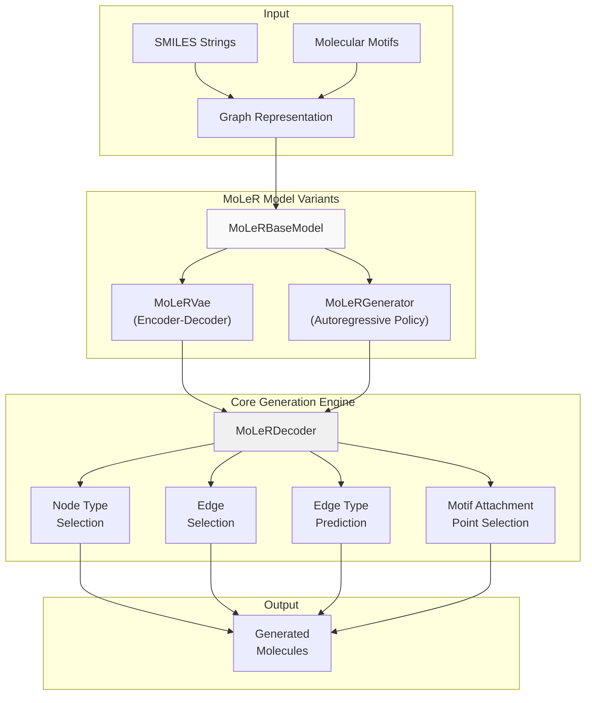
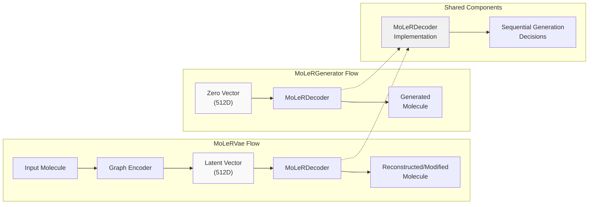
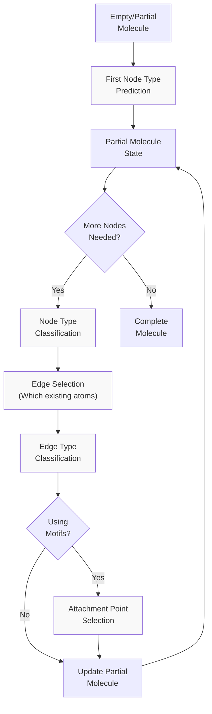
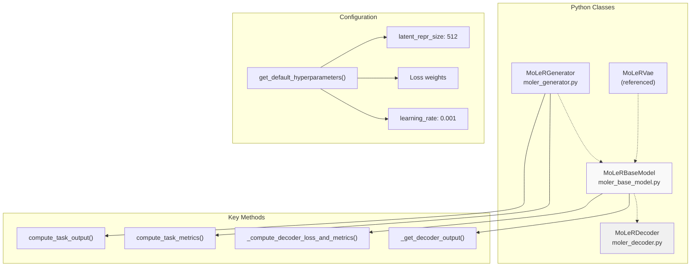

<!-- source: DeepWiki mcp.deepwiki.com · repo microsoft/molecule-generation · page 4.1 MoLeR Model Overview · fetched 2026-10-26 -->

# MoLeR Model Overview

Relevant source files

The following files were used as context for generating this wiki page:

- [CHANGELOG.md](CHANGELOG.md)
- [molecule_generation/models/moler_base_model.py](molecule_generation/models/moler_base_model.py)
- [molecule_generation/models/moler_generator.py](molecule_generation/models/moler_generator.py)

This document provides a high-level overview of the MoLeR (Molecule Learning Representation) model architecture and its approach to molecule generation. This covers the core concepts, model variants, and generation methodology used throughout the system.

For detailed information about the VAE variant, see [MoLeR VAE Architecture](#4.2). For the autoregressive generator variant, see [MoLeR Generator Architecture](#4.3). For implementation details of individual components, see [Model Components](#4.4).

## Core MoLeR Approach

MoLeR employs a step-by-step graph construction approach to generate molecular structures. Rather than generating molecules as sequences (like SMILES strings), MoLeR builds molecular graphs incrementally by making a series of discrete decisions about atoms, bonds, and molecular fragments.

The key innovation is treating molecule generation as a sequential decision-making process where at each step, the model chooses:
- What type of atom to add next
- Where to connect new atoms via bonds  
- What type of bonds to form
- How to incorporate molecular motifs/fragments

**MoLeR Model Architecture Overview**

Sources: [molecule_generation/models/moler_base_model.py:18-140](), [molecule_generation/models/moler_generator.py:15-21]()

## Model Variants

The MoLeR system provides two distinct model variants that share the same core generation engine but differ in their conditioning approach:

| Variant | Class | Conditioning | Use Case |
|---------|-------|-------------|----------|
| **MoLeR VAE** | `MoLeRVae` | Latent space encoding of input molecules | Molecule optimization, latent space interpolation |
| **MoLeR Generator** | `MoLeRGenerator` | Zero-vector conditioning (unconditional) | De novo molecule generation, sampling |

**Model Variant Relationship**

Sources: [molecule_generation/models/moler_base_model.py:18-19](), [molecule_generation/models/moler_generator.py:15-17](), [molecule_generation/models/moler_generator.py:34-36]()

## Step-by-Step Generation Process

Both MoLeR variants use the same underlying generation methodology. The process builds molecules incrementally through a sequence of prediction tasks:

**Generation Decision Sequence**

Sources: [molecule_generation/models/moler_base_model.py:175-197](), [molecule_generation/models/moler_generator.py:46-49]()

## Key Components and Loss Functions

The MoLeR model uses multiple prediction heads and corresponding loss functions to handle different aspects of molecule generation:

| Component | Purpose | Loss Weight Parameter |
|-----------|---------|----------------------|
| **Node Classification** | Predict next atom type | `node_classification_loss_weight` (1.0) |
| **First Node Classification** | Predict starting atom | `first_node_classification_loss_weight` (0.07) |
| **Edge Selection** | Choose connection points | `edge_selection_loss_weight` (1.0) |
| **Edge Type** | Predict bond types | `edge_type_loss_weight` (1.0) |
| **Attachment Point Selection** | Handle motif connections | `attachment_point_selection_weight` (1.0) |

**Component Implementation Mapping**

Sources: [molecule_generation/models/moler_base_model.py:28-56](), [molecule_generation/models/moler_base_model.py:175-197](), [molecule_generation/models/moler_generator.py:26-33]()

## Training and Inference Integration

The MoLeR models integrate with the broader training and inference pipeline through standardized interfaces:

- **Dataset Integration**: Works with `TraceDataset` objects that provide molecule generation traces
- **Wrapper Classes**: `VaeWrapper` and `GeneratorWrapper` provide high-level APIs for model usage
- **Inference Server**: `MoLeRInferenceServer` enables scalable batch processing
- **Visualization**: Generation traces can be visualized through HTML and CLI tools

The models use TensorFlow/Keras and follow the `GraphTaskModel` pattern from the tf2_gnn library, enabling GPU acceleration and efficient batch processing of molecular graphs.

Sources: [molecule_generation/models/moler_base_model.py:59-60](), [molecule_generation/models/moler_base_model.py:226-247]()

---

