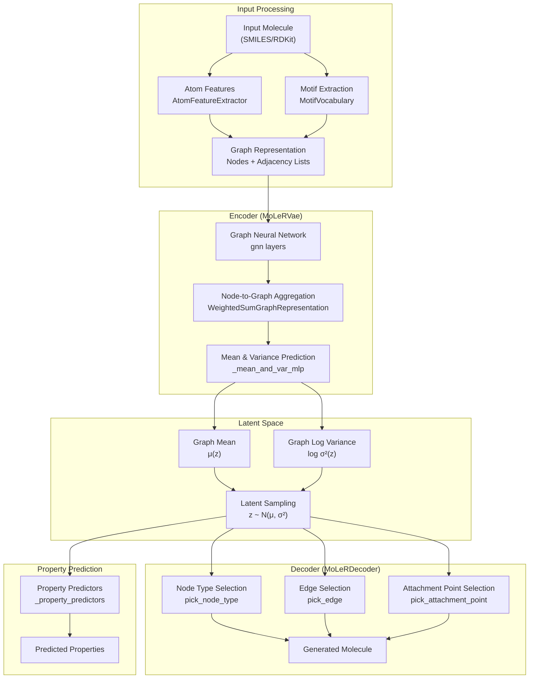
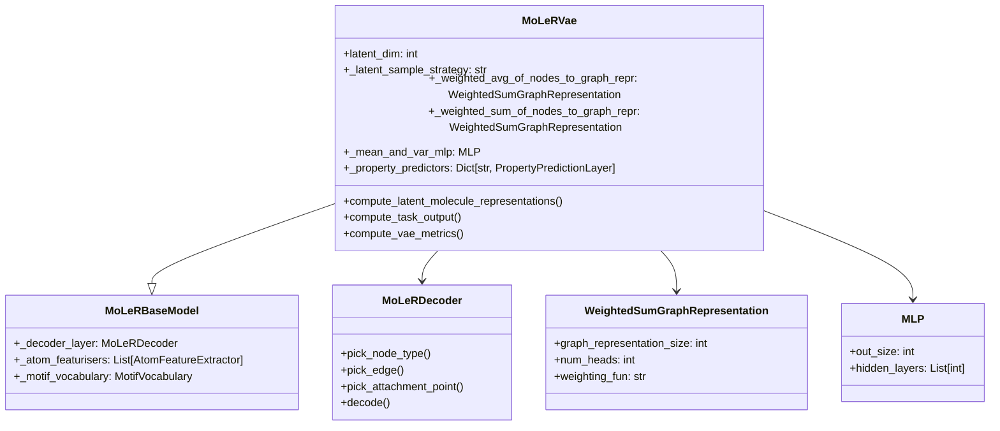
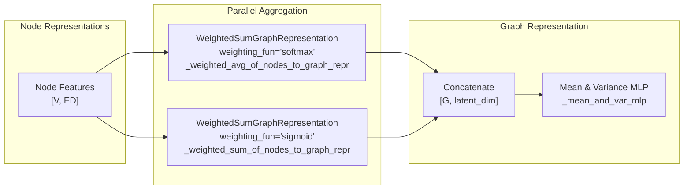
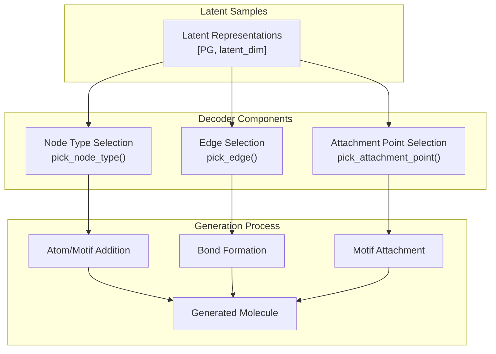
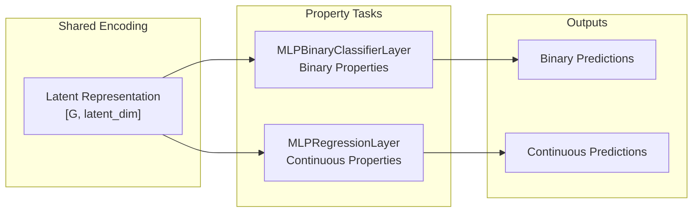
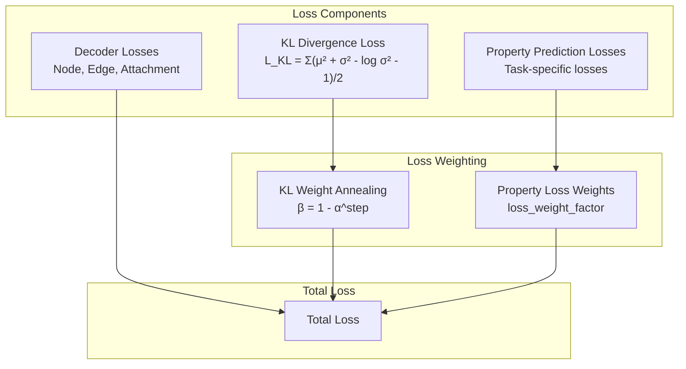

<!-- source: DeepWiki mcp.deepwiki.com · repo microsoft/molecule-generation · page 4.2 MoLeR VAE Architecture · fetched 2026-10-26 -->

# MoLeR VAE Architecture

<details>
<summary>Relevant source files</summary>

The following files were used as context for generating this wiki page:

- [molecule_generation/layers/moler_decoder.py](molecule_generation/layers/moler_decoder.py)
- [molecule_generation/models/moler_vae.py](molecule_generation/models/moler_vae.py)

</details>


This document describes the Variational Autoencoder (VAE) variant of the MoLeR model architecture, which learns to encode molecular graphs into a continuous latent space and decode them back to generate new molecules. The VAE approach enables controlled molecule generation through latent space manipulation and interpolation.

For the autoregressive generation variant, see [MoLeR Generator Architecture](#4.3). For an overview of the broader MoLeR approach, see [MoLeR Model Overview](#4.1). For detailed information about shared decoder components, see [Model Components](#4.4).

## Architecture Overview

The MoLeR VAE follows the standard VAE paradigm adapted for molecular graphs, with the key innovation being the use of both atomic and motif-level representations for hierarchical molecule generation.

### High-Level Data Flow



**MoLeR VAE Data Flow Architecture**

Sources: [molecule_generation/models/moler_vae.py:45-53](), [molecule_generation/layers/moler_decoder.py:107-140]()

## Core Components

### MoLeRVae Class Structure

The `MoLeRVae` class orchestrates the complete VAE pipeline through several key components:



**MoLeR VAE Class Architecture**

Sources: [molecule_generation/models/moler_vae.py:45-155](), [molecule_generation/models/moler_base_model.py]()

## Encoder Architecture

The encoder transforms molecular graphs into continuous latent representations through a multi-stage process.

### Graph Neural Network Encoding

The encoder uses a Graph Neural Network (GNN) to compute node-level representations:

| Parameter | Default Value | Description |
|-----------|---------------|-------------|
| `gnn_hidden_dim` | 64 | Hidden dimension for GNN layers |
| `gnn_num_layers` | 12 | Number of GNN message passing layers |
| `gnn_message_activation_function` | "leaky_relu" | Activation function for messages |
| `use_intermediate_gnn_results` | True | Concatenate all layer outputs |

Sources: [molecule_generation/models/moler_vae.py:60-68]()

### Node-to-Graph Aggregation

Two parallel aggregation mechanisms combine node representations into graph-level encodings:



**Node-to-Graph Aggregation Process**

The aggregation uses attention mechanisms with different weighting functions to capture complementary aspects of the molecular structure.

Sources: [molecule_generation/models/moler_vae.py:98-116](), [molecule_generation/models/moler_vae.py:283-291]()

## Latent Space and Sampling

### Latent Representation Computation

The `compute_latent_molecule_representations` method implements the core VAE sampling mechanism:

```python
# From the actual implementation structure
graph_mean_and_log_variance = self._mean_and_var_mlp(input_graph_encodings)
graph_mean = graph_mean_and_log_variance[:, :self.latent_dim]  
graph_log_variance = graph_mean_and_log_variance[:, self.latent_dim:]
```

Sources: [molecule_generation/models/moler_vae.py:293-297]()

### Sampling Strategies

The model supports three different sampling strategies controlled by `latent_sample_strategy`:

| Strategy | Description | Use Case |
|----------|-------------|----------|
| `"passthrough"` | No noise added, deterministic | Reconstruction/encoding |
| `"per_graph"` | Same noise per input graph | Consistent generation per molecule |
| `"per_partial_graph"` | Independent noise per partial graph | Maximum diversity |

Sources: [molecule_generation/models/moler_vae.py:300-319]()

## Decoder Integration

The VAE integrates with the `MoLeRDecoder` through the `_get_decoder_output` method, passing latent representations as conditioning information.

### Decoder Input Preparation



**Decoder Integration in VAE**

Sources: [molecule_generation/models/moler_vae.py:342-347](), [molecule_generation/layers/moler_decoder.py:472-542]()

## Property Prediction

The VAE supports auxiliary property prediction tasks that share the latent representation.

### Property Predictor Architecture



**Property Prediction Architecture**

Property predictors are configured during dataset initialization and built with task-specific parameters:

| Property Type | Layer Class | Configuration |
|---------------|-------------|---------------|
| Binary Classification | `MLPBinaryClassifierLayer` | `mlp_layers`, `dropout_rate` |
| Regression | `MLPRegressionLayer` | `mlp_layers`, `dropout_rate`, `property_stddev` |

Sources: [molecule_generation/models/moler_vae.py:127-154](), [molecule_generation/models/moler_vae.py:364-372]()

## Training Process

### Loss Computation

The VAE training combines multiple loss components through the `compute_vae_metrics` method:



**VAE Training Loss Computation**

### KL Divergence Annealing

The model implements KL divergence annealing to balance reconstruction and regularization:

| Parameter | Default Value | Effect |
|-----------|---------------|---------|
| `kl_divergence_weight` | 0.02 | Base KL weight |
| `kl_divergence_annealing_beta` | 0.999 | Annealing rate |

The annealing formula: `kl_weight = (1 - β^step) * base_weight`

Sources: [molecule_generation/models/moler_vae.py:409-450](), [molecule_generation/models/moler_vae.py:428-434]()

## Key Methods and Outputs

### Primary Output Structure

The `MoLeRVaeOutput` dataclass encapsulates all model outputs:

```python
@dataclass
class MoLeRVaeOutput:
    graph_representation_mean: tf.Tensor          # [G, latent_dim]
    graph_representation_log_variance: tf.Tensor  # [G, latent_dim]
    node_type_logits: tf.Tensor                  # [NTP, NT + 1]
    edge_candidate_logits: tf.Tensor             # [CE + PG]
    edge_type_logits: tf.Tensor                  # [CE, ET]
    attachment_point_selection_logits: tf.Tensor # [CA] or None
    predicted_properties: Dict[str, tf.Tensor]   # Property predictions
```

Sources: [molecule_generation/models/moler_vae.py:22-32]()

### Inference and Generation

During inference, the model can be used for:
- **Encoding**: Convert molecules to latent representations
- **Decoding**: Generate molecules from latent codes  
- **Interpolation**: Generate intermediate molecules between two encoded molecules
- **Property-guided generation**: Sample latents to target specific properties

The latent space enables controlled generation through standard VAE techniques like latent arithmetic and interpolation.

Sources: [molecule_generation/models/moler_vae.py:225-321]()

---

