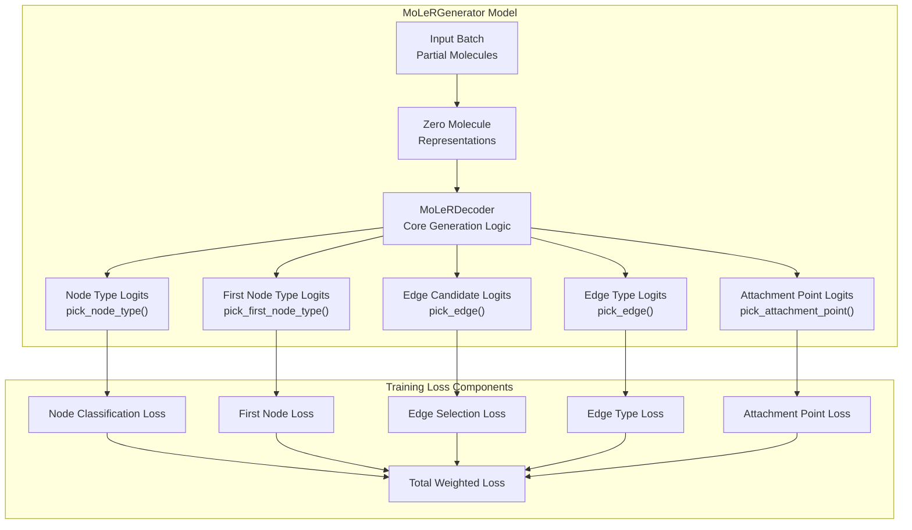
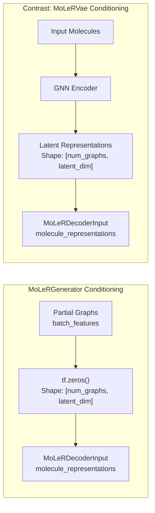
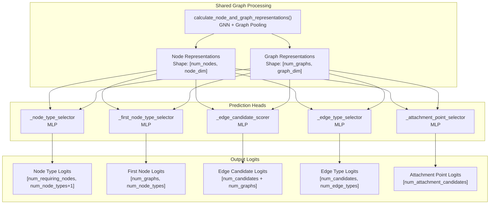
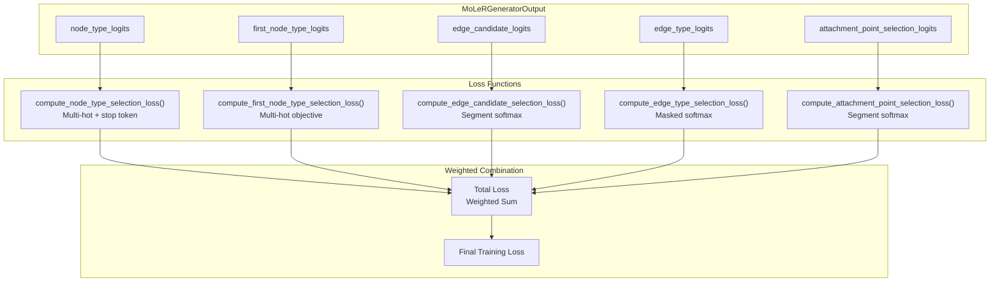
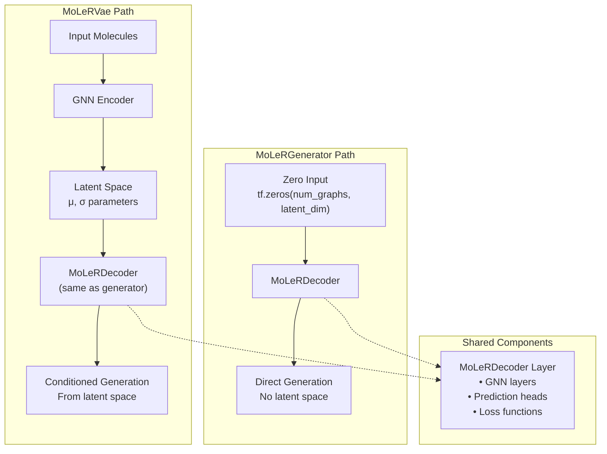

<!-- source: DeepWiki mcp.deepwiki.com · repo microsoft/molecule-generation · page 4.3 MoLeR Generator Architecture · fetched 2026-10-26 -->

# MoLeR Generator Architecture

Relevant source files

The following files were used as context for generating this wiki page:

- [molecule_generation/layers/moler_decoder.py](molecule_generation/layers/moler_decoder.py)
- [molecule_generation/models/moler_base_model.py](molecule_generation/models/moler_base_model.py)
- [molecule_generation/models/moler_generator.py](molecule_generation/models/moler_generator.py)

This document covers the architecture of the MoLeR Generator model, which is one of two main variants of the MoLeR (Molecule Learning Representation) system. The MoLeR Generator performs direct autoregressive generation of molecular structures without using a latent space representation.

For information about the VAE-based variant that uses latent space manipulation, see [MoLeR VAE Architecture](#4.2). For broader context about the MoLeR approach, see [MoLeR Model Overview](#4.1).

## Architecture Overview

The MoLeR Generator implements an autoregressive policy for step-by-step molecule construction. Unlike the VAE variant, it does not encode molecules into a latent space but instead directly generates molecules from scratch or from initial scaffolds.

### High-Level Generator Architecture

**Sources:** [molecule_generation/models/moler_generator.py:15-92](), [molecule_generation/models/moler_base_model.py:18-297]()

## Core Components

### MoLeRGenerator Class

The `MoLeRGenerator` class inherits from `MoLeRBaseModel` and implements the autoregressive generation policy. Key characteristics:

| Component | Implementation | Purpose |
|-----------|----------------|---------|
| **Molecule Representations** | Zero tensors | No conditioning from latent space |
| **Decoder Layer** | `MoLeRDecoder` | Shared with VAE variant |
| **Output Format** | `MoLeRGeneratorOutput` | Extends base decoder output |
| **Training Objective** | Weighted sum of prediction losses | Multi-task learning |

**Sources:** [molecule_generation/models/moler_generator.py:15-21](), [molecule_generation/models/moler_generator.py:26-57]()

### Zero Conditioning Strategy

The key architectural difference is in lines [molecule_generation/models/moler_generator.py:34-36](), where the generator creates zero-valued molecule representations instead of learning meaningful latent embeddings.

**Sources:** [molecule_generation/models/moler_generator.py:34-49]()

## Generation Process Components

### Multi-Head Prediction Architecture

**Sources:** [molecule_generation/layers/moler_decoder.py:544-619](), [molecule_generation/layers/moler_decoder.py:621-659](), [molecule_generation/layers/moler_decoder.py:681-795]()

### Decision Making Process

The generator makes several types of decisions during molecule construction:

| Decision Type | Method | Input Features | Output Shape |
|---------------|--------|----------------|--------------|
| **First Node** | `pick_first_node_type()` | Zero molecule repr | `[num_graphs, num_node_types]` |
| **Next Node** | `pick_node_type()` | Graph + molecule repr | `[num_requiring, num_types+1]` |
| **Edge Target** | `pick_edge()` | Node + graph + edge features | `[num_candidates + num_graphs]` |
| **Edge Type** | `pick_edge()` | Same as edge target | `[num_candidates, num_edge_types]` |
| **Attachment Point** | `pick_attachment_point()` | Node + graph repr | `[num_candidates]` |

**Sources:** [molecule_generation/layers/moler_decoder.py:661-679](), [molecule_generation/layers/moler_decoder.py:621-659](), [molecule_generation/layers/moler_decoder.py:681-795](), [molecule_generation/layers/moler_decoder.py:797-859]()

## Training Objective

### Loss Computation Architecture

**Sources:** [molecule_generation/models/moler_generator.py:64-76](), [molecule_generation/models/moler_base_model.py:175-197]()

### Loss Weighting Configuration

The default hyperparameters for loss weighting are defined in `MoLeRBaseModel.get_default_hyperparameters()`:

| Loss Component | Default Weight | Purpose |
|----------------|----------------|---------|
| `node_classification_loss_weight` | 1.0 | Balance node prediction |
| `first_node_classification_loss_weight` | 0.07 | Reduced weight for initial choice |
| `edge_selection_loss_weight` | 1.0 | Edge existence decisions |
| `edge_type_loss_weight` | 1.0 | Bond type classification |
| `attachment_point_selection_weight` | 1.0 | Motif attachment (if used) |

**Sources:** [molecule_generation/models/moler_base_model.py:28-48]()

## Key Architectural Differences

### Generator vs VAE Comparison

The fundamental difference is that `MoLeRGenerator` bypasses latent space learning entirely, as shown in [molecule_generation/models/moler_generator.py:34-36]() where it creates zero tensors instead of computing meaningful embeddings.

**Sources:** [molecule_generation/models/moler_generator.py:23-24](), [molecule_generation/models/moler_generator.py:34-49]()

---

