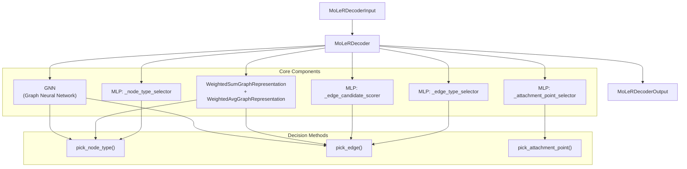
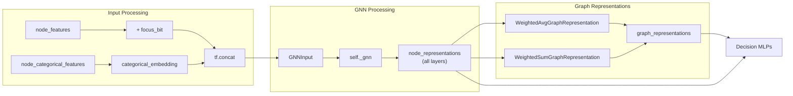
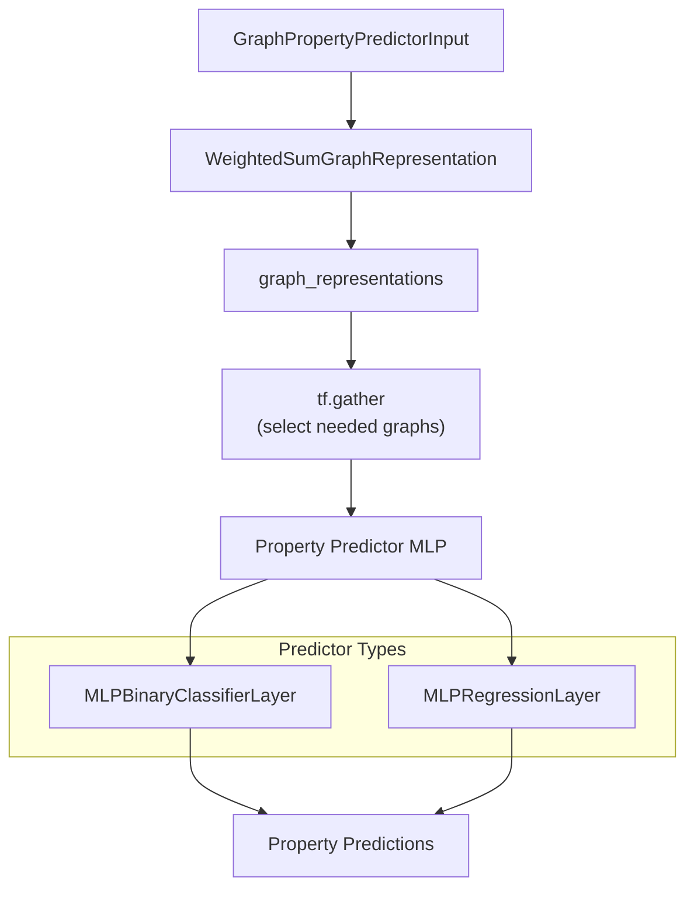
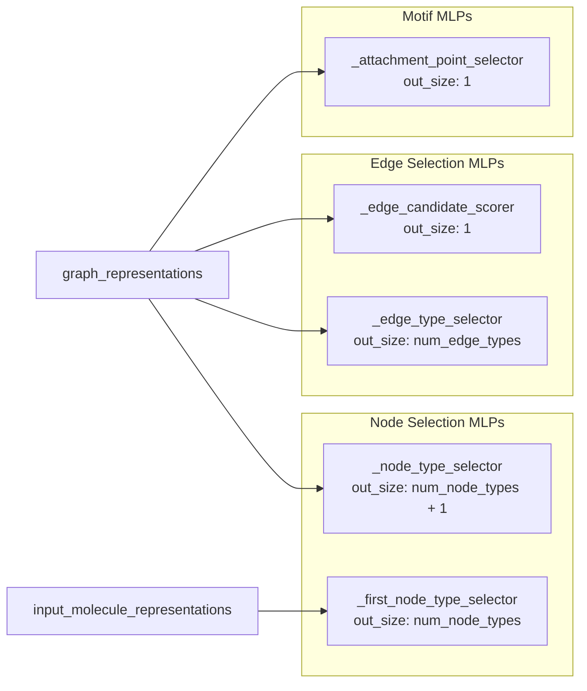
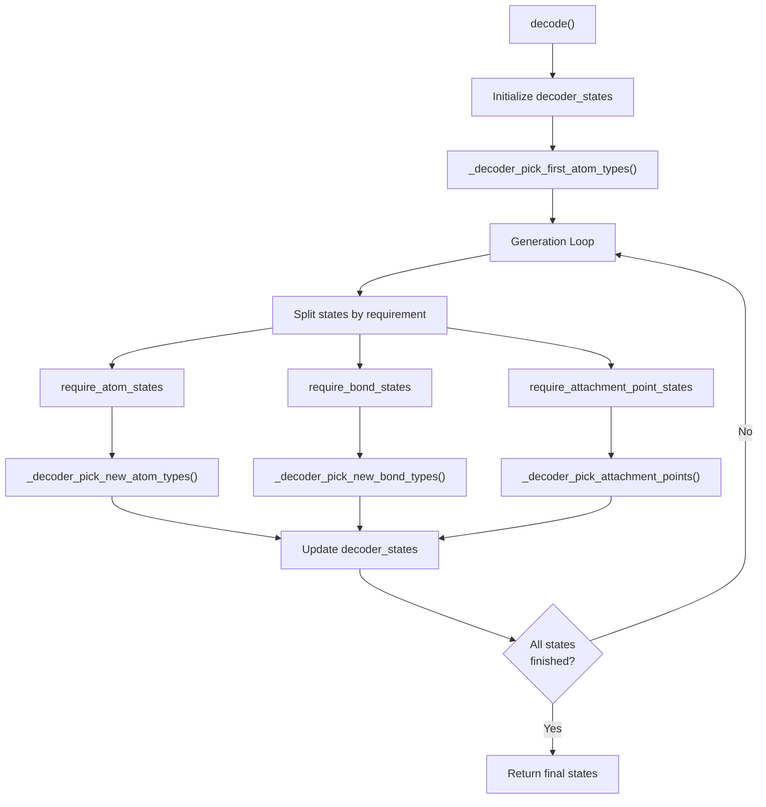
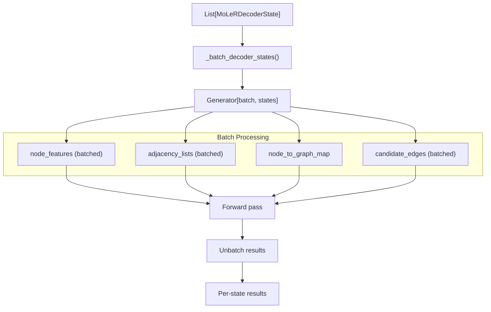

<!-- source: DeepWiki mcp.deepwiki.com · repo microsoft/molecule-generation · page 4.4 Model Components · fetched 2026-10-26 -->

# Model Components

Relevant source files

The following files were used as context for generating this wiki page:

- [molecule_generation/layers/graph_property_predictor.py](molecule_generation/layers/graph_property_predictor.py)
- [molecule_generation/layers/moler_decoder.py](molecule_generation/layers/moler_decoder.py)

This page provides a detailed technical reference for the core neural network components that implement the MoLeR model architectures. It covers the decoder layer, property predictors, and supporting neural network modules that enable molecule generation and property prediction.

For information about the high-level MoLeR model architectures, see [MoLeR Model Overview](#4.1), [MoLeR VAE Architecture](#4.2), and [MoLeR Generator Architecture](#4.3). For details on training these models, see [Training Models](#5).

## Core Decoder Architecture

The `MoLeRDecoder` class is the central component responsible for generating molecular structures step-by-step. It combines graph neural networks with multi-layer perceptrons to make sequential decisions about atom types, bond formations, and attachment points.

### MoLeRDecoder Class Structure

The decoder operates through three main decision types:
- **Node Type Selection**: Chooses the next atom or motif to add
- **Edge Formation**: Decides which bonds to form and their types  
- **Attachment Point Selection**: For motifs, picks where to attach to existing structure

Sources: [molecule_generation/layers/moler_decoder.py:107-543]()

### Input and Output Structures

The decoder uses structured input and output formats to handle batched graph data:

| Component | Purpose | Key Fields |
|-----------|---------|------------|
| `MoLeRDecoderInput` | Batched graph data and features | `node_features`, `adjacency_lists`, `candidate_edges` |
| `MoLeRDecoderOutput` | Prediction logits for all decision types | `node_type_logits`, `edge_candidate_logits`, `edge_type_logits` |
| `MoLeRDecoderMetrics` | Training loss components | `node_classification_loss`, `edge_loss`, `edge_type_loss` |

Sources: [molecule_generation/layers/moler_decoder.py:91-106](), [molecule_generation/layers/moler_decoder.py:52-58](), [molecule_generation/layers/moler_decoder.py:43-50]()

### Graph Neural Network Integration

The decoder leverages graph neural networks to compute node and graph representations:

The GNN processes node features through multiple layers, and the results are aggregated into graph-level representations using weighted averaging and weighted sum mechanisms.

Sources: [molecule_generation/layers/moler_decoder.py:544-619]()

## Property Prediction Components

The `GraphPropertyPredictor` provides auxiliary property prediction capabilities that can be used during training or inference to predict molecular properties from graph representations.

### GraphPropertyPredictor Architecture

The property predictor aggregates node representations into graph-level features, then applies task-specific MLPs for binary classification or regression tasks.

Sources: [molecule_generation/layers/graph_property_predictor.py:23-157]()

### Property Task Configuration

The property predictor supports different task types configured at initialization:

| Task Type | Implementation | Use Case |
|-----------|----------------|----------|
| `BINARY_CLASSIFICATION` | `MLPBinaryClassifierLayer` | Molecular property classification (e.g., drug-likeness) |
| `REGRESSION` | `MLPRegressionLayer` | Continuous property prediction (e.g., molecular weight, logP) |

Sources: [molecule_generation/layers/graph_property_predictor.py:36-69]()

## Neural Network Building Blocks

### Multi-Layer Perceptrons (MLPs)

The decoder uses several specialized MLPs for different decision types:

Each MLP is configured with specific hidden layer sizes and dropout rates defined in the model hyperparameters.

Sources: [molecule_generation/layers/moler_decoder.py:237-277]()

### Graph Representation Layers

The decoder uses two complementary graph aggregation mechanisms:

| Layer | Weighting Function | Purpose |
|-------|------------------|---------|
| `_weighted_avg_of_nodes_to_graph_repr` | `softmax` | Attention-based node aggregation |
| `_weighted_sum_of_nodes_to_graph_repr` | `sigmoid` | Magnitude-preserving aggregation with upper bounds |

These layers convert node-level representations into graph-level features that inform generation decisions.

Sources: [molecule_generation/layers/moler_decoder.py:217-235]()

## Decoding Process Flow

### Sequential Decision Making

The decoder implements a multi-step generation process that alternates between different decision types:

The decoding process continues until all molecules reach completion or the maximum number of steps is exceeded.

Sources: [molecule_generation/layers/moler_decoder.py:1120-1519]()

### Batching and Efficiency

The decoder implements sophisticated batching mechanisms to process multiple generation states efficiently:

This batching strategy enables efficient GPU utilization while handling variable-sized molecular graphs.

Sources: [molecule_generation/layers/moler_decoder.py:292-301](), [molecule_generation/utils/decoder_batching.py]()

---

