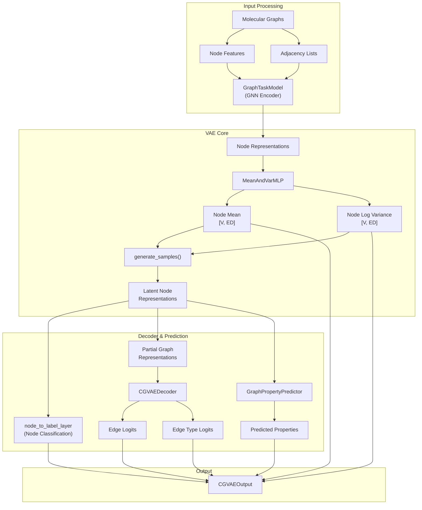
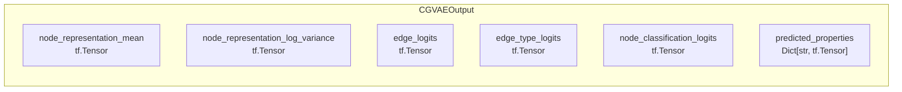
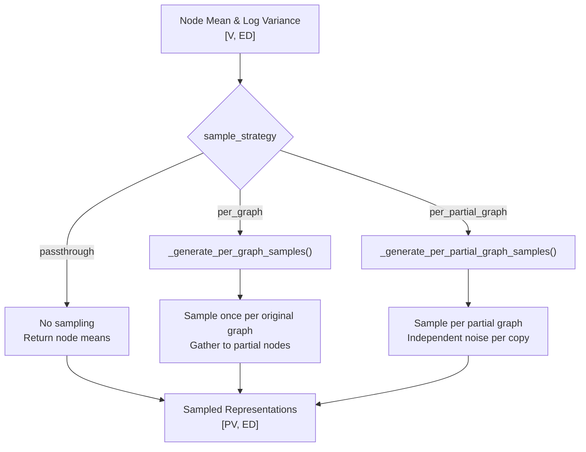
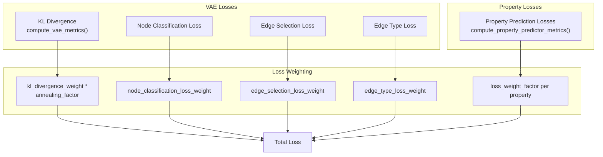

<!-- source: DeepWiki mcp.deepwiki.com · repo microsoft/molecule-generation · page 4.5 CGVAE Model · fetched 2026-10-26 -->

# CGVAE Model

Relevant source files

The following files were used as context for generating this wiki page:

- [CHANGELOG.md](CHANGELOG.md)
- [molecule_generation/models/cgvae.py](molecule_generation/models/cgvae.py)

This document describes the Conditional Graph Variational Autoencoder (CGVAE) model implementation in the molecule generation system. The CGVAE serves as a reference implementation and baseline model for comparison with the main MoLeR architectures. 

For information about the main MoLeR VAE architecture, see [MoLeR VAE Architecture](#4.2). For details about the autoregressive MoLeR Generator, see [MoLeR Generator Architecture](#4.3).

## Architecture Overview

The CGVAE model implements a variational autoencoder specifically designed for molecular graph generation. Unlike the MoLeR models which use sophisticated trace-based generation, CGVAE follows a more traditional VAE approach with graph-specific adaptations.

**CGVAE Model Architecture**

Sources: [molecule_generation/models/cgvae.py:1-648]()

## Key Components

The `CGVAE` class inherits from `GraphTaskModel` and integrates several specialized components for molecular graph processing.

### Core Architecture Components

| Component | Class/Method | Purpose |
|-----------|--------------|---------|
| Encoder | `GraphTaskModel` (inherited) | GNN-based encoding of molecular graphs |
| Mean/Variance Computation | `MeanAndVarMLP` | Computes latent distribution parameters |
| Sampling | `generate_samples()` | Samples from latent space using various strategies |
| Node Classification | `node_to_label_layer` | Predicts atom types |
| Graph Decoder | `CGVAEDecoder` | Reconstructs molecular graphs |
| Property Prediction | `GraphPropertyPredictor` | Predicts molecular properties |

### Data Structures

The model uses several key data structures for organizing inputs and outputs:

**Key Output Structure**

Sources: [molecule_generation/models/cgvae.py:21-28]()

## Sampling Strategies

The CGVAE implements three different sampling strategies for generating latent representations, controlled by the `sample_strategy` hyperparameter:

### Strategy Implementations

**Sampling Strategy Flow**

| Strategy | Implementation | Use Case |
|----------|----------------|----------|
| `passthrough` | Returns node means directly | Deterministic generation/testing |
| `per_graph` | `_generate_per_graph_samples()` | One sample per original molecule |
| `per_partial_graph` | `_generate_per_partial_graph_samples()` | Independent sampling for each partial graph |

Sources: [molecule_generation/models/cgvae.py:325-360]()

## Training Process

The CGVAE training combines multiple loss components through a weighted sum approach.

### Loss Computation

**Loss Component Structure**

### Key Training Features

1. **KL Divergence Annealing**: Uses `kl_divergence_annealing_beta` to gradually increase KL weight during training
2. **Class Balancing**: Supports weighted node classification loss based on atom type frequency
3. **Multi-task Learning**: Jointly trains graph reconstruction and property prediction
4. **Flexible Property Prediction**: Supports multiple molecular properties with individual loss weights

Sources: [molecule_generation/models/cgvae.py:508-568](), [molecule_generation/models/cgvae.py:570-585]()

## Configuration and Hyperparameters

The CGVAE model provides extensive configuration through the `get_default_hyperparameters()` method:

### Key Hyperparameter Categories

| Category | Key Parameters | Default Values |
|----------|----------------|----------------|
| GNN Encoder | `gnn_hidden_dim`, `gnn_num_layers` | 64, 12 |
| Node Classification | `node_classifier_hidden_layers` | [64, 32] |
| Loss Weights | `node_classification_loss_weight`, `edge_selection_loss_weight` | 1.0, 1.0 |
| KL Annealing | `kl_divergence_annealing_beta`, `kl_divergence_weight` | 0.999, 0.3 |
| Sampling | `sample_strategy` | "per_graph" |

Sources: [molecule_generation/models/cgvae.py:56-104]()

## Relationship to MoLeR Models

The CGVAE serves as a reference implementation with several key differences from the main MoLeR models:

1. **Generation Approach**: Uses traditional VAE reconstruction vs. MoLeR's trace-based generation
2. **API Support**: Not integrated into the high-level model API (as noted in changelog)
3. **Baseline Role**: Provides comparison baseline for evaluating MoLeR performance
4. **Decoder Architecture**: Uses `CGVAEDecoder` vs. MoLeR's `MoLeRDecoder`

The CGVAE demonstrates a more conventional approach to molecular graph generation, making it useful for understanding the improvements provided by the MoLeR architecture.

Sources: [CHANGELOG.md:67](), [molecule_generation/models/cgvae.py:163-169]()

---

