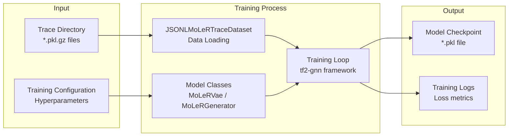
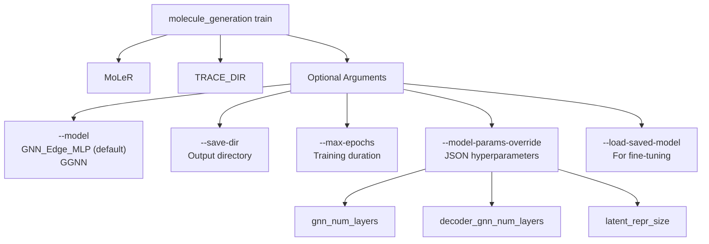
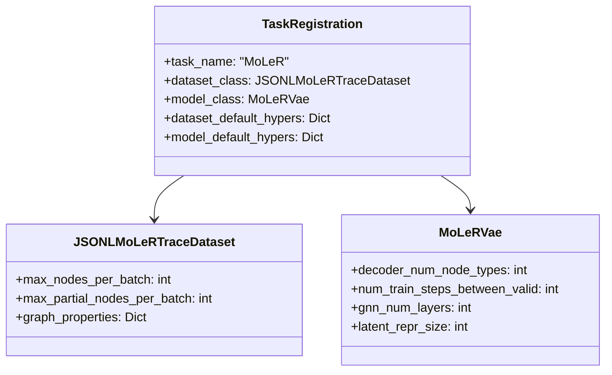
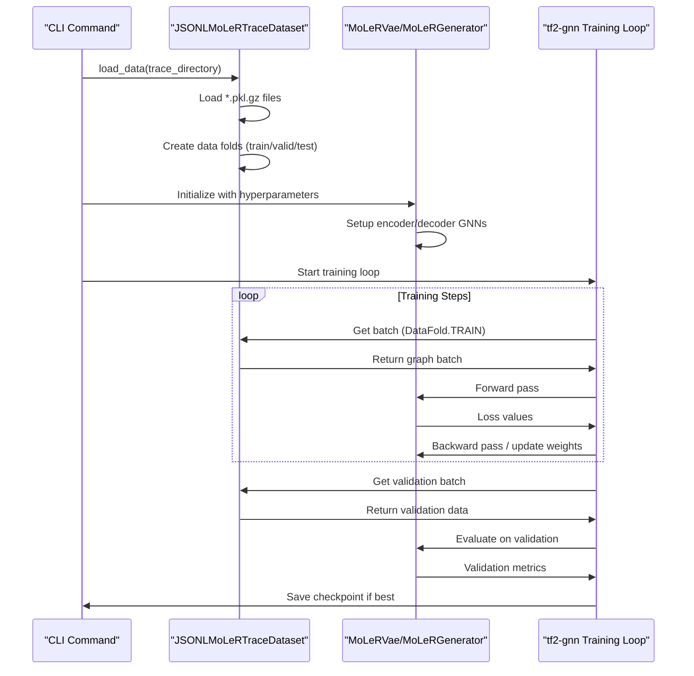
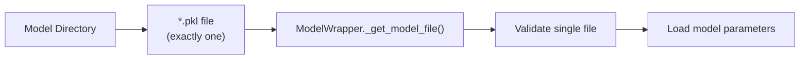

<!-- source: DeepWiki mcp.deepwiki.com · repo microsoft/molecule-generation · page 5 Training Models · fetched 2026-10-26 -->

# Training Models

<details>
<summary>Relevant source files</summary>

The following files were used as context for generating this wiki page:

- [README.md](README.md)
- [molecule_generation/test/integration/test_data_moler_integration.py](molecule_generation/test/integration/test_data_moler_integration.py)
- [molecule_generation/wrapper.py](molecule_generation/wrapper.py)

</details>


This document covers the process of training MoLeR models on preprocessed molecular datasets. Training transforms preprocessed trace data into trained model checkpoints that can generate new molecules or encode existing ones into latent representations.

For information about preparing data for training, see [Data Processing Pipeline](#3). For using trained models to generate molecules, see [Inference & Generation](#6).

## Training Workflow Overview

The training process operates on preprocessed trace datasets and produces model checkpoints. The system supports training two main model architectures: `MoLeRVae` (Variational Autoencoder) and `MoLeRGenerator` (autoregressive generator).



**Training Pipeline Architecture**

Sources: [README.md:100-138](), [molecule_generation/test/integration/test_data_moler_integration.py:186-230]()

## Command Line Training

The primary interface for training models is the CLI command `molecule_generation train`:

```bash
molecule_generation train MoLeR TRACE_DIR
```

This command requires two key arguments:
- **Task Type**: `MoLeR` specifies the training task
- **Trace Directory**: Path containing preprocessed `*.pkl.gz` trace files

### Training Arguments



**CLI Training Arguments Structure**

Sources: [README.md:104-118](), [molecule_generation/test/integration/test_data_moler_integration.py:208-220]()

### Example Training Commands

Basic training with default parameters:
```bash
molecule_generation train MoLeR /path/to/traces
```

Training with custom GNN architecture:
```bash
molecule_generation train MoLeR /path/to/traces \
    --model GGNN \
    --model-params-override '{"gnn_num_layers": 6, "decoder_gnn_num_layers": 6}'
```

Training with custom save directory and epoch limit:
```bash
molecule_generation train MoLeR /path/to/traces \
    --save-dir ./trained_models \
    --max-epochs 10
```

Sources: [README.md:109-115]()

## Model Configuration and Hyperparameters

### Task Registration

Training requires registering the task with specific dataset and model classes:



**Task Registration and Model Configuration**

### Key Hyperparameters

| Parameter | Default | Description |
|-----------|---------|-------------|
| `gnn_num_layers` | 8 | Number of layers in encoder GNN |
| `decoder_gnn_num_layers` | 8 | Number of layers in decoder GNN |
| `latent_repr_size` | 512 | Dimensionality of latent space |
| `num_train_steps_between_valid` | 5000 | Steps per mini-epoch |
| `max_nodes_per_batch` | Variable | Maximum nodes per training batch |
| `decoder_num_node_types` | Inferred | Number of atom types in decoder |

Sources: [molecule_generation/test/integration/test_data_moler_integration.py:188-198](), [molecule_generation/test/integration/test_data_moler_integration.py:237-247]()

## Training Process Internals

### Dataset Loading

The training process uses `JSONLMoLeRTraceDataset` to load preprocessed trace data:



**Training Process Sequence**

Sources: [molecule_generation/test/integration/test_data_moler_integration.py:131-184](), [molecule_generation/test/integration/test_data_moler_integration.py:268-315]()

### Training Output

During training, the system outputs metrics including:

- **Graph losses**: Loss components from molecular graph reconstruction
- **Property losses**: Auxiliary property prediction losses  
- **Node classification loss**: Atom type prediction accuracy
- **Edge losses**: Bond type and connection prediction
- **KL divergence**: Regularization term for VAE models

Example training output:
```
Initial valid metric:
Avg weighted sum. of graph losses:  122.1728
Avg weighted sum. of prop losses:   0.4712
Avg node class. loss:                 35.9361
Avg first node class. loss:           27.4681
Avg edge selection loss:              1.7522
Avg edge type loss:                   3.8963
Avg attachment point selection loss:  1.1227
Avg KL divergence:                    7335960.5000
```

Sources: [README.md:121-133]()

## Model Checkpoints

### Checkpoint Format

Training produces model checkpoints saved as `.pkl` files in the specified save directory. The checkpoint filename includes:
- Model architecture (`GNN_Edge_MLP_MoLeR`)
- Timestamp of training
- `_best.pkl` suffix for best validation checkpoint

Example: `GNN_Edge_MLP_MoLeR__2022-03-01_18-15-14_best.pkl`

### Checkpoint Loading

The system expects exactly one `.pkl` file per model directory:



**Model Checkpoint Loading Process**

Sources: [molecule_generation/wrapper.py:38-58](), [README.md:156-157]()

## Training Convergence

Training continues until no improvement in validation loss for consecutive mini-epochs:
- **Default patience**: 3 mini-epochs without improvement
- **Mini-epoch definition**: 5000 training steps (configurable via `num_train_steps_between_valid`)
- **Early stopping**: Controlled by `--patience` flag

Sources: [README.md:137-138]()

## Fine-tuning

For fine-tuning existing models on new data:

1. **Preprocess with existing model**:
```bash
molecule_generation preprocess INPUT_DIR OUTPUT_DIR TRACE_DIR \
    --pretrained-model-path CHECKPOINT_PATH
```

2. **Fine-tune from checkpoint**:
```bash
molecule_generation train MoLeR TRACE_DIR \
    --load-saved-model CHECKPOINT_PATH \
    --load-weights-only
```

The `--pretrained-model-path` ensures preprocessing uses the same metadata (atom types, motif vocabulary) as the original model.

Sources: [README.md:198-219]()

---

