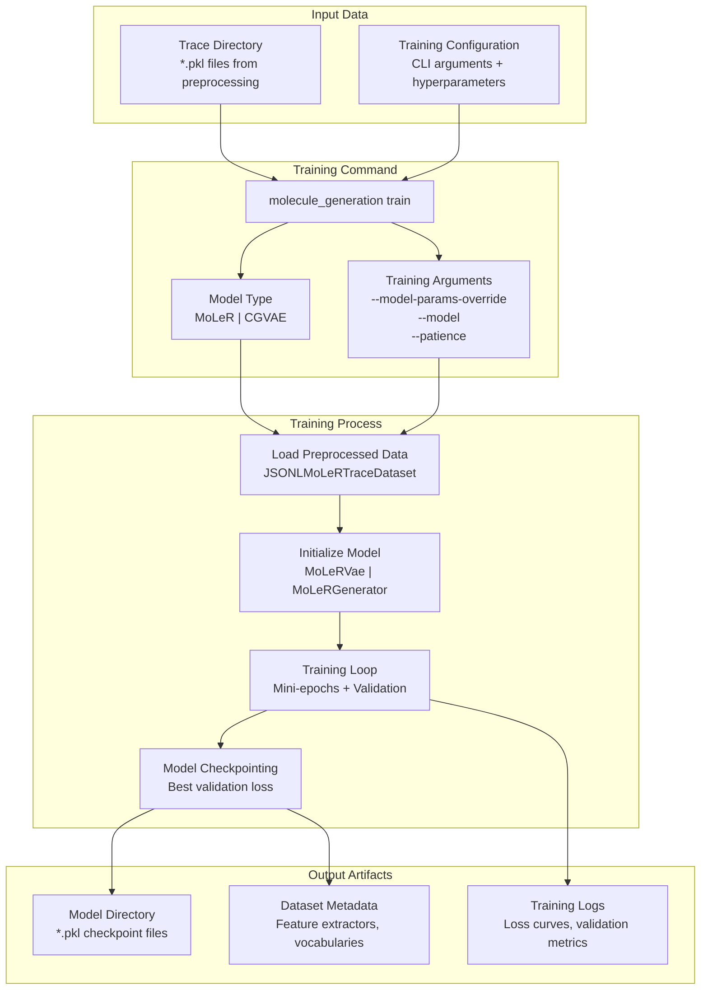
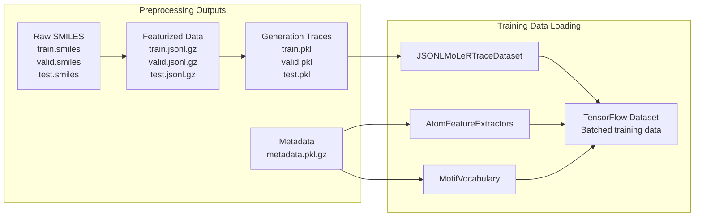
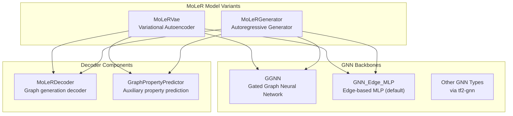
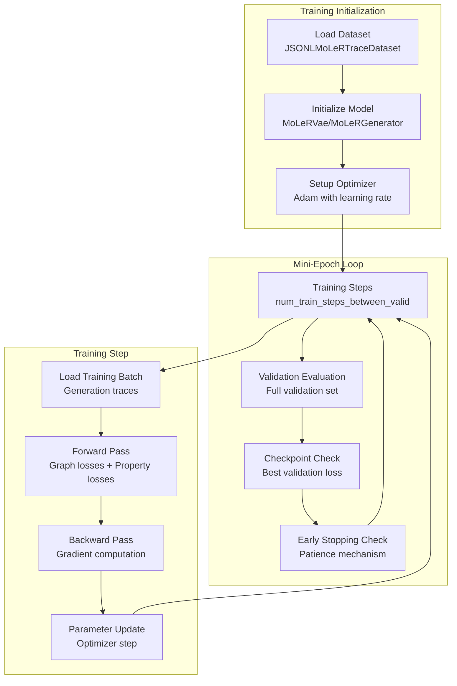
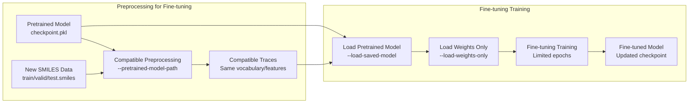
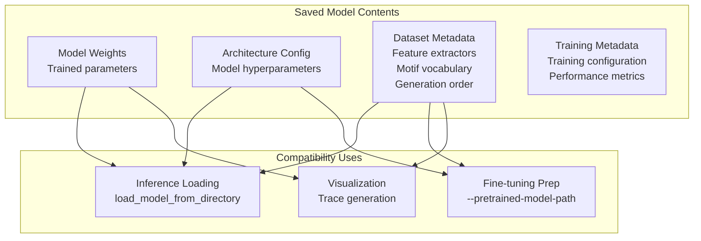

<!-- source: DeepWiki mcp.deepwiki.com · repo microsoft/molecule-generation · page 5.1 Training Process · fetched 2026-10-26 -->

# Training Process

<details>
<summary>Relevant source files</summary>

The following files were used as context for generating this wiki page:

- [README.md](README.md)
- [molecule_generation/chem/molecule_dataset_utils.py](molecule_generation/chem/molecule_dataset_utils.py)
- [molecule_generation/cli/preprocess.py](molecule_generation/cli/preprocess.py)

</details>


This document covers the process of training MoLeR models using the `molecule_generation train` command. It explains the training workflow, configuration options, data requirements, and output artifacts produced during model training.

For information about preparing data for training, see [Data Processing Pipeline](#3). For details about using trained models for inference, see [Inference & Generation](#6).

## Purpose and Scope

The training process transforms preprocessed molecular datasets into trained MoLeR models capable of generating and encoding molecules. This document covers the CLI-based training workflow, configuration parameters, and the relationship between preprocessing outputs and training inputs.

## Training Workflow Overview

The training process follows a clear sequence from preprocessed data to trained models:



**Training Workflow Components**
The training process consists of data loading, model initialization, iterative training with validation, and checkpoint management.

Sources: [README.md:102-138]()

## CLI Command Structure

The training command follows this basic structure:

```bash
molecule_generation train MODEL_TYPE TRACE_DIR [OPTIONS]
```

### Basic Training Command

```bash
molecule_generation train MoLeR TRACE_DIR
```

This trains a MoLeR model using default hyperparameters on preprocessed data in `TRACE_DIR`.

### Advanced Configuration Example

```bash
molecule_generation train MoLeR TRACE_DIR \
    --model GGNN \
    --model-params-override '{"gnn_num_layers": 6, "decoder_gnn_num_layers": 6}' \
    --patience 5 \
    --max-epochs 50
```

### Training Arguments

| Argument | Purpose | Example |
|----------|---------|---------|
| `MODEL_TYPE` | Model architecture to train | `MoLeR`, `CGVAE` |
| `TRACE_DIR` | Directory containing preprocessed traces | `/path/to/traces` |
| `--model` | GNN backbone architecture | `GGNN`, `GNN_Edge_MLP` |
| `--model-params-override` | JSON string with hyperparameter overrides | `'{"gnn_num_layers": 8}'` |
| `--patience` | Early stopping patience | `3` (default) |
| `--max-epochs` | Maximum training epochs | `100` |
| `--load-saved-model` | Path to pretrained model for fine-tuning | `/path/to/model.pkl` |
| `--load-weights-only` | Load only weights (for fine-tuning) | flag |

Sources: [README.md:109-119](), [README.md:213-219]()

## Data Requirements and Preprocessing Integration

Training requires properly preprocessed molecular data in a specific format:



**Preprocessing Integration**
Training depends on the complete preprocessing pipeline to transform raw SMILES into machine-learning ready generation traces.

### Required Directory Structure

The `TRACE_DIR` must contain files produced by the preprocessing step:

```
TRACE_DIR/
├── train.pkl              # Training generation traces
├── valid.pkl              # Validation generation traces  
├── test.pkl               # Test generation traces
└── metadata.pkl.gz        # Dataset metadata
```

Sources: [molecule_generation/cli/preprocess.py:318-330](), [README.md:62-70]()

## Model Types and Architecture Selection

The training system supports multiple model architectures through the `MODEL_TYPE` parameter:

### MoLeR Models



**Model Architecture Selection**
The `--model` parameter selects the GNN backbone, while the model type determines the overall architecture pattern.

### Architecture Configuration

| Model Type | Capabilities | Use Cases |
|------------|-------------|-----------|
| `MoLeRVae` | Encode, decode, sample | Latent space manipulation, interpolation |
| `MoLeRGenerator` | Sample only | Direct molecule generation |
| `CGVAE` | Legacy compatibility | Comparison with CGVAE baseline |

Sources: [README.md:109-117](), [README.md:193-194]()

## Training Configuration and Hyperparameters

### Model Parameter Override System

The `--model-params-override` argument accepts a JSON string containing hyperparameter overrides:

```bash
--model-params-override '{
    "gnn_num_layers": 8,
    "decoder_gnn_num_layers": 6,
    "node_embedding_size": 128,
    "learning_rate": 0.001,
    "num_train_steps_between_valid": 5000
}'
```

### Key Hyperparameters

| Parameter | Description | Default | Impact |
|-----------|-------------|---------|--------|
| `gnn_num_layers` | Encoder GNN depth | Varies by model | Model capacity |
| `decoder_gnn_num_layers` | Decoder GNN depth | Varies by model | Generation quality |
| `node_embedding_size` | Node feature dimensions | 128 | Model capacity |
| `learning_rate` | Optimizer learning rate | 0.001 | Training speed/stability |
| `num_train_steps_between_valid` | Steps per mini-epoch | 5000 | Validation frequency |

### Training Schedule Control

| Parameter | Purpose | Default |
|-----------|---------|---------|
| `--patience` | Early stopping patience (mini-epochs) | 3 |
| `--max-epochs` | Maximum training duration | Unlimited |
| `num_train_steps_between_valid` | Validation frequency | 5000 steps |

Sources: [README.md:109-117](), [README.md:136-137]()

## Training Process Internals

### Training Loop Structure



**Training Loop Components**
The training process alternates between training steps and validation evaluation, with checkpointing and early stopping based on validation performance.

### Loss Components

The training system optimizes multiple loss components simultaneously:

| Loss Component | Purpose | Typical Value Range |
|----------------|---------|-------------------|
| Graph losses | Node/edge prediction accuracy | 20-200 |
| Property losses | Auxiliary property prediction | 0.1-10 |
| Node classification loss | Atom type prediction | 10-100 |
| Edge selection loss | Bond prediction | 1-10 |
| KL divergence | VAE regularization | 1000-10000000 |

### Example Training Output

```
Initial valid metric:
Avg weighted sum. of graph losses:  122.1728
Avg weighted sum. of prop losses:   0.4712
Avg node class. loss:                 35.9361
Avg first node class. loss:           27.4681
Avg edge selection loss:              1.7522
Avg edge type loss:                   3.8963
Avg attachment point selection loss:  1.1227
Avg KL divergence:                    7335960.5000
Property results: sa_score: MAE 11.23, MSE 1416.26 | clogp: MAE 10.87, MSE 4620.69
```

Sources: [README.md:122-135]()

## Fine-tuning Process

The training system supports fine-tuning pretrained models on new datasets:

### Fine-tuning Workflow



**Fine-tuning Data Compatibility**
Fine-tuning requires preprocessing the new data with the same feature extractors and motif vocabulary as the original model.

### Fine-tuning Commands

1. **Preprocess data for fine-tuning:**
```bash
molecule_generation preprocess INPUT_DIR OUTPUT_DIR TRACE_DIR \
    --pretrained-model-path CHECKPOINT_PATH
```

2. **Run fine-tuning:**
```bash
molecule_generation train MoLeR TRACE_DIR \
    --load-saved-model CHECKPOINT_PATH \
    --load-weights-only
```

3. **Control fine-tuning duration:**
```bash
molecule_generation train MoLeR TRACE_DIR \
    --load-saved-model CHECKPOINT_PATH \
    --load-weights-only \
    --model-params-override '{"num_train_steps_between_valid": 100}' \
    --max-epochs 10
```

Sources: [README.md:197-219](), [molecule_generation/cli/preprocess.py:243-267]()

## Output Artifacts

### Model Directory Structure

Training produces a model directory containing the trained checkpoint:

```
MODEL_DIR/
└── GNN_Edge_MLP_MoLeR__2022-03-01_18-15-14_best.pkl
```

The checkpoint file contains:
- Trained model weights
- Model architecture configuration  
- Dataset metadata (feature extractors, motif vocabulary)
- Training hyperparameters

### Model Metadata

The saved model preserves preprocessing compatibility information:



**Model Checkpoint Contents**
The checkpoint preserves all information needed for inference, fine-tuning, and compatibility with the original preprocessing pipeline.

### Training Logs and Metrics

During training, the system outputs:
- Loss curves for all loss components
- Validation metrics including property predictions
- Model checkpointing notifications
- Early stopping information

Sources: [README.md:133-135](), [README.md:156-157](), [molecule_generation/cli/preprocess.py:246-248]()

---

