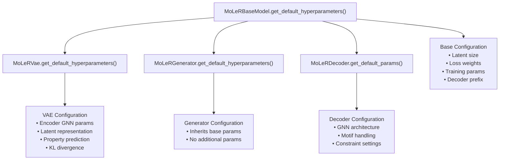
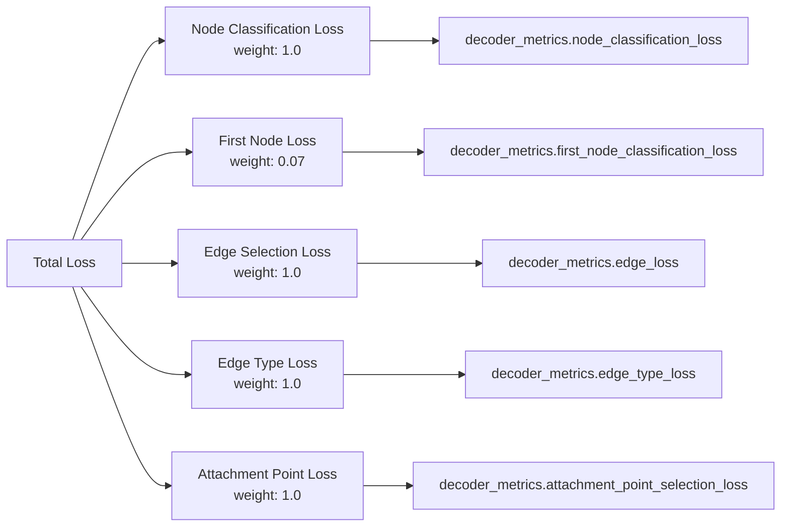
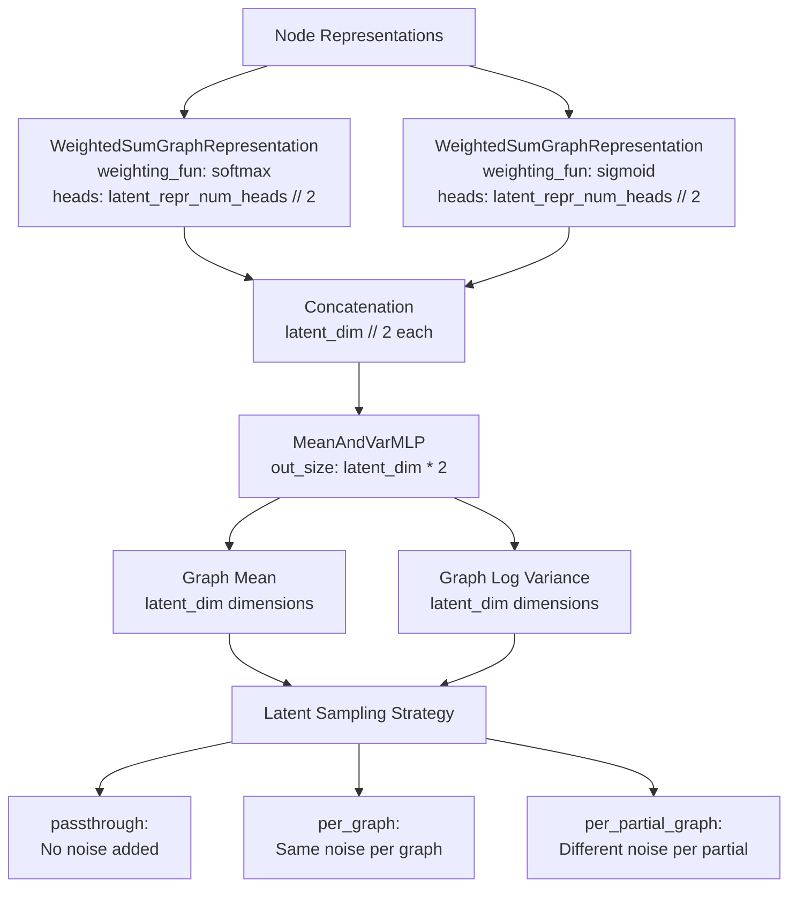
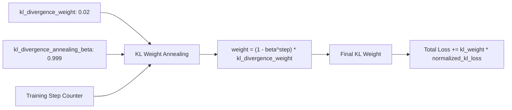

<!-- source: DeepWiki mcp.deepwiki.com · repo microsoft/molecule-generation · page 5.2 Model Configuration · fetched 2026-10-26 -->

# Model Configuration

<details>
<summary>Relevant source files</summary>

The following files were used as context for generating this wiki page:

- [molecule_generation/models/moler_base_model.py](molecule_generation/models/moler_base_model.py)
- [molecule_generation/models/moler_generator.py](molecule_generation/models/moler_generator.py)
- [molecule_generation/models/moler_vae.py](molecule_generation/models/moler_vae.py)

</details>


This page explains the hyperparameter configuration system for MoLeR models, including the structure of configuration parameters and their roles in model behavior. For information about the actual training process, see [Training Process](#5.1). For details about model architectures, see [Model Architecture](#4).

## Overview

The MoLeR system uses a hierarchical configuration system where model hyperparameters are organized into categories and shared between model variants through inheritance. All models inherit base configuration from `MoLeRBaseModel`, with specific variants like `MoLeRVae` and `MoLeRGenerator` adding their own specialized parameters.

### Configuration Architecture



**Configuration Inheritance Structure**

Sources: [molecule_generation/models/moler_base_model.py:28-57](), [molecule_generation/models/moler_vae.py:56-86]()

## Base Model Configuration

The `MoLeRBaseModel` class defines the core configuration parameters shared across all model variants. These parameters control fundamental aspects like latent representation size, loss weighting, and training behavior.

### Core Parameters

| Parameter | Default Value | Description |
|-----------|---------------|-------------|
| `latent_repr_size` | 512 | Dimension of latent representation vectors |
| `learning_rate` | 0.001 | Optimizer learning rate |
| `gradient_clip_value` | 0.5 | Gradient clipping threshold |
| `logged_loss_smoothing_window_size` | 100 | Moving average window for loss reporting |

### Loss Weighting Configuration



**Loss Component Weighting in Base Model**

The loss weights control the relative importance of different prediction tasks during training. The first node classification receives much lower weight (0.07) since it occurs only once per molecule generation.

Sources: [molecule_generation/models/moler_base_model.py:35-40](), [molecule_generation/models/moler_base_model.py:182-196]()

### Decoder Configuration Integration

The base model integrates decoder parameters using a prefix system:

```python
# From get_default_hyperparameters()
decoder_hypers = {
    cls.decoder_prefix() + k: v
    for k, v in MoLeRDecoder.get_default_params(mp_style).items()
}
```

All decoder parameters are prefixed with `"decoder_"` to avoid namespace conflicts with model-specific parameters.

Sources: [molecule_generation/models/moler_base_model.py:50-56](), [molecule_generation/models/moler_base_model.py:21-25]()

## VAE Model Configuration

The `MoLeRVae` class extends the base configuration with parameters specific to variational autoencoder functionality, including encoder architecture, latent sampling strategies, and property prediction.

### Encoder GNN Configuration

| Parameter | Default Value | Description |
|-----------|---------------|-------------|
| `gnn_hidden_dim` | 64 | Hidden dimension for GNN layers |
| `gnn_num_layers` | 12 | Number of GNN layers in encoder |
| `gnn_message_activation_function` | "leaky_relu" | Activation function for message passing |
| `gnn_layer_input_dropout_rate` | 0.0 | Dropout rate for layer inputs |
| `gnn_use_inter_layer_layernorm` | True | Whether to use layer normalization |
| `use_intermediate_gnn_results` | True | Use all intermediate GNN layer outputs |

### Latent Representation Configuration



**Latent Representation Architecture**

The VAE uses two different graph aggregation methods (weighted average and weighted sum) that are concatenated before computing mean and variance parameters.

Sources: [molecule_generation/models/moler_vae.py:70-83](), [molecule_generation/models/moler_vae.py:94-116]()

### Sampling Strategy Configuration

The `latent_sample_strategy` parameter controls how noise is applied during latent sampling:

- **`"passthrough"`**: No noise, deterministic encoding
- **`"per_graph"`**: Same noise sample for all partial graphs from the same original graph
- **`"per_partial_graph"`**: Independent noise for each partial graph

Sources: [molecule_generation/models/moler_vae.py:74](), [molecule_generation/models/moler_vae.py:300-319]()

### Property Prediction Configuration

| Parameter | Default Value | Description |
|-----------|---------------|-------------|
| `property_predictor_mlp_layers` | [64, 32] | MLP layer sizes for property prediction |
| `property_predictor_mlp_dropout_rate` | 0.0 | Dropout rate for property predictors |

Property predictors are configured per-property based on dataset metadata, with support for binary classification and regression tasks.

Sources: [molecule_generation/models/moler_vae.py:75-77](), [molecule_generation/models/moler_vae.py:127-155]()

### KL Divergence Configuration



**KL Divergence Weight Annealing**

The KL divergence weight starts at 0 and gradually increases during training using exponential annealing. This prevents posterior collapse early in training.

Sources: [molecule_generation/models/moler_vae.py:78-83](), [molecule_generation/models/moler_vae.py:428-439]()

## Generator Model Configuration

The `MoLeRGenerator` class inherits all base configuration without adding model-specific parameters. It uses zero-valued latent representations instead of learned encodings.

### Key Differences from VAE

| Aspect | VAE | Generator |
|--------|-----|-----------|
| Encoder | Full GNN encoder | None (`compute_final_node_representations` returns `None`) |
| Latent Representation | Learned from input molecules | Zero vectors |
| Configuration | Base + VAE-specific parameters | Base parameters only |

Sources: [molecule_generation/models/moler_generator.py:23-24](), [molecule_generation/models/moler_generator.py:34-41]()

## Configuration Usage Examples

### Accessing Default Hyperparameters

```python
# Get default VAE configuration
vae_params = MoLeRVae.get_default_hyperparameters(mp_style="mpnn")

# Get default Generator configuration  
gen_params = MoLeRGenerator.get_default_hyperparameters(mp_style="mpnn")
```

### Parameter Categories

The configuration system organizes parameters into logical categories:

1. **Training Parameters**: Learning rates, gradient clipping, step counts
2. **Architecture Parameters**: Layer sizes, dimensions, activation functions
3. **Loss Parameters**: Weights for different loss components
4. **Decoder Parameters**: All parameters prefixed with `"decoder_"`
5. **Property Parameters**: Configuration for auxiliary property prediction tasks

Sources: [molecule_generation/models/moler_vae.py:56-86](), [molecule_generation/models/moler_base_model.py:28-57]()

---

