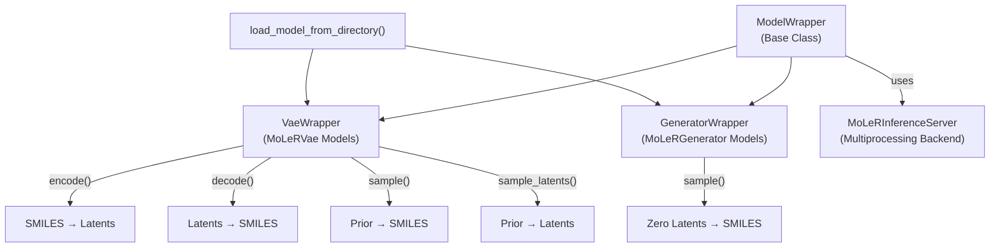
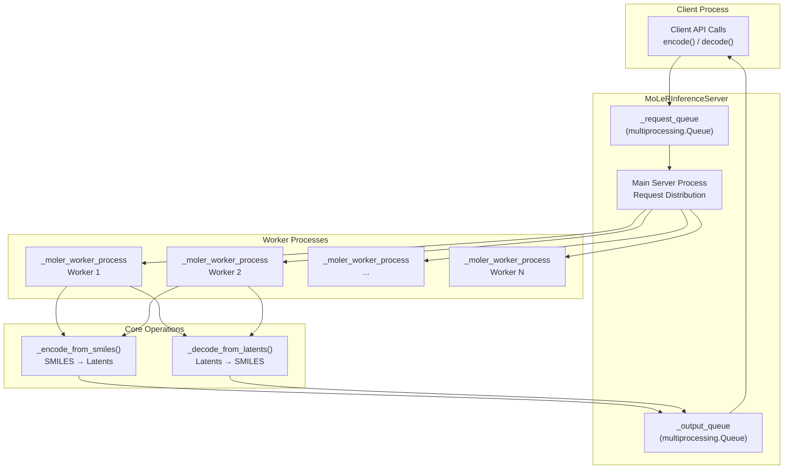
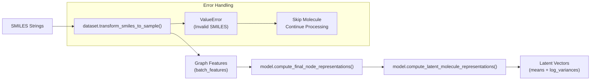
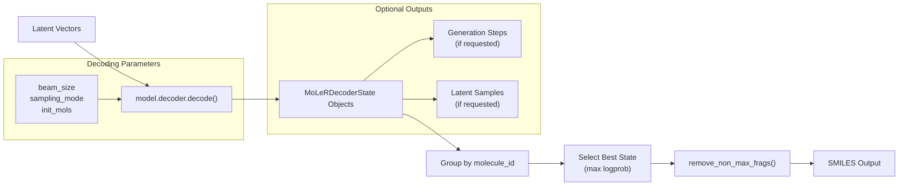

<!-- source: DeepWiki mcp.deepwiki.com · repo microsoft/molecule-generation · page 6 Inference & Generation · fetched 2026-10-26 -->

# Inference & Generation

<details>
<summary>Relevant source files</summary>

The following files were used as context for generating this wiki page:

- [molecule_generation/test/integration/test_data_moler_integration.py](molecule_generation/test/integration/test_data_moler_integration.py)
- [molecule_generation/utils/moler_inference_server.py](molecule_generation/utils/moler_inference_server.py)
- [molecule_generation/wrapper.py](molecule_generation/wrapper.py)

</details>


This page covers how to use trained MoLeR models to perform molecular inference and generation tasks. The system provides capabilities for encoding SMILES strings to latent representations, decoding latent vectors back to molecules, and sampling new molecules from the learned distribution.

For training models, see [Training Models](#5). For detailed API usage, see [Python API](#6.1) and [Command Line Tools](#6.2). For understanding the underlying decoding process, see [Decoding Process](#6.4).

## Overview

The inference system supports two main model architectures:
- **MoLeRVae**: Variational autoencoder that maps molecules to/from a continuous latent space
- **MoLeRGenerator**: Autoregressive generator that directly samples molecules

Both models share the same decoder infrastructure but differ in their training objectives and sampling approaches.

**Core Inference Operations**

| Operation | Description | Input | Output |
|-----------|-------------|-------|--------|
| **Encoding** | Convert SMILES to latent vectors | SMILES strings | Latent representations |
| **Decoding** | Convert latent vectors to molecules | Latent vectors | SMILES strings |
| **Sampling** | Generate new molecules | None (uses prior) | SMILES strings |
| **Scaffold Generation** | Generate molecules with constraints | Latent vectors + scaffold | SMILES strings |

Sources: [molecule_generation/wrapper.py:83-193](), [molecule_generation/utils/moler_inference_server.py:30-35]()

## Model Wrapper Architecture

The system provides high-level wrapper classes that abstract the complexity of model loading and inference operations.

**Model Wrapper Class Hierarchy**


**Key Components:**
- `ModelWrapper`: Base class providing common functionality like model loading and seed management
- `VaeWrapper`: Specialized for VAE models, supports encoding/decoding operations  
- `GeneratorWrapper`: Specialized for autoregressive models, supports direct sampling
- `MoLeRInferenceServer`: Multiprocessing backend for scalable inference

Sources: [molecule_generation/wrapper.py:21-82](), [molecule_generation/wrapper.py:83-167](), [molecule_generation/wrapper.py:168-183](), [molecule_generation/wrapper.py:185-193]()

## Inference Server Infrastructure

The `MoLeRInferenceServer` provides a scalable multiprocessing architecture for batch molecular encoding and decoding operations.

**Inference Server Architecture**


**Request Types:**
- `MoLeRRequestType.ENCODE`: Convert SMILES strings to latent representations
- `MoLeRRequestType.DECODE`: Convert latent vectors to SMILES strings  
- `MoLeRRequestType.TERMINATE`: Shutdown worker processes

The server automatically chunks large requests across workers and collects results in the correct order.

Sources: [molecule_generation/utils/moler_inference_server.py:186-201](), [molecule_generation/utils/moler_inference_server.py:137-176](), [molecule_generation/utils/moler_inference_server.py:30-34]()

## Core Inference Workflows

### Encoding Process

The encoding workflow transforms SMILES strings into latent vector representations.

**Encoding Pipeline**


The process handles invalid SMILES gracefully by skipping problematic molecules and continuing with the batch.

Sources: [molecule_generation/utils/moler_inference_server.py:36-89]()

### Decoding Process  

The decoding workflow converts latent representations back into molecular structures.

**Decoding Pipeline**


Key decoding parameters:
- `beam_size`: Number of candidate sequences to maintain during generation
- `sampling_mode`: `GREEDY`, `SAMPLING`, or `BEAM_SEARCH`
- `init_mols`: Optional scaffold molecules to constrain generation

Sources: [molecule_generation/utils/moler_inference_server.py:92-135]()

### Sampling Operations

**VAE Sampling**: Sample from the learned prior distribution
```python
# Sample latent vectors from N(0,I)
latents = vae_wrapper.sample_latents(num_samples=100)
# Decode to molecules
molecules = vae_wrapper.decode(latents)
```

**Direct Generator Sampling**: Sample directly from the autoregressive model
```python
# Generate molecules without explicit latent sampling
molecules = generator_wrapper.sample(num_samples=100)
```

Sources: [molecule_generation/wrapper.py:86-95](), [molecule_generation/wrapper.py:156-165](), [molecule_generation/wrapper.py:171-182]()

## Usage Patterns

### Context Manager Pattern

The recommended usage pattern leverages Python context managers for proper resource cleanup:

```python
from molecule_generation.wrapper import load_model_from_directory

with load_model_from_directory("path/to/model") as model:
    # Encoding
    latents = model.encode(["CCO", "c1ccccc1"])
    
    # Decoding  
    molecules = model.decode(latents)
    
    # Sampling
    new_molecules = model.sample(num_samples=10)
```

Sources: [molecule_generation/wrapper.py:60-75](), [molecule_generation/wrapper.py:288-294]()

### Batch Processing

The system automatically handles batching for efficient processing of large molecule sets:

```python
# Large batches are automatically chunked across workers
large_smiles_list = [...]  # thousands of SMILES
embeddings = model.encode(large_smiles_list)
```

The `max_num_samples_per_chunk` parameter controls batch sizes to balance memory usage and throughput.

Sources: [molecule_generation/utils/moler_inference_server.py:296-310](), [molecule_generation/wrapper.py:63-67]()

### Scaffold-Constrained Generation

Generate molecules that contain specific structural motifs:

```python
scaffold_smiles = "c1ccccc1"  # benzene ring
latents = model.encode(["some_base_molecule"])
constrained_molecules = model.decode(latents, scaffolds=[scaffold_smiles])
```

Sources: [molecule_generation/wrapper.py:117-154](), [molecule_generation/test/integration/test_data_moler_integration.py:344-365]()

---

