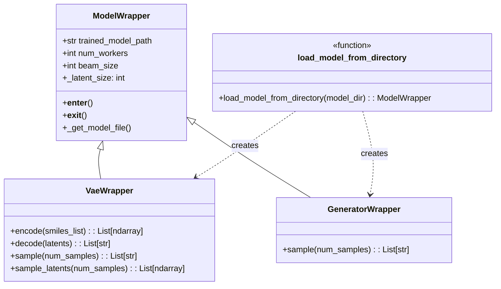
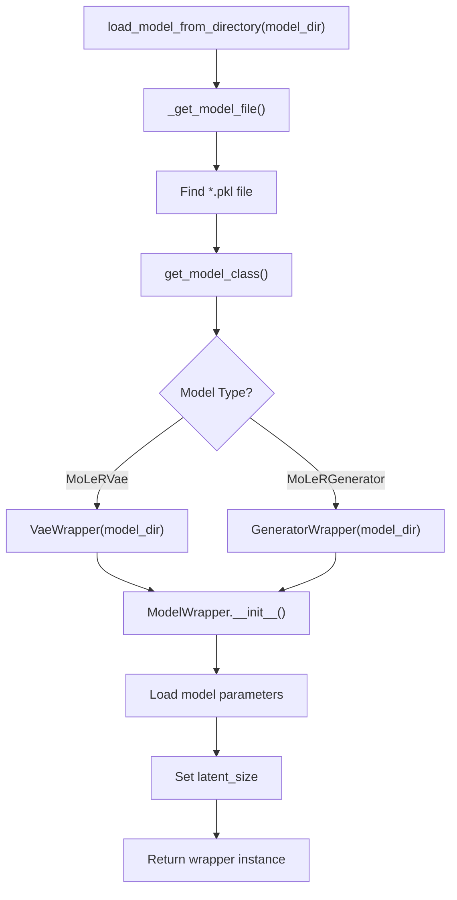
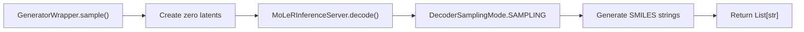
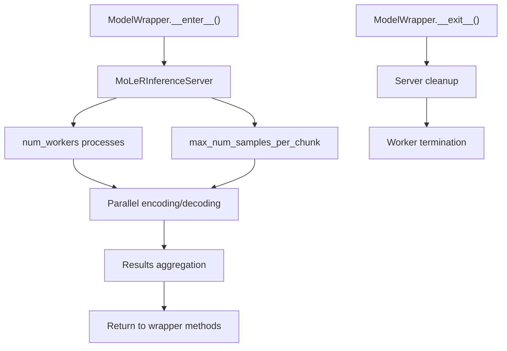
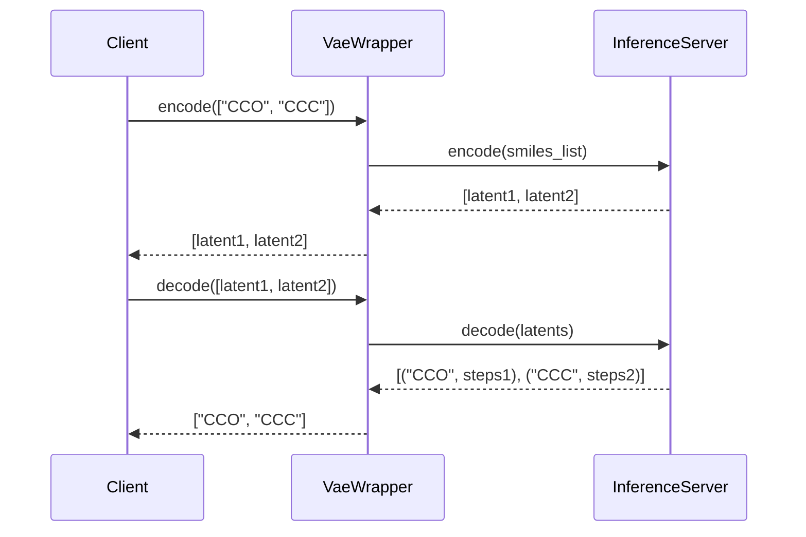

<!-- source: DeepWiki mcp.deepwiki.com · repo microsoft/molecule-generation · page 6.1 Python API · fetched 2026-10-26 -->

# Python API

<details>
<summary>Relevant source files</summary>

The following files were used as context for generating this wiki page:

- [molecule_generation/__init__.py](molecule_generation/__init__.py)
- [molecule_generation/test/integration/test_data_moler_integration.py](molecule_generation/test/integration/test_data_moler_integration.py)
- [molecule_generation/utils/model_utils.py](molecule_generation/utils/model_utils.py)
- [molecule_generation/version.py](molecule_generation/version.py)
- [molecule_generation/wrapper.py](molecule_generation/wrapper.py)

</details>


## Purpose and Scope

The Python API provides programmatic access to trained MoLeR models for molecular encoding, decoding, and generation tasks. This API is designed for integration into other Python applications, notebooks, and research workflows. For command-line usage, see [Command Line Tools](#6.2). For details about the underlying inference infrastructure, see [Inference Server](#6.3).

The API supports both MoLeRVae (variational autoencoder) and MoLeRGenerator (autoregressive) model architectures through a unified interface with model-specific wrappers.

## API Architecture Overview

The Python API is built around wrapper classes that provide a clean interface to the underlying models and inference server infrastructure.

**API Class Hierarchy**


Sources: [molecule_generation/wrapper.py:21-193](), [molecule_generation/__init__.py:1-15]()

## Loading Models

### Model Discovery and Loading

The primary entry point is the `load_model_from_directory()` function, which automatically detects the model type and returns the appropriate wrapper.

**Model Loading Workflow**


The function expects a directory containing exactly one `.pkl` file with the trained model:

| Parameter | Type | Description |
|-----------|------|-------------|
| `model_dir` | `str` | Path to directory containing model `.pkl` file |
| `**model_kwargs` | `dict` | Additional arguments passed to wrapper constructor |

Common wrapper constructor parameters:

| Parameter | Type | Default | Description |
|-----------|------|---------|-------------|
| `seed` | `int` | `0` | Random seed for reproducible results |
| `num_workers` | `int` | `6` | Number of worker processes for inference |
| `beam_size` | `int` | `1` | Beam size for decoding |

Sources: [molecule_generation/wrapper.py:185-192](), [molecule_generation/wrapper.py:39-58](), [molecule_generation/wrapper.py:22-36]()

### Context Manager Usage

All model wrappers implement the context manager protocol and should be used with `with` statements to ensure proper resource cleanup:

```python
with load_model_from_directory("path/to/model") as model:
    # Use model for inference
    results = model.sample(10)
# Resources automatically cleaned up
```

Sources: [molecule_generation/wrapper.py:60-81]()

## VAE Model Interface

The `VaeWrapper` provides access to MoLeRVae models with full encode/decode functionality and latent space manipulation.

### Encoding Molecules

The `encode()` method converts SMILES strings to latent vector representations:

| Parameter | Type | Description |
|-----------|------|-------------|
| `smiles_list` | `List[str]` | List of SMILES strings to encode |
| `include_log_variances` | `bool` | Return log variances with means (default: `False`) |

**Returns:** 
- If `include_log_variances=False`: `List[np.ndarray]` of latent means
- If `include_log_variances=True`: `List[Tuple[np.ndarray, np.ndarray]]` of (mean, log_variance) pairs

### Decoding Molecules

The `decode()` method generates SMILES strings from latent vectors:

| Parameter | Type | Description |
|-----------|------|-------------|
| `latents` | `List[np.ndarray]` | List of latent vectors to decode |
| `scaffolds` | `Optional[List[Optional[str]]]` | Optional scaffold constraints |
| `include_generation_steps` | `bool` | Include generation trace metadata |

**Returns:**
- If `include_generation_steps=False`: `List[str]` of SMILES strings
- If `include_generation_steps=True`: `List[Tuple[str, MoleculeGenerationChoiceInfo]]`

### Sampling Operations

**Sample from Prior:**
```python
latents = model.sample_latents(num_samples=100)  # Returns List[np.ndarray]
```

**End-to-End Sampling:**
```python
molecules = model.sample(num_samples=100)  # Returns List[str]
```

Sources: [molecule_generation/wrapper.py:83-166]()

## Generator Model Interface

The `GeneratorWrapper` provides access to MoLeRGenerator models for direct autoregressive molecule generation.

**Generator Sampling Workflow**


| Method | Parameters | Returns | Description |
|--------|------------|---------|-------------|
| `sample()` | `num_samples: int` | `List[str]` | Generate molecules directly |

The generator model uses zero-filled latent vectors as placeholders since it generates molecules autoregressively without explicit latent space encoding.

Sources: [molecule_generation/wrapper.py:168-182]()

## Inference Infrastructure Integration

All wrapper classes integrate with the `MoLeRInferenceServer` for efficient batch processing and multiprocessing.

**Inference Server Integration**


The inference server configuration is automatically derived from wrapper parameters:

| Server Parameter | Derived From | Purpose |
|-----------------|--------------|---------|
| `num_workers` | `ModelWrapper.num_workers` | Parallel processing capacity |
| `max_num_samples_per_chunk` | `500 // beam_size` | Batch size optimization |

Sources: [molecule_generation/wrapper.py:61-68](), [molecule_generation/wrapper.py:113-115](), [molecule_generation/wrapper.py:143-149]()

## Usage Patterns and Examples

### Basic VAE Workflow

**Complete Encode-Decode Cycle:**


### Scaffold-Constrained Generation

The VAE wrapper supports scaffold-constrained generation where new molecules must contain specified substructures:

| Scaffold Parameter | Effect |
|-------------------|---------|
| `None` | Unconstrained generation |
| `"SMILES_string"` | Must contain this scaffold |
| `[None, "scaffold"]` | Mixed constrained/unconstrained batch |

Sources: [molecule_generation/wrapper.py:120-154](), integration test examples in [molecule_generation/test/integration/test_data_moler_integration.py:344-396]()

### Error Handling

The API includes validation for common error conditions:

| Error Condition | Exception | Location |
|----------------|-----------|----------|
| Multiple/missing `.pkl` files | `ValueError` | `_get_model_file()` |
| Unsupported model class | `ValueError` | `load_model_from_directory()` |
| Invalid SMILES in scaffolds | RDKit error | `decode()` method |

Sources: [molecule_generation/wrapper.py:54-55](), [molecule_generation/wrapper.py:189-190]()

---

