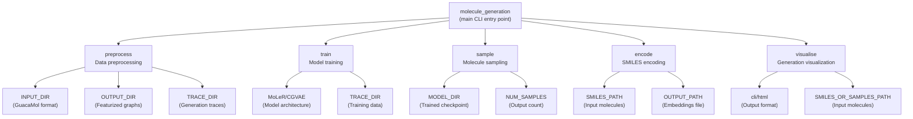
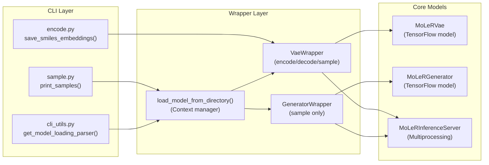
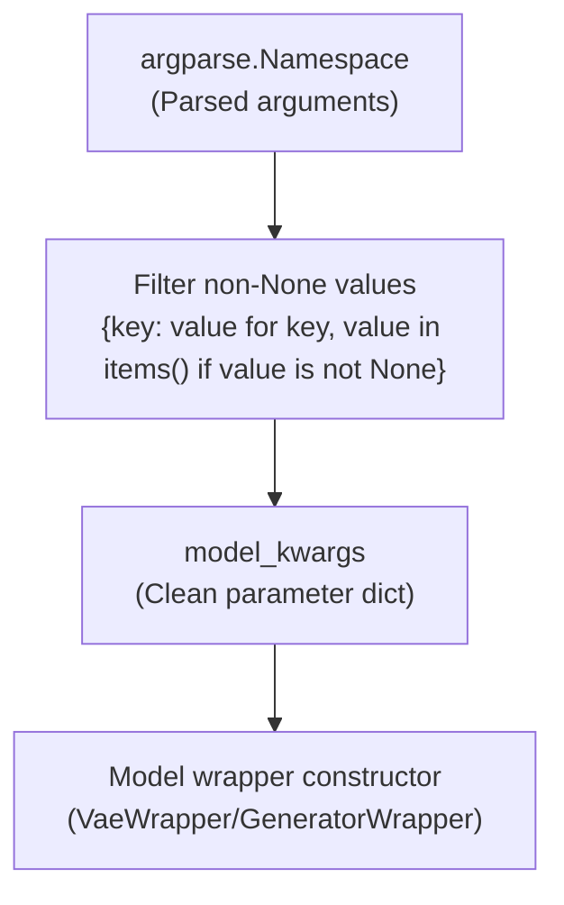

<!-- source: DeepWiki mcp.deepwiki.com · repo microsoft/molecule-generation · page 6.2 Command Line Tools · fetched 2026-10-26 -->

# Command Line Tools

<details>
<summary>Relevant source files</summary>

The following files were used as context for generating this wiki page:

- [README.md](README.md)
- [molecule_generation/cli/encode.py](molecule_generation/cli/encode.py)
- [molecule_generation/cli/sample.py](molecule_generation/cli/sample.py)
- [molecule_generation/test/integration/test_cli.py](molecule_generation/test/integration/test_cli.py)

</details>


The molecule generation system provides a comprehensive command-line interface for executing common workflows without requiring Python programming. These CLI tools wrap the core functionality exposed by the Python API (see [Python API](#6.1)) and provide batch processing capabilities for preprocessing, training, inference, and visualization tasks.

For distributed inference workloads, see [Inference Server](#6.3). For programmatic access to individual model operations, see [Python API](#6.1).

## CLI Architecture Overview

The CLI system is implemented as a unified `molecule_generation` command with multiple subcommands. Each subcommand is implemented as a separate module in the `molecule_generation/cli/` directory and provides specialized functionality for different stages of the molecule generation pipeline.

**CLI Command Structure**


Sources: [README.md:63-67](), [README.md:144-154](), [molecule_generation/cli/sample.py:19-25](), [molecule_generation/cli/encode.py:28-39]()

## Core CLI Commands

### Sample Command

The `sample` command generates new molecules from a trained model using the `print_samples` function.

```bash
molecule_generation sample MODEL_DIR NUM_SAMPLES [--beam-size BEAM_SIZE]
```

**Implementation Details:**
- Located in [molecule_generation/cli/sample.py:12-16]()
- Uses `load_model_from_directory` context manager for model loading
- Supports configurable beam size for decoding via `--beam-size` parameter
- Outputs SMILES strings directly to stdout, one per line

**Arguments:**
| Argument | Type | Description |
|----------|------|-------------|
| `MODEL_DIR` | string | Directory containing model checkpoint (`.pkl` file) |
| `NUM_SAMPLES` | integer | Number of molecules to generate |
| `--beam-size` | integer | Beam size for decoding (optional) |

Sources: [molecule_generation/cli/sample.py:12-25](), [molecule_generation/test/integration/test_cli.py:48-66]()

### Encode Command

The `encode` command converts SMILES strings to latent vector embeddings using `save_smiles_embeddings`.

```bash
molecule_generation encode MODEL_DIR SMILES_PATH OUTPUT_PATH
```

**Implementation Details:**
- Located in [molecule_generation/cli/encode.py:13-26]()
- Requires `VaeWrapper` for encoding functionality (VAE models only)
- Reads SMILES from text file (one per line) and outputs pickled numpy arrays
- Automatically handles batch processing of input molecules

**Arguments:**
| Argument | Type | Description |
|----------|------|-------------|
| `MODEL_DIR` | string | Directory containing VAE model checkpoint |
| `SMILES_PATH` | string | Path to `.smiles` file with input molecules |
| `OUTPUT_PATH` | string | Path for output pickle file containing embeddings |

Sources: [molecule_generation/cli/encode.py:13-26](), [molecule_generation/test/integration/test_cli.py:30-46]()

### Preprocess Command

The `preprocess` command transforms raw SMILES data into training-ready format.

```bash
molecule_generation preprocess INPUT_DIR OUTPUT_DIR TRACE_DIR [--pretrained-model-path PATH]
```

**Functionality:**
- Converts GuacaMol format (`train.smiles`, `valid.smiles`, `test.smiles`) to featurized graphs
- Extracts molecular motifs and builds motif vocabulary
- Generates generation traces for training
- Supports fine-tuning mode via `--pretrained-model-path` flag

Sources: [README.md:63-98](), [README.md:200-209]()

### Train Command

The `train` command trains MoLeR models on preprocessed data.

```bash
molecule_generation train MODEL_TYPE TRACE_DIR [--model-params-override JSON] [--load-saved-model PATH]
```

**Key Features:**
- Supports `MoLeR` and `CGVAE` model architectures
- Configurable hyperparameters via `--model-params-override` JSON string
- Fine-tuning support through `--load-saved-model` and `--load-weights-only` flags
- Automatic validation and early stopping

Sources: [README.md:102-138](), [README.md:211-219]()

### Visualise Command

The `visualise` command provides step-by-step visualization of molecule generation.

```bash
molecule_generation visualise {cli|html} MODEL_DIR SMILES_OR_SAMPLES_PATH [OUTPUT_DIR]
```

**Output Modes:**
- `cli`: Plain text output to terminal
- `html`: Static HTML webpage saved to `OUTPUT_DIR`

Sources: [README.md:225-237]()

## CLI-to-Code Mapping

The CLI commands directly interface with core system components through wrapper classes and utility functions.

**CLI Implementation Architecture**


Sources: [molecule_generation/cli/sample.py:4-16](), [molecule_generation/cli/encode.py:5-22](), [README.md:159-195]()

## Common CLI Arguments

All model-loading CLI commands inherit common arguments from `get_model_loading_parser`:

| Argument | Default | Description |
|----------|---------|-------------|
| `--seed` | None | Random seed for reproducible generation |
| `--num-workers` | Auto | Number of parallel workers for inference |
| `--beam-size` | Model default | Beam size for decoding (sample command only) |

**Argument Processing Pattern:**


Sources: [molecule_generation/cli/sample.py:28-34](), [molecule_generation/cli/encode.py:42-49]()

## Error Handling and Validation

The CLI implements robust error handling for common failure modes:

**Model Loading Validation:**
- Ensures exactly one `.pkl` file exists in `MODEL_DIR`
- Validates model architecture compatibility with requested operation
- Provides clear error messages for missing or invalid checkpoints

**Input Validation:**
- SMILES file format validation for encode command
- Numeric parameter bounds checking
- Path existence verification for input/output directories

Sources: [README.md:156-157](), [molecule_generation/test/integration/test_cli.py:24-28]()

## Integration Testing

The CLI commands are tested through integration tests that verify end-to-end functionality using a pretrained checkpoint:

**Test Coverage:**
- Sample generation with deterministic output verification
- SMILES encoding with embedding shape and norm validation  
- Model loading and context manager behavior
- Error handling for invalid inputs

Sources: [molecule_generation/test/integration/test_cli.py:30-66]()

---

