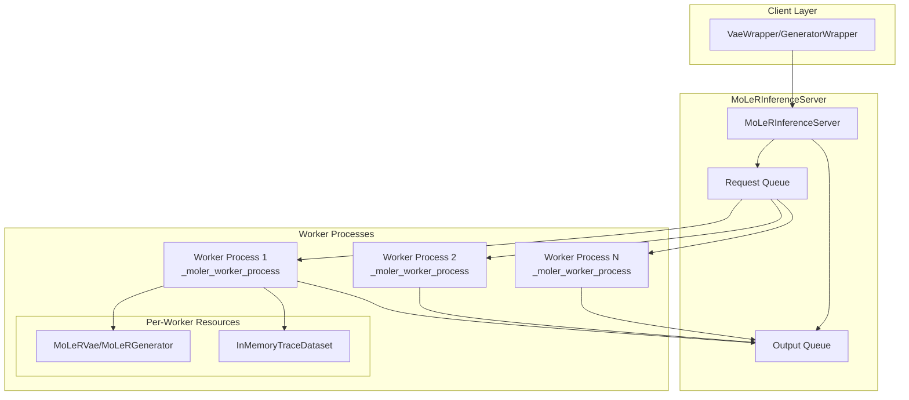
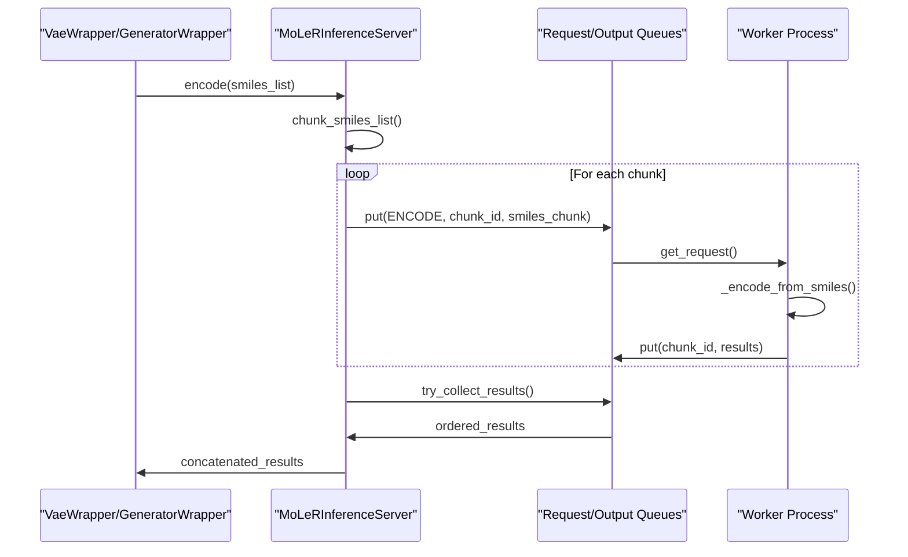
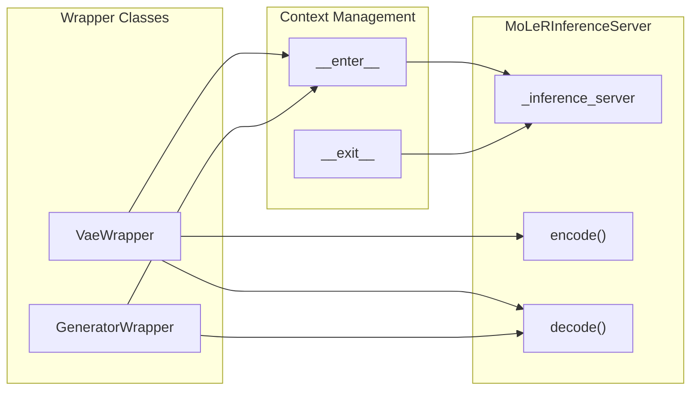

<!-- source: DeepWiki mcp.deepwiki.com · repo microsoft/molecule-generation · page 6.3 Inference Server · fetched 2026-10-26 -->

# Inference Server

<details>
<summary>Relevant source files</summary>

The following files were used as context for generating this wiki page:

- [molecule_generation/test/integration/test_data_moler_integration.py](molecule_generation/test/integration/test_data_moler_integration.py)
- [molecule_generation/utils/moler_inference_server.py](molecule_generation/utils/moler_inference_server.py)
- [molecule_generation/wrapper.py](molecule_generation/wrapper.py)

</details>


The MoLeR Inference Server provides a multiprocessing-based architecture for scalable molecule encoding and decoding operations. It enables parallel processing of molecular data by distributing work across multiple worker processes, each running independent instances of trained MoLeR models.

This page covers the server infrastructure and worker management. For information about the high-level Python API that uses this server, see [Python API](#6.1). For details about the underlying decoding algorithms, see [Decoding Process](#6.4).

## Architecture Overview

The inference server implements a producer-consumer pattern using Python's `multiprocessing` module to enable parallel processing of molecular data across multiple worker processes.

**MoLeR Inference Server Architecture**



**Sources:** [molecule_generation/utils/moler_inference_server.py:186-264](), [molecule_generation/wrapper.py:61-68]()

## Core Components

### MoLeRInferenceServer Class

The `MoLeRInferenceServer` class manages the lifecycle of worker processes and coordinates request distribution and result collection.

| Method | Purpose | Key Parameters |
|--------|---------|----------------|
| `__init__` | Initialize server with worker configuration | `model_path`, `num_workers`, `max_num_samples_per_chunk` |
| `init_workers` | Start worker processes and create communication queues | None |
| `cleanup_workers` | Terminate workers and cleanup resources | `ignore_failures` |
| `encode` | Encode SMILES strings to latent representations | `smiles_list`, `include_log_variances` |
| `decode` | Decode latent representations to SMILES strings | `latent_representations`, `include_generation_steps` |

**Sources:** [molecule_generation/utils/moler_inference_server.py:186-357]()

### Request Types

The server handles three types of requests defined in the `MoLeRRequestType` enum:

```python
class MoLeRRequestType(enum.Enum):
    TERMINATE = enum.auto()
    ENCODE = enum.auto() 
    DECODE = enum.auto()
```

**Sources:** [molecule_generation/utils/moler_inference_server.py:30-34]()

### Worker Process Function

Each worker process runs the `_moler_worker_process` function, which:
1. Loads the model and dataset from the specified path
2. Enters a request processing loop
3. Handles ENCODE and DECODE requests by calling appropriate functions
4. Returns results via the output queue

**Sources:** [molecule_generation/utils/moler_inference_server.py:137-176]()

## Request/Response Flow

The server processes requests through a chunked, parallel workflow that maximizes worker utilization while maintaining result ordering.

**Request Processing Flow**



**Chunking Strategy**

The server automatically determines optimal chunk sizes to ensure all workers have meaningful work:

```python
chunk_size = min(max_num_samples_per_chunk, len(input_data) // num_workers + 1)
```

**Sources:** [molecule_generation/utils/moler_inference_server.py:296-310](), [molecule_generation/utils/moler_inference_server.py:312-357]()

## Worker Process Operations

### Encoding Process

The `_encode_from_smiles` function transforms SMILES strings into latent representations:

1. **SMILES Parsing**: Convert SMILES strings to molecular graph representations using the dataset's transformation pipeline
2. **Batch Processing**: Group molecules into batches for efficient GPU utilization
3. **Model Inference**: Compute final node representations and latent molecule encodings
4. **Result Collection**: Extract means and optionally log variances from the latent distributions

**Sources:** [molecule_generation/utils/moler_inference_server.py:36-89]()

### Decoding Process

The `_decode_from_latents` function generates SMILES strings from latent representations:

1. **Decoder Invocation**: Call the model's decoder with specified parameters (beam size, sampling mode)
2. **State Management**: Collect and organize decoder states by molecule ID
3. **Best Selection**: Choose the highest probability result for each input latent
4. **Molecule Sanitization**: Clean up generated molecules and convert to SMILES format

**Sources:** [molecule_generation/utils/moler_inference_server.py:92-135]()

## Integration with Model Wrappers

The inference server is primarily accessed through model wrapper classes that provide high-level APIs:

**Wrapper Integration Pattern**



The wrappers use the server as a context manager, automatically handling worker lifecycle:

```python
def __enter__(self):
    self._inference_server = MoLeRInferenceServer(
        self.trained_model_path,
        num_workers=self.num_workers,
        max_num_samples_per_chunk=500 // self.beam_size,
    )
    return self
```

**Sources:** [molecule_generation/wrapper.py:60-68](), [molecule_generation/wrapper.py:113-115]()

## Performance Considerations

### Worker Configuration

The server provides several tuning parameters for optimal performance:

| Parameter | Default | Purpose |
|-----------|---------|---------|
| `num_workers` | 6 | Number of parallel worker processes |
| `max_num_samples_per_chunk` | 2000 | Maximum samples per worker request |
| `TF_FORCE_GPU_ALLOW_GROWTH` | "true" | Prevent GPU memory overconsumption |

### Memory Management

The server implements several strategies to prevent memory leaks:

1. **TensorFlow Graph Cleanup**: Clears `_py_funcs_used_in_graph` to prevent memory leaks from repeated dataset creation
2. **Process Isolation**: Each worker runs in a separate process with independent memory space
3. **Graceful Shutdown**: Proper cleanup of queues and worker processes on server destruction

**Sources:** [molecule_generation/utils/moler_inference_server.py:85-87](), [molecule_generation/utils/moler_inference_server.py:194](), [molecule_generation/utils/moler_inference_server.py:285-286]()

### Error Handling

The server includes robust error handling for worker failures:

- **Worker Death Detection**: Monitors worker process health during result collection
- **Automatic Cleanup**: Triggers cleanup when worker processes die unexpectedly
- **Graceful Degradation**: Continues operation with remaining healthy workers

**Sources:** [molecule_generation/utils/moler_inference_server.py:277-281](), [molecule_generation/utils/moler_inference_server.py:178-183]()

---

