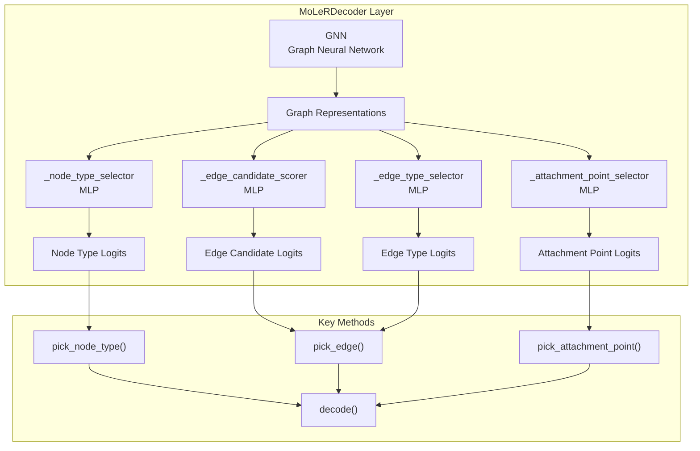
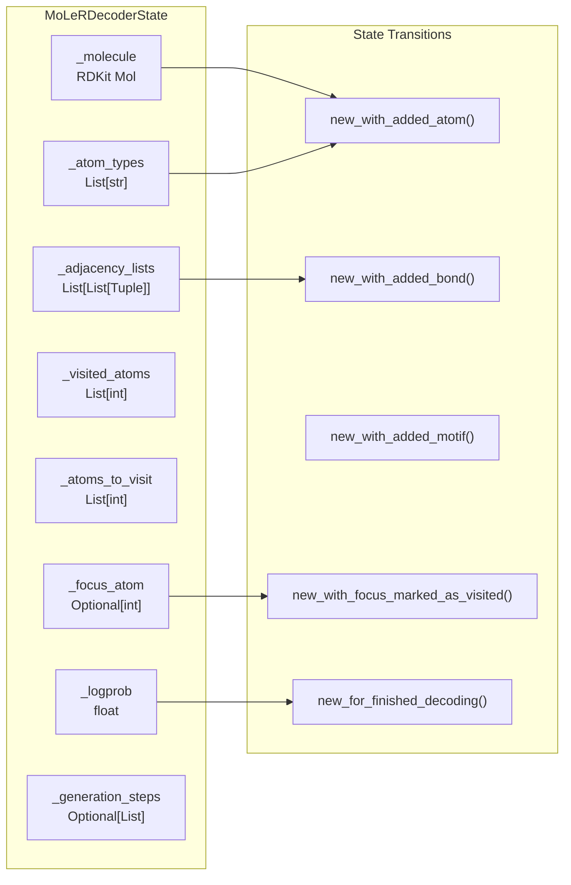
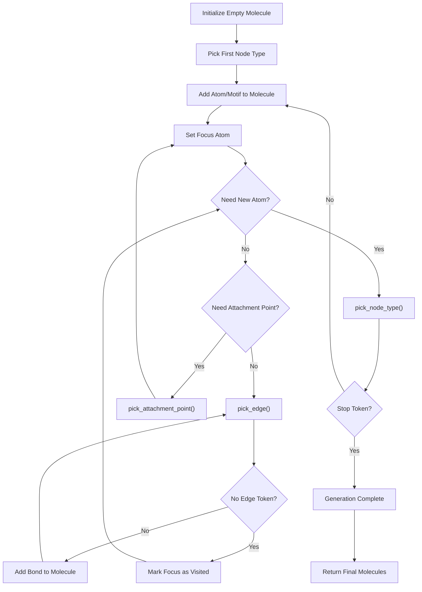
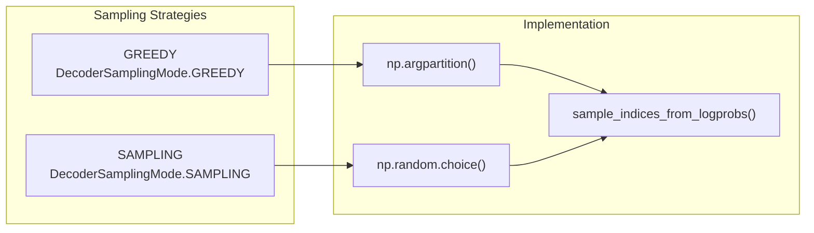
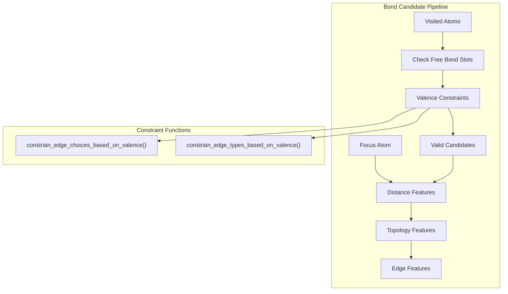
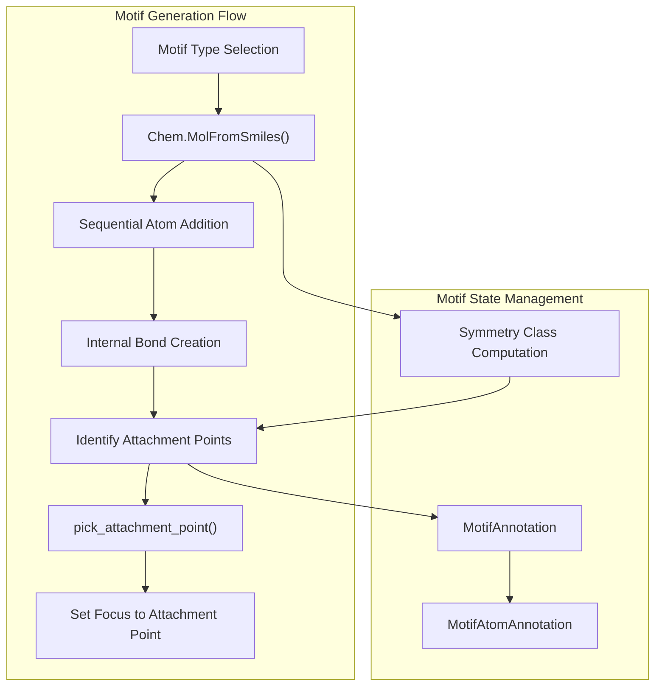
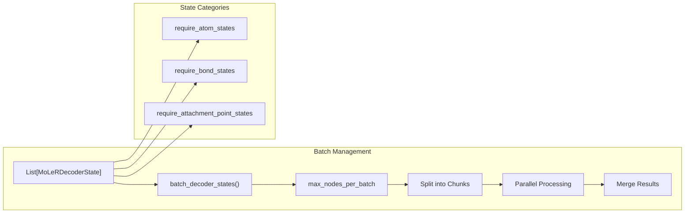

<!-- source: DeepWiki mcp.deepwiki.com · repo microsoft/molecule-generation · page 6.4 Decoding Process · fetched 2026-10-26 -->

# Decoding Process

Relevant source files

The following files were used as context for generating this wiki page:

- [molecule_generation/layers/moler_decoder.py](molecule_generation/layers/moler_decoder.py)
- [molecule_generation/test/layers/test_moler_decoder.py](molecule_generation/test/layers/test_moler_decoder.py)
- [molecule_generation/utils/moler_decoding_utils.py](molecule_generation/utils/moler_decoding_utils.py)

This page describes the step-by-step molecular generation process implemented by the MoLeR decoder, which converts latent representations into complete molecules through iterative atom and bond selection. For information about model training, see [Training Models](#5). For details about the overall model architecture, see [Model Architecture](#4).

## Overview

The decoding process is the core inference mechanism of MoLeR that transforms continuous latent representations into discrete molecular structures. The process operates through an iterative algorithm that sequentially adds atoms (or motifs) and bonds to construct complete molecules from partial graphs.

The decoder maintains state information throughout generation and supports both greedy and sampling-based approaches, as well as beam search for exploring multiple generation paths simultaneously.

Sources: [molecule_generation/layers/moler_decoder.py:1120-1175]()

## Core Components

### MoLeRDecoder Class

The `MoLeRDecoder` is the primary component responsible for molecule generation. It combines graph neural networks with specialized MLPs to make sequential decisions about molecular structure.

**Key Decoder Components:**

| Component | Purpose | Output Shape |
|-----------|---------|--------------|
| `_gnn` | Processes partial graph structure | `[V, VD*(num_layers+1)]` |
| `_node_type_selector` | Predicts next atom/motif type | `[NTP, NT+1]` |
| `_edge_candidate_scorer` | Scores potential bond targets | `[CE+PG]` |
| `_edge_type_selector` | Predicts bond type (single/double/triple) | `[CE, ET]` |
| `_attachment_point_selector` | Selects motif attachment points | `[CA]` |

Sources: [molecule_generation/layers/moler_decoder.py:107-141](), [molecule_generation/layers/moler_decoder.py:214-281]()

### MoLeRDecoderState

The `MoLeRDecoderState` class tracks the complete state of molecule generation, including the partial molecule, visited atoms, and generation history.

**State Management Methods:**

- `new_with_added_atom()`: Adds a new atom and updates focus
- `new_with_added_bond()`: Creates a bond between focus atom and target
- `new_with_added_motif()`: Adds entire molecular fragment
- `new_with_focus_marked_as_visited()`: Marks current focus as complete
- `new_for_finished_decoding()`: Finalizes generation process

Sources: [molecule_generation/utils/moler_decoding_utils.py:129-234](), [molecule_generation/utils/moler_decoding_utils.py:235-594]()

## Decoding Algorithm

The decoding process follows a systematic algorithm that alternates between atom/motif selection and bond formation:

### Step-by-Step Process

1. **Initialization**: Create `MoLeRDecoderState` with empty or scaffold molecule
2. **First Node Selection**: For empty molecules, pick initial atom type using `pick_first_node_type()`
3. **Iterative Generation Loop**:
   - **Node Addition Phase**: Add new atoms or motifs using `pick_node_type()`
   - **Attachment Point Phase**: For motifs, select connection point using `pick_attachment_point()`
   - **Bond Formation Phase**: Add bonds from focus atom using `pick_edge()`
   - **Focus Management**: Mark atoms as visited and select next focus
4. **Termination**: Stop when no more atoms needed or maximum steps reached

Sources: [molecule_generation/layers/moler_decoder.py:1120-1175](), [molecule_generation/layers/moler_decoder.py:1359-1500]()

## Sampling and Beam Search

The decoder supports multiple sampling strategies through the `DecoderSamplingMode` enum and beam search for exploring multiple generation paths.

### Sampling Modes

**Sampling Parameters:**

| Parameter | Purpose | Default |
|-----------|---------|---------|
| `sampling_mode` | Greedy vs probabilistic sampling | `GREEDY` |
| `beam_size` | Number of parallel generation paths | `1` |
| `max_num_steps` | Maximum generation steps | `120` |

### Beam Search Implementation

The decoder implements beam search by maintaining multiple `MoLeRDecoderState` objects and restricting to the top candidates after each step using `restrict_to_beam_size_per_mol()`.

Sources: [molecule_generation/utils/moler_decoding_utils.py:41-83](), [molecule_generation/utils/moler_decoding_utils.py:737-749]()

## Bond and Atom Selection

### Bond Candidate Generation

The decoder generates valid bond candidates by considering chemical constraints:

**Bond Selection Process:**

1. **Candidate Identification**: Find visited atoms with available bond slots
2. **Existing Bond Filtering**: Remove atoms already connected to focus
3. **Valence Validation**: Apply chemical valence constraints
4. **Feature Computation**: Calculate distance and topology features
5. **Type Constraints**: Determine valid bond types (single/double/triple)

### Edge Feature Computation

Edge features combine multiple aspects of molecular structure:

| Feature Type | Source Function | Dimension |
|--------------|----------------|-----------|
| Distance | `calculate_dist_from_focus_to_valid_target()` | 1 |
| Topology | `calculate_topology_features()` | 2 |
| Embeddings | `_distance_embedding` lookup | 1 |

Sources: [molecule_generation/utils/moler_decoding_utils.py:662-735](), [molecule_generation/chem/valence_constraints.py:22-24]()

## Motif-Based Generation

For models trained with motif vocabularies, the decoder supports adding entire molecular fragments as single units:

### Motif Addition Process

**Motif Processing Steps:**

1. **Motif Reconstruction**: Convert SMILES string to RDKit molecule
2. **Atom-by-Atom Addition**: Add individual atoms from motif
3. **Internal Bond Creation**: Connect atoms within motif
4. **Attachment Point Identification**: Find valid connection points using symmetry
5. **Focus Assignment**: Select attachment point for external connections

Sources: [molecule_generation/utils/moler_decoding_utils.py:394-501](), [molecule_generation/chem/motif_utils.py:15-19]()

## Batching and Performance

The decoder implements efficient batching to handle multiple molecules simultaneously:

### Batch Processing

**Batching Parameters:**

- `max_nodes_per_batch`: Controls memory usage by limiting graph sizes
- State categorization enables specialized processing for different generation phases
- Automatic splitting and merging maintains performance at scale

Sources: [molecule_generation/layers/moler_decoder.py:292-301](), [molecule_generation/utils/decoder_batching.py:1-38]()

## Generation Trace Storage

The decoder optionally stores detailed generation traces for visualization and debugging:

### Trace Information Classes

| Class | Purpose | Key Fields |
|-------|---------|------------|
| `MoleculeGenerationAtomChoiceInfo` | Atom selection metadata | `type_idx_to_prob`, `true_type_idx` |
| `MoleculeGenerationEdgeChoiceInfo` | Bond selection metadata | `candidate_edge_infos`, `no_edge_logprob` |
| `MoleculeGenerationAttachmentPointChoiceInfo` | Attachment point metadata | `candidate_idx_to_prob` |

When `store_generation_traces=True`, each decision point records:
- Available choices and their probabilities
- Selected option and its likelihood
- Molecular state at decision time
- Ground truth information (for evaluation)

Sources: [molecule_generation/utils/moler_decoding_utils.py:85-127](), [molecule_generation/layers/moler_decoder.py:1125-1165]()

---

