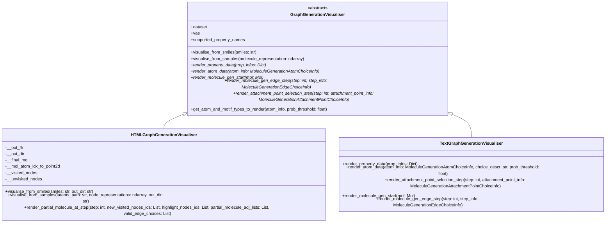
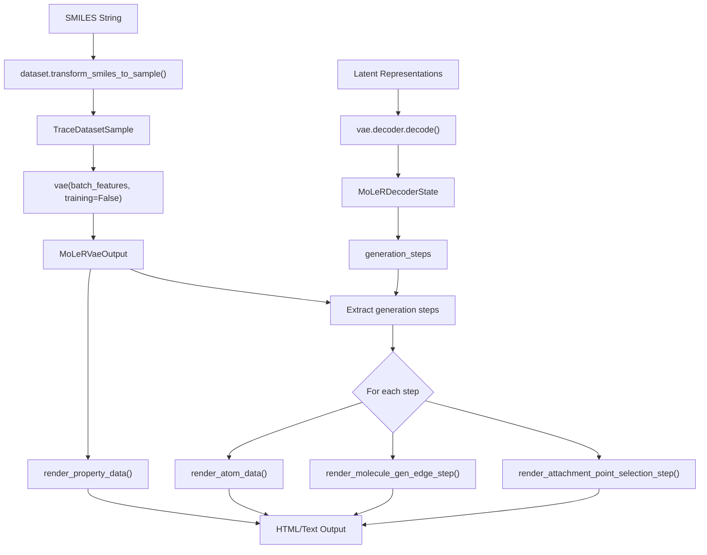
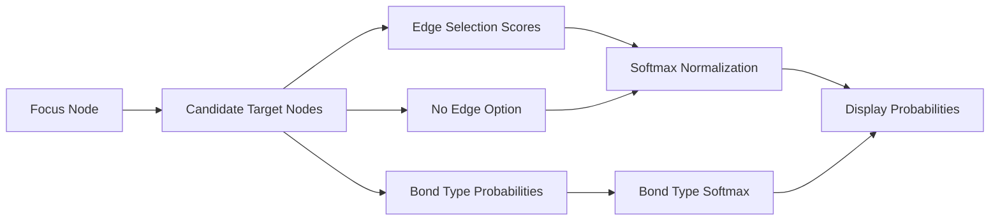
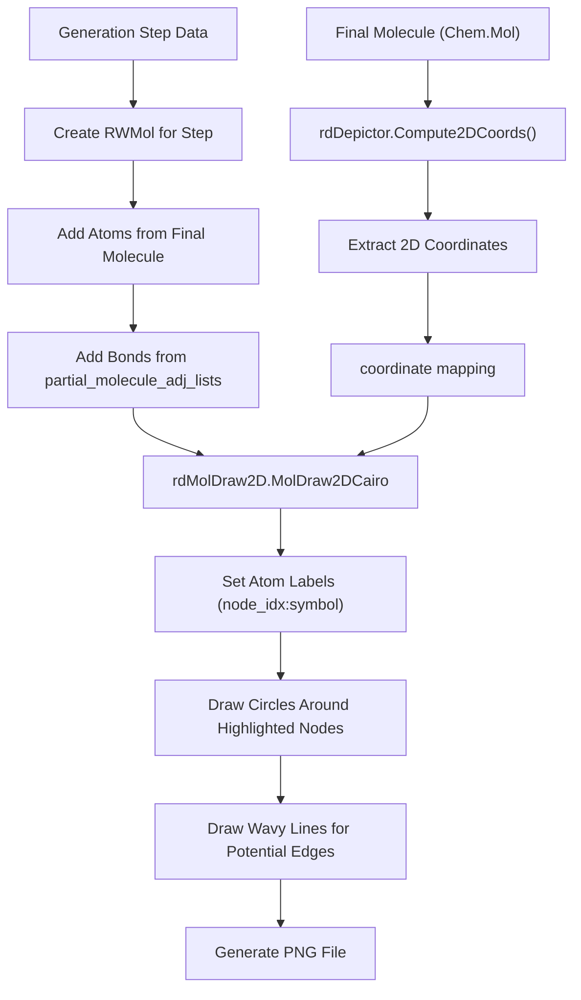
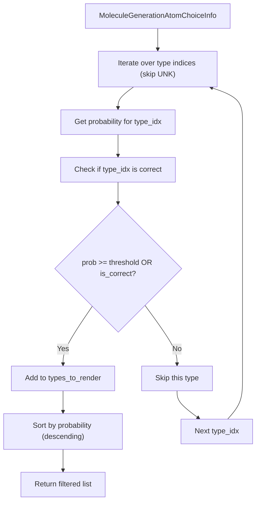

<!-- source: DeepWiki mcp.deepwiki.com · repo microsoft/molecule-generation · page 7 Visualization & Analysis · fetched 2026-10-26 -->

# Visualization & Analysis

<details>
<summary>Relevant source files</summary>

The following files were used as context for generating this wiki page:

- [molecule_generation/utils/moler_visualisation_utils.py](molecule_generation/utils/moler_visualisation_utils.py)
- [molecule_generation/visualisation/moler_visualiser_cli.py](molecule_generation/visualisation/moler_visualiser_cli.py)
- [molecule_generation/visualisation/moler_visualiser_html.py](molecule_generation/visualisation/moler_visualiser_html.py)

</details>


This document covers the visualization and analysis tools for understanding the MoLeR molecule generation process. The system provides both HTML-based rich visualizations and command-line text output to help users analyze how the model generates molecules step-by-step, including atom/motif selection, edge formation, and property predictions.

For information about using these tools through the command-line interface, see [Command Line Tools](#6.2). For details on the underlying decoding process being visualized, see [Decoding Process](#6.4).

## Visualization Framework Architecture

The visualization system is built around an abstract base class that defines a common interface for different visualization backends. This allows the same analysis logic to produce output in multiple formats.



The system uses several specialized data structures to capture different types of generation decisions:

```mermaid
classDiagram
    class PropertyPredictionInformation {
        +prediction: float
        +ground_truth: Optional[float]
    }
    
    class MoleculeGenerationAtomChoiceInfo {
        +node_idx: int
        +true_type_idx: Optional[List[int]]
        +type_idx_to_prob: List[float]
    }
    
    class MoleculeGenerationEdgeChoiceInfo {
        +focus_node_idx: int
        +partial_molecule_adjacency_lists: List[ndarray]
        +candidate_edge_infos: List[MoleculeGenerationEdgeCandidateInfo]
        +no_edge_score: float
        +no_edge_logprob: float
        +no_edge_correct: bool
    }
    
    class MoleculeGenerationEdgeCandidateInfo {
        +target_node_idx: int
        +score: float
        +logprob: float
        +correct: bool
        +type_idx_to_logprobs: ndarray
    }
    
    class MoleculeGenerationAttachmentPointChoiceInfo {
        +partial_molecule_adjacency_lists: List[ndarray]
        +motif_nodes: List[int]
        +candidate_attachment_points: List[int]
        +candidate_idx_to_prob: ndarray
        +correct_attachment_point_idx: int
    }
```



**Sources:** [molecule_generation/utils/moler_visualisation_utils.py:22-25](), [molecule_generation/utils/moler_visualisation_utils.py:27-30](), [molecule_generation/utils/moler_visualisation_utils.py:33-106](), [molecule_generation/visualisation/moler_visualiser_html.py:29-341](), [molecule_generation/visualisation/moler_visualiser_cli.py:20-97]()

## Visualization Process Flow

The visualization system follows a consistent process regardless of whether input comes from SMILES strings or latent representations:



**Sources:** [molecule_generation/utils/moler_visualisation_utils.py:108-124](), [molecule_generation/utils/moler_visualisation_utils.py:281-333](), [molecule_generation/utils/moler_visualisation_utils.py:126-280]()

## Generation Process Visualization

The visualization system captures and displays the step-by-step molecule generation process, showing how the model makes decisions at each stage.

### Atom and Motif Selection Visualization

The system visualizes atom and motif type selection by showing probability distributions over all possible choices. The `get_atom_and_motif_types_to_render()` method filters choices based on a probability threshold and correctness:

| Visualization Element | HTML Output | CLI Output |
|----------------------|-------------|------------|
| Property predictions | HTML table with prediction vs ground truth | Text format with aligned columns |
| Atom/motif choices | HTML table with probabilities, highlighting max probability | Text list with probabilities and descriptions |
| Correctness indicators | Color coding and bold formatting | Text markers like "[correct]" or "[incorrect]" |

**Sources:** [molecule_generation/utils/moler_visualisation_utils.py:74-106](), [molecule_generation/visualisation/moler_visualiser_html.py:53-102](), [molecule_generation/visualisation/moler_visualiser_cli.py:30-44]()

### Edge Formation Visualization

Edge selection steps show the model choosing between potential bonds from a focus node to target nodes, including bond type probabilities:



The HTML visualizer renders partial molecules with highlighted focus nodes and candidate edges, while the CLI version shows tabular probability data.

**Sources:** [molecule_generation/utils/moler_visualisation_utils.py:220-264](), [molecule_generation/visualisation/moler_visualiser_html.py:229-304](), [molecule_generation/visualisation/moler_visualiser_cli.py:68-96]()

### Partial Molecule Rendering

The HTML visualizer creates visual representations of molecules at each generation step using RDKit's drawing capabilities:



**Sources:** [molecule_generation/visualisation/moler_visualiser_html.py:152-227](), [molecule_generation/visualisation/moler_visualiser_html.py:164-227]()

## Model Analysis Tools

The visualization framework provides tools for analyzing model behavior and decision-making patterns.

### Property Prediction Analysis

Both visualizers display property predictions alongside ground truth values when available. The system supports any properties defined in the dataset configuration:

```python
# Property information structure
PropertyPredictionInformation(
    prediction=predictions.predicted_properties[prop_name].numpy(),
    ground_truth=trace_sample.graph_property_values[prop_name]
)
```

**Sources:** [molecule_generation/utils/moler_visualisation_utils.py:22-25](), [molecule_generation/utils/moler_visualisation_utils.py:116-124]()

### Probability Threshold Filtering

The visualization system includes configurable probability thresholds to focus on significant model predictions. The `get_atom_and_motif_types_to_render()` method filters out low-probability choices while always including correct answers for comparison:



**Sources:** [molecule_generation/utils/moler_visualisation_utils.py:74-106]()

### Command Line Interface Integration

The visualization tools integrate with the main CLI through dedicated commands:

| Command | Implementation | Purpose |
|---------|---------------|---------|
| `molecule_generation visualise html` | `HTMLGraphGenerationVisualiser` | Rich HTML output with molecule drawings |
| `molecule_generation visualise cli` | `TextGraphGenerationVisualiser` | Simple text-based output for terminal use |

Both commands accept either SMILES strings or paths to pickled latent representations as input.

**Sources:** [molecule_generation/visualisation/moler_visualiser_html.py:343-363](), [molecule_generation/visualisation/moler_visualiser_cli.py:99-122]()

---

