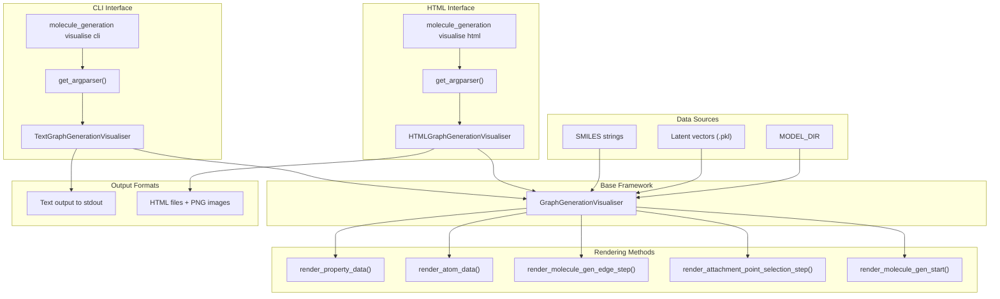
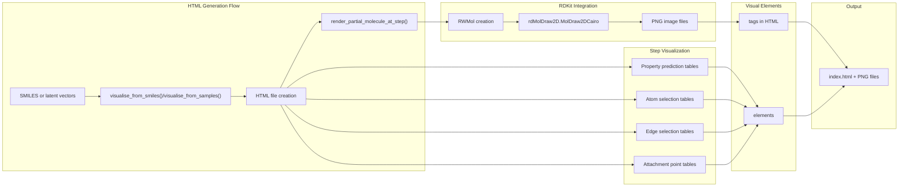

<!-- source: DeepWiki mcp.deepwiki.com · repo microsoft/molecule-generation · page 7.1 Generation Process Visualization · fetched 2026-10-26 -->

# Generation Process Visualization

<details>
<summary>Relevant source files</summary>

The following files were used as context for generating this wiki page:

- [README.md](README.md)
- [molecule_generation/visualisation/moler_visualiser_cli.py](molecule_generation/visualisation/moler_visualiser_cli.py)
- [molecule_generation/visualisation/moler_visualiser_html.py](molecule_generation/visualisation/moler_visualiser_html.py)

</details>


This document covers the visualization tools for understanding how MoLeR generates molecules step-by-step. The visualization system provides detailed insights into the model's decision-making process during molecule generation, including atom selection, edge formation, and attachment point choices.

For information about model analysis and understanding the visualization framework itself, see [Model Analysis Tools](#7.2). For details about the decoding process that generates the data being visualized, see [Decoding Process](#6.4).

## Visualization Modes

The MoLeR system provides two visualization modes: CLI text output and HTML visual output. Both modes can visualize either teacher-forced decoding (from a known SMILES string) or free sampling (from latent vectors).

### CLI Text Visualization

The CLI visualizer provides a text-based step-by-step breakdown of the generation process using the `TextGraphGenerationVisualiser` class.

```bash
molecule_generation visualise cli MODEL_DIR SMILES_OR_SAMPLES_PATH
```

### HTML Visual Visualization  

The HTML visualizer creates interactive web pages with molecular structure diagrams and probability tables using the `HTMLGraphGenerationVisualiser` class.

```bash
molecule_generation visualise html MODEL_DIR SMILES_OR_SAMPLES_PATH OUTPUT_DIR
```

**Sources:** [README.md:221-237](), [molecule_generation/visualisation/moler_visualiser_cli.py:112-122](), [molecule_generation/visualisation/moler_visualiser_html.py:353-363]()

## Visualization Architecture



**Sources:** [molecule_generation/visualisation/moler_visualiser_cli.py:20-123](), [molecule_generation/visualisation/moler_visualiser_html.py:29-364]()

## Generation Process Components

The visualization system displays several key components of the molecule generation process:

| Component | Data Structure | Purpose |
|-----------|---------------|---------|
| Property Predictions | `PropertyPredictionInformation` | Shows predicted molecular properties vs ground truth |
| Atom/Motif Selection | `MoleculeGenerationAtomChoiceInfo` | Displays probability distribution over atom/motif types |
| Edge Formation | `MoleculeGenerationEdgeChoiceInfo` | Shows edge target selection and bond type probabilities |
| Attachment Points | `MoleculeGenerationAttachmentPointChoiceInfo` | Visualizes motif attachment point selection |

### Property Visualization

Both visualizers display property predictions using the `render_property_data()` method, showing predicted values alongside ground truth when available.

### Atom and Motif Selection

The `render_atom_data()` method displays the probability distribution over possible atom and motif types at each generation step, highlighting correct choices when known.

### Edge Selection Process

The `render_molecule_gen_edge_step()` method shows:
- Target node candidates with probabilities
- Bond type probabilities (single, double, triple)
- Edge formation scores
- "No edge" option probability

### Attachment Point Selection

For motif-based generation, `render_attachment_point_selection_step()` visualizes which attachment points on existing motifs are candidates for connection.

**Sources:** [molecule_generation/visualisation/moler_visualiser_html.py:30-305](), [molecule_generation/visualisation/moler_visualiser_cli.py:21-97]()

## HTML Visualization Implementation



The HTML visualizer creates detailed molecular structure diagrams using RDKit's drawing capabilities. The `render_partial_molecule_at_step()` method:

1. Creates `RWMol` objects representing partial molecules
2. Uses `rdMolDraw2D.MolDraw2DCairo` for rendering
3. Highlights visited/unvisited nodes with different labels
4. Draws circles around candidate attachment points
5. Shows potential edges as wavy lines

**Sources:** [molecule_generation/visualisation/moler_visualiser_html.py:164-227](), [molecule_generation/visualisation/moler_visualiser_html.py:306-341]()

## CLI Visualization Implementation

The CLI visualizer provides a compact text representation through the `TextGraphGenerationVisualiser` class:

### Property Display
```
= Molecule properties
 Property    sa_score: Pred =   2.456 (True =   2.234)
 Property       clogp: Pred =   1.789
```

### Atom Selection Display
```
  - Atom/motif choices for first node
    Correct: C
     0.845 - C
     0.089 - N
     0.034 - O
```

### Edge Selection Display
```
 -- Step 3 - focusing on node 1
  - Edge choices
    Edge  1 --  2:   prob 0.456, score  12.345 [correct] | type 1 prob: 0.678, type 2 prob: 0.234, type 3 prob: 0.088
    No further edge: prob 0.544, score   8.901 [incorrect]
```

**Sources:** [molecule_generation/visualisation/moler_visualiser_cli.py:21-97]()

## Usage Examples

### Visualizing SMILES Generation

```bash
# CLI visualization of benzene generation
molecule_generation visualise cli /path/to/model "c1ccccc1"

# HTML visualization with output directory
molecule_generation visualise html /path/to/model "c1ccccc1" /output/dir
```

### Visualizing Latent Sampling

```bash
# First generate samples and save latents
molecule_generation sample /path/to/model 10 --save-latents samples.pkl

# Then visualize the generation process
molecule_generation visualise cli /path/to/model samples.pkl
molecule_generation visualise html /path/to/model samples.pkl /output/dir
```

### Programmatic Usage

The visualizers can be used programmatically by instantiating the classes directly:

```python
from molecule_generation.visualisation.moler_visualiser_html import HTMLGraphGenerationVisualiser

visualizer = HTMLGraphGenerationVisualiser(model_dir)
visualizer.visualise_from_smiles("c1ccccc1", output_dir)
```

**Sources:** [README.md:221-237](), [molecule_generation/visualisation/moler_visualiser_html.py:343-351](), [molecule_generation/visualisation/moler_visualiser_cli.py:99-110]()

---

