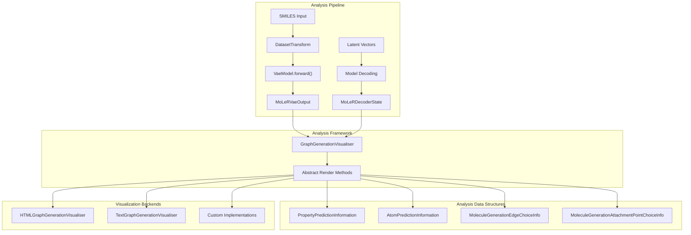
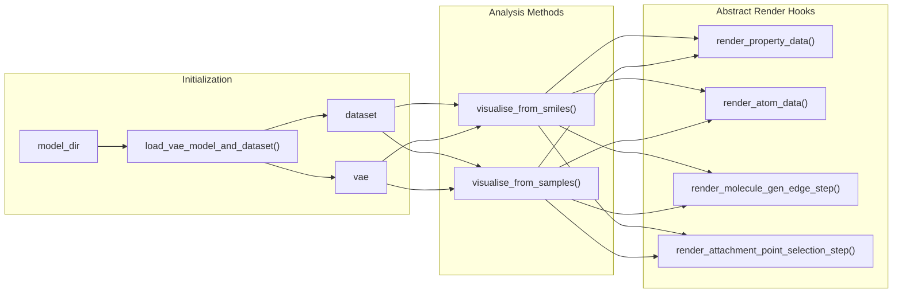
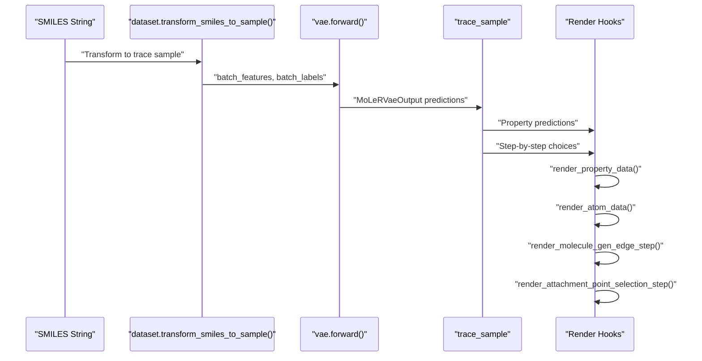
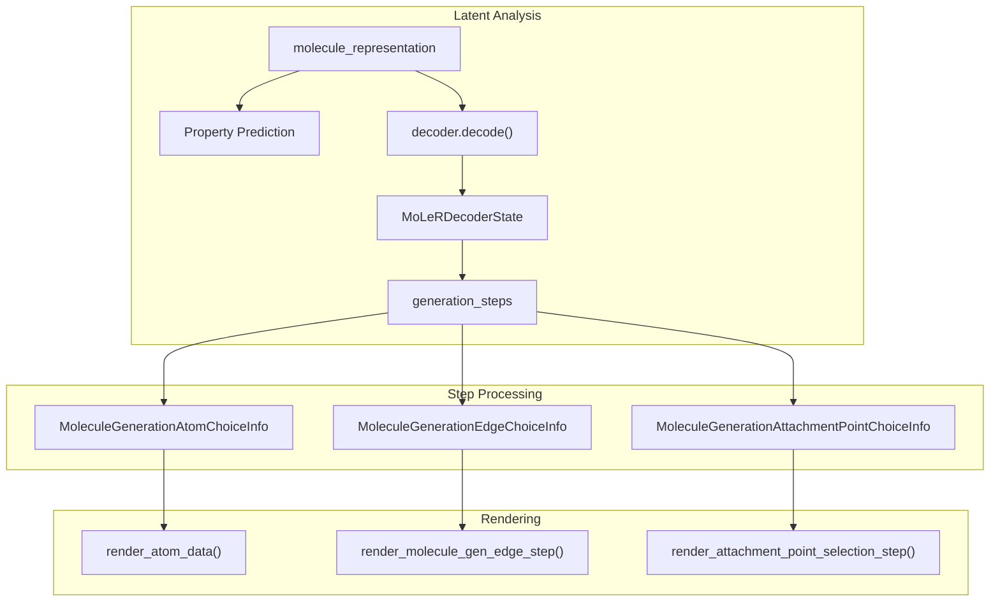
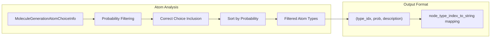

<!-- source: DeepWiki mcp.deepwiki.com · repo microsoft/molecule-generation · page 7.2 Model Analysis Tools · fetched 2026-10-26 -->

# Model Analysis Tools

Relevant source files

The following files were used as context for generating this wiki page:

- [molecule_generation/utils/moler_visualisation_utils.py](molecule_generation/utils/moler_visualisation_utils.py)
- [molecule_generation/visualisation/moler_visualiser_cli.py](molecule_generation/visualisation/moler_visualiser_cli.py)
- [molecule_generation/visualisation/moler_visualiser_html.py](molecule_generation/visualisation/moler_visualiser_html.py)

This page documents the model analysis framework that enables detailed inspection of MoLeR model behavior during molecule generation. The analysis tools capture step-by-step decision-making information from trained models and provide a flexible framework for visualizing and understanding generation processes.

For information about the specific visualization implementations (HTML and CLI), see [Generation Process Visualization](#7.1). For details about the underlying decoding process being analyzed, see [Decoding Process](#6.4).

## Analysis Framework Overview

The model analysis system is built around the `GraphGenerationVisualiser` abstract base class, which provides a standardized interface for capturing and processing detailed model behavior during molecule generation.

**Analysis Framework Architecture**: The system separates model execution from visualization rendering, allowing multiple presentation formats to share the same analysis logic.

Sources: [molecule_generation/utils/moler_visualisation_utils.py:33-43](), [molecule_generation/visualisation/moler_visualiser_html.py:29](), [molecule_generation/visualisation/moler_visualiser_cli.py:20]()

## Core Analysis Components

### GraphGenerationVisualiser Base Class

The `GraphGenerationVisualiser` class provides the foundation for all model analysis tools. It handles model loading, data processing, and generation trace analysis.

**Core Analysis Methods**: The base class orchestrates model execution and provides standardized hooks for processing different types of generation decisions.

The key initialization parameters include:
- `trace_element_keep_prob = 1.0` - Ensures all generation steps are captured
- `max_nodes_per_batch = 5000` - Handles large molecule analysis
- `supported_property_names` - Available molecular properties for analysis

Sources: [molecule_generation/utils/moler_visualisation_utils.py:34-43]()

### Analysis Data Structures

The framework defines specialized data structures to capture different aspects of model behavior:

| Data Structure | Purpose | Key Fields |
|---|---|---|
| `PropertyPredictionInformation` | Property prediction analysis | `prediction`, `ground_truth` |
| `AtomPredictionInformation` | Atom/motif selection analysis | `node_idx`, `true_type_idx`, `type_idx_to_prob` |
| `MoleculeGenerationEdgeChoiceInfo` | Edge selection analysis | `focus_node_idx`, `candidate_edge_infos`, `no_edge_logprob` |
| `MoleculeGenerationAttachmentPointChoiceInfo` | Attachment point analysis | `candidate_attachment_points`, `candidate_idx_to_prob` |

Sources: [molecule_generation/utils/moler_visualisation_utils.py:22-31](), [molecule_generation/layers/moler_decoder.py:11-16]()

## Visualization Pipeline

### SMILES-Based Analysis

The `visualise_from_smiles()` method provides comprehensive analysis by running a complete forward pass through the trained model:

**SMILES Analysis Pipeline**: The framework transforms input SMILES through the complete model pipeline, capturing predictions and ground truth labels for detailed comparison.

The analysis captures:
- **Property Predictions**: Comparison of predicted vs. ground truth molecular properties
- **Initial Atom Choice**: First node type selection with probability distribution
- **Edge Decisions**: Step-by-step edge formation choices with scores and correctness
- **Attachment Points**: Motif connection point selection analysis

Sources: [molecule_generation/utils/moler_visualisation_utils.py:108-124](), [molecule_generation/utils/moler_visualisation_utils.py:174-189]()

### Latent-Based Analysis

The `visualise_from_samples()` method analyzes generation from latent representations without ground truth comparisons:

**Latent Analysis Pipeline**: Generation from latent vectors captures the full decoder trace with step-by-step decision information.

Sources: [molecule_generation/utils/moler_visualisation_utils.py:281-333]()

## Analysis Processing Methods

### Atom and Motif Analysis

The `get_atom_and_motif_types_to_render()` method filters and ranks atom/motif choices based on prediction probabilities:

**Atom Type Analysis**: The framework intelligently filters atom/motif choices, ensuring correct choices are always shown regardless of their predicted probability.

Key features:
- Skips the "UNK" type (index 0) in analysis
- Applies configurable probability threshold filtering
- Always includes ground truth choices for comparison
- Sorts results by decreasing probability

Sources: [molecule_generation/utils/moler_visualisation_utils.py:74-106]()

### Edge Choice Analysis

Edge selection analysis captures both the discrete choice of target nodes and the continuous edge type predictions:

The analysis processes:
- **Candidate Edges**: Valid connection options with scores and probabilities
- **Edge Types**: Single/double/triple bond probability distributions
- **No-Edge Option**: Probability of stopping edge addition from current focus node
- **Correctness Labels**: Ground truth comparison when available

Sources: [molecule_generation/utils/moler_visualisation_utils.py:220-264]()

## Extensibility Framework

The abstract base class design enables custom analysis implementations by extending `GraphGenerationVisualiser`:

```mermaid
graph TB
    subgraph "Abstract Interface"
        ABSTRACT["GraphGenerationVisualiser"]
        ABSTRACT --> RENDERPROP["render_property_data()"]
        ABSTRACT --> RENDERATOM["render_atom_data()"]
        ABSTRACT --> RENDEREDGE["render_molecule_gen_edge_step()"]
        ABSTRACT --> RENDERATTACH["render_attachment_point_selection_step()"]
        ABSTRACT --> RENDERSTART["render_molecule_gen_start()"]
    end
    
    subgraph "Concrete Implementations"
        HTML["HTMLGraphGenerationVisualiser"]
        CLI["TextGraphGenerationVisualiser"]
        CUSTOM["Custom Visualizers"]
    end
    
    subgraph "Shared Utilities"
        ATOMUTIL["get_atom_and_motif_types_to_render()"]
        SMILES["visualise_from_smiles()"]
        SAMPLES["visualise_from_samples()"]
    end
    
    ABSTRACT --> HTML
    ABSTRACT --> CLI
    ABSTRACT --> CUSTOM
    ABSTRACT --> ATOMUTIL
    ABSTRACT --> SMILES
    ABSTRACT --> SAMPLES
```

**Extensibility Design**: The framework separates analysis logic from presentation, enabling diverse visualization approaches while maintaining consistent analysis capabilities.

Custom implementations need only override the five abstract render methods to create new analysis presentations. The base class handles all model interaction, data processing, and analysis orchestration.

Sources: [molecule_generation/utils/moler_visualisation_utils.py:45-72]()

---

