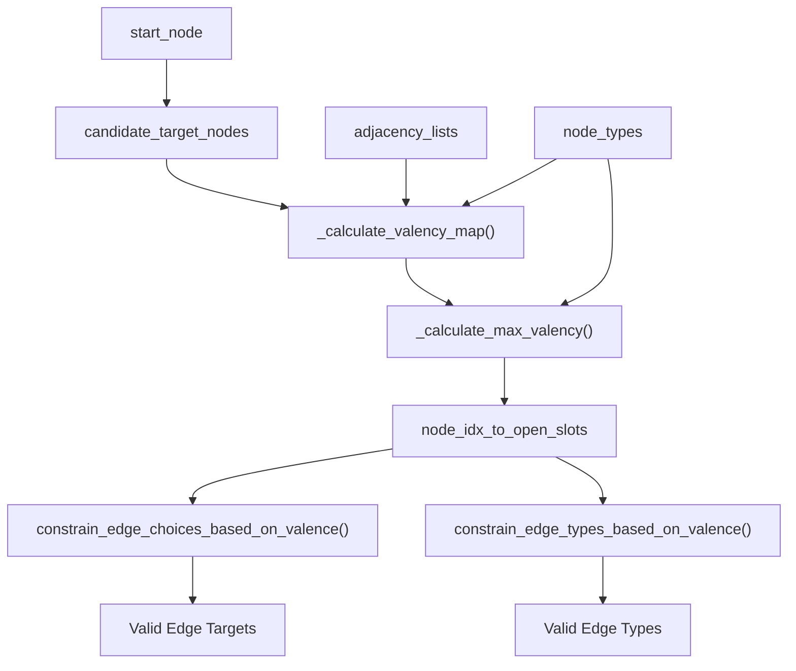
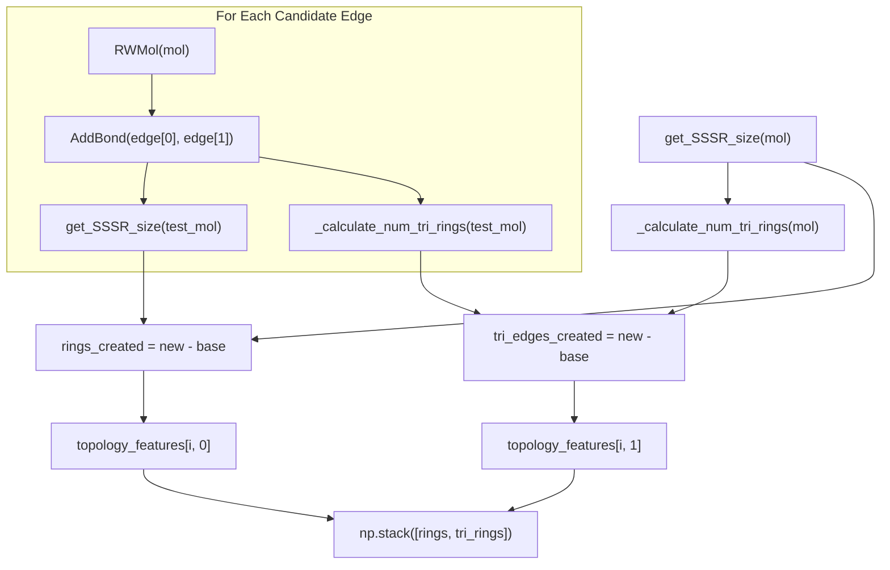
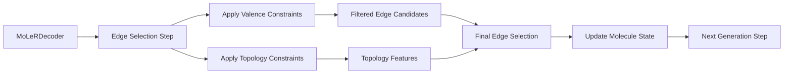

<!-- source: DeepWiki mcp.deepwiki.com · repo microsoft/molecule-generation · page 8 Advanced Topics · fetched 2026-10-26 -->

# Advanced Topics

Relevant source files

The following files were used as context for generating this wiki page:

- [molecule_generation/chem/topology_features.py](molecule_generation/chem/topology_features.py)
- [molecule_generation/chem/valence_constraints.py](molecule_generation/chem/valence_constraints.py)
- [molecule_generation/test/utils/test_valence_constraints.py](molecule_generation/test/utils/test_valence_constraints.py)

This document covers advanced features and customization options for the molecule generation system, focusing on the sophisticated constraint mechanisms that ensure chemical validity during molecule generation and motif-based approaches for working with molecular fragments.

For basic model training and inference, see [Training Models](#5) and [Inference & Generation](#6). For understanding the core decoding process, see [Decoding Process](#6.4).

## Overview

The MoLeR system incorporates several advanced mechanisms to ensure generated molecules are chemically valid and respect fundamental chemical principles. The primary advanced topics covered include:

- **Molecular Constraints**: Valence and topology constraints that enforce chemical validity
- **Motif-Based Generation**: Working with pre-defined molecular fragments and motifs

These features operate during the molecule generation process to guide the decoder toward chemically meaningful structures.

## Molecular Constraints

The system implements two primary types of constraints during molecule generation:

### Valence Constraints

Valence constraints ensure that atoms do not exceed their maximum bonding capacity. The system maintains a mapping of atomic symbols to their maximum valence values and applies these constraints during edge selection.

**Valence Constraint Process**

The `constrain_edge_choices_based_on_valence()` function filters candidate target nodes based on whether both the source and target atoms have available valence slots. The process:

1. **Calculate Current Valency**: Uses `_calculate_valency_map()` to sum existing bonds weighted by bond order
2. **Determine Maximum Valency**: Uses `_calculate_max_valency()` based on atomic symbols and charges  
3. **Filter Valid Targets**: Returns boolean mask indicating which candidate nodes can accept new bonds

| Atom Type | Maximum Valence | Common in |
|-----------|----------------|-----------|
| C | 4 | Organic molecules |
| N | 3 | Amines, amides |
| O | 2 | Alcohols, ethers |
| S | 6 | Sulfur compounds |
| F, Cl, Br | 1 | Halides |

The `constrain_edge_types_based_on_valence()` function additionally determines which bond types (single, double, triple) are valid for each potential edge based on available valence slots.

Sources: [molecule_generation/chem/valence_constraints.py:9-22](), [molecule_generation/chem/valence_constraints.py:25-61](), [molecule_generation/chem/valence_constraints.py:64-102]()

### Topology Constraints  

Topology constraints prevent the generation of chemically unfavorable ring structures by analyzing the impact of potential edges on molecular topology.

**Topology Feature Calculation**

The `calculate_topology_features()` function computes two key metrics for each potential edge:

1. **Rings Created**: Difference in SSSR (Smallest Set of Smallest Rings) size before and after adding the edge
2. **Tri-Ring Edges Created**: Number of edges involved in three or more rings

These features help the model avoid generating molecules with strained ring systems or overly complex topologies that would be chemically unstable.

Sources: [molecule_generation/chem/topology_features.py:23-66](), [molecule_generation/chem/topology_features.py:13-21](), [molecule_generation/chem/topology_features.py:68-70]()

## Integration with Decoding Process

During molecule generation, these constraints are applied at each step when the decoder selects:

**Constraint Application in Generation**

The constraints operate as filters and feature providers during the generation process, ensuring that:

- **Edge Candidates**: Only chemically valid edge targets are considered
- **Edge Types**: Only appropriate bond orders (single/double/triple) are selected
- **Topology Features**: Ring formation characteristics inform the selection process

Sources: [molecule_generation/chem/valence_constraints.py:25-102](), [molecule_generation/chem/topology_features.py:23-66]()

## Motif-Based Generation

The system supports generation based on pre-defined molecular motifs and fragments, allowing for more controlled molecule design. This approach enables:

- **Fragment-Based Design**: Building molecules from known active fragments
- **Scaffold Hopping**: Generating variations around core molecular scaffolds  
- **Constrained Generation**: Ensuring specific substructures appear in generated molecules

The motif vocabulary and extraction mechanisms work in conjunction with the core MoLeR architecture to enable this functionality.

For detailed information on motif extraction and vocabulary creation, see the preprocessing pipeline documentation in [Preprocessing Pipeline](#3.2).

## Implementation Details

### Valence Constraint Functions

The core valence constraint implementation consists of several key functions:

- `constrain_edge_choices_based_on_valence()`: Primary function for filtering valid edge targets
- `constrain_edge_types_based_on_valence()`: Determines valid bond types for each edge
- `_calculate_valency_map()`: Computes current valence usage for all nodes
- `_calculate_max_valency()`: Determines maximum allowed valence based on atom types

### Error Handling

The topology constraint system includes robust error handling for RDKit operations, falling back to permissive defaults when molecular structure analysis fails.

Sources: [molecule_generation/chem/valence_constraints.py:1-189](), [molecule_generation/chem/topology_features.py:1-71]()

---

