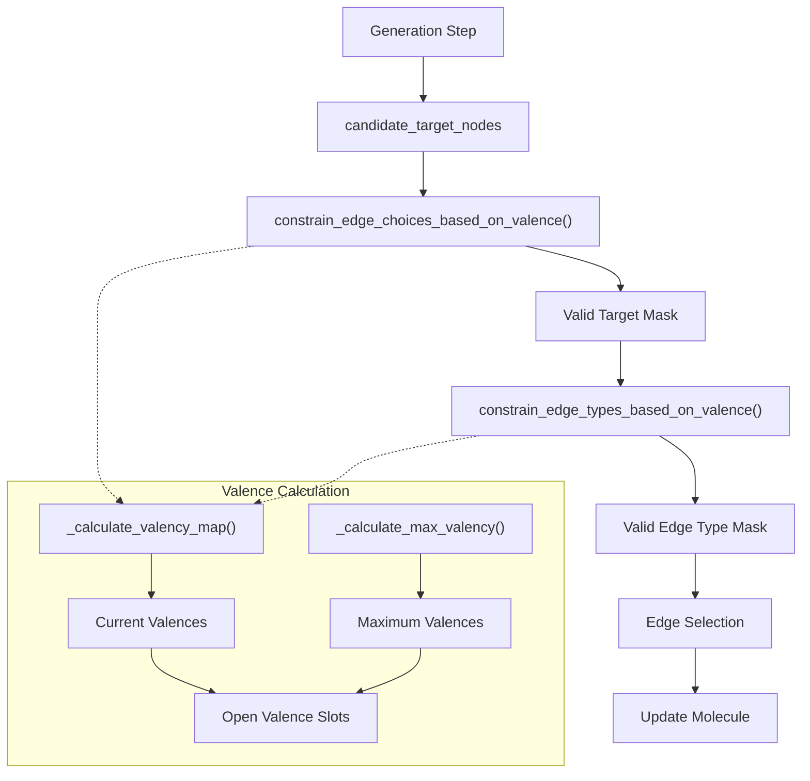
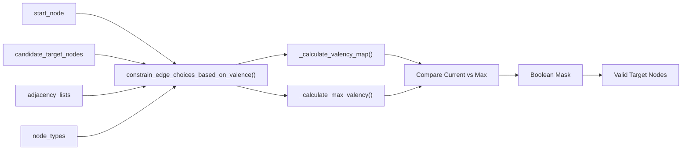
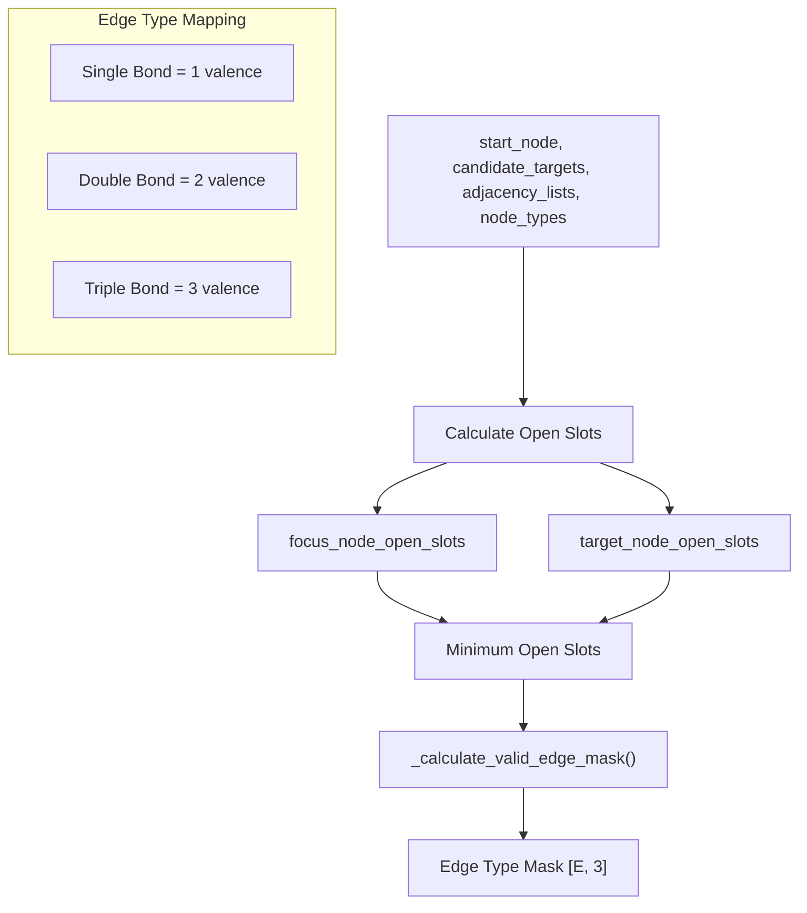
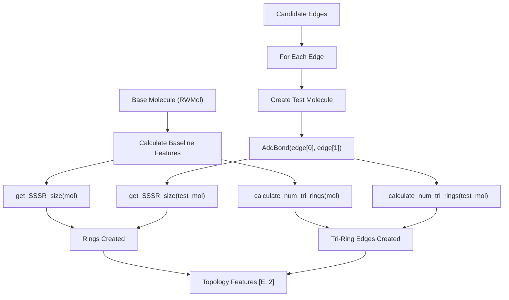
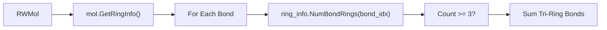
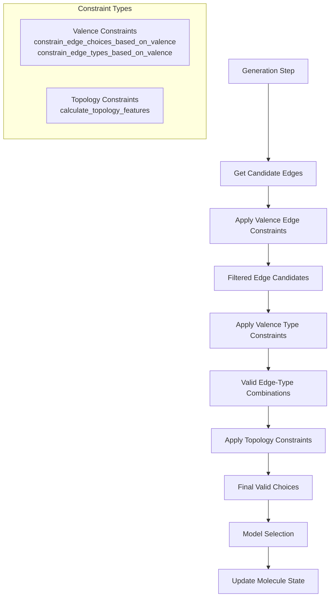

<!-- source: DeepWiki mcp.deepwiki.com · repo microsoft/molecule-generation · page 8.1 Molecular Constraints · fetched 2026-10-26 -->

# Molecular Constraints

Relevant source files

The following files were used as context for generating this wiki page:

- [molecule_generation/chem/topology_features.py](molecule_generation/chem/topology_features.py)
- [molecule_generation/chem/valence_constraints.py](molecule_generation/chem/valence_constraints.py)
- [molecule_generation/test/utils/test_valence_constraints.py](molecule_generation/test/utils/test_valence_constraints.py)

This document covers the molecular constraint system in the MoLeR molecule generation framework. The constraint system ensures that generated molecules satisfy fundamental chemical rules by enforcing valence limits and topology constraints during the generation process.

The system implements two primary types of constraints: **valence constraints** that prevent atoms from exceeding their maximum chemical valence, and **topology constraints** that control ring formation and molecular structure complexity. These constraints are applied during the step-by-step molecule generation process to ensure chemically valid outputs.

For information about the decoding process where these constraints are applied, see [Decoding Process](#6.4). For details about motif-based constraints, see [Motif-Based Generation](#8.2).

## Valence Constraints

### Overview

Valence constraints ensure that atoms in generated molecules do not exceed their maximum chemical valence. The system tracks the current valence of each atom and prevents the addition of bonds that would violate chemical rules.

**Constraint Application Workflow**

Sources: [molecule_generation/chem/valence_constraints.py:25-61]()

### Maximum Valence Definitions

The system defines maximum valences for common chemical elements based on RDKit definitions:

| Element | Maximum Valence |
|---------|----------------|
| C (Carbon) | 4 |
| N (Nitrogen) | 3 |
| O (Oxygen) | 2 |
| S (Sulfur) | 6 |
| P (Phosphorus) | 7 |
| F, Cl, Br (Halogens) | 1, 1, 1 |
| I (Iodine) | 5 |
| B (Boron) | 3 |
| Si (Silicon) | 6 |
| Se (Selenium) | 6 |

The system also accounts for formal charges on atoms, with the effective maximum valence calculated as `base_valence + charge`.

Sources: [molecule_generation/chem/valence_constraints.py:9-22](), [molecule_generation/chem/valence_constraints.py:179-182]()

### Core Constraint Functions

**Edge Choice Filtering**

The `constrain_edge_choices_based_on_valence()` function filters which target nodes can receive new edges from a given start node:

The function returns a boolean mask indicating which candidate target nodes can accept a new edge without violating valence constraints.

Sources: [molecule_generation/chem/valence_constraints.py:25-61]()

**Edge Type Filtering**

The `constrain_edge_types_based_on_valence()` function determines which bond types (single, double, triple) are valid for each potential edge:

The function returns a 2D array where element `(e, t)` indicates whether edge `e` can be of type `t`.

Sources: [molecule_generation/chem/valence_constraints.py:64-102]()

### Valence Calculation Implementation

**Current Valence Tracking**

The `_calculate_valency_map()` function computes current valences by examining the adjacency lists:

- Single bonds contribute 1 to valence
- Double bonds contribute 2 to valence  
- Triple bonds contribute 3 to valence

The function iterates through each edge type's adjacency list and accumulates valence contributions for each node.

Sources: [molecule_generation/chem/valence_constraints.py:137-160]()

**Maximum Valence Calculation**

The `_calculate_max_valency()` function determines maximum allowed valences by:

1. Extracting the true chemical symbol from node type strings
2. Getting the formal charge from the node type
3. Looking up the base maximum valence for the element
4. Adding the charge to get the effective maximum valence

Sources: [molecule_generation/chem/valence_constraints.py:163-182]()

## Topology Constraints

### Overview

Topology constraints control the formation of rings and complex molecular structures during generation. The system calculates topology features to understand how adding edges affects molecular topology and prevents the creation of overly complex or chemically unrealistic structures.

**Topology Feature Calculation**

Sources: [molecule_generation/chem/topology_features.py:23-66]()

### Ring Detection and Analysis

**SSSR (Smallest Set of Smallest Rings)**

The system uses RDKit's `GetSSSR()` function to analyze ring structures, with version-specific handling:

- RDKit >= 2022.09.1: Returns the actual SSSR, function takes `len()`
- RDKit < 2022.09.1: Returns the size of the SSSR directly

Sources: [molecule_generation/chem/topology_features.py:13-20]()

**Tri-Ring Edge Detection**

The `_calculate_num_tri_rings()` function counts edges that participate in three or more rings:

This metric helps identify highly constrained molecular regions where bond formation might create excessive ring strain.

Sources: [molecule_generation/chem/topology_features.py:68-70]()

### Topology Feature Output

The `calculate_topology_features()` function returns a 2D array with shape `[E, 2]` where:

- Column 0: Number of rings created by adding the edge
- Column 1: Number of tri-ring edges created by adding the edge

These features can be used by the generation model to make informed decisions about which edges to add based on topological complexity.

Sources: [molecule_generation/chem/topology_features.py:33-39]()

## Integration with Generation Process

### Constraint Application Pipeline

During molecule generation, constraints are applied in a hierarchical manner:

### Error Handling

The constraint system includes robust error handling for RDKit operations:

- Valence calculations use numpy operations that are generally safe
- Topology calculations wrap RDKit calls in try-catch blocks
- Default values are provided when RDKit throws exceptions
- Logging captures warnings about problematic molecules

Sources: [molecule_generation/chem/topology_features.py:63-65]()

## Usage Examples

### Typical Constraint Application

The constraint functions are typically used during the decoding phase of molecule generation:

1. **Edge Filtering**: `constrain_edge_choices_based_on_valence()` removes invalid target nodes
2. **Type Filtering**: `constrain_edge_types_based_on_valence()` determines valid bond types
3. **Topology Analysis**: `calculate_topology_features()` provides structural complexity metrics

### Test Cases

The system includes comprehensive test cases demonstrating constraint behavior on simple molecular graphs, including:

- Basic valence constraint application on carbon chains
- Handling of empty edge candidate lists
- Behavior when focus nodes are at maximum valence
- Edge type constraint validation

Sources: [molecule_generation/test/utils/test_valence_constraints.py:11-183]()

---

