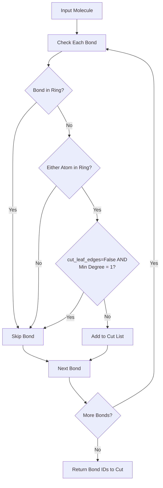
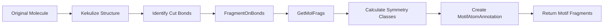
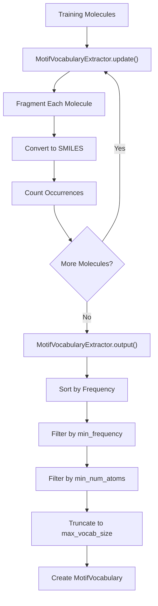
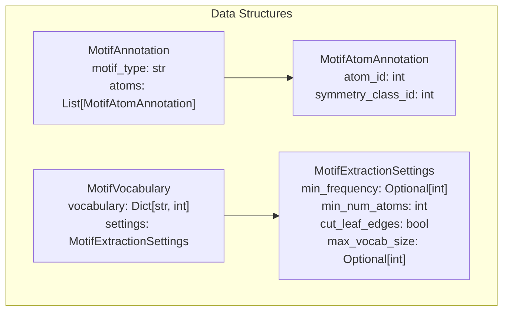
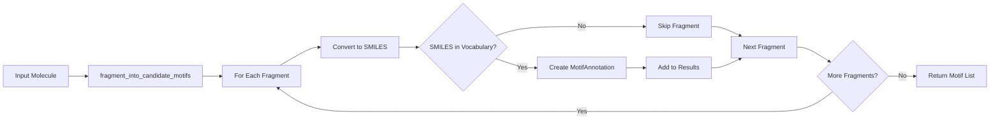
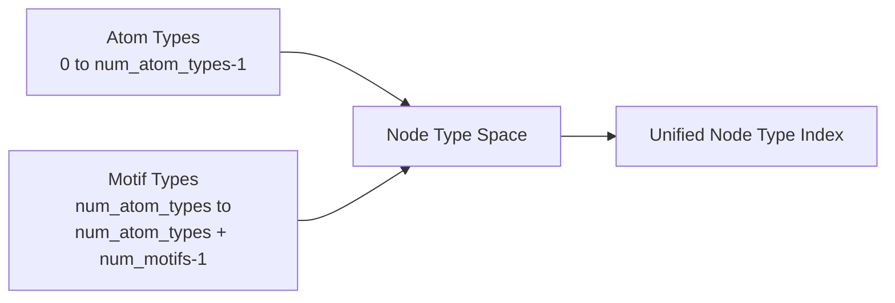

<!-- source: DeepWiki mcp.deepwiki.com · repo microsoft/molecule-generation · page 8.2 Motif-Based Generation · fetched 2026-10-26 -->

# Motif-Based Generation

Relevant source files

The following files were used as context for generating this wiki page:

- [CHANGELOG.md](CHANGELOG.md)
- [molecule_generation/chem/motif_utils.py](molecule_generation/chem/motif_utils.py)

This document covers the motif-based molecular fragment system used in MoLeR for hierarchical molecule generation. Motifs are molecular substructures that are extracted from training data and used as building blocks during generation to improve chemical validity and generation efficiency.

For information about the overall molecule generation process, see [Decoding Process](#6.4). For details on molecular constraints during generation, see [Molecular Constraints](#8.1).

## Overview

The MoLeR system uses a motif-based approach where molecules are decomposed into meaningful chemical fragments (motifs) that can be recombined during generation. This approach provides several advantages:

- **Chemical Validity**: Using known chemical fragments as building blocks increases the likelihood of generating valid molecules
- **Generation Efficiency**: Starting with larger molecular fragments reduces the number of generation steps required
- **Structural Diversity**: Combining motifs in new ways can lead to novel molecular structures

## Motif Extraction Process

The motif extraction process identifies molecular fragments by strategically breaking bonds that connect ring systems to non-ring atoms or other ring systems.

### Bond Selection Strategy

The system identifies bonds to cut based on specific criteria implemented in `get_bonds_to_fragment_on`:

**Sources:** [molecule_generation/chem/motif_utils.py:39-68]()

### Fragmentation Algorithm

The `fragment_into_candidate_motifs` function performs the actual molecular fragmentation:

Each fragment is returned with atom annotations that track:
- Original atom IDs from the parent molecule
- Symmetry class IDs within the motif for canonical representation

**Sources:** [molecule_generation/chem/motif_utils.py:71-134]()

## Motif Vocabulary Creation

### MotifVocabularyExtractor

The `MotifVocabularyExtractor` class builds a vocabulary of motifs from a collection of training molecules:

| Component | Purpose | Key Parameters |
|-----------|---------|----------------|
| `MotifExtractionSettings` | Configuration for extraction | `min_frequency`, `min_num_atoms`, `cut_leaf_edges`, `max_vocab_size` |
| `MotifVocabularyExtractor` | Accumulates motif counts | Counter for motif occurrences |
| `MotifVocabulary` | Final vocabulary output | Dictionary mapping SMILES to IDs |

### Vocabulary Building Process

### Filtering Criteria

The vocabulary creation applies several filtering steps:

1. **Minimum Frequency**: Remove motifs that appear less than `min_frequency` times
2. **Minimum Size**: Remove motifs with fewer than `min_num_atoms` atoms
3. **Vocabulary Size**: Truncate to `max_vocab_size` most common motifs

**Sources:** [molecule_generation/chem/motif_utils.py:137-212]()

## Motif Detection and Annotation

### MotifAnnotation Data Structures

The system uses several data structures to track motifs within molecules:

### Finding Motifs in Molecules

The `find_motifs_from_vocabulary` function identifies occurrences of known motifs in new molecules:

**Sources:** [molecule_generation/chem/motif_utils.py:215-239]()

## Integration with Node Type System

### Motif-to-Node-Type Mapping

The system integrates motifs into the broader node type system used during generation. The `get_motif_type_to_node_type_index_map` function creates a mapping that shifts motif indices to avoid conflicts with atom types:

This mapping allows the generation system to treat both individual atoms and molecular motifs as node types during the decoding process.

**Sources:** [molecule_generation/chem/motif_utils.py:242-250]()

## Configuration and Usage

### Typical Configuration

Common motif extraction settings include:

| Setting | Typical Value | Purpose |
|---------|---------------|---------|
| `min_frequency` | 10-100 | Remove rare motifs |
| `min_num_atoms` | 3-5 | Remove trivial fragments |
| `cut_leaf_edges` | `True` | Include terminal fragments |
| `max_vocab_size` | 1000-5000 | Limit vocabulary size |

### Integration Points

The motif system integrates with other components of the MoLeR system:

- **Preprocessing**: Motifs are extracted during data preprocessing
- **Featurization**: Motif annotations are included in molecular graphs
- **Generation**: Motifs are used as high-level building blocks during decoding
- **Visualization**: Motif boundaries can be highlighted in generation traces

**Sources:** [molecule_generation/chem/motif_utils.py:11-16]()

---

