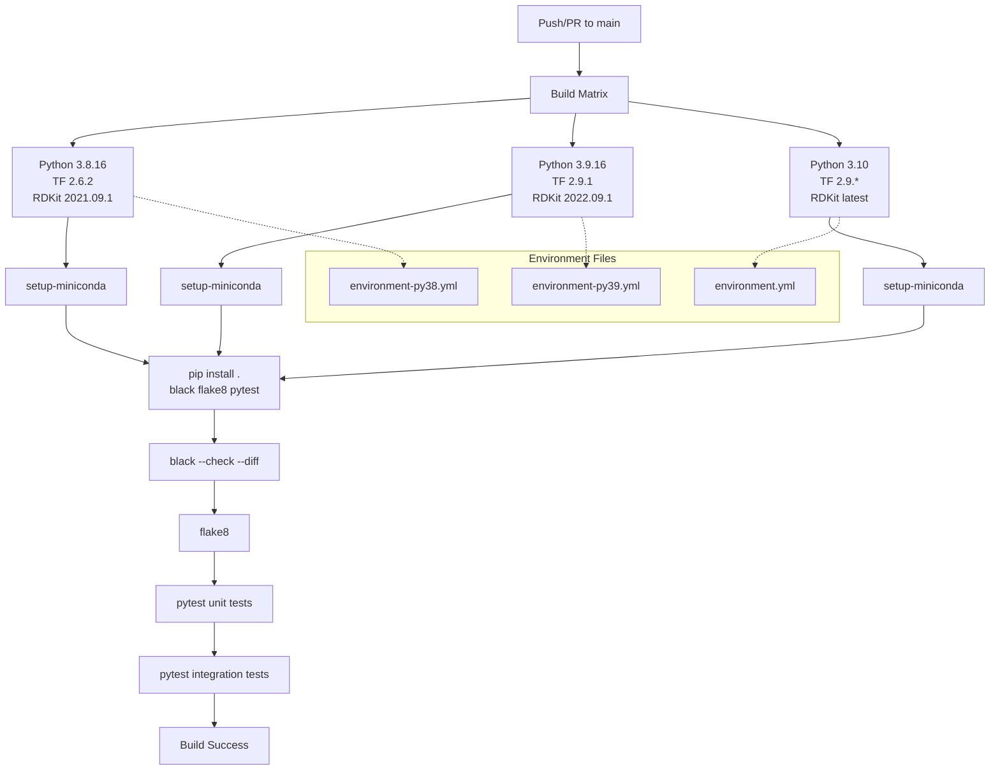
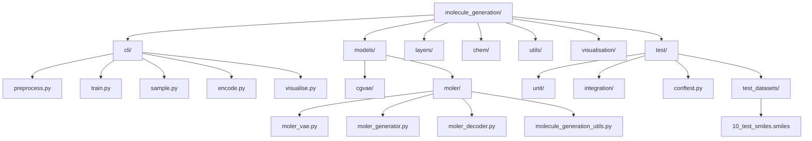
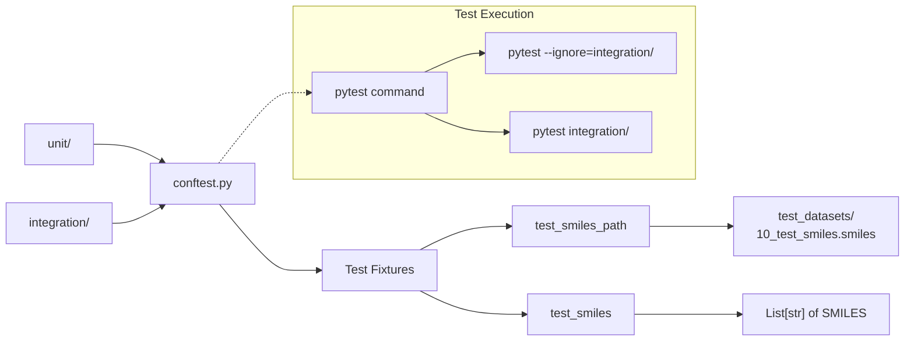

<!-- source: DeepWiki mcp.deepwiki.com · repo microsoft/molecule-generation · page 9 Development & Contributing · fetched 2026-10-26 -->

# Development & Contributing

Relevant source files

The following files were used as context for generating this wiki page:

- [.github/workflows/ci.yml](.github/workflows/ci.yml)
- [molecule_generation/test/conftest.py](molecule_generation/test/conftest.py)

This page provides guidance for developers who want to contribute to or extend the molecule-generation system. It covers the development workflow, code organization, testing framework, and contribution guidelines. For specific setup instructions for a development environment, see [Development Environment](#9.1). For detailed information about running and writing tests, see [Testing Framework](#9.2).

## Overview

The molecule-generation repository follows modern software engineering practices with comprehensive testing, continuous integration, and multi-version compatibility. The project supports Python 3.8-3.10 with multiple TensorFlow and RDKit versions to ensure broad compatibility across different computational environments.

## Development Workflow

### CI/CD Pipeline Architecture

The project uses GitHub Actions for continuous integration with a comprehensive build matrix that tests across multiple Python and dependency versions.

**CI/CD Pipeline Structure**

Sources: [.github/workflows/ci.yml:1-51]()

### Code Quality Standards

The project enforces strict code quality standards through automated tooling:

| Tool | Purpose | Configuration |
|------|---------|---------------|
| `black==23.1.0` | Code formatting | Enforces consistent Python style |
| `flake8` | Linting | Catches syntax errors and style violations |
| `pytest` | Testing | Unit and integration test execution |

The CI pipeline runs these tools in sequence, failing the build if any violations are detected.

Sources: [.github/workflows/ci.yml:38-44]()

## Project Structure and Code Organization

### Core Module Architecture

The codebase is organized into logical modules that correspond to different aspects of the molecule generation pipeline:

**Module Organization and Key Components**

Sources: Inferred from repository structure and [molecule_generation/test/conftest.py:1-17]()

### Testing Infrastructure

The testing framework uses `pytest` with a clear separation between unit and integration tests:

**Test Fixture Architecture**

The `conftest.py` file provides reusable test fixtures:
- `test_smiles_path`: Path to test SMILES dataset
- `test_smiles`: Loaded list of SMILES strings for testing

Sources: [molecule_generation/test/conftest.py:7-16]()

## Environment Management

### Multi-Version Support Matrix

The project maintains compatibility across multiple Python and dependency versions using conda environment files:

| Environment File | Python Version | TensorFlow | RDKit | Purpose |
|------------------|----------------|------------|-------|---------|
| `environment-py38.yml` | 3.8.16 | 2.6.2 | 2021.09.1 | Legacy compatibility |
| `environment-py39.yml` | 3.9.16 | 2.9.1 | 2022.09.1 | Stable production |
| `environment.yml` | 3.10 | 2.9.* | latest | Latest features |

This matrix ensures the system works across different computational environments and dependency constraints.

Sources: [.github/workflows/ci.yml:17-22]()

## Contributing Guidelines

### Development Setup

1. **Environment Setup**: Choose the appropriate conda environment file based on your Python version requirements
2. **Installation**: Install the package in development mode using `pip install .`
3. **Development Dependencies**: Install additional tools with `pip install black==23.1.0 flake8 pytest`

### Code Standards

- **Formatting**: All code must pass `black --check --diff`
- **Linting**: Code must be free of `flake8` violations
- **Testing**: New features require corresponding unit tests
- **Integration Testing**: Complex features should include integration tests

### Pull Request Process

1. **Code Quality**: Ensure all CI checks pass
2. **Test Coverage**: Include appropriate test coverage for new functionality
3. **Documentation**: Update relevant documentation for API changes
4. **Multi-Version Testing**: Changes are tested across the full build matrix

### Testing Strategy

The project uses a two-tier testing approach:

- **Unit Tests**: Fast, isolated tests for individual components
- **Integration Tests**: End-to-end tests that verify the complete pipeline

Test isolation is achieved through the fixture system in `conftest.py`, which provides consistent test data across different test modules.

Sources: [.github/workflows/ci.yml:46-50](), [molecule_generation/test/conftest.py:1-17]()

## Development Best Practices

### Code Organization Principles

- **Modular Design**: Each module has a clear, single responsibility
- **CLI Separation**: Command-line interfaces are separated from core logic
- **Model Abstraction**: Different model architectures share common interfaces
- **Test Data Management**: Test datasets are centrally managed and reusable

### Dependency Management

The project uses conda for environment management to handle complex scientific computing dependencies like RDKit and TensorFlow. The multi-environment approach ensures compatibility across different deployment scenarios while maintaining reproducible builds.

For detailed information about setting up a local development environment, see [Development Environment](#9.1). For comprehensive testing procedures and writing new tests, see [Testing Framework](#9.2).

---

