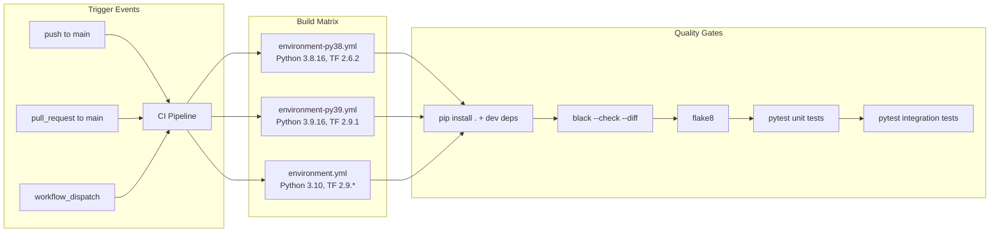
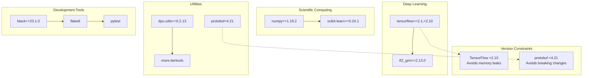

<!-- source: DeepWiki mcp.deepwiki.com · repo microsoft/molecule-generation · page 9.1 Development Environment · fetched 2026-10-26 -->

# Development Environment

Relevant source files

The following files were used as context for generating this wiki page:

- [.github/workflows/ci.yml](.github/workflows/ci.yml)
- [environment.yml](environment.yml)
- [setup.py](setup.py)

This document covers setting up a development environment for contributing to the molecule-generation codebase and understanding its internal structure. This includes development dependencies, code organization, CI/CD infrastructure, and development workflows.

For basic user installation and environment setup, see [Installation & Environment Setup](#2.1). For information about the testing infrastructure specifically, see [Testing Framework](#9.2).

## Development Environment Setup

The molecule-generation project supports multiple Python and TensorFlow versions through different conda environment configurations. The development environment includes additional tools for code quality, testing, and contribution workflows.

### Multi-Version Support Matrix

The project maintains compatibility across several Python and TensorFlow versions through dedicated environment files:

| Environment File | Python Version | TensorFlow Version | RDKit Version | Purpose |
|------------------|----------------|-------------------|---------------|---------|
| `environment-py38.yml` | 3.8.16 | 2.6.2 | 2021.09.1 | Legacy compatibility |
| `environment-py39.yml` | 3.9.16 | 2.9.1 | 2022.09.1 | Stable release |
| `environment.yml` | 3.10 | 2.9.* | latest | Current development |

### Development Dependencies

Development builds require additional packages beyond the core runtime dependencies defined in [setup.py:20-28]():

- **Code formatting**: `black==23.1.0` for consistent code style
- **Linting**: `flake8` for code quality checks  
- **Testing**: `pytest` for running unit and integration tests
- **Package installation**: Development installation via `pip install .`

Sources: [.github/workflows/ci.yml:35-38](), [setup.py:20-28]()

## Codebase Structure

### Package Organization

```mermaid
graph TB
    subgraph "molecule_generation Package"
        CLI["cli/"] --> MAIN_CLI["cli.py"]
        MODELS["models/"] --> MOLER_VAE["MoLeRVae"]
        MODELS --> MOLER_GEN["MoLeRGenerator"] 
        MODELS --> CGVAE["CGVAE"]
        LAYERS["layers/"] --> DECODER["MoLeRDecoder"]
        LAYERS --> ENCODER["MoLeREncoder"]
        CHEM["chem/"] --> MOTIF["MotifVocabulary"]
        CHEM --> FEATURES["AtomFeatureExtractors"]
        UTILS["utils/"] --> INFERENCE["MoLeRInferenceServer"]
        UTILS --> WRAPPERS["VaeWrapper, GeneratorWrapper"]
        VIS["visualisation/"] --> HTML_VIZ["HTMLMoleculeVisualiser"]
        VIS --> CLI_VIZ["CLIMoleculeVisualiser"]
        TEST["test/"] --> UNIT["unit tests"]
        TEST --> INTEGRATION["integration tests"]
    end
    
    subgraph "Entry Points"
        CONSOLE["console_scripts"] --> ENTRY_POINT["molecule_generation = molecule_generation.cli.cli:main"]
    end
    
    subgraph "Test Data"
        TEST_DATA["test_datasets/"] --> PKL_DATA["*.pkl.gz"]
        TEST_DATA --> SMILES_DATA["*.smiles"]
    end
    
    ENTRY_POINT --> MAIN_CLI
    PKL_DATA --> UNIT
    SMILES_DATA --> INTEGRATION
```

### Core Development Components

The codebase follows a modular architecture with clear separation of concerns:

- **CLI Interface**: `molecule_generation.cli.cli` provides the main entry point defined in [setup.py:32]()
- **Model Implementations**: `models/` contains `MoLeRVae`, `MoLeRGenerator`, and `CGVAE` classes
- **Neural Network Layers**: `layers/` implements `MoLeRDecoder` and `MoLeREncoder` components
- **Chemistry Logic**: `chem/` handles molecular features and motif vocabularies
- **Utilities**: `utils/` contains wrappers and the multiprocessing `MoLeRInferenceServer`
- **Visualization**: `visualisation/` provides HTML and CLI molecule generation visualizers

Sources: [setup.py:29-32]()

## CI/CD Pipeline

### Build Matrix Configuration

The CI pipeline ensures code quality and compatibility across multiple Python/TensorFlow versions using a fail-fast strategy with [.github/workflows/ci.yml:14]().

### Automated Quality Checks

The pipeline runs several automated checks in sequence:

1. **Environment Setup**: Uses `conda-incubator/setup-miniconda@v2` with mamba for fast dependency resolution
2. **Code Formatting**: `black --check --diff` ensures consistent formatting without modifying files
3. **Linting**: `flake8` checks for code quality issues and PEP8 compliance
4. **Unit Testing**: `pytest --ignore=./molecule_generation/test/integration/` runs isolated unit tests
5. **Integration Testing**: `pytest ./molecule_generation/test/integration/` validates end-to-end workflows

Sources: [.github/workflows/ci.yml:16-22](), [.github/workflows/ci.yml:39-50]()

## Development Dependencies

### Core Runtime Dependencies

The package defines strict version constraints to ensure compatibility:

### Package Installation Requirements

The project supports Python versions 3.7 through 3.10 as defined in [setup.py:19]() and enforced through CI testing. The `setuptools_scm` integration provides automatic version management from git tags.

Sources: [setup.py:18-28](), [setup.py:37-40]()

## Development Workflow

### Setting Up Development Environment

1. **Clone Repository**: Clone the molecule-generation repository
2. **Environment Creation**: Create conda environment using appropriate environment file
3. **Development Installation**: Install package in development mode with `python -m pip install .`
4. **Development Dependencies**: Install additional tools with `python -m pip install black==23.1.0 flake8 pytest`

### Code Quality Standards

The project enforces strict code quality standards through automated tooling:

- **Code Formatting**: All code must pass `black --check --diff` formatting validation
- **Linting**: Code must pass `flake8` checks for style and quality issues
- **Testing**: All unit and integration tests must pass before merging

### Contribution Guidelines

Development follows a standard GitHub workflow:
- **Branching**: Create feature branches from `main`
- **Testing**: Ensure all tests pass locally before pushing
- **Pull Requests**: Submit PR against `main` branch to trigger CI validation
- **Review Process**: Code review and CI validation required before merging

Sources: [.github/workflows/ci.yml:3-8](), [.github/workflows/ci.yml:39-50]()

---

