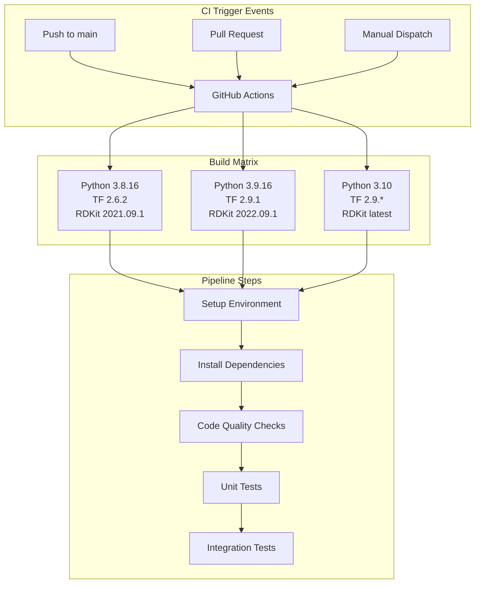
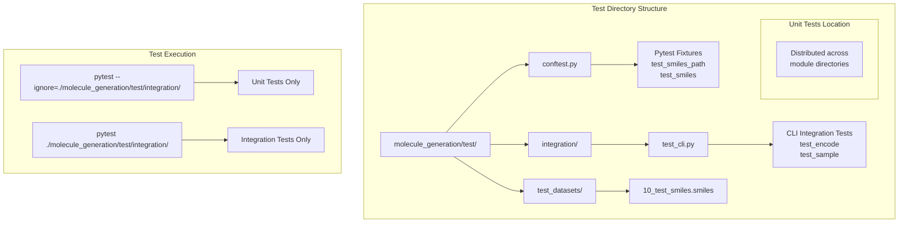
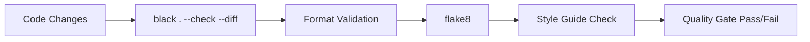
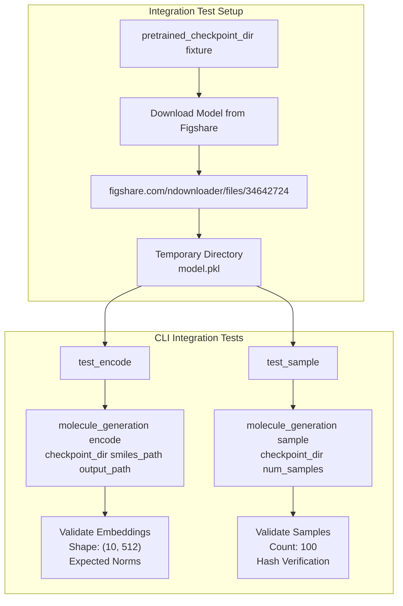

<!-- source: DeepWiki mcp.deepwiki.com · repo microsoft/molecule-generation · page 9.2 Testing Framework · fetched 2026-10-26 -->

# Testing Framework

<details>
<summary>Relevant source files</summary>

The following files were used as context for generating this wiki page:

- [.github/workflows/ci.yml](.github/workflows/ci.yml)
- [molecule_generation/test/conftest.py](molecule_generation/test/conftest.py)
- [molecule_generation/test/integration/test_cli.py](molecule_generation/test/integration/test_cli.py)

</details>


## Purpose and Scope

The molecule-generation repository implements a comprehensive testing framework that ensures code quality, functionality, and compatibility across multiple Python and dependency versions. This framework includes automated continuous integration, unit tests, integration tests, and code quality checks.

For information about setting up the development environment, see [Development Environment](#9.1). For details about the overall codebase structure, see [Overview](#1).

## CI/CD Pipeline

The testing framework is built around a GitHub Actions CI/CD pipeline that runs automatically on pushes and pull requests to the main branch.

### Build Matrix Strategy

The CI pipeline uses a matrix strategy to test compatibility across multiple environment configurations:

| Environment File | Python Version | TensorFlow Version | RDKit Version |
|-----------------|----------------|-------------------|---------------|
| `environment-py38.yml` | 3.8.16 | 2.6.2 | 2021.09.1 |
| `environment-py39.yml` | 3.9.16 | 2.9.1 | 2022.09.1 |
| `environment.yml` | 3.10 | 2.9.* | latest |



**CI Pipeline Flow Diagram**

Sources: [.github/workflows/ci.yml:1-51]()

### Pipeline Execution Steps

The CI pipeline executes the following sequence:

1. **Environment Setup**: Uses `conda-incubator/setup-miniconda` with mamba for fast dependency resolution
2. **Dependency Installation**: Installs the package and development dependencies including `black`, `flake8`, and `pytest`
3. **Code Quality Checks**: Runs linting with `black` and `flake8`
4. **Unit Tests**: Executes unit tests while excluding integration tests
5. **Integration Tests**: Runs full integration tests that may download external resources

## Test Organization Structure



**Test Organization Structure**

Sources: [molecule_generation/test/conftest.py:1-17](), [molecule_generation/test/integration/test_cli.py:1-66](), [.github/workflows/ci.yml:45-50]()

## Test Fixtures and Test Data

### Core Test Fixtures

The testing framework provides shared fixtures through `conftest.py`:

- **`test_smiles_path`**: Returns path to test SMILES file containing 10 molecular structures
- **`test_smiles`**: Loads and returns the actual SMILES strings as a list

These fixtures enable consistent test data access across all test modules.

### Test Dataset

The framework includes a curated test dataset at `molecule_generation/test/test_datasets/10_test_smiles.smiles` containing 10 SMILES strings used for integration testing.

Sources: [molecule_generation/test/conftest.py:7-16]()

## Code Quality Enforcement

### Linting Tools

The framework enforces code quality through automated linting:

- **Black**: Code formatting with version pinned to `23.1.0`
- **Flake8**: Style guide enforcement and static analysis

### Quality Check Execution



**Code Quality Pipeline**

Sources: [.github/workflows/ci.yml:39-44]()

## Integration Testing

### Test Infrastructure

Integration tests verify end-to-end functionality by testing the complete CLI interface with real model artifacts.



**Integration Test Flow**

Sources: [molecule_generation/test/integration/test_cli.py:13-22](), [molecule_generation/test/integration/test_cli.py:30-66]()

### Test Validation Methods

Integration tests employ multiple validation strategies:

1. **Shape Validation**: Ensures embeddings have expected dimensions `(10, 512)`
2. **Numerical Validation**: Compares embedding norms against precomputed values using `np.allclose`
3. **Deterministic Output**: Validates exact first three samples for debugging
4. **Hash Verification**: Uses `hashlib.shake_256` to verify complete sample output integrity

### CLI Command Testing

The `run_cli` helper function provides a standardized interface for testing CLI commands:

```python
def run_cli(args: List[str]) -> str:
    return subprocess.run(
        ["molecule_generation"] + args, stdout=subprocess.PIPE, check=True, text=True
    ).stdout
```

This enables systematic testing of all CLI endpoints including `encode` and `sample` commands.

Sources: [molecule_generation/test/integration/test_cli.py:24-27]()

## Running Tests Locally

### Prerequisites

Install development dependencies:
```bash
python -m pip install .
python -m pip install black==23.1.0 flake8 pytest
```

### Test Execution Commands

| Test Type | Command | Purpose |
|-----------|---------|---------|
| Unit Tests Only | `pytest --ignore=./molecule_generation/test/integration/` | Fast feedback during development |
| Integration Tests | `pytest ./molecule_generation/test/integration/` | Full end-to-end validation |
| All Tests | `pytest` | Complete test suite |
| Code Formatting | `black . --check --diff` | Validate formatting |
| Style Checking | `flake8` | Check style guide compliance |

### Test Performance Considerations

- Unit tests execute quickly for rapid development feedback
- Integration tests download external model files and may take longer
- The `pretrained_checkpoint_dir` fixture uses module scope to avoid repeated downloads

Sources: [.github/workflows/ci.yml:35-50]()