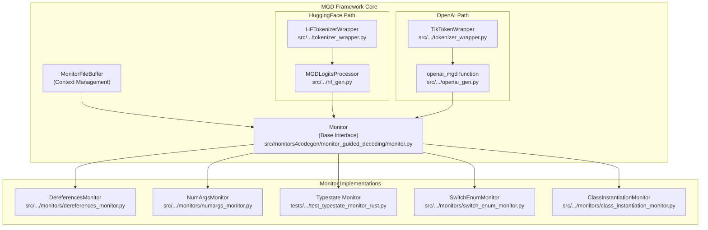
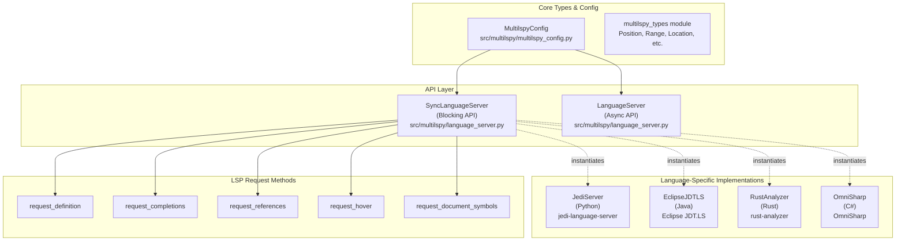
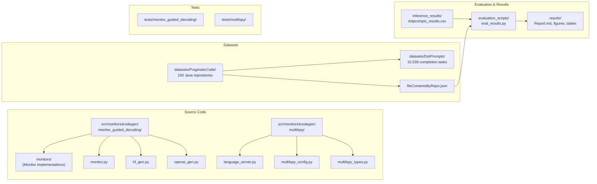
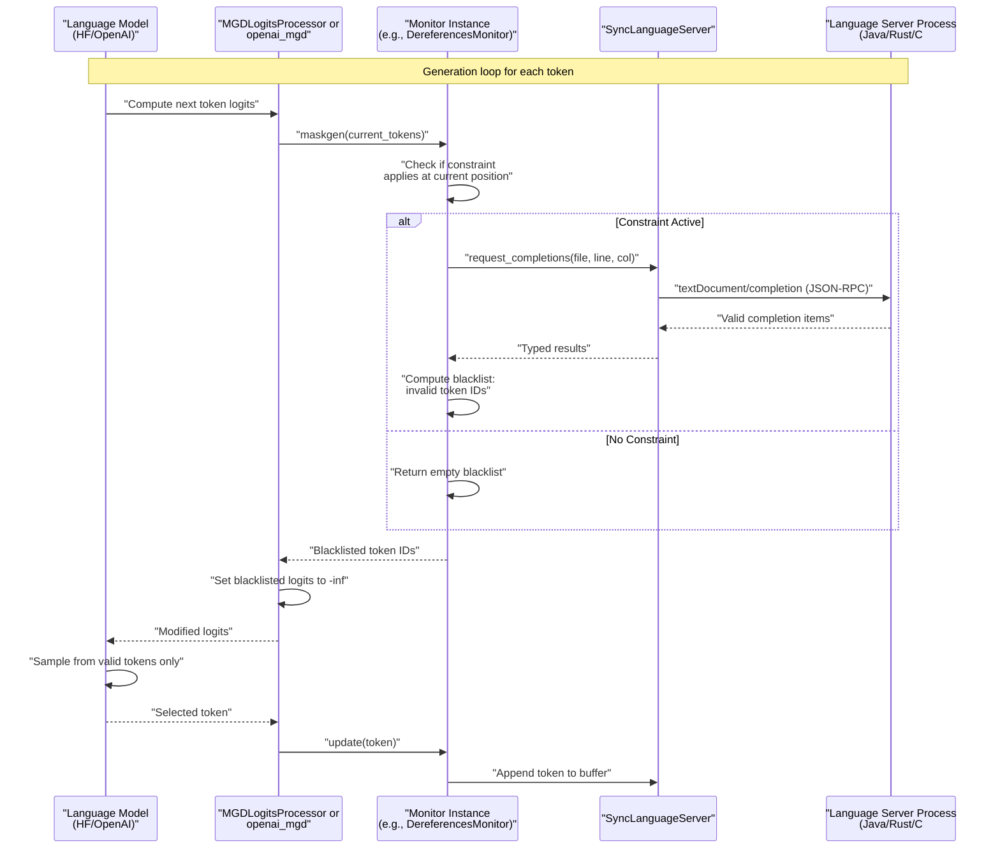
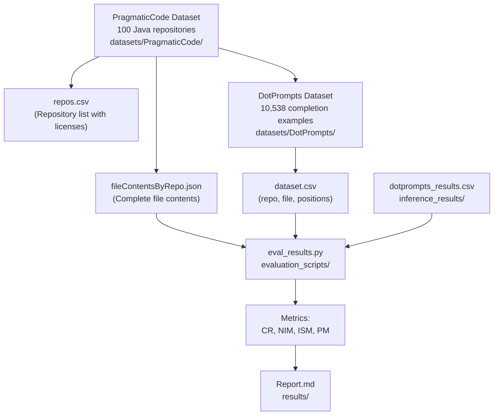

<!-- source: DeepWiki mcp.deepwiki.com · repo microsoft/monitors4codegen · page 1 Overview · fetched 2026-10-26 -->

# Overview

<details>
<summary>Relevant source files</summary>

The following files were used as context for generating this wiki page:

- [README.md](README.md)
- [pyproject.toml](pyproject.toml)
- [tests/monitor_guided_decoding/test_typestate_monitor_rust.py](tests/monitor_guided_decoding/test_typestate_monitor_rust.py)

</details>


This page introduces the monitors4codegen repository, explaining its purpose, core components, and architecture. The repository provides a framework for **Monitor-Guided Decoding (MGD)**, which uses static analysis to constrain language model code generation, and **multilspy**, a cross-platform library for interacting with Language Server Protocol (LSP) servers.

For details on installation and environment setup, see [Getting Started](#2). For in-depth explanations of MGD concepts and monitor implementations, see [Monitor-Guided Decoding](#3) and its subsections. For multilspy usage and API documentation, see [multilspy Library](#4).

## Purpose and Scope

The monitors4codegen repository serves three primary purposes:

1. **Monitor-Guided Decoding Framework**: Provides a mechanism to constrain code generation by language models using static analysis feedback from language servers
2. **multilspy Library**: Offers a unified, language-agnostic interface for querying language servers that implement the Language Server Protocol
3. **Research Artifact**: Includes datasets (PragmaticCode and DotPrompts), evaluation scripts, and experimental results demonstrating MGD's effectiveness

The repository supports code generation for Java, Rust, C#, and Python, and integrates with both HuggingFace transformer models and OpenAI API models.

**Sources**: [README.md:1-14]()

## Core Components

### Monitor-Guided Decoding (MGD)

Monitor-Guided Decoding is a framework that constrains language model token generation to ensure generated code satisfies specific semantic properties. Instead of relying solely on the language model's learned patterns, MGD queries language servers in real-time to determine what tokens are semantically valid at each generation step.



**Key Classes and Functions:**

| Component | Location | Purpose |
|-----------|----------|---------|
| `Monitor` | [src/monitors4codegen/monitor_guided_decoding/monitor.py]() | Base interface defining `maskgen`, `initialize`, and `update` methods |
| `MGDLogitsProcessor` | [src/monitors4codegen/monitor_guided_decoding/hf_gen.py]() | LogitsProcessor for HuggingFace models |
| `openai_mgd` | [src/monitors4codegen/monitor_guided_decoding/openai_gen.py]() | Generation function for OpenAI models |
| `MonitorFileBuffer` | [src/monitors4codegen/monitor_guided_decoding/monitor.py]() | Manages file buffer state during generation |

**Sources**: [README.md:4-22](), [README.md:178-187]()

### multilspy Library

multilspy is a language-agnostic client library that abstracts the complexity of setting up and communicating with language servers. It provides a unified interface for querying static analysis results across different programming languages.



**Key LSP Request Methods:**

| Method | LSP Operation | Returns |
|--------|---------------|---------|
| `request_definition` | `textDocument/definition` | Symbol definition location |
| `request_references` | `textDocument/references` | All references to a symbol |
| `request_completions` | `textDocument/completion` | Valid completion items at cursor |
| `request_hover` | `textDocument/hover` | Hover information (e.g., signatures) |
| `request_document_symbols` | `textDocument/documentSymbol` | All symbols in a document |

**Sources**: [README.md:109-177](), [pyproject.toml:12-13]()

## Repository Structure

The repository is organized into distinct functional areas:



**Directory Structure:**

| Path | Contents |
|------|----------|
| `src/monitors4codegen/monitor_guided_decoding/` | MGD framework implementation |
| `src/monitors4codegen/monitor_guided_decoding/monitors/` | Individual monitor implementations |
| `src/monitors4codegen/multilspy/` | multilspy library source |
| `datasets/PragmaticCode/` | Real-world Java repositories dataset |
| `datasets/DotPrompts/` | Code completion benchmark dataset |
| `evaluation_scripts/` | Scripts for computing metrics |
| `inference_results/` | Generated code samples and results |
| `tests/` | Unit tests and integration tests |

**Sources**: [README.md:7-13]()

## How MGD Works: Token-Level Constraint Application

Monitor-Guided Decoding operates at each token generation step, querying language servers to determine valid continuations:



**Generation Flow:**

1. **Language model** computes logits for all vocabulary tokens
2. **MGDLogitsProcessor** or **openai_mgd** calls `Monitor.maskgen()`
3. **Monitor** determines if a constraint applies (e.g., after `.` for member access)
4. If constraint applies:
   - Monitor queries **SyncLanguageServer** with `request_completions()` or similar
   - Language server returns semantically valid completions
   - Monitor converts completions to token IDs, blacklists invalid tokens
5. **Processor** sets blacklisted token logits to `-∞` (HuggingFace) or uses `logit_bias` (OpenAI)
6. **Language model** samples only from valid tokens
7. Selected token is appended to buffer via `Monitor.update()`

**Sources**: [README.md:16-22](), [tests/monitor_guided_decoding/test_typestate_monitor_rust.py:60-110]()

## Supported Languages and Models

### Programming Languages

| Language | Language Server | Monitor Support |
|----------|----------------|-----------------|
| **Java** | Eclipse JDT.LS | DereferencesMonitor, NumArgsMonitor, ClassInstantiationMonitor |
| **Rust** | rust-analyzer | DereferencesMonitor, Typestate Monitor |
| **C#** | OmniSharp | SwitchEnumMonitor, NumArgsMonitor |
| **Python** | Jedi Language Server | DereferencesMonitor (potential) |

### Language Model Backends

| Backend | Integration Class/Function | API |
|---------|---------------------------|-----|
| **HuggingFace Transformers** | `MGDLogitsProcessor` | `LogitsProcessor` interface |
| **OpenAI API** | `openai_mgd` | Custom generation loop with `logit_bias` |

**Tested Models:**
- `bigcode/santacoder` (1.1B parameters)
- `Salesforce/codegen-350M-multi`, `codegen-2B-multi`, `codegen-6B-multi`
- `text-davinci-003` (OpenAI)

**Sources**: [README.md:114-115](), [README.md:86-89](), [README.md:182-187]()

## Key Concepts

### Monitors

A **Monitor** is a stateful object that enforces a specific code property during generation. Each monitor implements three core methods:

```python
class Monitor:
    def maskgen(self, tokens: List[int]) -> List[int]:
        """Returns list of token IDs to blacklist at current position"""
        
    def initialize(self) -> None:
        """Initialize monitor state before generation"""
        
    def update(self, generated_token: int) -> None:
        """Update monitor state after token is generated"""
```

**Monitor Types:**

| Monitor | Property Enforced | Languages |
|---------|------------------|-----------|
| `DereferencesMonitor` | Type-valid member access (`obj.member`) | Java, Rust |
| `NumArgsMonitor` | Correct function argument count | Java, C# |
| `ClassInstantiationMonitor` | Valid class after `new` keyword | Java |
| `SwitchEnumMonitor` | Valid enum constants in switch cases | C# |
| Typestate Monitor | Valid API method call ordering | Rust |

**Sources**: [README.md:180](), [README.md:188-205]()

### MonitorFileBuffer

`MonitorFileBuffer` manages the state of the file being generated, tracking cursor position and coordinating updates with the language server. It provides the context monitors need to query the LSP effectively.

**Sources**: [tests/monitor_guided_decoding/test_typestate_monitor_rust.py:50-59]()

### Joint Monitoring

Multiple monitors can operate simultaneously, with their blacklists combined. This allows enforcing multiple properties at once (e.g., type-valid dereferences AND correct argument counts).

**Sources**: [README.md:204-205]()

## Evaluation and Datasets

### Datasets



**Evaluation Metrics:**

| Metric | Full Name | Measures |
|--------|-----------|----------|
| **CR** | Compilation Rate | Percentage of generated code that compiles |
| **NIM** | Next-Identifier Match | Exact match of next token with ground truth |
| **ISM** | Identifier-Sequence Match | Ordered subsequence match of identifiers |
| **PM** | Prefix Match | Longest common prefix with ground truth |

**Sources**: [README.md:25-44](), [README.md:46-107]()

## Motivating Example

The README provides a concrete example demonstrating MGD's effectiveness:

**Scenario**: Complete code after `ServerNode.Builder.newServerNode()`
- **Without MGD**: Models hallucinate non-existent methods like `.host()` and `.port()`
- **With MGD**: DereferencesMonitor queries the language server for valid methods on `ServerNode.Builder` type, constrains generation to only valid methods
- **Result**: Generated code compiles and matches ground truth

According to the paper, MGD improves compilation rates by **19-25%** across model scales from 350M to 175B parameters.

**Sources**: [README.md:16-23]()

## Installation

To use monitors4codegen, install via pip:

```bash
pip install https://github.com/microsoft/multilspy/archive/main.zip
pip install -r requirements.txt
```

For detailed setup instructions including virtual environment creation and language server configuration, see [Getting Started](#2).

**Sources**: [README.md:47-64](), [README.md:125-128]()

## Next Steps

- **For installation and setup**: See [Getting Started](#2)
- **For MGD framework details**: See [Monitor-Guided Decoding](#3)
- **For individual monitor documentation**: See [Monitor Implementations](#3.2)
- **For multilspy usage**: See [multilspy Library](#4)
- **For dataset details and evaluation**: See [Datasets and Evaluation](#5)
- **For contributing**: See [Development Guide](#6)

---

