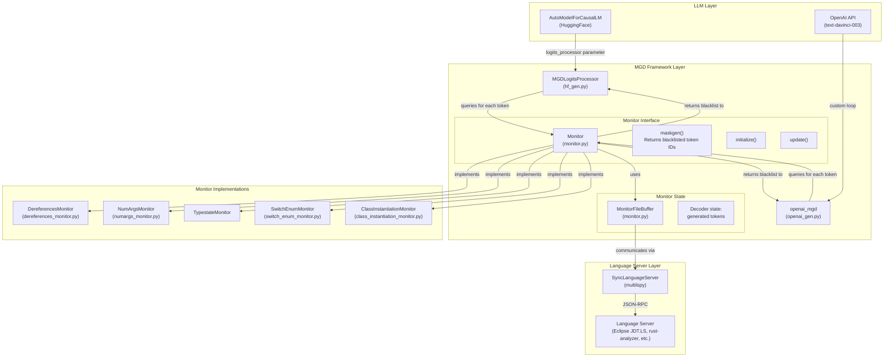
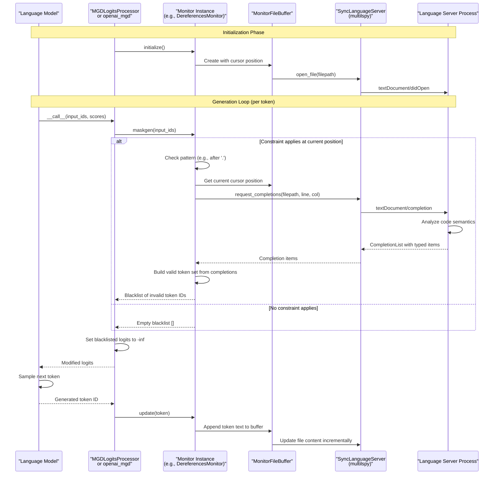
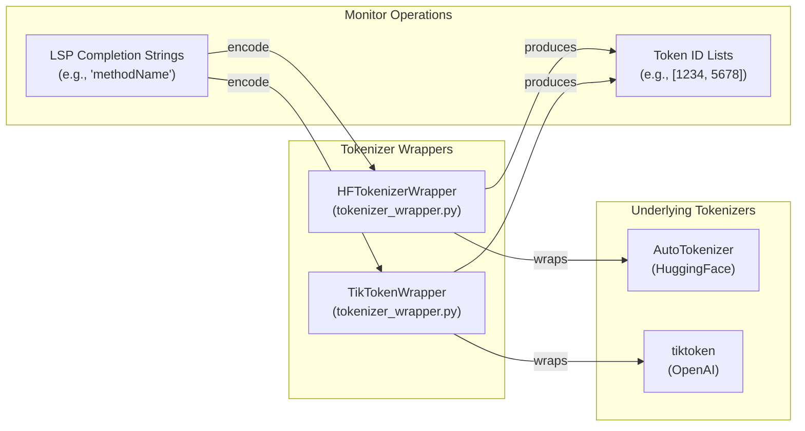

<!-- source: DeepWiki mcp.deepwiki.com · repo microsoft/monitors4codegen · page 3 Monitor-Guided Decoding · fetched 2026-10-26 -->

# Monitor-Guided Decoding

<details>
<summary>Relevant source files</summary>

The following files were used as context for generating this wiki page:

- [README.md](README.md)
- [src/monitors4codegen/monitor_guided_decoding/hf_gen.py](src/monitors4codegen/monitor_guided_decoding/hf_gen.py)
- [tests/monitor_guided_decoding/test_typestate_monitor_rust.py](tests/monitor_guided_decoding/test_typestate_monitor_rust.py)

</details>


## Purpose and Scope

This page explains the Monitor-Guided Decoding (MGD) framework, which constrains code generation from Large Language Models (LLMs) using static analysis to ensure syntactic and semantic correctness. MGD queries Language Server Protocol (LSP) servers in real-time during token generation to restrict the model's output vocabulary to only valid completions at each cursor position.

This page covers the MGD framework architecture, the monitor interface, and integration patterns with different LLM backends. For specific monitor implementations and their constraints, see [Monitor Implementations](#3.2). For the multilspy library that provides LSP client functionality, see [multilspy Library](#4). For datasets and evaluation metrics, see [Datasets and Evaluation](#5).

**Sources:** [README.md:1-23](), [README.md:178-206]()

## What is Monitor-Guided Decoding?

Monitor-Guided Decoding addresses the problem of LLMs hallucinating invalid code by constraining generation using static analysis. When an LLM lacks information about types, APIs, or repository context, it may generate syntactically incorrect code such as referencing non-existent methods or using incorrect argument counts. MGD solves this by:

1. **Real-time constraint checking**: For each token to be generated, monitors query the language server to determine what is semantically valid at the current cursor position
2. **Vocabulary restriction**: Invalid tokens are blacklisted by setting their logits to negative infinity, preventing the model from sampling them
3. **Language-agnostic approach**: By using the Language Server Protocol, MGD works across multiple programming languages (Java, Rust, C#, Python)

The paper reports that MGD improves compilation rates by 19-25% across models ranging from 350M to 175B parameters, without requiring any training or fine-tuning.

**Sources:** [README.md:16-22](), [README.md:178-187]()

## Framework Architecture

The following diagram shows the core components of the MGD framework and their relationships:

### MGD Component Architecture



**Sources:** [src/monitors4codegen/monitor_guided_decoding/hf_gen.py:1-66](), [src/monitors4codegen/monitor_guided_decoding/monitor.py](), [README.md:178-206]()

### Key Components

| Component | Location | Purpose |
|-----------|----------|---------|
| `Monitor` | [src/monitors4codegen/monitor_guided_decoding/monitor.py]() | Abstract base class defining the monitor interface with `maskgen()`, `initialize()`, and `update()` methods |
| `MGDLogitsProcessor` | [src/monitors4codegen/monitor_guided_decoding/hf_gen.py:13-66]() | HuggingFace `LogitsProcessor` implementation that modifies token logits based on monitor blacklists |
| `openai_mgd` | [src/monitors4codegen/monitor_guided_decoding/openai_gen.py]() | Custom generation loop for OpenAI API that uses `logit_bias` parameter |
| `MonitorFileBuffer` | [src/monitors4codegen/monitor_guided_decoding/monitor.py]() | Manages file state in the language server, tracking cursor position and text edits |
| Monitor Implementations | [src/monitors4codegen/monitor_guided_decoding/monitors/]() | Concrete monitor classes enforcing specific properties (dereferences, argument counts, etc.) |

**Sources:** [src/monitors4codegen/monitor_guided_decoding/hf_gen.py:1-66](), [README.md:178-206]()

## Token-by-Token Generation Flow

The following sequence diagram illustrates how MGD constrains token generation through real-time LSP queries:

### MGD Token Generation Process



**Sources:** [src/monitors4codegen/monitor_guided_decoding/hf_gen.py:30-65](), [tests/monitor_guided_decoding/test_typestate_monitor_rust.py:25-110]()

### Generation Flow Details

1. **Initialization**: The monitor is instantiated with a `MonitorFileBuffer` that opens the file in the language server and positions the cursor at the generation point [tests/monitor_guided_decoding/test_typestate_monitor_rust.py:50-61]()

2. **Token Scoring**: For each generation step, the LLM backend calls the processor with:
   - `input_ids`: All tokens generated so far (including prompt)
   - `scores`: Logits for the next token across the vocabulary
   
   [src/monitors4codegen/monitor_guided_decoding/hf_gen.py:44-49]()

3. **Constraint Checking**: The processor invokes `maskgen()` on each monitor, which:
   - Examines the current decoder state to determine if a constraint applies
   - If applicable, queries the language server for valid completions
   - Converts valid completions to token IDs using the tokenizer
   - Returns blacklisted (invalid) token IDs
   
   [src/monitors4codegen/monitor_guided_decoding/hf_gen.py:30-42]()

4. **Logit Modification**: Blacklisted token logits are set to negative infinity:
   ```python
   output_scores: torch.FloatTensor = torch.where(
       torch.tensor([True if i in blacklisted_ids else False for i in range(scores.shape[0])]),
       float("-inf") * torch.ones(scores.shape[0]),
       scores
   )
   ```
   [src/monitors4codegen/monitor_guided_decoding/hf_gen.py:37-41]()

5. **State Update**: After token selection, `update()` is called to append the token to the file buffer, keeping the language server's view synchronized [src/monitors4codegen/monitor_guided_decoding/hf_gen.py:36]()

**Sources:** [src/monitors4codegen/monitor_guided_decoding/hf_gen.py:13-66]()

## Monitor Interface and Lifecycle

### Monitor Base Class

The `Monitor` abstract class defines three key methods that all monitor implementations must provide:

```
Monitor Interface Methods:
├── initialize() → None
│   └── Called once before generation begins
│       └── Sets up initial state and LSP connections
│
├── maskgen(input_ids: List[int]) → List[int]
│   └── Called for each token generation
│       ├── Determines if constraint applies at current position
│       ├── Queries LSP if constraint is active
│       └── Returns list of blacklisted token IDs
│
└── update(input_ids: List[int]) → None
    └── Called after each token is generated
        └── Updates internal state and file buffer
```

**Sources:** [src/monitors4codegen/monitor_guided_decoding/monitor.py](), [README.md:180]()

### MonitorFileBuffer State Management

The `MonitorFileBuffer` class manages the synchronized state between the decoder and the language server:

| Property | Type | Purpose |
|----------|------|---------|
| `lsp` | `LanguageServer` | Reference to language server instance |
| `filepath` | `str` | Relative path to file being edited |
| `start_line_col` | `Tuple[int, int]` | Starting cursor position (line, column) |
| `end_line_col` | `Tuple[int, int]` | Ending cursor position for text deletion |
| `code_language` | `Language` | Programming language (Java, Rust, C#, Python) |
| `content_after` | `str` | Text after cursor (for FIM/infilling scenarios) |

The buffer tracks the current cursor position as tokens are generated, ensuring LSP queries are made at the correct location in the file.

**Sources:** [tests/monitor_guided_decoding/test_typestate_monitor_rust.py:50]()

### Tokenizer Wrapper Integration

Monitors use tokenizer wrappers to convert between string representations and token IDs:



Monitors receive completion strings from the LSP (e.g., method names, class names) and use the wrapper to encode them into token sequences. The first token ID of each valid completion is added to the allowlist, and all other token IDs are blacklisted.

**Sources:** [tests/monitor_guided_decoding/test_typestate_monitor_rust.py:60]()

## Multiple Monitor Coordination

MGD supports using multiple monitors simultaneously to enforce multiple constraints. When multiple monitors are active:

1. Each monitor independently computes its blacklist via `maskgen()`
2. Blacklists are combined using set union
3. The combined blacklist is applied to the logits

This enables joint monitoring scenarios such as:
- Simultaneously enforcing type-valid dereferences AND correct argument counts
- Combining structural constraints (syntax) with behavioral constraints (API usage patterns)

Example from tests:
```python
monitors = [
    DereferencesMonitor(tokenizer_wrapper, filebuffer1),
    NumArgsMonitor(tokenizer_wrapper, filebuffer2)
]
mgd_logits_processor = MGDLogitsProcessor(monitors, loop)
```

**Sources:** [README.md:204-206](), [tests/monitor_guided_decoding/test_joint_monitors.py]()

## Integration with LLM Backends

MGD provides two integration patterns to accommodate different LLM API designs:

### Backend Integration Comparison

| Aspect | HuggingFace Integration | OpenAI Integration |
|--------|------------------------|-------------------|
| **Implementation** | `MGDLogitsProcessor` class | `openai_mgd` function |
| **Integration Point** | `LogitsProcessor` interface | Custom generation loop |
| **API Call Pattern** | Single `generate()` call | Token-by-token API requests |
| **Logit Modification** | Direct logit tensor manipulation | `logit_bias` parameter (max 300 tokens) |
| **Batch Support** | Yes (via `input_ids.shape[0]`) | No (sequential generation) |
| **Async Handling** | Uses asyncio event loop | Synchronous API calls |

**Sources:** [src/monitors4codegen/monitor_guided_decoding/hf_gen.py:13-66](), [README.md:182-187]()

### HuggingFace Integration Architecture

```mermaid
graph TB
    subgraph "HuggingFace Generation"
        generate["model.generate()"]
        logits_param["logits_processor<br/>parameter"]
    end
    
    subgraph "MGDLogitsProcessor Implementation"
        call["__call__(input_ids, scores)"]
        process["process_scores_for_single_input_id()"]
        async_gather["asyncio.gather()"]
        set_inf["Set blacklisted scores to -inf"]
    end
    
    subgraph "Monitor Queries"
        maskgen_calls["Multiple monitor.maskgen() calls"]
        lsp_queries["LSP completion requests"]
    end
    
    generate -->|"calls for each token"| logits_param
    logits_param -->|"invokes"| call
    call -->|"creates coroutines"| process
    process -->|"awaits in parallel"| async_gather
    async_gather -->|"executes"| maskgen_calls
    maskgen_calls -->|"may trigger"| lsp_queries
    lsp_queries -.->|"returns blacklists"| async_gather
    async_gather -->|"combines results"| set_inf
    set_inf -.->|"modified scores"| generate
```

The `MGDLogitsProcessor` implements the `LogitsProcessor` interface from HuggingFace transformers. Key implementation details:

- **Batch Processing**: Handles multiple sequences in parallel via `input_ids.shape[0]` [src/monitors4codegen/monitor_guided_decoding/hf_gen.py:51]()
- **Async Execution**: Uses `asyncio.gather()` to query all monitors concurrently [src/monitors4codegen/monitor_guided_decoding/hf_gen.py:59]()
- **Thread-Safe**: Uses `asyncio.run_coroutine_threadsafe()` to bridge sync and async contexts [src/monitors4codegen/monitor_guided_decoding/hf_gen.py:62]()

**Sources:** [src/monitors4codegen/monitor_guided_decoding/hf_gen.py:13-66]()

### OpenAI Integration Architecture

The `openai_mgd` function implements a custom generation loop because the OpenAI API has constraints:

1. **300 Token Limit**: The `logit_bias` parameter accepts at most 300 tokens
2. **Blacklist Size Management**: When monitor blacklists exceed 300 tokens, the function:
   - Inverts the blacklist to an allowlist (if smaller)
   - Uses the allowlist to bias allowed tokens positively
   - Implements retry logic if generation fails

3. **Token-by-Token Generation**: Makes separate API calls for each token, updating monitor state between calls

**Sources:** [README.md:185-187]()

## Monitor Implementation Overview

MGD includes several monitor implementations targeting different code properties:

| Monitor | Target Property | Languages | LSP Queries Used |
|---------|----------------|-----------|------------------|
| `DereferencesMonitor` | Type-valid member access after `.` | Java, Rust | `textDocument/completion` |
| `NumArgsMonitor` | Correct function argument count | Java, C# | `textDocument/hover`, `textDocument/completion` |
| `SwitchEnumMonitor` | Valid enum members in switch cases | C# | `textDocument/completion` |
| `ClassInstantiationMonitor` | Valid class names after `new` | Java | `textDocument/documentSymbol` |
| Typestate Monitor | Valid method call ordering | Rust | `textDocument/completion` |

For detailed information about each monitor's implementation and usage, see [Monitor Implementations](#3.2).

**Sources:** [README.md:189-203]()

## Usage Examples

### Basic HuggingFace Example

```python
from monitors4codegen.monitor_guided_decoding.hf_gen import MGDLogitsProcessor
from monitors4codegen.monitor_guided_decoding.monitors.dereferences_monitor import DereferencesMonitor
from monitors4codegen.monitor_guided_decoding.monitor import MonitorFileBuffer
from transformers.generation.utils import LogitsProcessorList

# Initialize monitor with file buffer
filebuffer = MonitorFileBuffer(lsp, filepath, (line, col), (line, col), Language.JAVA, "")
monitor = DereferencesMonitor(tokenizer_wrapper, filebuffer)

# Create MGD logits processor
mgd_logits_processor = MGDLogitsProcessor([monitor], event_loop)
logits_processor = LogitsProcessorList([mgd_logits_processor])

# Generate with constraints
generated_code = model.generate(
    prompt_tokenized,
    do_sample=False,
    max_new_tokens=30,
    logits_processor=logits_processor
)
```

**Sources:** [tests/monitor_guided_decoding/test_typestate_monitor_rust.py:60-100]()

### Multi-Monitor Example

```python
# Create multiple monitors
monitor1 = DereferencesMonitor(tokenizer_wrapper, filebuffer1)
monitor2 = NumArgsMonitor(tokenizer_wrapper, filebuffer2)

# Combine monitors in processor
mgd_logits_processor = MGDLogitsProcessor([monitor1, monitor2], event_loop)

# All constraints enforced simultaneously
generated_code = model.generate(
    prompt_tokenized,
    logits_processor=LogitsProcessorList([mgd_logits_processor])
)
```

**Sources:** [README.md:204-206]()

## Performance and Effectiveness

According to the paper's evaluation on the DotPrompts dataset:

- **Compilation Rate Improvement**: 19-25% across model scales (350M-175B parameters)
- **No Training Required**: MGD is applied at inference time only
- **Model Agnostic**: Works with any autoregressive language model
- **Language Agnostic**: Supports any language with an LSP implementation

The improvement comes from preventing the model from generating tokens that would lead to compilation errors, steering generation toward semantically valid code paths.

**Sources:** [README.md:21-22]()

---

For detailed information about specific monitors and the constraints they enforce, continue to [Monitor Implementations](#3.2). For information about integrating MGD with HuggingFace models, see [HuggingFace Integration](#3.3.1). For OpenAI model integration, see [OpenAI Integration](#3.3.2).

---

