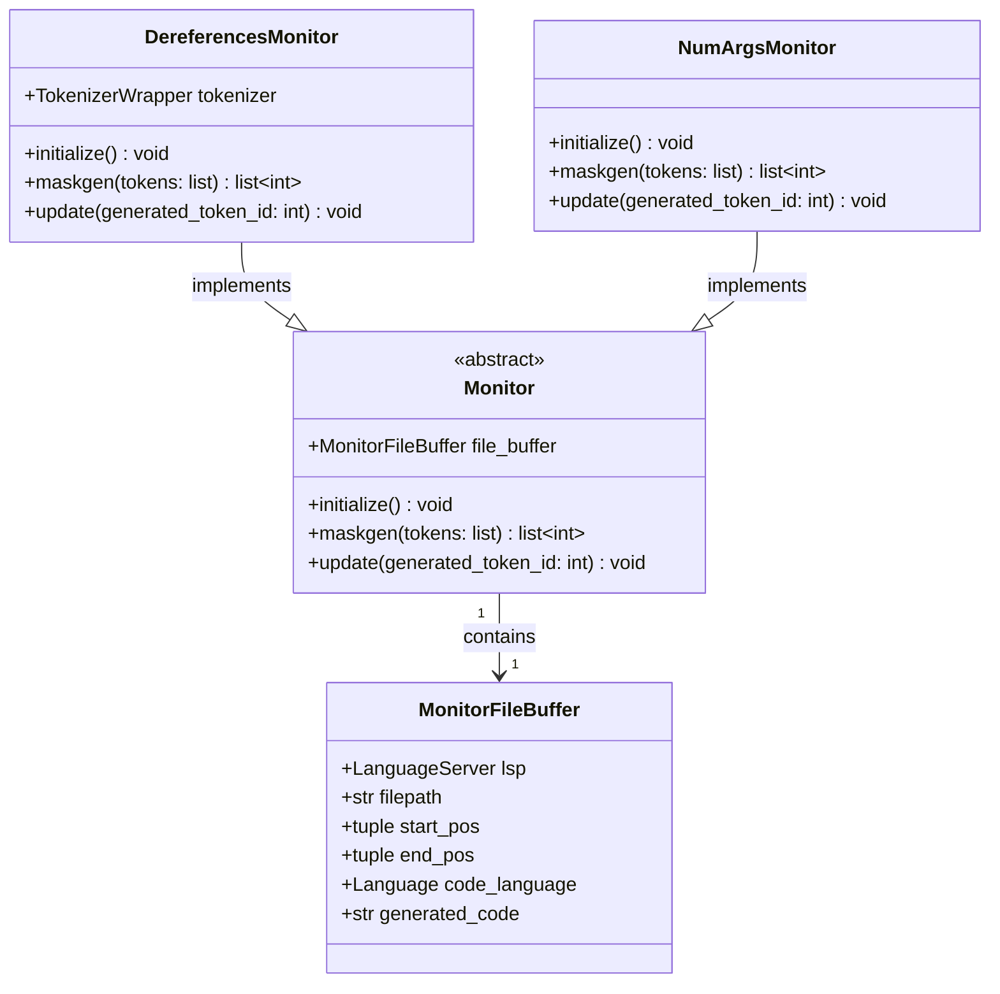
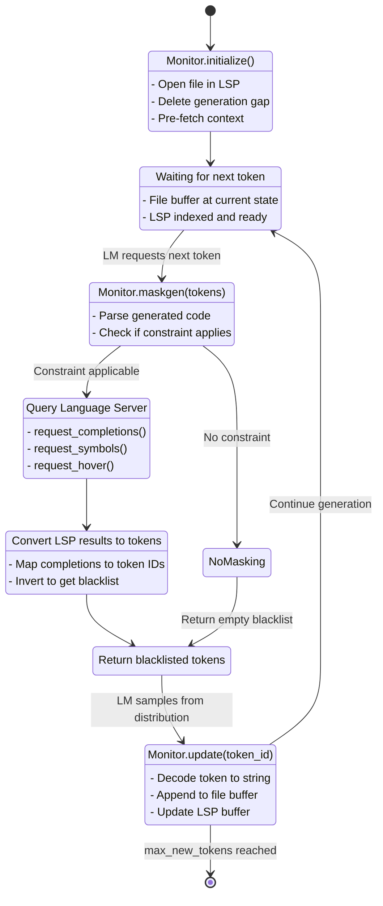
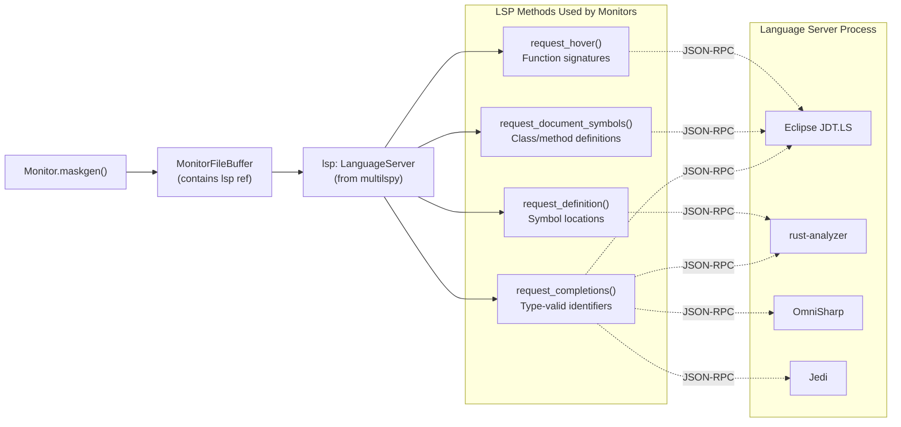

<!-- source: DeepWiki mcp.deepwiki.com · repo microsoft/monitors4codegen · page 3.1 Core Concepts · fetched 2026-10-26 -->

# Core Concepts

<details>
<summary>Relevant source files</summary>

The following files were used as context for generating this wiki page:

- [README.md](README.md)
- [tests/monitor_guided_decoding/test_dereferences_monitor_java.py](tests/monitor_guided_decoding/test_dereferences_monitor_java.py)
- [tests/monitor_guided_decoding/test_typestate_monitor_rust.py](tests/monitor_guided_decoding/test_typestate_monitor_rust.py)

</details>


This page explains the fundamental concepts underlying Monitor-Guided Decoding (MGD), including the monitor abstraction, decoder state management, token masking mechanisms, and the monitoring lifecycle. These concepts form the foundation for understanding how monitors constrain language model generation to ensure code correctness.

For specific monitor implementations and their usage, see [Monitor Implementations](#3.2). For integration details with HuggingFace or OpenAI models, see [LLM Backend Integrations](#3.3).

---

## Overview of Monitor-Guided Decoding

Monitor-Guided Decoding (MGD) is a framework that constrains language model token generation by applying semantic analysis at each decoding step. The core principle is **logit modification**: monitors query a language server to determine valid tokens at the current cursor position, then modify the model's output distribution to blacklist invalid tokens by setting their logits to negative infinity.

The framework operates in three layers:

| Layer | Components | Responsibility |
|-------|-----------|----------------|
| **Monitor Layer** | `Monitor` subclasses (e.g., `DereferencesMonitor`) | Define what properties to enforce and when |
| **Processor Layer** | `MGDLogitsProcessor` (HF) or `openai_mgd` function | Orchestrate monitors and modify logits |
| **Analysis Layer** | `SyncLanguageServer` via `multilspy` | Provide semantic information from LSP |

The key insight is that monitors operate **statefully**: they maintain a representation of the partially generated code and update it with each new token, enabling context-aware constraint enforcement.

**Sources:** [README.md:4-21](), Diagram 2 from high-level architecture

---

## The Monitor Interface

All monitors implement the `Monitor` interface, which defines three core methods that manage the monitoring lifecycle:



### Key Methods

#### `initialize()`
Called once when the monitor is created. Performs any initial LSP queries needed to set up monitoring. For example, `DereferencesMonitor` may pre-fetch type information for variables in scope.

#### `maskgen(tokens: list[int]) -> list[int]`
The core constraint method. Called for each token position during generation. Receives the list of tokens generated so far and returns a list of token IDs that should be blacklisted (masked out) at this position. This is where monitors query the language server to determine validity.

The method logic typically follows this pattern:
1. Check if a constraint applies at the current position (e.g., after a `.` for member access)
2. If applicable, query the language server for valid completions
3. Convert valid completions to valid token IDs
4. Return token IDs that are **not** in the valid set (the blacklist)

#### `update(generated_token_id: int)`
Called after each token is generated. Updates the monitor's internal state and the file buffer with the newly generated token. This ensures the language server's view of the code remains synchronized with generation progress.

**Sources:** [src/monitors4codegen/monitor_guided_decoding/monitor.py](), [README.md:180-181]()

---

## Decoder State and File Buffers

The `MonitorFileBuffer` class maintains the decoder state—the current partially generated code and its position within the file context. This is crucial because language servers require complete file context to provide accurate semantic analysis.

### MonitorFileBuffer Structure

```mermaid
graph TB
    subgraph "MonitorFileBuffer State"
        LSP["lsp: LanguageServer<br/>(from multilspy)"]
        FilePath["filepath: str<br/>(relative path in repo)"]
        StartPos["start_pos: tuple[int, int]<br/>(line, column where generation starts)"]
        EndPos["end_pos: tuple[int, int]<br/>(line, column - tracks current position)"]
        GenCode["generated_code: str<br/>(accumulates generated tokens)"]
        CodeLang["code_language: Language<br/>(Java, Rust, C#, Python)"]
    end
    
    subgraph "File View in Language Server"
        OriginalContent["Original file content<br/>up to start_pos"]
        GeneratedContent["Generated code<br/>(updated via update())"]
        Suffix["Optional suffix context<br/>(for FIM scenarios)"]
    end
    
    MonitorFileBuffer --> LSP
    MonitorFileBuffer --> FilePath
    MonitorFileBuffer --> StartPos
    MonitorFileBuffer --> EndPos
    MonitorFileBuffer --> GenCode
    MonitorFileBuffer --> CodeLang
    
    GenCode -.synced via LSP.-.> GeneratedContent
```

### State Management Flow

When a monitor is initialized:

1. **Context Setup**: The file buffer is created with the starting position (where generation begins) and ending position (initially the same as start)
2. **File Opening**: The language server opens the file and indexes the repository
3. **Text Deletion**: Any text between `start_pos` and original `end_pos` is deleted from the LSP's view to create the generation gap
4. **Incremental Update**: As tokens are generated, `update()` appends them to `generated_code` and updates the LSP buffer

Example instantiation from tests:
```python
filebuffer = MonitorFileBuffer(
    lsp.language_server,
    "src/main/java/com/example/File.java",
    (74, 17),  # start position: line 74, column 17
    (74, 17),  # end position: same initially
    Language.JAVA,
    ""         # generated_code: empty initially
)
```

The file buffer ensures that when monitors query the language server (e.g., via `request_completions`), the LSP sees the file with the current partial generation, enabling it to provide contextually accurate analysis.

**Sources:** [tests/monitor_guided_decoding/test_dereferences_monitor_java.py:50-53](), [tests/monitor_guided_decoding/test_dereferences_monitor_java.py:156-162]()

---

## Token Masking and Logits Modification

Token masking is the mechanism by which monitors constrain the language model's output. The process differs slightly between HuggingFace and OpenAI backends, but the concept is the same: invalid tokens are prevented from being selected.

### HuggingFace: MGDLogitsProcessor

The `MGDLogitsProcessor` class implements the `LogitsProcessor` interface, allowing it to be passed to the `model.generate()` method:

```mermaid
sequenceDiagram
    participant Gen as "model.generate()"
    participant Proc as "MGDLogitsProcessor"
    participant Monitors as "List[Monitor]"
    participant Loop as "asyncio event loop"
    
    Note over Gen,Loop: For each token position
    Gen->>Proc: __call__(input_ids, scores)
    Proc->>Proc: Extract current tokens
    
    loop For each monitor
        Proc->>Loop: run_coroutine_threadsafe
        Loop->>Monitors: await monitor.maskgen(tokens)
        Monitors->>Monitors: Query LSP if constraint applies
        Monitors-->>Loop: Return blacklist
        Loop-->>Proc: Blacklisted token IDs
    end
    
    Proc->>Proc: Combine all blacklists
    Proc->>Proc: Set scores[blacklisted] = -inf
    Proc-->>Gen: Modified scores tensor
    Gen->>Gen: Sample from distribution
    Gen->>Proc: update_monitors(new_token)
    
    loop For each monitor
        Proc->>Loop: run_coroutine_threadsafe
        Loop->>Monitors: await monitor.update(token)
        Monitors->>Monitors: Append to file buffer
        Monitors-->>Loop: Complete
        Loop-->>Proc: Complete
    end
```

#### Key Implementation Details

- **Asynchronous Execution**: Monitors query language servers asynchronously. `MGDLogitsProcessor` uses `run_coroutine_threadsafe` to execute async LSP calls from the synchronous `generate()` context
- **Blacklist Combination**: When multiple monitors are active, their blacklists are unioned—a token is masked if **any** monitor blacklists it
- **Infinity Masking**: Blacklisted tokens have their logits set to `-float('inf')`, ensuring they receive zero probability after softmax

Example usage:
```python
monitors = [DereferencesMonitor(tokenizer_wrapper, filebuffer)]
mgd_processor = MGDLogitsProcessor(monitors, lsp.language_server.server.loop)
logits_processor = LogitsProcessorList([mgd_processor])

generated = model.generate(
    input_ids,
    logits_processor=logits_processor,
    max_new_tokens=30
)
```

**Sources:** [src/monitors4codegen/monitor_guided_decoding/hf_gen.py](), [tests/monitor_guided_decoding/test_dereferences_monitor_java.py:63-91]()

### OpenAI: Logit Bias Approach

For OpenAI models, token masking uses the `logit_bias` parameter (limited to 300 tokens per API call):

| Aspect | HuggingFace | OpenAI |
|--------|-------------|--------|
| **Mechanism** | Direct logit modification (`-inf`) | `logit_bias` dictionary with bias `-100` |
| **Scope** | Can blacklist entire vocabulary | Limited to 300 tokens per request |
| **Implementation** | `MGDLogitsProcessor` class | `openai_mgd` function |
| **Token Loop** | Handled by `model.generate()` | Manual token-by-token loop |
| **Constraint** | No limit on blacklist size | Priority selection when >300 tokens |

**Sources:** [src/monitors4codegen/monitor_guided_decoding/openai_gen.py](), Diagram 6 from high-level architecture

---

## The Monitoring Lifecycle

The complete monitoring lifecycle spans initialization, token-by-token generation, and state updates. Here's how monitors operate during code generation:



### Lifecycle Phases

#### 1. Initialization Phase
- Monitor instance created with `MonitorFileBuffer`
- `initialize()` called once
- Language server opens file and indexes repository
- Generation gap created by deleting text between start and end positions

#### 2. Generation Loop (per token)
Each token generation involves:

**Step A: Constraint Check**
- `maskgen(tokens)` receives all tokens generated so far
- Monitor parses the current code state to determine if constraint applies
- Example: `DereferencesMonitor` checks if the last non-whitespace character is `.`

**Step B: LSP Query (if applicable)**
- Monitor queries language server for valid options at cursor position
- Query type depends on constraint (completions, symbols, hover, etc.)
- LSP analyzes code semantically using type information and repository context

**Step C: Blacklist Computation**
- Convert LSP results (valid identifiers/symbols) to valid token IDs
- Compute blacklist as the complement: all tokens **not** in valid set
- Return blacklist to processor

**Step D: Logit Modification**
- Processor sets logits for blacklisted tokens to `-inf`
- Language model samples from modified distribution
- Only valid tokens can be selected

**Step E: State Update**
- `update(token_id)` called with generated token
- Token decoded to string and appended to `file_buffer.generated_code`
- LSP buffer updated to reflect new code state

#### 3. Termination
- Generation continues until `max_new_tokens` reached or `early_stopping` condition met
- Monitor state reflects final generated code
- Language server context can be used for validation or further analysis

**Sources:** [tests/monitor_guided_decoding/test_dereferences_monitor_java.py:25-98](), Diagram 2 from high-level architecture

---

## Integration with Language Servers

Monitors rely on `multilspy` to query language servers. The integration enables semantic analysis without language-specific code in monitors:



### Common Query Patterns

Different monitors use different LSP capabilities based on the property they enforce:

| Monitor Type | Primary LSP Method | Purpose |
|-------------|-------------------|---------|
| `DereferencesMonitor` | `request_completions()` | Get type-valid member names for `object.` |
| `NumArgsMonitor` | `request_hover()`, `request_completions()` | Get function signature for arity checking |
| `ClassInstantiationMonitor` | `request_document_symbols()` | Get list of classes for `new ClassName()` |
| `SwitchEnumMonitor` | `request_completions()` | Get enum members for switch cases |
| `TypestateMonitor` | `request_completions()` | Get valid methods in current typestate |

### Query Timing

Monitors query the language server **only when constraints apply**. For example:
- `DereferencesMonitor` queries only after detecting `.` in generated code
- `NumArgsMonitor` queries only when closing `)` is about to be generated
- Between constraint points, `maskgen()` returns empty blacklists (no masking)

This selective querying minimizes LSP overhead and generation latency.

**Sources:** [README.md:109-123](), [src/monitors4codegen/monitor_guided_decoding/monitors/dereferences_monitor.py](), Diagram 3 from high-level architecture

---

## Example: End-to-End Flow

To illustrate how these concepts work together, consider generating code to complete `ServerNode.Builder.`:

1. **Initialization**: `DereferencesMonitor` created with file buffer at position after `.`
2. **First Token**:
   - `maskgen([])` called (no tokens yet)
   - Detects `.` at cursor position
   - Queries `request_completions()` at that position
   - LSP returns valid methods: `newServerNode()`, `build()`, etc.
   - Converts to token IDs, returns blacklist of all other tokens
   - LM generates `new` (first token of `newServerNode`)
   - `update(token_id)` appends `new` to buffer
3. **Second Token**:
   - `maskgen(['new'])` called
   - Still after `.`, constraint applies
   - LSP completions filtered to those starting with `new`
   - LM generates `Server`
   - Buffer updated
4. **Subsequent Tokens**: Continue until method name complete
5. **After `()`**: Constraint no longer applies (not after `.`), normal LM sampling resumes

**Sources:** [README.md:16-23](), [tests/monitor_guided_decoding/test_dereferences_monitor_java.py:50-97]()

---

