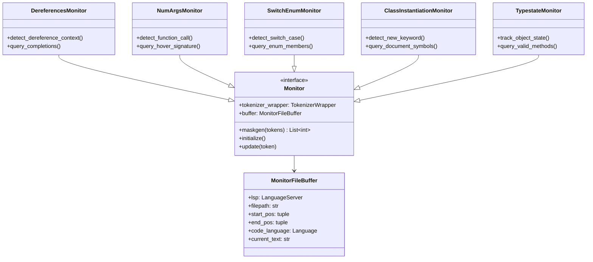
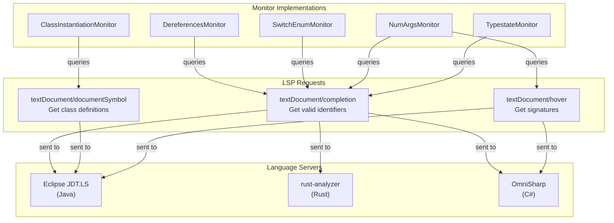
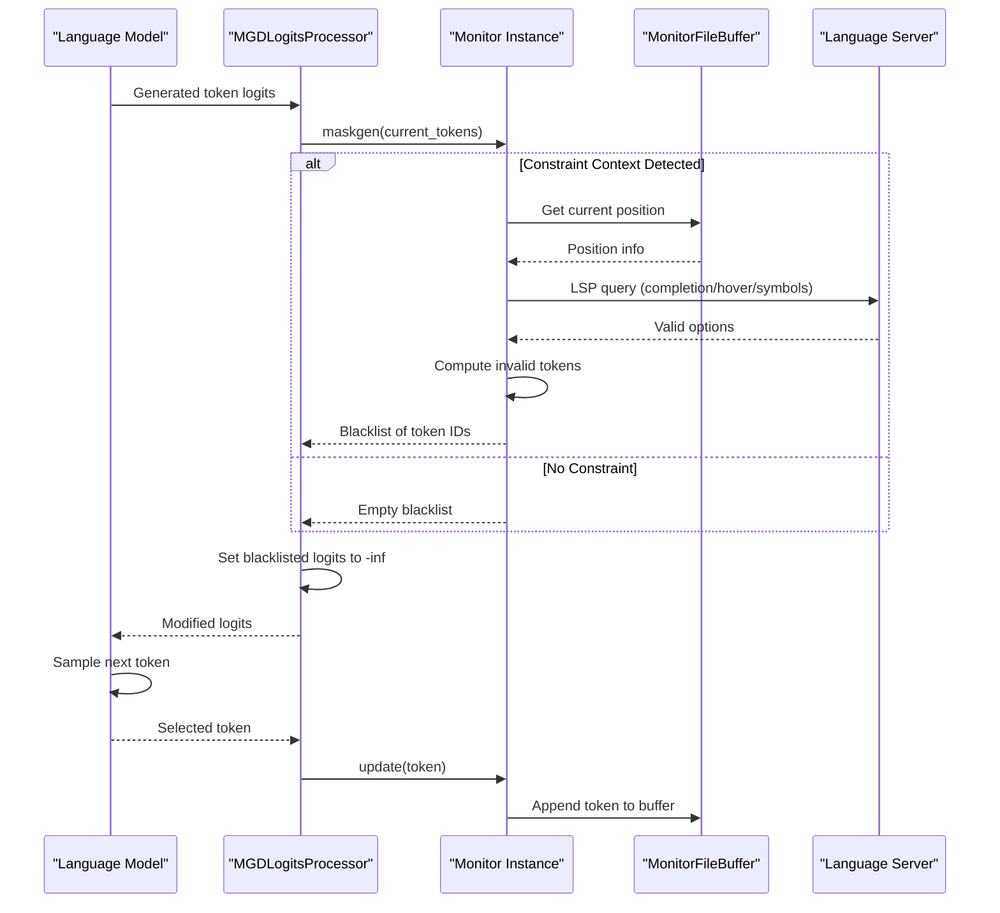

<!-- source: DeepWiki mcp.deepwiki.com · repo microsoft/monitors4codegen · page 3.2 Monitor Implementations · fetched 2026-10-26 -->

# Monitor Implementations

<details>
<summary>Relevant source files</summary>

The following files were used as context for generating this wiki page:

- [README.md](README.md)
- [tests/monitor_guided_decoding/test_dereferences_monitor_java.py](tests/monitor_guided_decoding/test_dereferences_monitor_java.py)
- [tests/monitor_guided_decoding/test_typestate_monitor_rust.py](tests/monitor_guided_decoding/test_typestate_monitor_rust.py)

</details>


This page provides an overview of the monitor implementations available in the Monitor-Guided Decoding framework and the code properties they enforce. Each monitor constrains code generation to ensure specific correctness properties by querying language servers during the generation process.

For detailed information about individual monitors, see their dedicated pages: [DereferencesMonitor](#3.2.1), [NumArgsMonitor](#3.2.2), [SwitchEnumMonitor](#3.2.3), [ClassInstantiationMonitor](#3.2.4), and [Typestate Monitor](#3.2.5). For information about using multiple monitors simultaneously, see [Joint Monitoring](#3.2.6).

## Overview

A monitor in the MGD framework is a component that observes the code generation process token-by-token and constrains the language model's output to ensure specific correctness properties. Each monitor implements a common interface and uses Language Server Protocol queries to determine valid continuations at each generation step.

Monitors operate by:
1. Detecting when their constraint applies (e.g., after a `.` operator)
2. Querying the language server for valid options at the current position
3. Computing a blacklist of invalid tokens
4. Returning this blacklist to the MGD framework, which masks out invalid tokens by setting their logits to negative infinity

**Monitor Interface Architecture**



**Sources:** [src/monitors4codegen/monitor_guided_decoding/monitor.py](), [tests/monitor_guided_decoding/test_dereferences_monitor_java.py:1-20]()

## Monitor Interface

The base `Monitor` class defines the interface that all monitor implementations must follow. Located in [src/monitors4codegen/monitor_guided_decoding/monitor.py](), it provides three key methods:

| Method | Purpose |
|--------|---------|
| `maskgen(tokens: List[int])` | Returns a list of token IDs that should be blacklisted at the current generation step |
| `initialize()` | Performs any setup needed before generation begins |
| `update(token: int)` | Updates monitor state after a token has been generated |

The `MonitorFileBuffer` class maintains the current state of code generation, including the file path, position in the file, and accumulated generated text. It provides the context monitors need to query the language server.

**Sources:** [src/monitors4codegen/monitor_guided_decoding/monitor.py](), [tests/monitor_guided_decoding/test_dereferences_monitor_java.py:50-62]()

## Available Monitor Implementations

The framework provides five distinct monitor implementations, each enforcing different code properties:

### Monitor Categories

Monitors can be categorized into two types based on the properties they enforce:

**Structural Monitors** ensure syntactic correctness of specific code patterns:
- **DereferencesMonitor**: Ensures type-valid member access (e.g., `object.member`)
- **ClassInstantiationMonitor**: Ensures valid class names follow `new` keywords
- **SwitchEnumMonitor**: Ensures valid enum members in switch case statements

**Behavioral Monitors** enforce semantic properties related to API usage:
- **NumArgsMonitor**: Ensures correct number of arguments in function/method calls
- **Typestate Monitor**: Enforces valid method call ordering according to API contracts

### Monitor-LSP Query Mapping



**Sources:** [README.md:188-202](), Diagram 4 from context

## Monitor Implementations Summary

| Monitor | File Location | Property Enforced | Primary LSP Query | Supported Languages |
|---------|--------------|-------------------|-------------------|---------------------|
| **DereferencesMonitor** | [monitors/dereferences_monitor.py]() | Type-valid identifier dereferencing | `textDocument/completion` | Java, Rust, Python (potential) |
| **NumArgsMonitor** | [monitors/numargs_monitor.py]() | Correct number of function arguments | `textDocument/hover`, `textDocument/completion` | Java, C# |
| **SwitchEnumMonitor** | [monitors/switch_enum_monitor.py]() | Valid enum members in switch cases | `textDocument/completion` | C# |
| **ClassInstantiationMonitor** | [monitors/class_instantiation_monitor.py]() | Valid class names after `new` | `textDocument/documentSymbol` | Java |
| **Typestate Monitor** | Tested in [test_typestate_monitor_rust.py]() | Valid method call ordering | `textDocument/completion` | Rust |

All monitor files are located under `src/monitors4codegen/monitor_guided_decoding/monitors/` unless otherwise specified.

**Sources:** [README.md:188-206](), [src/monitors4codegen/monitor_guided_decoding/monitors/dereferences_monitor.py](), [src/monitors4codegen/monitor_guided_decoding/monitors/numargs_monitor.py](), [src/monitors4codegen/monitor_guided_decoding/monitors/switch_enum_monitor.py](), [src/monitors4codegen/monitor_guided_decoding/monitors/class_instantiation_monitor.py]()

## Monitor Integration with MGD Pipeline

Monitors integrate into the MGD pipeline through either `MGDLogitsProcessor` (for HuggingFace models) or `openai_mgd` (for OpenAI models). The following diagram shows how monitors interact with the generation process:

**Token Generation Flow with Monitors**



**Example Initialization and Usage**

The following pattern demonstrates how monitors are instantiated and used (from test examples):

```python
# Initialize file buffer with current position
filebuffer = MonitorFileBuffer(
    lsp.language_server,
    filepath,
    (74, 17),  # start position (line, column)
    (74, 17),  # end position
    code_language,
    ""
)

# Create monitor with tokenizer wrapper and buffer
monitor = DereferencesMonitor(
    HFTokenizerWrapper(tokenizer),
    filebuffer
)

# Create MGD logits processor with monitor list
mgd_logits_processor = MGDLogitsProcessor(
    [monitor],
    lsp.language_server.server.loop
)

# Use in generation
logits_processor = LogitsProcessorList([mgd_logits_processor])
generated_code = model.generate(
    prompt_tokenized,
    do_sample=False,
    max_new_tokens=30,
    logits_processor=logits_processor
)
```

**Sources:** [tests/monitor_guided_decoding/test_dereferences_monitor_java.py:50-97](), [src/monitors4codegen/monitor_guided_decoding/hf_gen.py]()

## Language Support Matrix

Different monitors have varying levels of support across programming languages:

| Language | DereferencesMonitor | NumArgsMonitor | SwitchEnumMonitor | ClassInstantiationMonitor | Typestate Monitor |
|----------|---------------------|----------------|-------------------|---------------------------|-------------------|
| **Java** | ✓ | ✓ | - | ✓ | - |
| **Rust** | ✓ | - | - | - | ✓ |
| **C#** | - | ✓ | ✓ | - | - |
| **Python** | Potential | - | - | - | - |

The language support is determined by:
1. Language-specific syntax patterns the monitor detects
2. Availability of required LSP capabilities in the language server
3. Implementation and testing status

**Test Coverage:**
- Java: [tests/monitor_guided_decoding/test_dereferences_monitor_java.py](), [tests/monitor_guided_decoding/test_numargs_monitor_java.py](), [tests/monitor_guided_decoding/test_classinstantiation_monitor_java.py]()
- Rust: [tests/monitor_guided_decoding/test_typestate_monitor_rust.py]()
- C#: [tests/monitor_guided_decoding/test_switchenum_monitor_csharp.py]()

**Sources:** [README.md:188-202](), Diagram 4 from context

## Monitor File Organization

All monitor implementations are organized in a consistent directory structure:

```
src/monitors4codegen/monitor_guided_decoding/
├── monitor.py                          # Base Monitor interface and MonitorFileBuffer
├── hf_gen.py                           # MGDLogitsProcessor for HuggingFace models
├── openai_gen.py                       # openai_mgd for OpenAI models
└── monitors/
    ├── dereferences_monitor.py         # Type-valid member access
    ├── numargs_monitor.py              # Correct argument count
    ├── switch_enum_monitor.py          # Valid enum in switch cases
    └── class_instantiation_monitor.py  # Valid class after 'new'
```

The typestate monitor implementation details are primarily documented through test examples rather than a standalone module file.

**Sources:** [README.md:178-206]()

## Multiple Monitors

Multiple monitors can be used simultaneously to enforce multiple constraints on the same generation task. When multiple monitors are active, their blacklists are combined (unioned) before being applied to the logits. This allows for joint enforcement of multiple properties.

For detailed information about using monitors together, see [Joint Monitoring](#3.2.6).

**Sources:** [README.md:204-205](), [tests/monitor_guided_decoding/test_joint_monitors.py]()

---

