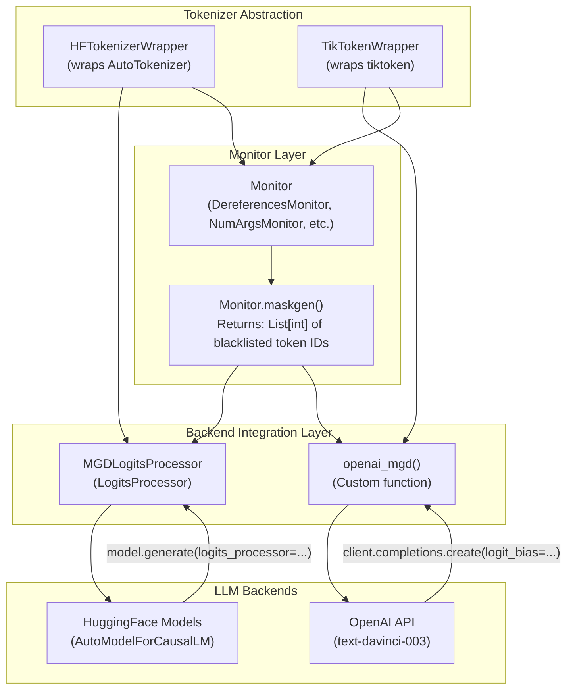
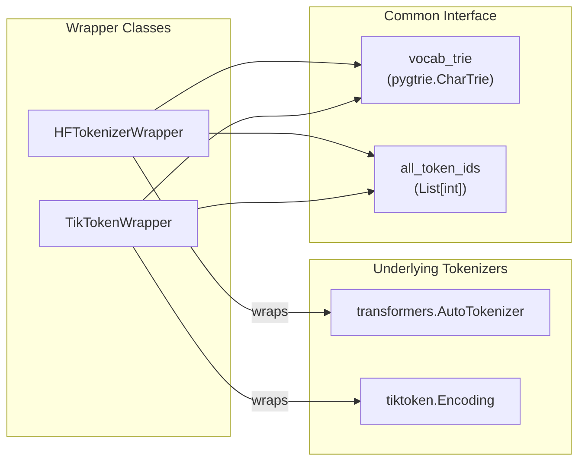
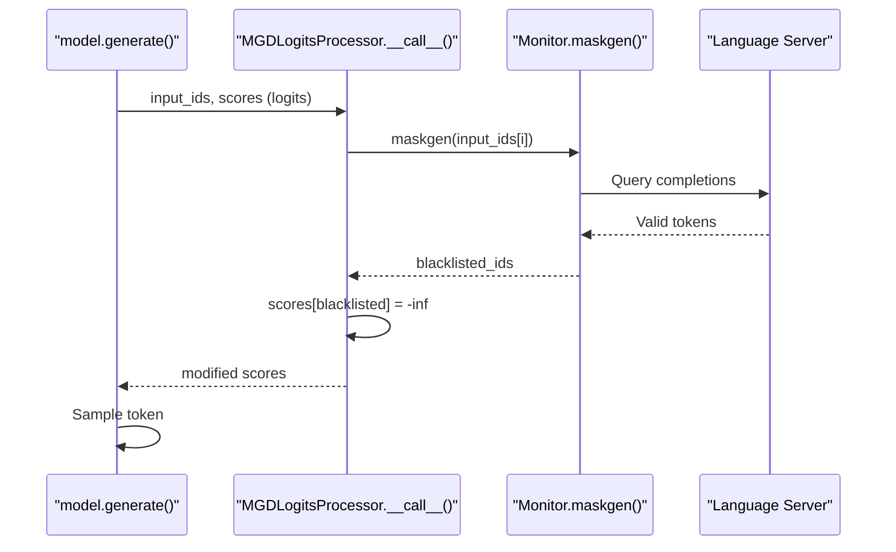
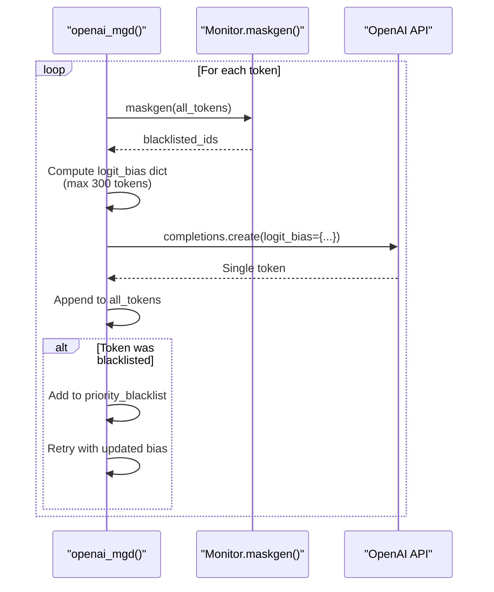

<!-- source: DeepWiki mcp.deepwiki.com · repo microsoft/monitors4codegen · page 3.3 LLM Backend Integrations · fetched 2026-10-26 -->

# LLM Backend Integrations

<details>
<summary>Relevant source files</summary>

The following files were used as context for generating this wiki page:

- [README.md](README.md)
- [src/monitors4codegen/monitor_guided_decoding/hf_gen.py](src/monitors4codegen/monitor_guided_decoding/hf_gen.py)
- [src/monitors4codegen/monitor_guided_decoding/openai_gen.py](src/monitors4codegen/monitor_guided_decoding/openai_gen.py)
- [tests/monitor_guided_decoding/test_typestate_monitor_rust.py](tests/monitor_guided_decoding/test_typestate_monitor_rust.py)

</details>


## Purpose and Scope

This page provides an overview of how Monitor-Guided Decoding (MGD) integrates with different language model backends to constrain code generation. It covers the architecture and common patterns used to connect monitors with Large Language Models (LLMs), focusing on the integration layer that translates monitor constraints into backend-specific token masking mechanisms.

For detailed implementation of specific backends, see:
- HuggingFace Integration: [3.3.1](#3.3.1)
- OpenAI Integration: [3.3.2](#3.3.2)

For information about monitor implementations themselves, see [Monitor Implementations](#3.2).

**Sources:** [README.md:178-187](), [src/monitors4codegen/monitor_guided_decoding/hf_gen.py](), [src/monitors4codegen/monitor_guided_decoding/openai_gen.py]()

## Integration Architecture

MGD supports two primary LLM backends: HuggingFace Transformers and OpenAI API. Both integrations achieve the same goal—constraining token generation based on monitor feedback—but adapt to their respective API architectures and constraints.

### High-Level Integration Flow



**Diagram: Overall Backend Integration Architecture**

The integration layer sits between monitors and LLM backends, translating monitor blacklists into backend-specific mechanisms:
- **HuggingFace**: Uses `LogitsProcessor` interface to modify logits in-place
- **OpenAI**: Uses custom generation loop with `logit_bias` parameter

**Sources:** [src/monitors4codegen/monitor_guided_decoding/hf_gen.py:13-66](), [src/monitors4codegen/monitor_guided_decoding/openai_gen.py:18-177]()

## Common Monitor Interface

Both backend integrations rely on the common `Monitor` interface to obtain blacklisted tokens:

| Method | Returns | Description |
|--------|---------|-------------|
| `Monitor.maskgen(tokens: List[int])` | `List[int]` | Asynchronously returns list of token IDs that should be blacklisted at current generation step |

This unified interface enables backend-agnostic monitor implementations. The same monitor can be used with either HuggingFace or OpenAI backends without modification.

**Sources:** [src/monitors4codegen/monitor_guided_decoding/monitor.py](), [src/monitors4codegen/monitor_guided_decoding/hf_gen.py:36](), [src/monitors4codegen/monitor_guided_decoding/openai_gen.py:73]()

## Tokenizer Abstraction Layer

To support multiple tokenizer implementations, MGD provides wrapper classes that expose a common interface:



**Diagram: Tokenizer Wrapper Architecture**

Both wrapper classes provide:
- `vocab_trie`: A character trie mapping token strings to token IDs
- `all_token_ids`: Complete list of all token IDs in vocabulary
- Common encoding/decoding methods

These abstractions enable monitors to work with tokens in a backend-agnostic manner.

**Sources:** [src/monitors4codegen/monitor_guided_decoding/tokenizer_wrapper.py]()

## Backend Integration Patterns

The two backend integrations use fundamentally different approaches due to API differences:

### HuggingFace Pattern: Native LogitsProcessor



**Diagram: HuggingFace Integration Flow**

`MGDLogitsProcessor` implements the `LogitsProcessor` interface from HuggingFace Transformers, which is called automatically during generation. Key characteristics:
- **Batch processing**: Handles multiple sequences simultaneously
- **Direct logit modification**: Sets blacklisted token logits to `-inf`
- **Native integration**: Works seamlessly with `model.generate()`
- **No token limit**: Can blacklist any number of tokens

**Sources:** [src/monitors4codegen/monitor_guided_decoding/hf_gen.py:13-66](), [tests/monitor_guided_decoding/test_typestate_monitor_rust.py:61-100]()

### OpenAI Pattern: Custom Generation Loop



**Diagram: OpenAI Integration Flow**

`openai_mgd` implements a custom token-by-token generation loop. Key characteristics:
- **Token-by-token generation**: Requests one token at a time from API
- **300-token limit**: OpenAI's `logit_bias` parameter supports max 300 tokens
- **Priority selection**: When blacklist exceeds 300 tokens, prioritizes which to include
- **Retry mechanism**: If blacklisted token is generated, retries with updated bias
- **Stop sequences**: Uses `stop=['.']` parameter for efficiency

**Sources:** [src/monitors4codegen/monitor_guided_decoding/openai_gen.py:18-177]()

## Key Components

### MGDLogitsProcessor

Located in [src/monitors4codegen/monitor_guided_decoding/hf_gen.py:13-66]()

```
Class: MGDLogitsProcessor(LogitsProcessor)
├── Constructor: __init__(monitors, loop=None)
├── Method: __call__(input_ids, scores) -> scores
└── Method: process_scores_for_single_input_id(segment_idx, input_ids, scores) -> scores
```

**Responsibilities:**
- Implements HuggingFace's `LogitsProcessor` interface
- Maintains list of `Monitor` instances (one per batch sequence)
- Queries monitors asynchronously during generation
- Modifies logit tensors by setting blacklisted token scores to `-inf`

**Usage:**
```python
mgd_processor = MGDLogitsProcessor([monitor], event_loop)
logits_processor_list = LogitsProcessorList([mgd_processor])
generated = model.generate(..., logits_processor=logits_processor_list)
```

**Sources:** [src/monitors4codegen/monitor_guided_decoding/hf_gen.py:13-66](), [tests/monitor_guided_decoding/test_typestate_monitor_rust.py:61-100]()

### openai_mgd Function

Located in [src/monitors4codegen/monitor_guided_decoding/openai_gen.py:18-177]()

```
Function: openai_mgd(client, model, tokenizer, prompt_tokenized, temp, top_p, monitor, num_new_tokens)
└── Returns: (gen_tokens: List[int], gen_text: str)
```

**Responsibilities:**
- Implements custom generation loop for OpenAI models
- Constructs `logit_bias` dictionary from monitor blacklists
- Handles 300-token limit through priority selection and retry logic
- Manages exponential backoff for API rate limits
- Decodes byte representations from OpenAI responses

**Usage:**
```python
gen_tokens, gen_text = openai_mgd(
    client=openai_client,
    model=OpenAI_Models.TD3,
    tokenizer=TikTokenWrapper(tiktoken_encoder),
    prompt_tokenized=prompt_tokens,
    temp=0.8,
    top_p=0.95,
    monitor=monitor,
    num_new_tokens=50
)
```

**Sources:** [src/monitors4codegen/monitor_guided_decoding/openai_gen.py:18-177]()

## Backend Comparison

| Feature | HuggingFace Integration | OpenAI Integration |
|---------|------------------------|-------------------|
| **Implementation** | `MGDLogitsProcessor` class | `openai_mgd` function |
| **Interface** | `LogitsProcessor` | Custom generation loop |
| **Integration Method** | Native via `logits_processor` parameter | Custom wrapper around API calls |
| **Token Limit** | Unlimited blacklisting | 300 tokens via `logit_bias` |
| **Batch Support** | Yes (multiple sequences) | No (single sequence) |
| **Generation Control** | Model's `generate()` method | Token-by-token API calls |
| **Logit Modification** | Direct: set to `-inf` | Indirect: `logit_bias` with `-100` |
| **Retry Logic** | Not needed | Required when blacklisted token generated |
| **Latency** | Low (local inference) | Higher (API calls per token) |
| **Models Supported** | All HF causal LMs | text-davinci-003 |
| **File Location** | `hf_gen.py` | `openai_gen.py` |

**Sources:** [src/monitors4codegen/monitor_guided_decoding/hf_gen.py](), [src/monitors4codegen/monitor_guided_decoding/openai_gen.py]()

## Asynchronous Execution

Both integrations handle the asynchronous nature of monitor operations differently:

**HuggingFace:** 
- Uses `asyncio.run_coroutine_threadsafe()` to execute async `maskgen()` calls
- Gathers results from multiple monitors in parallel for batch processing
- Maintains reference to event loop: [hf_gen.py:18-26]()

**OpenAI:**
- Uses `asyncio.run_coroutine_threadsafe()` for each `maskgen()` call
- Accesses monitor's LSP event loop: `monitor.monitor_file_buffer.lsp.server.loop`
- Sequential execution (one token at a time)

**Sources:** [src/monitors4codegen/monitor_guided_decoding/hf_gen.py:54-65](), [src/monitors4codegen/monitor_guided_decoding/openai_gen.py:73]()

## Error Handling and Robustness

### OpenAI Integration Error Handling

The OpenAI integration includes several robustness features:

1. **Exponential Backoff** [openai_gen.py:91-115](): Handles API rate limits with exponential backoff (1s → 2s → 4s → ... → 64s)
2. **Unicode Handling** [openai_gen.py:93-96](): Falls back to token ID list if prompt contains invalid UTF-8
3. **Stop Sequence Detection** [openai_gen.py:139-148](): Correctly handles when generation stops due to stop sequence vs. length limit
4. **Priority Retry** [openai_gen.py:158-163](): If blacklisted token is generated despite `logit_bias`, adds to priority blacklist and retries

### HuggingFace Integration Error Handling

The HuggingFace integration is simpler due to native API support:
- Validates tensor shapes and dimensions
- Ensures monitor count matches batch size
- Device-aware tensor operations

**Sources:** [src/monitors4codegen/monitor_guided_decoding/openai_gen.py:91-163](), [src/monitors4codegen/monitor_guided_decoding/hf_gen.py:44-52]()

## Performance Considerations

| Aspect | HuggingFace | OpenAI |
|--------|-------------|--------|
| **Latency per Token** | Milliseconds (local GPU) | Seconds (API roundtrip) |
| **Parallelism** | Batch generation supported | Sequential only |
| **Monitor Queries** | Per token in batch | Per token generated |
| **Network Dependency** | None | Required for each token |
| **Constraint Enforcement** | Perfect (all tokens blacklistable) | Approximate (300 token limit) |

The 300-token limit in OpenAI integration means that when monitor blacklists exceed 300 tokens, only a subset can be enforced. The implementation includes commented-out priority strategies [openai_gen.py:41-64]() for future enhancement:
1. Prioritize tokens with break characters
2. Prioritize by token frequency in repository
3. Use auxiliary model for scoring
4. Use prompt-based scoring

**Sources:** [src/monitors4codegen/monitor_guided_decoding/openai_gen.py:41-90](), [src/monitors4codegen/monitor_guided_decoding/hf_gen.py:44-65]()

---

