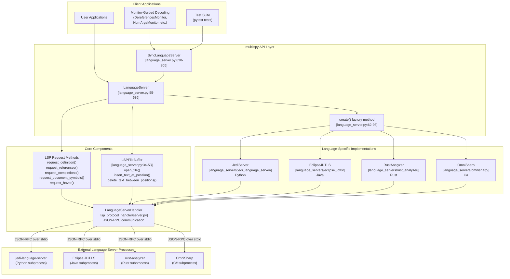
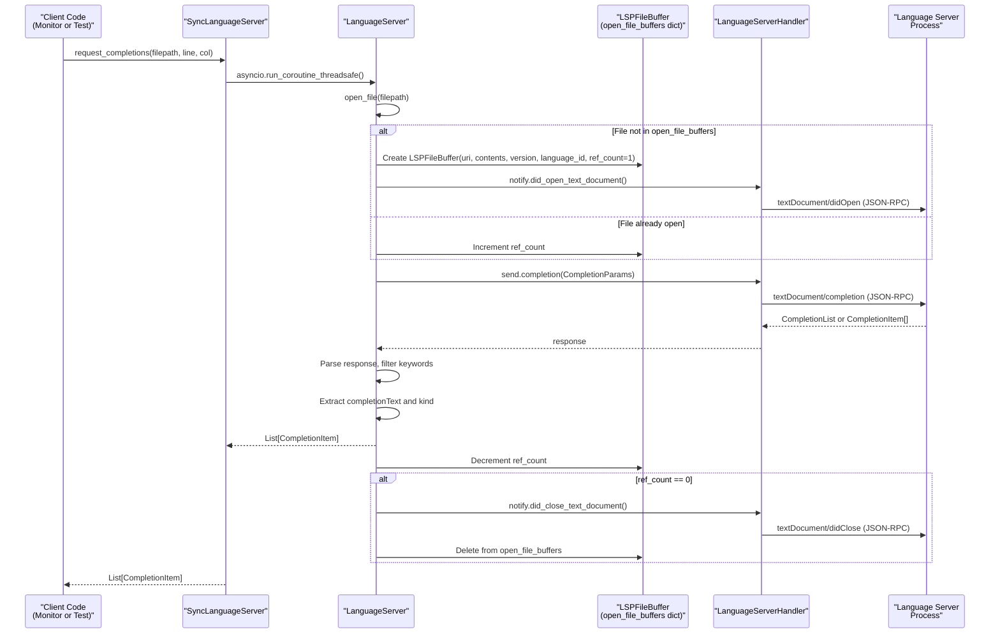
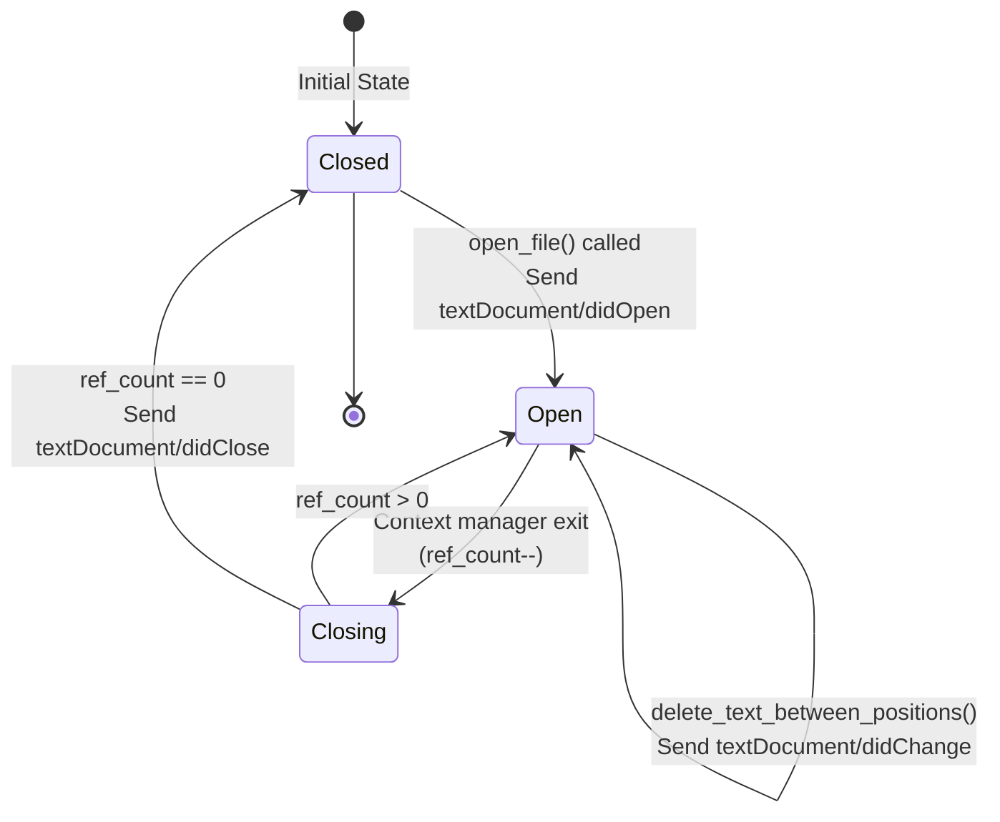
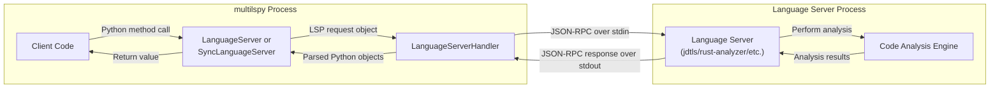
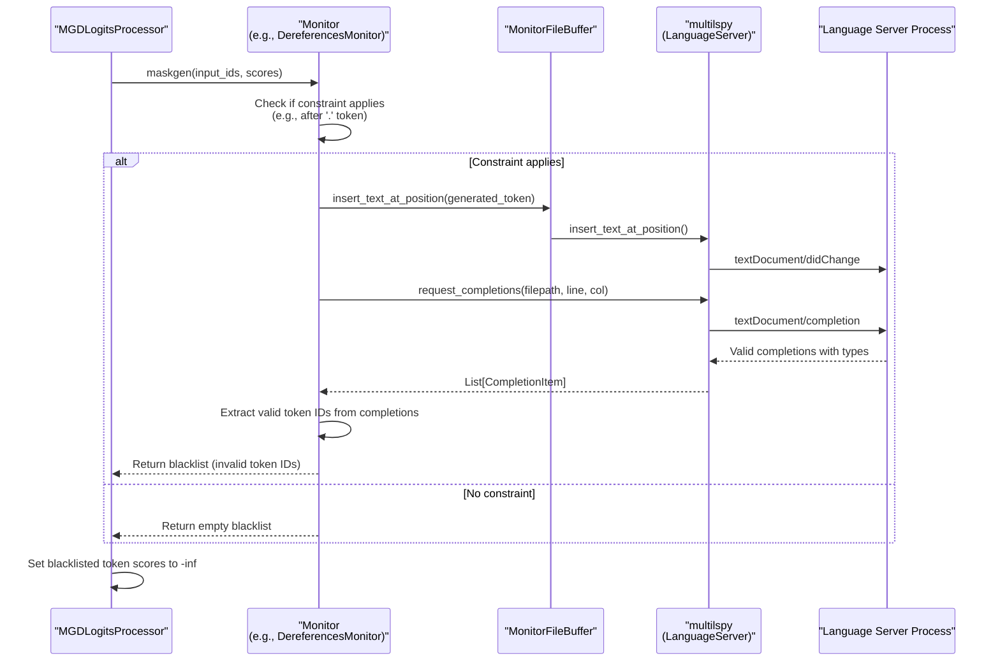

<!-- source: DeepWiki mcp.deepwiki.com · repo microsoft/monitors4codegen · page 4 multilspy Library · fetched 2026-10-26 -->

# multilspy Library

<details>
<summary>Relevant source files</summary>

The following files were used as context for generating this wiki page:

- [README.md](README.md)
- [src/monitors4codegen/multilspy/language_server.py](src/monitors4codegen/multilspy/language_server.py)
- [tests/monitor_guided_decoding/test_typestate_monitor_rust.py](tests/monitor_guided_decoding/test_typestate_monitor_rust.py)

</details>


The `multilspy` library is a cross-platform Python library that provides a unified interface for interacting with Language Server Protocol (LSP) compliant language servers. It abstracts the complexity of language server setup, configuration, and JSON-RPC communication, enabling applications to perform static analysis queries across multiple programming languages through a single, consistent API.

**Note**: The `multilspy` library has been migrated to [microsoft/multilspy](https://github.com/microsoft/multilspy) as a standalone project. The implementation discussed here is from the integrated version within the monitors4codegen repository.

For information about how multilspy is used by Monitor-Guided Decoding, see [Monitor-Guided Decoding](#3). For implementation details of the core classes and methods, see [Core Architecture](#4.1), [LSP Request Methods](#4.2), and [Language Server Clients](#4.3).

---

## Purpose and Scope

multilspy serves as the static analysis foundation for the Monitor-Guided Decoding framework. Its primary responsibilities are:

- **Language Server Lifecycle Management**: Starting, configuring, and terminating language server processes for Java (Eclipse JDT.LS), Rust (rust-analyzer), C# (OmniSharp), and Python (Jedi)
- **LSP Communication**: Handling JSON-RPC protocol communication with language servers, including request serialization, response deserialization, and error handling
- **File Buffer Management**: Maintaining synchronized in-memory representations of code files and propagating incremental changes to language servers
- **Unified API**: Providing language-agnostic methods for querying definitions, references, completions, symbols, and hover information

The library supports both asynchronous (`LanguageServer`) and synchronous (`SyncLanguageServer`) APIs, with the synchronous version managing an internal event loop for applications that prefer blocking calls.

---

## High-Level Architecture

### Component Overview



**Sources**: [src/monitors4codegen/multilspy/language_server.py:1-806]()

---

### Request Flow Architecture

The following diagram shows the complete flow when a client application requests code completions from the language server:



**Sources**: [src/monitors4codegen/multilspy/language_server.py:467-559](), [src/monitors4codegen/multilspy/language_server.py:758-775](), [src/monitors4codegen/multilspy/language_server.py:169-221]()

---

## Key Concepts

### Factory Pattern for Language-Specific Instantiation

The `LanguageServer.create()` factory method instantiates the appropriate language-specific client based on the `MultilspyConfig` parameter:

| Language | Configuration | Implementation Class | Language Server |
|----------|--------------|---------------------|-----------------|
| Python | `Language.PYTHON` | `JediServer` | jedi-language-server |
| Java | `Language.JAVA` | `EclipseJDTLS` | Eclipse JDT.LS |
| Rust | `Language.RUST` | `RustAnalyzer` | rust-analyzer |
| C# | `Language.CSHARP` | `OmniSharp` | OmniSharp |

**Sources**: [src/monitors4codegen/multilspy/language_server.py:62-98]()

### File Buffer Management

multilspy maintains in-memory file buffers that track the state of files opened in the language server:



The `LSPFileBuffer` dataclass stores:
- `uri`: File URI (e.g., `file:///path/to/file.java`)
- `contents`: Current file contents as synchronized with the language server
- `version`: Incremental version number for change notifications
- `language_id`: Language identifier (e.g., `"java"`, `"rust"`)
- `ref_count`: Reference count for nested `open_file()` contexts

**Sources**: [src/monitors4codegen/multilspy/language_server.py:34-53](), [src/monitors4codegen/multilspy/language_server.py:169-221]()

### Synchronous vs. Asynchronous APIs

**`LanguageServer` (Asynchronous API)**:
- Methods are `async` and must be awaited
- Suitable for asyncio-based applications
- Context manager: `async with lsp.start_server():`
- Example: `result = await lsp.request_definition(...)`

**`SyncLanguageServer` (Synchronous API)**:
- Wraps `LanguageServer` with blocking methods
- Manages internal event loop in a daemon thread
- Context manager: `with lsp.start_server():`
- Example: `result = lsp.request_definition(...)`
- Uses `asyncio.run_coroutine_threadsafe()` to bridge sync/async boundary

**Sources**: [src/monitors4codegen/multilspy/language_server.py:637-805]()

---

## Language Server Communication Flow

The following diagram illustrates the protocol-level communication between multilspy and language servers:



**Protocol Details**:
- **Transport**: Standard input/output (stdio) pipes
- **Format**: JSON-RPC 2.0 protocol
- **Message Structure**: Content-Length header followed by JSON payload
- **Request Types**: Notifications (no response expected) and Requests (awaits response)
- **Examples**:
  - Notification: `textDocument/didOpen`, `textDocument/didChange`, `textDocument/didClose`
  - Request: `textDocument/definition`, `textDocument/completion`, `textDocument/hover`

**Sources**: [src/monitors4codegen/multilspy/language_server.py:142-143]()

---

## Usage Example

The following example demonstrates typical usage of multilspy in a synchronous context:

```python
from multilspy import SyncLanguageServer
from multilspy.multilspy_config import MultilspyConfig
from multilspy.multilspy_logger import MultilspyLogger

# Configure for Java language server
config = MultilspyConfig.from_dict({"code_language": "java"})
logger = MultilspyLogger()
lsp = SyncLanguageServer.create(config, logger, "/path/to/java/project")

# Start the language server and open a file
with lsp.start_server():
    with lsp.open_file("src/main/java/Example.java"):
        # Request definition of symbol at line 10, column 5
        definitions = lsp.request_definition("src/main/java/Example.java", 10, 5)
        
        # Request code completions at line 20, column 15
        completions = lsp.request_completions("src/main/java/Example.java", 20, 15)
        
        # Insert text and get updated position
        new_pos = lsp.insert_text_at_position("src/main/java/Example.java", 25, 0, "import java.util.List;\n")
        
        # Request hover information
        hover_info = lsp.request_hover("src/main/java/Example.java", 30, 10)
        
        # Get document symbols
        symbols, tree = lsp.request_document_symbols("src/main/java/Example.java")
```

**Sources**: [README.md:131-159](), [src/monitors4codegen/multilspy/language_server.py:666-805]()

---

## Integration with Monitor-Guided Decoding

Monitors use multilspy to query the language server for static analysis information during code generation. The typical pattern is:



**Sources**: [tests/monitor_guided_decoding/test_typestate_monitor_rust.py:25-110]()

---

## Additional Resources

For detailed documentation on specific components:
- **[Core Architecture](#4.1)**: Detailed explanation of `LanguageServer`, `SyncLanguageServer`, factory pattern, and file buffer management
- **[LSP Request Methods](#4.2)**: Complete API reference for `request_definition`, `request_references`, `request_completions`, `request_document_symbols`, and `request_hover`
- **[Language Server Clients](#4.3)**: Overview of language-specific implementations and their configurations
- **[LSP Types and Protocol](#4.4)**: Type definitions and LSP protocol mappings

**Sources**: [README.md:109-177](), [src/monitors4codegen/multilspy/language_server.py:1-806]()

---

