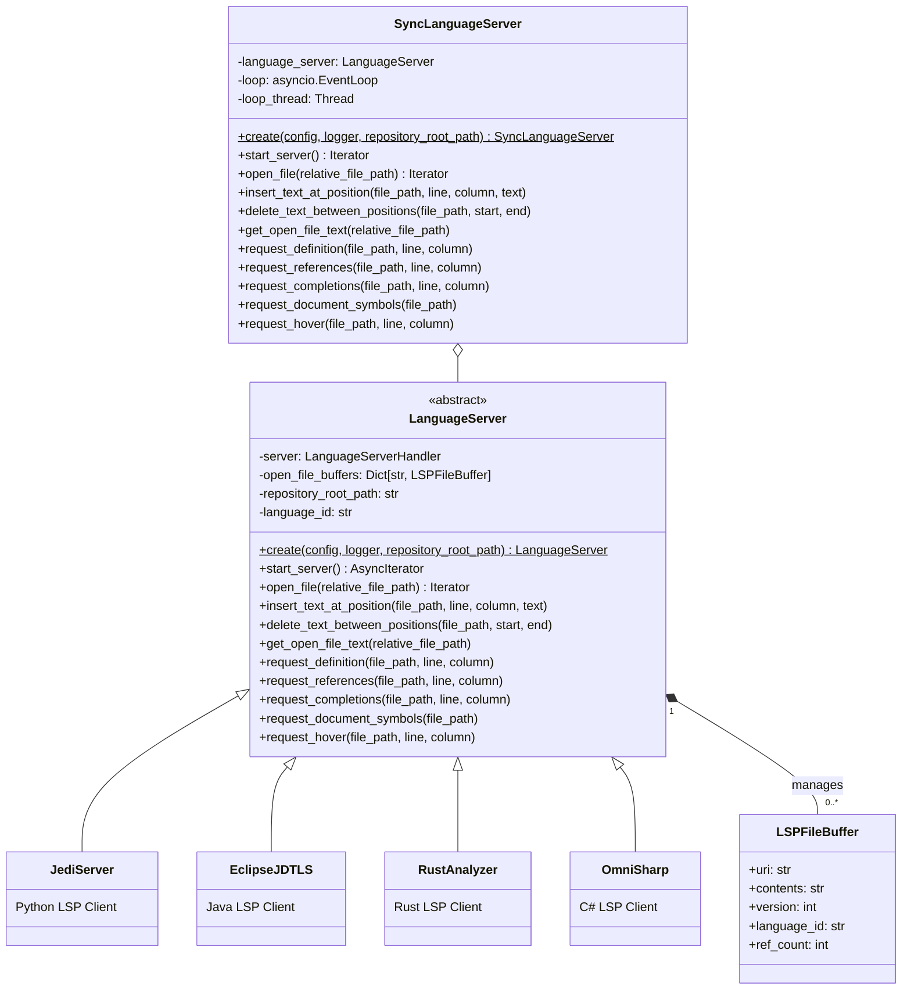
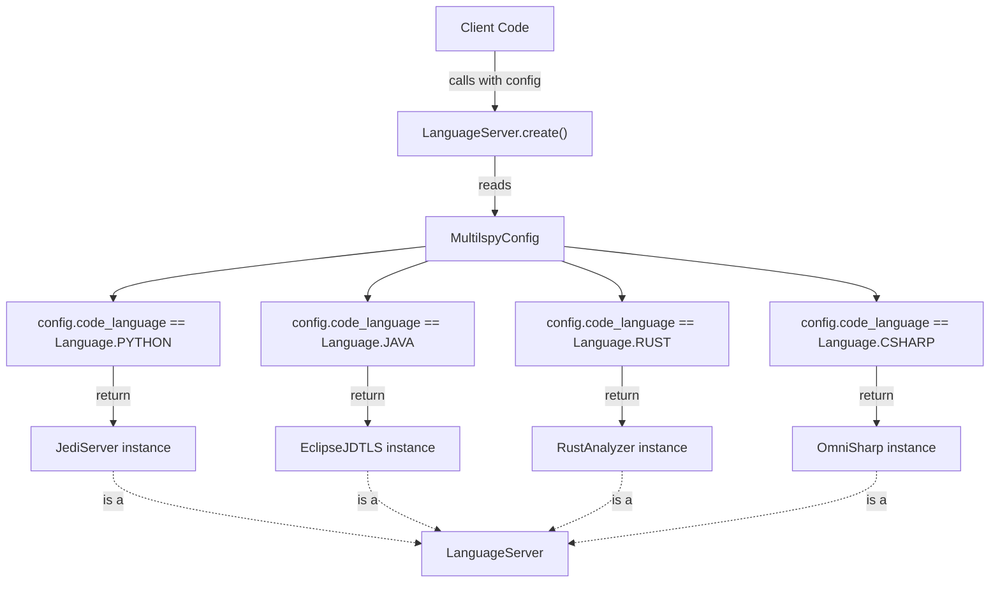
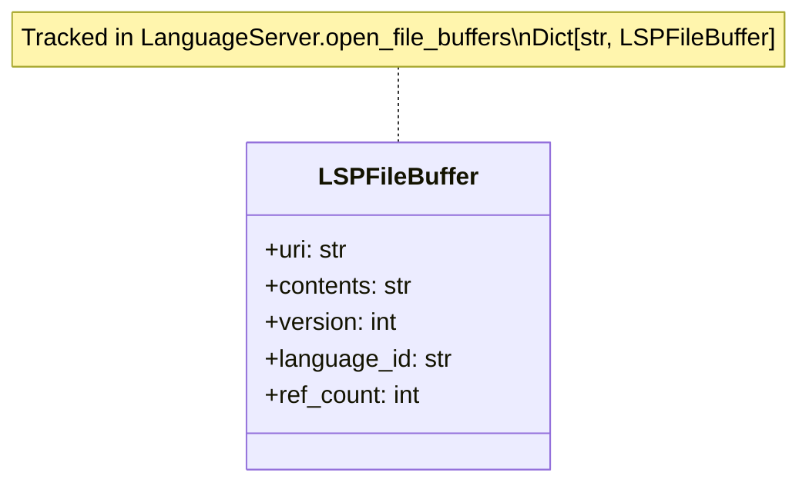
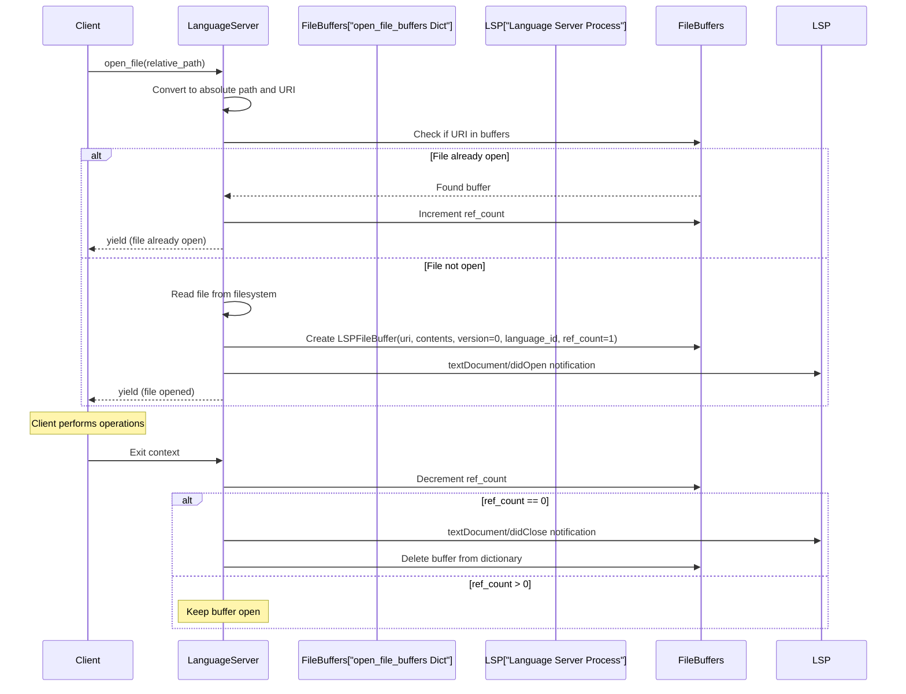
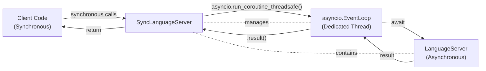
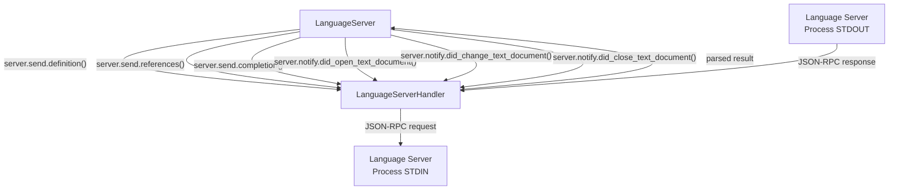
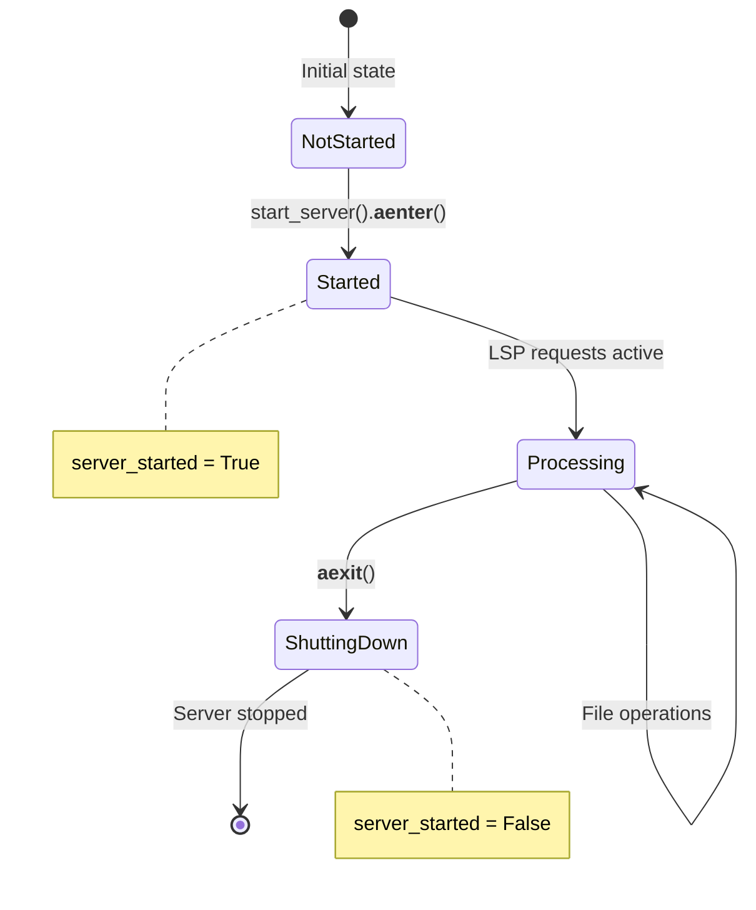

<!-- source: DeepWiki mcp.deepwiki.com · repo microsoft/monitors4codegen · page 4.1 Core Architecture · fetched 2026-10-26 -->

# Core Architecture

<details>
<summary>Relevant source files</summary>

The following files were used as context for generating this wiki page:

- [src/monitors4codegen/multilspy/language_server.py](src/monitors4codegen/multilspy/language_server.py)

</details>


## Purpose and Scope

This document explains the core architecture of the multilspy library, focusing on the `LanguageServer` and `SyncLanguageServer` classes, the factory pattern used for instantiating language-specific clients, and the file buffer management system. For information about specific LSP request methods (definition, references, completions, etc.), see [LSP Request Methods](#4.2). For details on language-specific client implementations, see [Language Server Clients](#4.3).

**Sources:** [src/monitors4codegen/multilspy/language_server.py:1-7]()

---

## Primary Classes and Components

The multilspy library is built around three primary abstractions that work together to provide a unified interface to the Language Server Protocol across different programming languages.

### Class Hierarchy



**Sources:** [src/monitors4codegen/multilspy/language_server.py:55-636](), [src/monitors4codegen/multilspy/language_server.py:638-805](), [src/monitors4codegen/multilspy/language_server.py:33-53]()

---

## The LanguageServer Class

The `LanguageServer` class provides the core asynchronous interface to the Language Server Protocol. It is an abstract base class that cannot be instantiated directly; instead, language-specific implementations are created through the factory pattern.

### Key Attributes

| Attribute | Type | Description |
|-----------|------|-------------|
| `server` | `LanguageServerHandler` | Handles JSON-RPC communication with the language server process |
| `open_file_buffers` | `Dict[str, LSPFileBuffer]` | Maps file URIs to their in-memory buffer state |
| `repository_root_path` | `str` | Absolute path to the repository root |
| `language_id` | `str` | LSP language identifier (e.g., "java", "rust", "python") |
| `server_started` | `bool` | Indicates whether the language server has been initialized |
| `completions_available` | `asyncio.Event` | Signals when completions are ready to be queried |

**Sources:** [src/monitors4codegen/multilspy/language_server.py:100-146]()

### Constructor Pattern

The `LanguageServer` class enforces that it cannot be instantiated directly. Subclasses must call the parent constructor with language-specific configuration:

```python
def __init__(
    self,
    config: MultilspyConfig,
    logger: MultilspyLogger,
    repository_root_path: str,
    process_launch_info: ProcessLaunchInfo,
    language_id: str,
):
```

The constructor validates that it is not being called on the base class itself, initializes the `LanguageServerHandler` for JSON-RPC communication, and sets up the file buffer dictionary.

**Sources:** [src/monitors4codegen/multilspy/language_server.py:100-146]()

---

## Factory Pattern for Language-Specific Clients

The multilspy library uses a factory pattern to abstract away the complexity of instantiating language-specific clients. The `LanguageServer.create()` class method serves as the factory.

### Factory Method Implementation



The factory method examines the `config.code_language` field and dynamically imports and instantiates the appropriate language-specific client:

| Language | Enum Value | Client Class | Module Path |
|----------|------------|--------------|-------------|
| Python | `Language.PYTHON` | `JediServer` | `monitors4codegen.multilspy.language_servers.jedi_language_server.jedi_server` |
| Java | `Language.JAVA` | `EclipseJDTLS` | `monitors4codegen.multilspy.language_servers.eclipse_jdtls.eclipse_jdtls` |
| Rust | `Language.RUST` | `RustAnalyzer` | `monitors4codegen.multilspy.language_servers.rust_analyzer.rust_analyzer` |
| C# | `Language.CSHARP` | `OmniSharp` | `monitors4codegen.multilspy.language_servers.omnisharp.omnisharp` |

If an unsupported language is specified, the factory raises a `MultilspyException`.

**Sources:** [src/monitors4codegen/multilspy/language_server.py:61-98]()

---

## LSPFileBuffer: In-Memory File State Management

The `LSPFileBuffer` dataclass tracks the state of files that are open in the language server. This is essential because language servers maintain their own in-memory representation of files, separate from the filesystem.

### LSPFileBuffer Structure



| Field | Type | Purpose |
|-------|------|---------|
| `uri` | `str` | File URI in the format `file:///absolute/path/to/file` |
| `contents` | `str` | Current contents of the file as known by the language server |
| `version` | `int` | Monotonically increasing version number for tracking changes |
| `language_id` | `str` | LSP language identifier (e.g., "java", "python") |
| `ref_count` | `int` | Reference count for nested `open_file()` contexts |

**Sources:** [src/monitors4codegen/multilspy/language_server.py:33-53]()

### Version Tracking

The `version` field is crucial for LSP protocol compliance. Every time the file is modified through `insert_text_at_position()` or `delete_text_between_positions()`, the version is incremented and included in the `textDocument/didChange` notification sent to the language server. This allows the server to track the evolution of file state and invalidate stale analysis results.

**Sources:** [src/monitors4codegen/multilspy/language_server.py:248-271](), [src/monitors4codegen/multilspy/language_server.py:296-309]()

---

## File Buffer Management Lifecycle

The multilspy library implements a sophisticated file buffer management system with reference counting to support nested contexts and efficient resource management.

### File Opening with Reference Counting



The `open_file()` method is implemented as a context manager that handles the complete lifecycle:

1. **URI Resolution**: Converts relative file path to absolute path, then to URI format
2. **Reference Counting**: If file is already open, increments `ref_count`; otherwise, creates new buffer with `ref_count=1`
3. **LSP Notification**: Sends `textDocument/didOpen` only for new files
4. **Cleanup**: On context exit, decrements `ref_count` and sends `textDocument/didClose` only when count reaches 0

This design enables nested contexts where the same file can be opened multiple times without redundant LSP notifications.

**Sources:** [src/monitors4codegen/multilspy/language_server.py:169-221]()

### Text Modification Operations

The library provides two primary methods for modifying file contents:

#### insert_text_at_position()

Inserts text at a specific line and column, updating the file buffer and notifying the language server:

1. Converts line/column to absolute character index in the contents string
2. Inserts text into the buffer's `contents` field
3. Increments the buffer's `version`
4. Sends `textDocument/didChange` notification with the change range
5. Returns the new cursor position after insertion

**Sources:** [src/monitors4codegen/multilspy/language_server.py:222-271]()

#### delete_text_between_positions()

Deletes text between two positions and returns the deleted text:

1. Converts start and end positions to character indices
2. Extracts and stores the deleted text
3. Updates the buffer's `contents` by removing the deleted range
4. Increments the buffer's `version`
5. Sends `textDocument/didChange` notification with the deletion range
6. Returns the deleted text

**Sources:** [src/monitors4codegen/multilspy/language_server.py:273-310]()

### File Content Retrieval

The `get_open_file_text()` method retrieves the current contents of an open file buffer as known by the language server, not from the filesystem. This ensures consistency with the language server's view of the file.

**Sources:** [src/monitors4codegen/multilspy/language_server.py:312-332]()

---

## The SyncLanguageServer Wrapper

The `SyncLanguageServer` class provides a synchronous interface to the asynchronous `LanguageServer` class. This is particularly useful for client code that operates in synchronous contexts or where managing async/await complexity would be burdensome.

### Internal Architecture



### Event Loop Management

The `SyncLanguageServer` creates and manages a dedicated event loop running in a separate daemon thread:

1. **Creation**: On `start_server()`, creates a new `asyncio.EventLoop` 
2. **Thread Launch**: Starts a daemon thread that runs `loop.run_forever()`
3. **Context Entry**: Calls the async context manager's `__aenter__()` using `run_coroutine_threadsafe()`
4. **Request Forwarding**: Each request method wraps the async version in `run_coroutine_threadsafe()` and blocks on `.result()`
5. **Context Exit**: Calls `__aexit__()` and stops the loop
6. **Thread Cleanup**: Waits for the thread to terminate

**Sources:** [src/monitors4codegen/multilspy/language_server.py:709-724]()

### Method Delegation Pattern

All public methods of `SyncLanguageServer` follow this pattern:

```python
def method_name(self, *args, **kwargs):
    result = asyncio.run_coroutine_threadsafe(
        self.language_server.method_name(*args, **kwargs),
        self.loop
    ).result()
    return result
```

This ensures that:
- The synchronous interface exactly mirrors the asynchronous interface
- All async operations execute on the dedicated event loop thread
- The calling thread blocks until the operation completes
- Exceptions are propagated correctly

**Sources:** [src/monitors4codegen/multilspy/language_server.py:726-805]()

### Interface Consistency Enforcement

The `@ensure_all_methods_implemented` decorator ensures that `SyncLanguageServer` implements all public methods of `LanguageServer`, preventing interface drift between the async and sync versions.

**Sources:** [src/monitors4codegen/multilspy/language_server.py:637]()

---

## Language Server Process Communication

Both `LanguageServer` and `SyncLanguageServer` communicate with external language server processes through the `LanguageServerHandler` class, which manages JSON-RPC protocol communication.

### Communication Architecture



### Request vs Notification Pattern

The `LanguageServerHandler` exposes two interfaces:

1. **`server.send.*`**: Request methods that expect responses (e.g., `definition`, `references`, `completion`)
2. **`server.notify.*`**: Notification methods that don't expect responses (e.g., `did_open_text_document`, `did_change_text_document`)

This distinction aligns with the LSP specification's request/notification dichotomy.

**Sources:** [src/monitors4codegen/multilspy/language_server.py:141-143]()

### Logging and Tracing

When `config.trace_lsp_communication` is enabled, the `LanguageServer` constructor configures a logging function that captures all JSON-RPC messages flowing between the client and server. This is invaluable for debugging protocol-level issues.

**Sources:** [src/monitors4codegen/multilspy/language_server.py:131-139]()

---

## Server Lifecycle Management

The `start_server()` method is implemented as an async context manager that controls the language server process lifetime.

### Lifecycle Phases



The context manager pattern ensures proper initialization and cleanup:

```python
async with lsp.start_server():
    # server_started is True
    # Can now open files and make requests
    await lsp.request_definition(...)
# Automatic cleanup on exit
```

**Sources:** [src/monitors4codegen/multilspy/language_server.py:148-165]()

---

## Usage Patterns

### Typical Asynchronous Usage

```python
# Create language server instance
lsp = LanguageServer.create(config, logger, repo_path)

async with lsp.start_server():
    with lsp.open_file("src/main.java"):
        # Make LSP requests
        definitions = await lsp.request_definition("src/main.java", 10, 5)
        completions = await lsp.request_completions("src/main.java", 10, 5)
        
        # Modify file
        lsp.insert_text_at_position("src/main.java", 10, 5, "newText")
```

### Typical Synchronous Usage

```python
# Create synchronous language server instance
lsp = SyncLanguageServer.create(config, logger, repo_path)

with lsp.start_server():
    with lsp.open_file("src/main.java"):
        # Make LSP requests (no await needed)
        definitions = lsp.request_definition("src/main.java", 10, 5)
        completions = lsp.request_completions("src/main.java", 10, 5)
        
        # Modify file
        lsp.insert_text_at_position("src/main.java", 10, 5, "newText")
```

**Sources:** [src/monitors4codegen/multilspy/language_server.py:148-165](), [src/monitors4codegen/multilspy/language_server.py:709-724]()

---

## Design Principles and Trade-offs

### Factory Pattern Benefits

The factory pattern implementation provides several advantages:

1. **Encapsulation**: Language-specific configuration details are hidden from client code
2. **Lazy Loading**: Language server modules are imported only when needed
3. **Extensibility**: New languages can be added by implementing a subclass and updating the factory
4. **Type Safety**: Factory returns the abstract `LanguageServer` type, enabling polymorphism

**Sources:** [src/monitors4codegen/multilspy/language_server.py:61-98]()

### Reference Counting Rationale

The reference counting system in file buffer management solves several problems:

1. **Nested Contexts**: Allows the same file to be opened in nested scopes without premature closure
2. **Performance**: Avoids redundant `textDocument/didOpen` and `textDocument/didClose` notifications
3. **Correctness**: Ensures the language server's view of open files matches the client's usage

**Sources:** [src/monitors4codegen/multilspy/language_server.py:186-220]()

### Synchronous Wrapper Design

The `SyncLanguageServer` wrapper addresses practical needs:

1. **Compatibility**: Enables use from synchronous codebases without async/await refactoring
2. **Simplicity**: Provides a simpler interface for clients that don't need async concurrency
3. **Thread Safety**: Dedicates a single event loop thread to avoid concurrent access issues

The trade-off is additional complexity and overhead from thread management, but this is acceptable for the improved usability in synchronous contexts.

**Sources:** [src/monitors4codegen/multilspy/language_server.py:638-805]()

---

