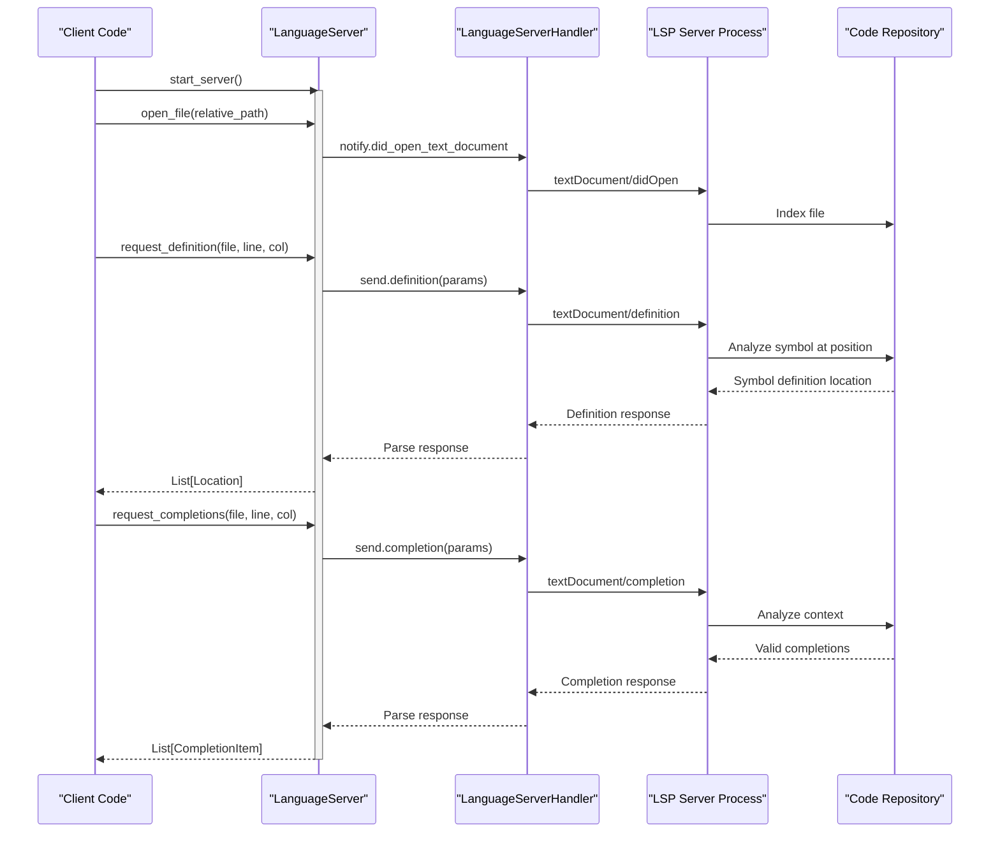
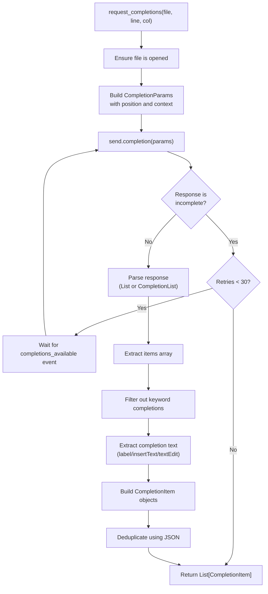
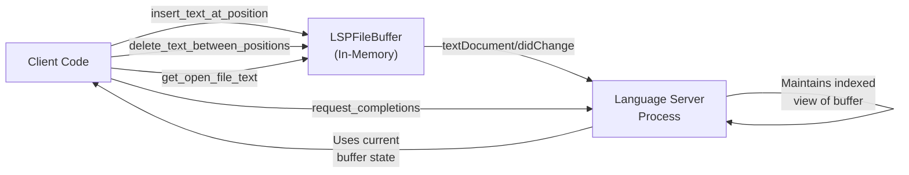

<!-- source: DeepWiki mcp.deepwiki.com · repo microsoft/monitors4codegen · page 4.2 LSP Request Methods · fetched 2026-10-26 -->

# LSP Request Methods

<details>
<summary>Relevant source files</summary>

The following files were used as context for generating this wiki page:

- [src/monitors4codegen/multilspy/language_server.py](src/monitors4codegen/multilspy/language_server.py)
- [tests/multilspy/test_multilspy_java.py](tests/multilspy/test_multilspy_java.py)

</details>


## Purpose and Scope

This page documents the LSP (Language Server Protocol) request methods available in the multilspy library. These methods provide a high-level interface for querying language servers to obtain semantic information about source code, including symbol definitions, references, completions, document symbols, and hover information.

For information about the core architecture of multilspy (including `LanguageServer` and `SyncLanguageServer` classes), see [Core Architecture](#4.1). For information about language-specific client implementations, see [Language Server Clients](#4.3).

---

## Overview

The multilspy library exposes five primary LSP request methods that enable semantic code analysis across multiple programming languages. Each method corresponds to a specific LSP specification request and is available in both asynchronous (`LanguageServer`) and synchronous (`SyncLanguageServer`) variants.

### Available Request Methods

| Method | LSP Request | Purpose |
|--------|------------|---------|
| `request_definition` | `textDocument/definition` | Find where a symbol is defined |
| `request_references` | `textDocument/references` | Find all references to a symbol |
| `request_completions` | `textDocument/completion` | Get code completion suggestions |
| `request_document_symbols` | `textDocument/documentSymbol` | Get all symbols in a file |
| `request_hover` | `textDocument/hover` | Get hover information (e.g., type signatures) |

All request methods require that the file is opened using the `open_file` context manager before making requests. The language server must also be started using the `start_server` context manager.

**Sources:** [src/monitors4codegen/multilspy/language_server.py:334-636]()

---

## Request-Response Flow



**Diagram: LSP Request Method Flow** - Shows the sequence of operations when making LSP requests through multilspy.

**Sources:** [src/monitors4codegen/multilspy/language_server.py:148-221](), [src/monitors4codegen/multilspy/language_server.py:334-636]()

---

## Definition Requests

The `request_definition` method sends a `textDocument/definition` request to find where a symbol is defined. This is useful for navigation and understanding code dependencies.

### Method Signature

**Asynchronous:**
```python
async def request_definition(
    self, 
    relative_file_path: str, 
    line: int, 
    column: int
) -> List[multilspy_types.Location]
```

**Synchronous:**
```python
def request_definition(
    self, 
    file_path: str, 
    line: int, 
    column: int
) -> List[multilspy_types.Location]
```

### Parameters

| Parameter | Type | Description |
|-----------|------|-------------|
| `relative_file_path` | `str` | Relative path from repository root to the file containing the symbol |
| `line` | `int` | Zero-indexed line number of the symbol |
| `column` | `int` | Zero-indexed column number of the symbol |

### Return Value

Returns a list of `Location` objects, each containing:
- `uri`: File URI
- `absolutePath`: Absolute file path
- `relativePath`: Relative file path from repository root
- `range`: Position range with `start` and `end` coordinates

### Response Processing

The method handles both `Location` and `LocationLink` response types from the LSP server:
- **Location response**: Contains `uri` and `range` fields directly
- **LocationLink response**: Contains `targetUri`, `targetRange`, `targetSelectionRange`, and `originSelectionRange` fields

The response is normalized to the `Location` format with added `absolutePath` and `relativePath` fields for convenience.

### Example Usage

```python
# Find definition of a symbol at line 44, column 59
result = await lsp.request_definition(
    "src/main/java/com/example/MyClass.java", 
    44, 
    59
)

# Result: [{'uri': 'file://...', 'relativePath': '...', 'range': {...}}]
```

**Sources:** [src/monitors4codegen/multilspy/language_server.py:334-415](), [src/monitors4codegen/multilspy/language_server.py:726-740](), [tests/multilspy/test_multilspy_java.py:33-44]()

---

## References Requests

The `request_references` method sends a `textDocument/references` request to find all locations where a symbol is referenced in the codebase.

### Method Signature

**Asynchronous:**
```python
async def request_references(
    self, 
    relative_file_path: str, 
    line: int, 
    column: int
) -> List[multilspy_types.Location]
```

**Synchronous:**
```python
def request_references(
    self, 
    file_path: str, 
    line: int, 
    column: int
) -> List[multilspy_types.Location]
```

### Parameters

| Parameter | Type | Description |
|-----------|------|-------------|
| `relative_file_path` | `str` | Relative path from repository root to the file containing the symbol |
| `line` | `int` | Zero-indexed line number of the symbol |
| `column` | `int` | Zero-indexed column number of the symbol |

### Return Value

Returns a list of `Location` objects with the same structure as `request_definition`. The request includes `includeDeclaration: False` in the context, so the definition location itself is not included in the results.

### Example Usage

```python
# Find all references to a symbol at line 82, column 27
result = await lsp.request_references(
    "src/main/java/com/example/MyClass.java",
    82,
    27
)

# Result: [
#   {'uri': '...', 'relativePath': '...', 'range': {'start': {...}, 'end': {...}}},
#   {'uri': '...', 'relativePath': '...', 'range': {'start': {...}, 'end': {...}}}
# ]
```

**Sources:** [src/monitors4codegen/multilspy/language_server.py:417-465](), [src/monitors4codegen/multilspy/language_server.py:742-756](), [tests/multilspy/test_multilspy_java.py:67-95]()

---

## Completion Requests

The `request_completions` method sends a `textDocument/completion` request to get code completion suggestions at a specific position in a file. This is the most complex request method due to handling incomplete results and multiple response formats.

### Method Signature

**Asynchronous:**
```python
async def request_completions(
    self, 
    relative_file_path: str, 
    line: int, 
    column: int,
    allow_incomplete: bool = False
) -> List[multilspy_types.CompletionItem]
```

**Synchronous:**
```python
def request_completions(
    self, 
    relative_file_path: str, 
    line: int, 
    column: int,
    allow_incomplete: bool = False
) -> List[multilspy_types.CompletionItem]
```

### Parameters

| Parameter | Type | Description |
|-----------|------|-------------|
| `relative_file_path` | `str` | Relative path from repository root to the file |
| `line` | `int` | Zero-indexed line number for completion |
| `column` | `int` | Zero-indexed column number for completion |
| `allow_incomplete` | `bool` | Whether to return results even if marked incomplete (default: `False`) |

### Return Value

Returns a list of `CompletionItem` objects, each containing:
- `completionText`: The text to be inserted
- `kind`: The kind of completion (e.g., method, field, class)
- `detail`: (Optional) Additional information like method signature

Keywords are filtered out from the results.

### Completion Response Handling

The method handles multiple response formats:
1. **List of CompletionItem**: Direct array of completion items
2. **CompletionList**: Object with `items` array and `isIncomplete` flag

When `isIncomplete` is `true`, the method retries up to 30 times, waiting for the language server to complete indexing. This is controlled by the `completions_available` event.

### Completion Text Extraction

The method extracts completion text from various LSP response fields, in priority order:
1. `label` field
2. `insertText` field
3. `textEdit.newText` field
4. `textEdit.range` with validation

### Deduplication

Completions are deduplicated using JSON serialization to ensure unique results.



**Diagram: Completion Request Processing Flow** - Shows the complete flow including retry logic and response parsing.

### Example Usage

```python
# Request completions after deleting some text
with lsp.open_file(filepath):
    lsp.delete_text_between_positions(
        filepath,
        Position(line=74, character=17),
        Position(line=78, character=4)
    )
    completions = await lsp.request_completions(filepath, 74, 17)
    completion_texts = [c["completionText"] for c in completions]
    # Result: ['class', 'newServerNode']
```

**Sources:** [src/monitors4codegen/multilspy/language_server.py:467-559](), [src/monitors4codegen/multilspy/language_server.py:758-775](), [tests/multilspy/test_multilspy_java.py:97-145]()

---

## Document Symbol Requests

The `request_document_symbols` method sends a `textDocument/documentSymbol` request to retrieve all symbols (classes, methods, fields, etc.) defined in a file.

### Method Signature

**Asynchronous:**
```python
async def request_document_symbols(
    self, 
    relative_file_path: str
) -> Tuple[List[multilspy_types.UnifiedSymbolInformation], Union[List[multilspy_types.TreeRepr], None]]
```

**Synchronous:**
```python
def request_document_symbols(
    self, 
    relative_file_path: str
) -> Tuple[List[multilspy_types.UnifiedSymbolInformation], Union[List[multilspy_types.TreeRepr], None]]
```

### Parameters

| Parameter | Type | Description |
|-----------|------|-------------|
| `relative_file_path` | `str` | Relative path from repository root to the file |

### Return Value

Returns a tuple containing:
1. **List of UnifiedSymbolInformation**: Flattened list of all symbols in the file
2. **Tree representation** (currently `None`): Reserved for future hierarchical representation

Each `UnifiedSymbolInformation` object contains:
- `name`: Symbol name
- `kind`: Symbol kind (class=5, method=6, field=8, constructor=9, etc.)
- `range`: Full range of the symbol in the file
- `selectionRange`: Range of the symbol's name/identifier
- `detail`: Additional details (e.g., return type for methods)

### Response Processing

The method handles two response formats:
1. **SymbolInformation**: Flat list of symbols
2. **DocumentSymbol**: Hierarchical structure with `children` field

For hierarchical responses, the method flattens the tree by recursively visiting all nodes using `visit_tree_nodes_and_build_tree_repr`.

### Symbol Kinds

Common symbol kinds (from LSP specification):

| Kind | Value | Description |
|------|-------|-------------|
| Class | 5 | Class definition |
| Method | 6 | Method/function definition |
| Field | 8 | Field/property |
| Constructor | 9 | Constructor |
| Enum | 10 | Enum definition |
| Interface | 11 | Interface definition |

### Example Usage

```python
# Get all symbols in a Java file
result = await lsp.request_document_symbols("Person.java")
symbols, tree = result

# symbols = [
#   {'name': 'Person', 'kind': 5, 'range': {...}, 'selectionRange': {...}},
#   {'name': 'name', 'kind': 8, 'range': {...}, 'selectionRange': {...}},
#   {'name': 'Person(String)', 'kind': 9, 'range': {...}, 'selectionRange': {...}},
#   {'name': 'getName()', 'kind': 6, 'range': {...}, 'selectionRange': {...}}
# ]
```

**Sources:** [src/monitors4codegen/multilspy/language_server.py:561-604](), [src/monitors4codegen/multilspy/language_server.py:777-789](), [tests/multilspy/test_multilspy_java.py:210-347]()

---

## Hover Requests

The `request_hover` method sends a `textDocument/hover` request to retrieve hover information (typically type signatures and documentation) for a symbol at a specific position.

### Method Signature

**Asynchronous:**
```python
async def request_hover(
    self, 
    relative_file_path: str, 
    line: int, 
    column: int
) -> Union[multilspy_types.Hover, None]
```

**Synchronous:**
```python
def request_hover(
    self, 
    relative_file_path: str, 
    line: int, 
    column: int
) -> Union[multilspy_types.Hover, None]
```

### Parameters

| Parameter | Type | Description |
|-----------|------|-------------|
| `relative_file_path` | `str` | Relative path from repository root to the file |
| `line` | `int` | Zero-indexed line number of the symbol |
| `column` | `int` | Zero-indexed column number of the symbol |

### Return Value

Returns a `Hover` object or `None` if no hover information is available. The `Hover` object typically contains:
- `contents`: The hover text, often with `language` and `value` fields for formatted code
- `range` (optional): The range the hover applies to

### Example Usage

```python
# Get hover information for a method call
result = await lsp.request_hover(
    "src/main/java/com/example/MyClass.java",
    75,
    27
)

# Result: {
#   'contents': {
#       'language': 'java',
#       'value': 'Builder com.example.Builder.withIpPort(String ip, Integer port)'
#   }
# }
```

**Sources:** [src/monitors4codegen/multilspy/language_server.py:606-636](), [src/monitors4codegen/multilspy/language_server.py:791-805](), [tests/multilspy/test_multilspy_java.py:350-387]()

---

## File Manipulation Methods

In addition to LSP request methods, the `LanguageServer` class provides methods for manipulating file contents in the language server's buffer. These methods notify the language server of changes, ensuring that subsequent requests reflect the updated file state.

### insert_text_at_position

Inserts text at a specific position in an opened file and returns the updated cursor position.

```python
def insert_text_at_position(
    self,
    relative_file_path: str,
    line: int,
    column: int,
    text_to_be_inserted: str
) -> multilspy_types.Position
```

**Behavior:**
1. Validates that the file is open
2. Updates the internal file buffer
3. Increments the file version
4. Sends `textDocument/didChange` notification to the language server
5. Returns the new cursor position after insertion

### delete_text_between_positions

Deletes text between two positions in an opened file and returns the deleted text.

```python
def delete_text_between_positions(
    self,
    relative_file_path: str,
    start: multilspy_types.Position,
    end: multilspy_types.Position
) -> str
```

**Behavior:**
1. Validates that the file is open
2. Extracts the text to be deleted from the buffer
3. Updates the internal file buffer
4. Increments the file version
5. Sends `textDocument/didChange` notification to the language server
6. Returns the deleted text

### get_open_file_text

Retrieves the current contents of an opened file from the language server's buffer.

```python
def get_open_file_text(
    self, 
    relative_file_path: str
) -> str
```

This returns the file contents as maintained by the language server, which may differ from the file on disk if modifications have been made.



**Diagram: File Manipulation and Buffer Synchronization** - Shows how file manipulation methods update the buffer and notify the language server.

### Example Usage

```python
with lsp.open_file(filepath):
    # Delete some text
    deleted = lsp.delete_text_between_positions(
        filepath,
        Position(line=74, character=17),
        Position(line=78, character=4)
    )
    
    # Insert new text
    new_pos = lsp.insert_text_at_position(
        filepath,
        75,
        28,
        ")"
    )
    
    # Get updated contents
    current_text = lsp.get_open_file_text(filepath)
    
    # Request completions with updated state
    completions = await lsp.request_completions(filepath, 75, 17)
```

**Sources:** [src/monitors4codegen/multilspy/language_server.py:222-332](), [tests/multilspy/test_multilspy_java.py:97-125](), [tests/multilspy/test_multilspy_java.py:368-387]()

---

## Common Patterns and Best Practices

### File Opening Context Manager

All LSP request methods require that the file is opened using the `open_file` context manager. The context manager:
- Sends `textDocument/didOpen` notification when entering
- Sends `textDocument/didClose` notification when exiting
- Maintains a reference count for nested contexts
- Manages the file buffer lifecycle

```python
with lsp.open_file(relative_file_path):
    # File is open, requests can be made
    result = await lsp.request_definition(relative_file_path, 10, 5)
# File is automatically closed
```

### Server Lifecycle

The language server must be started before any operations:

```python
async with lsp.start_server():
    # Server is running
    with lsp.open_file(file_path):
        result = await lsp.request_completions(file_path, 5, 10)
# Server is automatically shut down
```

### Synchronous vs Asynchronous

The library provides both asynchronous (`LanguageServer`) and synchronous (`SyncLanguageServer`) interfaces:

- **Asynchronous**: Use `await` with `async` functions, better for concurrent operations
- **Synchronous**: No `await` needed, manages an internal event loop, easier for simple scripts

### Error Handling

All request methods raise `MultilspyException` if:
- The server is not started
- The file is not opened (for file-specific requests)
- The language server returns an unexpected response format

**Sources:** [src/monitors4codegen/multilspy/language_server.py:148-221](), [src/monitors4codegen/multilspy/language_server.py:637-806]()

---

## Request Method Summary Table

| Method | Required Context | Parameters | Return Type | Use Case |
|--------|-----------------|------------|-------------|----------|
| `request_definition` | File must be open | file, line, col | `List[Location]` | Navigate to symbol definition |
| `request_references` | File must be open | file, line, col | `List[Location]` | Find all symbol usages |
| `request_completions` | File must be open | file, line, col, allow_incomplete | `List[CompletionItem]` | Code completion suggestions |
| `request_document_symbols` | File must be open | file | `Tuple[List[UnifiedSymbolInformation], TreeRepr]` | Get all symbols in file |
| `request_hover` | File must be open | file, line, col | `Hover` or `None` | Get type/signature info |
| `insert_text_at_position` | File must be open | file, line, col, text | `Position` | Modify file buffer |
| `delete_text_between_positions` | File must be open | file, start, end | `str` | Modify file buffer |
| `get_open_file_text` | File must be open | file | `str` | Retrieve buffer contents |

**Sources:** [src/monitors4codegen/multilspy/language_server.py:334-806]()

---

