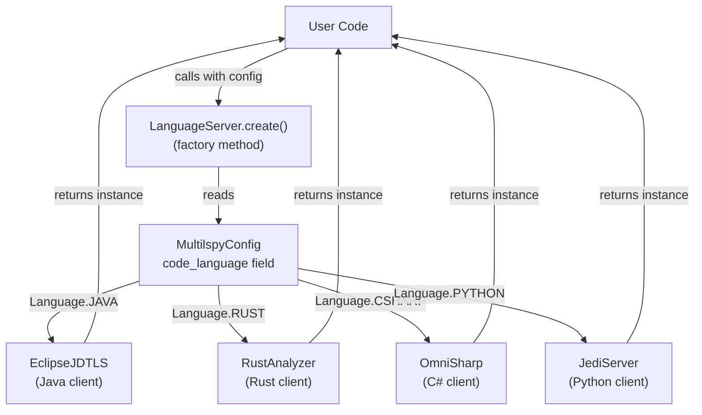
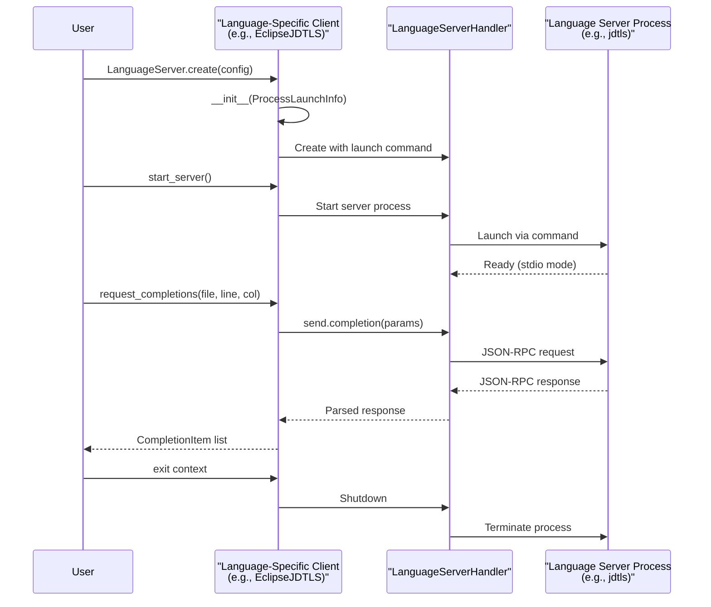
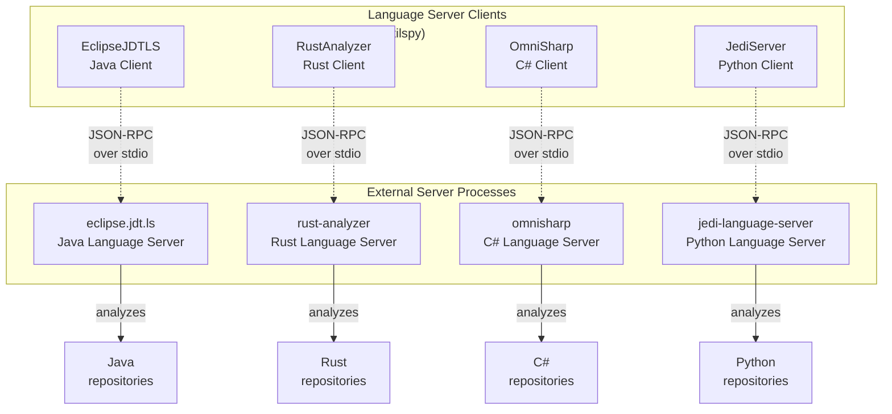
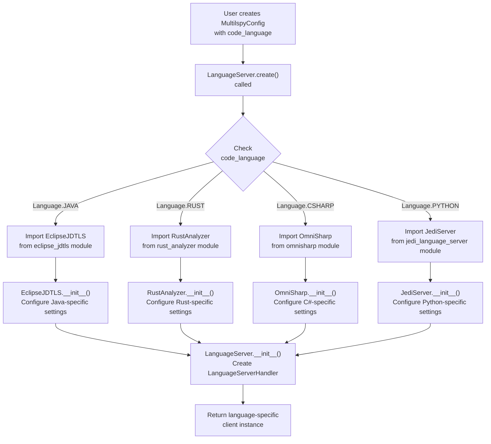

<!-- source: DeepWiki mcp.deepwiki.com · repo microsoft/monitors4codegen · page 4.3 Language Server Clients · fetched 2026-10-26 -->

# Language Server Clients

<details>
<summary>Relevant source files</summary>

The following files were used as context for generating this wiki page:

- [README.md](README.md)
- [src/monitors4codegen/multilspy/language_server.py](src/monitors4codegen/multilspy/language_server.py)
- [tests/monitor_guided_decoding/test_typestate_monitor_rust.py](tests/monitor_guided_decoding/test_typestate_monitor_rust.py)

</details>


## Purpose and Scope

This page provides an overview of the language-specific Language Server Protocol (LSP) client implementations in multilspy. Each client is responsible for launching, configuring, and communicating with a specific language server process (Java, Rust, C#, or Python). 

For details about the core `LanguageServer` and `SyncLanguageServer` classes and their common API, see [Core Architecture](#4.1). For information about the available LSP request methods (`request_definition`, `request_completions`, etc.), see [LSP Request Methods](#4.2). For detailed documentation of individual language server implementations, see [Java (Eclipse JDT.LS)](#4.3.1), [Rust (rust-analyzer)](#4.3.2), and [C# and Python Clients](#4.3.3).

---

## Factory Pattern for Client Creation

multilspy uses a factory pattern to instantiate language-specific client implementations. Users do not directly instantiate language-specific classes; instead, they call the factory method `LanguageServer.create()`, which dispatches to the appropriate implementation based on configuration.



**Factory Method Dispatch Logic**

The `LanguageServer.create()` method examines the `code_language` field in the provided `MultilspyConfig` and returns an instance of the appropriate language-specific subclass:

| Language Enum | Client Class | Module Path |
|--------------|--------------|-------------|
| `Language.JAVA` | `EclipseJDTLS` | `monitors4codegen.multilspy.language_servers.eclipse_jdtls.eclipse_jdtls` |
| `Language.RUST` | `RustAnalyzer` | `monitors4codegen.multilspy.language_servers.rust_analyzer.rust_analyzer` |
| `Language.CSHARP` | `OmniSharp` | `monitors4codegen.multilspy.language_servers.omnisharp.omnisharp` |
| `Language.PYTHON` | `JediServer` | `monitors4codegen.multilspy.language_servers.jedi_language_server.jedi_server` |

**Sources:** [src/monitors4codegen/multilspy/language_server.py:61-98]()

---

## Client Architecture and Process Communication

Each language server client extends the abstract `LanguageServer` class and provides language-specific configuration to launch and communicate with its corresponding language server process.



**Key Components:**

- **`ProcessLaunchInfo`**: Contains the command line and arguments needed to launch the language server process in stdio mode
- **`LanguageServerHandler`**: Manages the server process lifecycle, stdio communication, and JSON-RPC protocol handling
- **Language-specific client classes**: Provide the appropriate `ProcessLaunchInfo` and language ID for their respective servers

Each language server client must:
1. Construct a `ProcessLaunchInfo` with the command to launch the server
2. Specify a `language_id` string (e.g., `"java"`, `"rust"`, `"csharp"`, `"python"`)
3. Call the parent `LanguageServer.__init__()` with these parameters

**Sources:** [src/monitors4codegen/multilspy/language_server.py:100-146]()

---

## Supported Language Servers

multilspy currently supports four language servers, each providing static analysis capabilities for their respective programming languages:

### Summary Table

| Language | Server Name | Client Class | Language ID | Primary Use Cases |
|----------|------------|--------------|-------------|-------------------|
| **Java** | Eclipse JDT.LS | `EclipseJDTLS` | `"java"` | Type analysis, completions, symbol lookup |
| **Rust** | rust-analyzer | `RustAnalyzer` | `"rust"` | Trait resolution, borrow checking insights |
| **C#** | OmniSharp | `OmniSharp` | `"csharp"` | .NET type system, LINQ analysis |
| **Python** | Jedi | `JediServer` | `"python"` | Dynamic type inference, completions |

### Language Server Processes



**Sources:** [src/monitors4codegen/multilspy/language_server.py:74-98](), [README.md:109-122]()

---

## Client Instantiation Flow

The following diagram illustrates the complete flow from user code to a running language server client:



**Sources:** [src/monitors4codegen/multilspy/language_server.py:61-98](), [src/monitors4codegen/multilspy/language_server.py:100-146]()

---

## Common Interface and Inheritance

All language-specific clients inherit from the abstract `LanguageServer` class, which ensures they provide a uniform API regardless of the underlying language server. This abstraction allows monitors and other components to work with any supported language without modification.

**Inherited Methods from `LanguageServer`:**

- `start_server()`: Context manager to launch and manage server lifecycle
- `open_file()`: Open a file in the language server workspace
- `request_definition()`: Find symbol definitions
- `request_references()`: Find symbol references
- `request_completions()`: Get code completions
- `request_document_symbols()`: Get all symbols in a document
- `request_hover()`: Get hover information (e.g., type signatures)
- `insert_text_at_position()`: Modify file buffer
- `delete_text_between_positions()`: Remove text from file buffer
- `get_open_file_text()`: Retrieve current file buffer contents

**Constructor Requirements:**

Each language-specific client must call the parent constructor with:
```python
super().__init__(
    config=config,
    logger=logger,
    repository_root_path=repository_root_path,
    process_launch_info=ProcessLaunchInfo(...),  # Language-specific
    language_id="..."  # e.g., "java", "rust", "csharp", "python"
)
```

The `ProcessLaunchInfo` object encapsulates:
- The command to launch the language server executable
- Command-line arguments for stdio mode
- Working directory
- Environment variables

**Sources:** [src/monitors4codegen/multilspy/language_server.py:55-636]()

---

## Usage Example

Here is a typical usage pattern that works with any supported language server:

```python
from multilspy import SyncLanguageServer
from multilspy.multilspy_config import MultilspyConfig
from multilspy.multilspy_logger import MultilspyLogger

# Create configuration for desired language
config = MultilspyConfig.from_dict({"code_language": "rust"})
logger = MultilspyLogger()

# Factory method returns RustAnalyzer instance
lsp = SyncLanguageServer.create(config, logger, "/path/to/rust/project")

# Start server and make requests
with lsp.start_server():
    with lsp.open_file("src/main.rs"):
        # Request completions at a specific position
        completions = lsp.request_completions("src/main.rs", line=10, column=5)
        
        # Request symbol definition
        definitions = lsp.request_definition("src/main.rs", line=15, column=10)
```

The same code structure works for Java, C#, or Python by changing only the `code_language` value in the configuration.

**Sources:** [README.md:130-159](), [tests/monitor_guided_decoding/test_typestate_monitor_rust.py:44-48]()

---

## Language-Specific Requirements

Each language server has specific installation and configuration requirements:

### Java (Eclipse JDT.LS)
- **Requirement**: JDK 17.0.6 or higher
- **Environment**: `JAVA_HOME` must be set, `java` must be in `PATH`
- **Purpose**: Provides Java-specific analysis including type inference, class hierarchy, and Maven/Gradle project support

### Rust (rust-analyzer)
- **Requirement**: `rust-analyzer` executable installed
- **Environment**: Standard Rust toolchain (`rustc`, `cargo`)
- **Purpose**: Provides trait resolution, macro expansion, and borrow checker insights

### C# (OmniSharp)
- **Requirement**: OmniSharp server installed
- **Environment**: .NET SDK
- **Purpose**: Provides .NET type system analysis and framework-specific features

### Python (Jedi)
- **Requirement**: `jedi-language-server` package installed via pip
- **Environment**: Python interpreter
- **Purpose**: Provides dynamic type inference and completion for Python code

Detailed setup instructions and usage examples for each language server are provided in their respective sub-pages: [Java](#4.3.1), [Rust](#4.3.2), [C# and Python](#4.3.3).

**Sources:** [README.md:66](), [src/monitors4codegen/multilspy/language_server.py:66]()

---

## Extension Points

Adding support for a new language server requires:

1. Create a new module in `src/monitors4codegen/multilspy/language_servers/<language_name>/`
2. Implement a class extending `LanguageServer`
3. Provide a `ProcessLaunchInfo` with the command to launch the server
4. Specify the appropriate `language_id` string
5. Add a new case to the factory method in `LanguageServer.create()`
6. Add the new language to the `Language` enum in `MultilspyConfig`

The uniform interface ensures that monitors and other components work with the new language server without modification.

**Sources:** [src/monitors4codegen/multilspy/language_server.py:61-98]()

---

