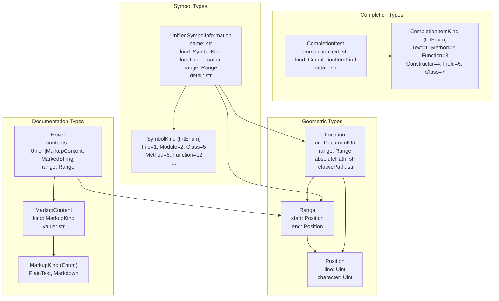
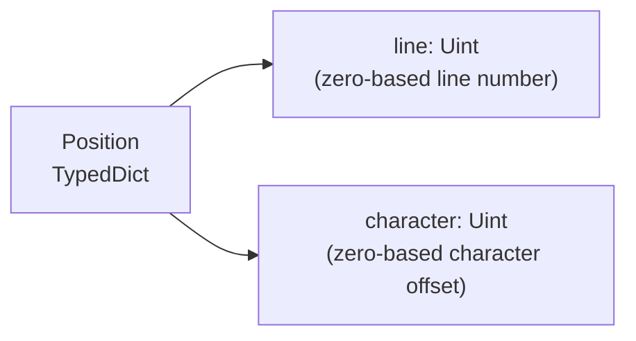
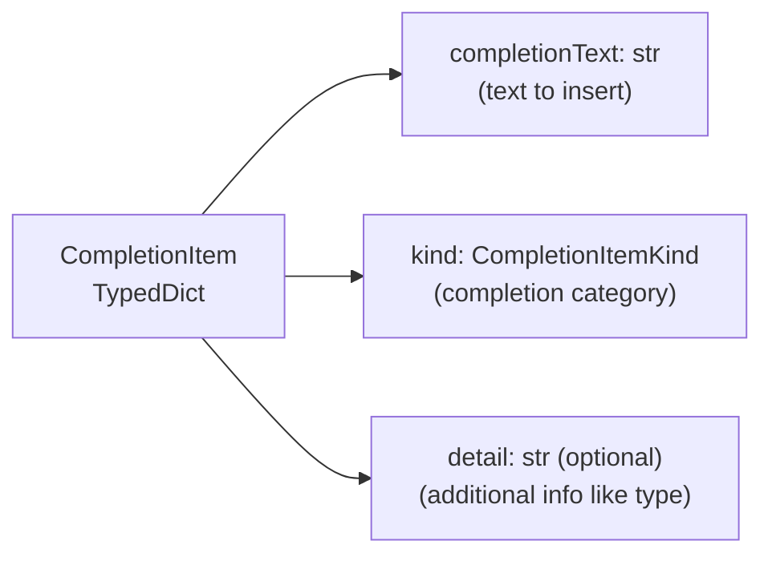
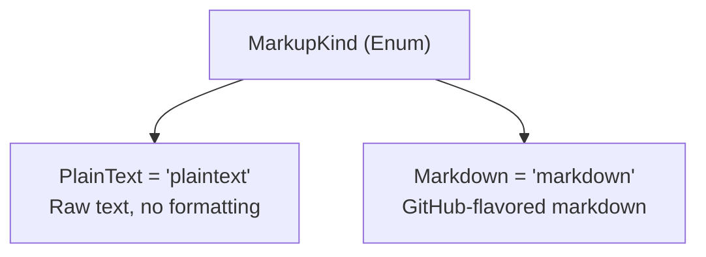
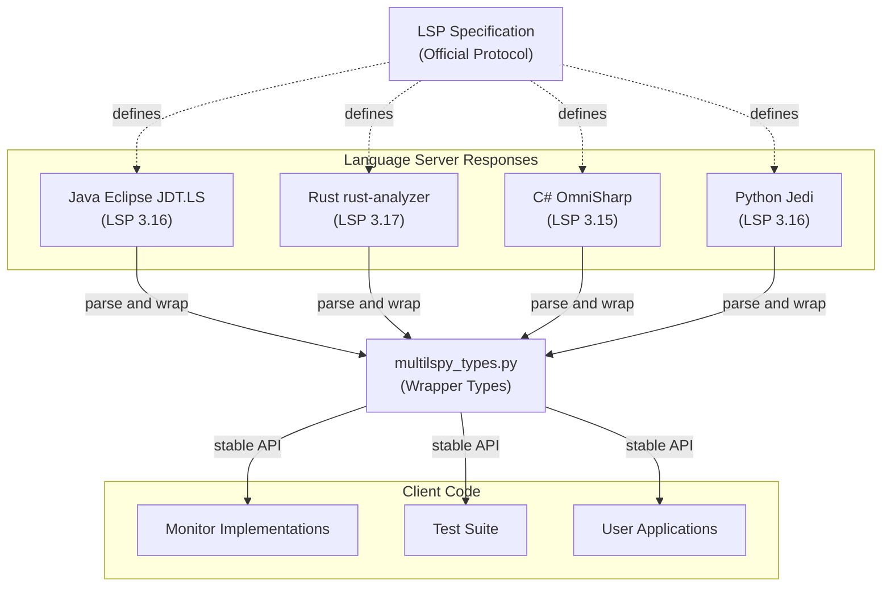
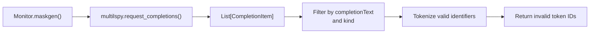
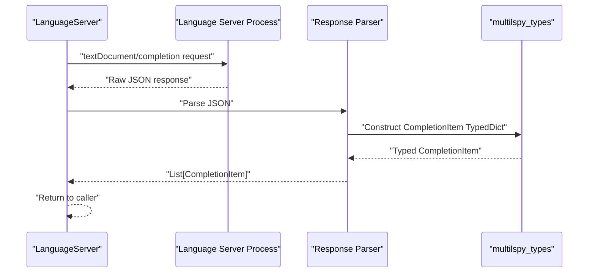

<!-- source: DeepWiki mcp.deepwiki.com · repo microsoft/monitors4codegen · page 4.4 LSP Types and Protocol · fetched 2026-10-26 -->

# LSP Types and Protocol

<details>
<summary>Relevant source files</summary>

The following files were used as context for generating this wiki page:

- [src/monitors4codegen/multilspy/lsp_protocol_handler/lsp_constants.py](src/monitors4codegen/multilspy/lsp_protocol_handler/lsp_constants.py)
- [src/monitors4codegen/multilspy/multilspy_types.py](src/monitors4codegen/multilspy/multilspy_types.py)

</details>


This document describes the type definitions and protocol constants used by the multilspy library to interact with Language Server Protocol (LSP) servers. These types serve as an abstraction layer that decouples multilspy from specific LSP versions, ensuring compatibility and maintainability.

For information about how these types are used in LSP request methods, see [LSP Request Methods](#4.2). For details on the language server client implementations that consume these types, see [Language Server Clients](#4.3).

---

## Purpose and Architecture

The multilspy library defines a complete set of type wrappers around LSP responses in [src/monitors4codegen/multilspy/multilspy_types.py:1-283](). These wrappers provide two key benefits:

1. **Version Decoupling**: By wrapping LSP types, multilspy can maintain a stable API even as the LSP specification evolves
2. **Language Agnostic Interface**: The same type definitions work across all supported languages (Java, Rust, C#, Python)

The type system is organized into several categories:
- **Geometric Types**: Position, Range, Location for identifying code spans
- **Completion Types**: CompletionItem, CompletionItemKind for code completion results
- **Symbol Types**: UnifiedSymbolInformation, SymbolKind for code structure information
- **Documentation Types**: Hover, MarkupContent for displaying information to users

**Sources:** [src/monitors4codegen/multilspy/multilspy_types.py:1-8]()

---

## Type Hierarchy and Relationships

The following diagram shows how the core types compose to represent information about code:



**Sources:** [src/monitors4codegen/multilspy/multilspy_types.py:10-283]()

---

## Core Geometric Types

### Position

The `Position` type represents a zero-based location within a text document. It is the fundamental building block for all location-based types.



**Type Definition:**
- **line** (`Uint`): Zero-based line number. If greater than document line count, defaults to the last line [src/monitors4codegen/multilspy/multilspy_types.py:44-48]()
- **character** (`Uint`): Zero-based character offset. Encoding is negotiated between client and server (UTF-16, UTF-8, etc.) [src/monitors4codegen/multilspy/multilspy_types.py:49-56]()

**Character Encoding Notes:** Since LSP 3.17, clients and servers can negotiate position encoding. multilspy inherits the encoding used by the specific language server, typically UTF-16 for compatibility with older LSP versions [src/monitors4codegen/multilspy/multilspy_types.py:21-37]().

**Sources:** [src/monitors4codegen/multilspy/multilspy_types.py:15-56]()

### Range

The `Range` type specifies a span of text between two positions:

| Field | Type | Description |
|-------|------|-------------|
| `start` | `Position` | The range's start position (inclusive) |
| `end` | `Position` | The range's end position (exclusive) |

**Line-Spanning Ranges:** To specify a range that includes a line ending, use an end position at the start of the next line. For example, to include line 5 completely:
```python
{
    "start": {"line": 5, "character": 23},
    "end": {"line": 6, "character": 0}
}
```

**Sources:** [src/monitors4codegen/multilspy/multilspy_types.py:59-75]()

### Location

The `Location` type represents a position within a specific file:

| Field | Type | Description |
|-------|------|-------------|
| `uri` | `DocumentUri` | The document's URI |
| `range` | `Range` | The text range within the document |
| `absolutePath` | `str` | Absolute filesystem path (multilspy extension) |
| `relativePath` | `str` | Relative path from workspace root (multilspy extension) |

The `absolutePath` and `relativePath` fields are multilspy-specific additions that simplify file path handling across different language servers [src/monitors4codegen/multilspy/multilspy_types.py:78-85]().

**Sources:** [src/monitors4codegen/multilspy/multilspy_types.py:78-85]()

---

## Completion Types

Completion types are returned by `textDocument/completion` requests and used by monitors like `DereferencesMonitor` to constrain valid token generation.

### CompletionItemKind

The `CompletionItemKind` enum categorizes completion items by their semantic role:

| Value | Name | Description |
|-------|------|-------------|
| 1 | Text | Plain text completion |
| 2 | Method | Instance method |
| 3 | Function | Standalone function |
| 4 | Constructor | Class constructor |
| 5 | Field | Class or struct field |
| 6 | Variable | Local or parameter variable |
| 7 | Class | Class definition |
| 8 | Interface | Interface definition |
| 9 | Module | Module or namespace |
| 10 | Property | Property accessor |
| 13 | Enum | Enum type |
| 20 | EnumMember | Enum constant |
| 22 | Struct | Struct definition |

Complete enumeration available in [src/monitors4codegen/multilspy/multilspy_types.py:87-114]().

**Sources:** [src/monitors4codegen/multilspy/multilspy_types.py:87-114]()

### CompletionItem

The `CompletionItem` type represents a single completion suggestion:



| Field | Type | Required | Description |
|-------|------|----------|-------------|
| `completionText` | `str` | Yes | The text to insert when selected |
| `kind` | `CompletionItemKind` | Yes | The type of completion |
| `detail` | `str` | No | Human-readable detail (e.g., method signature) |

**Usage in Monitors:** The `DereferencesMonitor` uses `completionText` to extract valid identifiers after a dot operator, filtering them through the tokenizer to construct token blacklists [src/monitors4codegen/multilspy/multilspy_types.py:116-132]().

**Sources:** [src/monitors4codegen/multilspy/multilspy_types.py:116-132]()

---

## Symbol Types

Symbol types represent structural elements of code (classes, methods, functions) and are returned by `textDocument/documentSymbol` requests.

### SymbolKind

The `SymbolKind` enum identifies different code constructs:

| Value | Name | Description | Used By |
|-------|------|-------------|---------|
| 1 | File | File symbol | Document structure |
| 5 | Class | Class definition | ClassInstantiationMonitor |
| 6 | Method | Instance method | Method signatures |
| 9 | Constructor | Constructor | Object creation |
| 10 | Enum | Enum type | SwitchEnumMonitor |
| 12 | Function | Standalone function | Function calls |
| 22 | EnumMember | Enum constant | Switch cases |

Complete enumeration available in [src/monitors4codegen/multilspy/multilspy_types.py:134-162]().

**Monitor Usage:** `ClassInstantiationMonitor` queries symbols with `kind=SymbolKind.Class` to validate class names after `new` keywords [src/monitors4codegen/multilspy/multilspy_types.py:134-162]().

**Sources:** [src/monitors4codegen/multilspy/multilspy_types.py:134-162]()

### SymbolTag

The `SymbolTag` enum provides metadata about symbols:

| Value | Name | Description |
|-------|------|-------------|
| 1 | Deprecated | Symbol is obsolete |

**Sources:** [src/monitors4codegen/multilspy/multilspy_types.py:164-170]()

### UnifiedSymbolInformation

The `UnifiedSymbolInformation` type describes a code symbol with full metadata:

| Field | Type | Required | Description |
|-------|------|----------|-------------|
| `name` | `str` | Yes | Symbol name (e.g., class or method name) |
| `kind` | `SymbolKind` | Yes | Symbol category |
| `location` | `Location` | No | Where the symbol is defined |
| `range` | `Range` | No | Text span of entire symbol |
| `selectionRange` | `Range` | No | Text span of symbol name only |
| `detail` | `str` | No | Additional info (e.g., method signature) |
| `containerName` | `str` | No | Enclosing symbol name |
| `tags` | `List[SymbolTag]` | No | Metadata tags |
| `deprecated` | `bool` | No | Whether symbol is deprecated (legacy) |

**Field Relationships:**
- `range` encompasses the entire symbol definition including body
- `selectionRange` highlights just the name for navigation
- `location.range` is typically equivalent to `range`

**Sources:** [src/monitors4codegen/multilspy/multilspy_types.py:172-213]()

---

## Documentation Types

Documentation types represent hover information and formatted text content.

### MarkupKind

The `MarkupKind` enum specifies how text content should be rendered:



**Sources:** [src/monitors4codegen/multilspy/multilspy_types.py:217-227]()

### MarkupContent

The `MarkupContent` type pairs formatted text with its rendering format:

| Field | Type | Description |
|-------|------|-------------|
| `kind` | `MarkupKind` | How to interpret the value |
| `value` | `str` | The actual content |

**Markdown Support:** When `kind="markdown"`, the value can contain fenced code blocks, headers, and other GitHub-flavored markdown. Clients may sanitize HTML to prevent script execution [src/monitors4codegen/multilspy/multilspy_types.py:247-274]().

**Sources:** [src/monitors4codegen/multilspy/multilspy_types.py:247-274]()

### MarkedString (Deprecated)

`MarkedString` is a legacy type that can be either a plain string or a code block with language identifier:

```python
# Plain string
marked_string = "Some text"

# Code block
marked_string = {
    "language": "java",
    "value": "public void method() { }"
}
```

**Deprecation Notice:** LSP 3.0+ recommends using `MarkupContent` instead [src/monitors4codegen/multilspy/multilspy_types.py:233-245]().

**Sources:** [src/monitors4codegen/multilspy/multilspy_types.py:229-245]()

### Hover

The `Hover` type represents information displayed when hovering over code:

| Field | Type | Required | Description |
|-------|------|----------|-------------|
| `contents` | `Union[MarkupContent, MarkedString, List[MarkedString]]` | Yes | The hover text |
| `range` | `Range` | No | Text span to highlight |

**Monitor Usage:** `NumArgsMonitor` parses hover content to extract function signatures and determine expected parameter counts [src/monitors4codegen/multilspy/multilspy_types.py:276-283]().

**Sources:** [src/monitors4codegen/multilspy/multilspy_types.py:276-283]()

---

## LSP Protocol Constants

The `LSPConstants` class defines string keys used in LSP JSON-RPC messages. These constants ensure consistent field naming across the codebase.

### Document and Position Constants

```mermaid
graph TB
    LSPConstants["LSPConstants"]
    
    subgraph "Document Identification"
        URI["URI = 'uri'<br/>Document identifier"]
        TEXT_DOCUMENT["TEXT_DOCUMENT = 'textDocument'<br/>Request field"]
        LANGUAGE_ID["LANGUAGE_ID = 'languageId'<br/>java, rust, csharp, python"]
        VERSION["VERSION = 'version'<br/>Document version number"]
        TEXT["TEXT = 'text'<br/>Document content"]
    end
    
    subgraph "Position and Range"
        POSITION["POSITION = 'position'<br/>Cursor location"]
        LINE["LINE = 'line'<br/>Line number"]
        CHARACTER["CHARACTER = 'character'<br/>Column number"]
        RANGE["RANGE = 'range'<br/>Text span"]
    end
    
    subgraph "Symbols"
        NAME["NAME = 'name'<br/>Symbol name"]
        KIND["KIND = 'kind'<br/>Symbol kind"]
        CHILDREN["CHILDREN = 'children'<br/>Nested symbols"]
    end
    
    LSPConstants --> URI
    LSPConstants --> TEXT_DOCUMENT
    LSPConstants --> LANGUAGE_ID
    LSPConstants --> VERSION
    LSPConstants --> TEXT
    LSPConstants --> POSITION
    LSPConstants --> LINE
    LSPConstants --> CHARACTER
    LSPConstants --> RANGE
    LSPConstants --> NAME
    LSPConstants --> KIND
    LSPConstants --> CHILDREN
```



### Complete Constant Reference

| Constant | Value | LSP Usage |
|----------|-------|-----------|
| `URI` | `"uri"` | Document identifier in responses |
| `RANGE` | `"range"` | Text span in locations |
| `TEXT_DOCUMENT` | `"textDocument"` | Request parameter for document operations |
| `LANGUAGE_ID` | `"languageId"` | Programming language identifier |
| `VERSION` | `"version"` | Document version for synchronization |
| `TEXT` | `"text"` | Document content in `textDocument/didOpen` |
| `POSITION` | `"position"` | Cursor position in requests |
| `LINE` | `"line"` | Line number field |
| `CHARACTER` | `"character"` | Character offset field |
| `CONTENT_CHANGES` | `"contentChanges"` | Document changes in `textDocument/didChange` |
| `NAME` | `"name"` | Symbol name field |
| `KIND` | `"kind"` | Symbol/completion kind field |
| `CHILDREN` | `"children"` | Nested symbols in document symbols |

**Sources:** [src/monitors4codegen/multilspy/lsp_protocol_handler/lsp_constants.py:1-60]()

### LocationLink Constants

For advanced navigation features, LSP supports `LocationLink` which provides more context:

| Constant | Value | Description |
|----------|-------|-------------|
| `ORIGIN_SELECTION_RANGE` | `"originSelectionRange"` | Source location span |
| `TARGET_URI` | `"targetUri"` | Destination document URI |
| `TARGET_RANGE` | `"targetRange"` | Full destination range |
| `TARGET_SELECTION_RANGE` | `"targetSelectionRange"` | Highlighted destination range |

**Sources:** [src/monitors4codegen/multilspy/lsp_protocol_handler/lsp_constants.py:16-26]()

---

## Type Aliases and Basic Types

multilspy defines several type aliases for clarity and LSP compatibility:

| Alias | Underlying Type | Purpose |
|-------|----------------|---------|
| `URI` | `str` | Generic URI string |
| `DocumentUri` | `str` | Document-specific URI |
| `Uint` | `int` | Unsigned integer (Python has no native uint) |
| `RegExp` | `str` | Regular expression pattern |

**Type Safety Note:** While Python's type system doesn't enforce unsigned integers, using `Uint` as an alias documents the intent and matches LSP type names [src/monitors4codegen/multilspy/multilspy_types.py:10-13]().

**Sources:** [src/monitors4codegen/multilspy/multilspy_types.py:10-13]()

---

## Version Decoupling Strategy

The multilspy type system achieves version independence through several design patterns:



### Key Decoupling Mechanisms

1. **TypedDict Classes**: Using `TypedDict` instead of native LSP JSON structures allows adding fields without breaking changes [src/monitors4codegen/multilspy/multilspy_types.py:1-3]()

2. **NotRequired Fields**: Optional fields marked with `NotRequired` accommodate LSP version differences. Older servers may omit fields that newer versions include [src/monitors4codegen/multilspy/multilspy_types.py:8]()

3. **Custom Extensions**: Fields like `absolutePath` and `relativePath` in `Location` extend LSP types with convenience properties specific to multilspy [src/monitors4codegen/multilspy/multilspy_types.py:84-85]()

4. **Enum Wrappers**: Wrapping LSP enums as `IntEnum` or `Enum` classes allows multilspy to handle version-specific enum values gracefully [src/monitors4codegen/multilspy/multilspy_types.py:87-114]()

**Sources:** [src/monitors4codegen/multilspy/multilspy_types.py:1-8](), [src/monitors4codegen/multilspy/multilspy_types.py:84-85]()

---

## Type Usage Patterns

### In Monitor Implementations

Monitors consume these types to make decisions about token masking:



**Example from DereferencesMonitor:**
1. Request completions at cursor position
2. Extract `completionText` from each `CompletionItem`
3. Filter by `kind` (e.g., only fields and methods)
4. Tokenize valid completion texts
5. Return tokens not in valid set as blacklist

**Sources:** [src/monitors4codegen/multilspy/multilspy_types.py:116-132]()

### In Language Server Clients

Language server implementations map raw JSON responses to these types:



The parsing logic in each language server client handles server-specific JSON formats and normalizes them to multilspy types.

**Sources:** [src/monitors4codegen/multilspy/multilspy_types.py:116-132]()

---

## Summary

The multilspy type system provides:

- **Comprehensive LSP Coverage**: All major LSP response types (Position, Range, Location, CompletionItem, UnifiedSymbolInformation, Hover)
- **Version Independence**: TypedDict-based wrappers insulate client code from LSP specification changes
- **Language Agnostic**: Same types work across Java, Rust, C#, and Python language servers
- **Monitor Integration**: Types are designed for efficient use in token-masking monitors
- **Protocol Constants**: Centralized string constants ensure consistent LSP field naming

These types form the foundation for Monitor-Guided Decoding's ability to query language servers and constrain code generation based on static analysis results.

**Sources:** [src/monitors4codegen/multilspy/multilspy_types.py:1-283](), [src/monitors4codegen/multilspy/lsp_protocol_handler/lsp_constants.py:1-60]()

---

