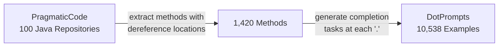
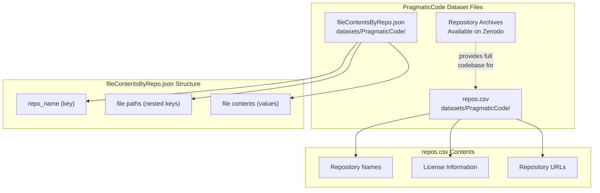
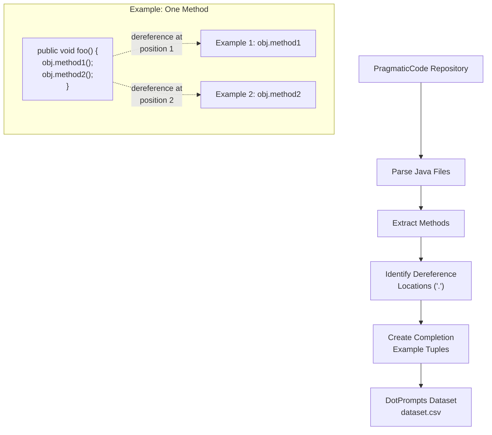
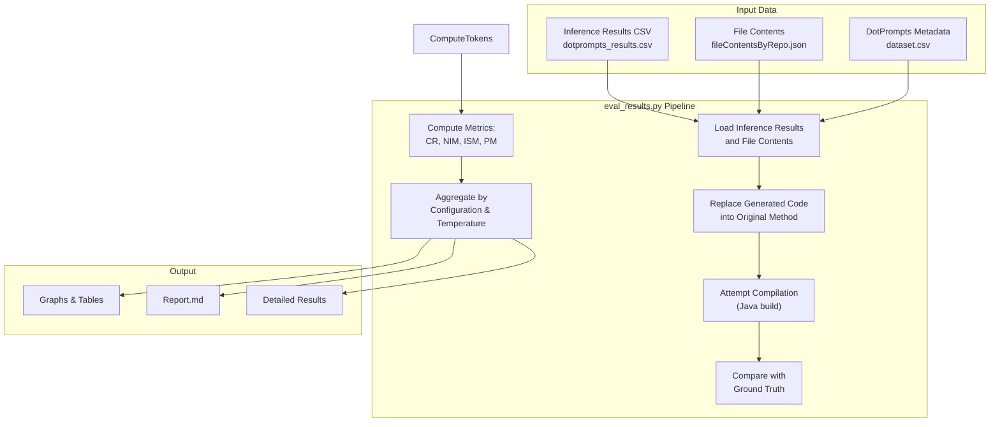
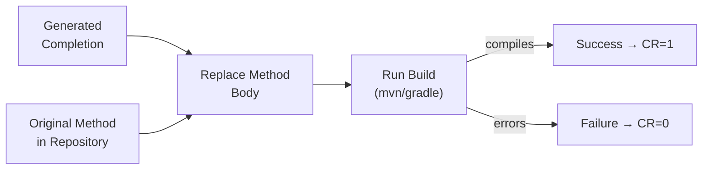
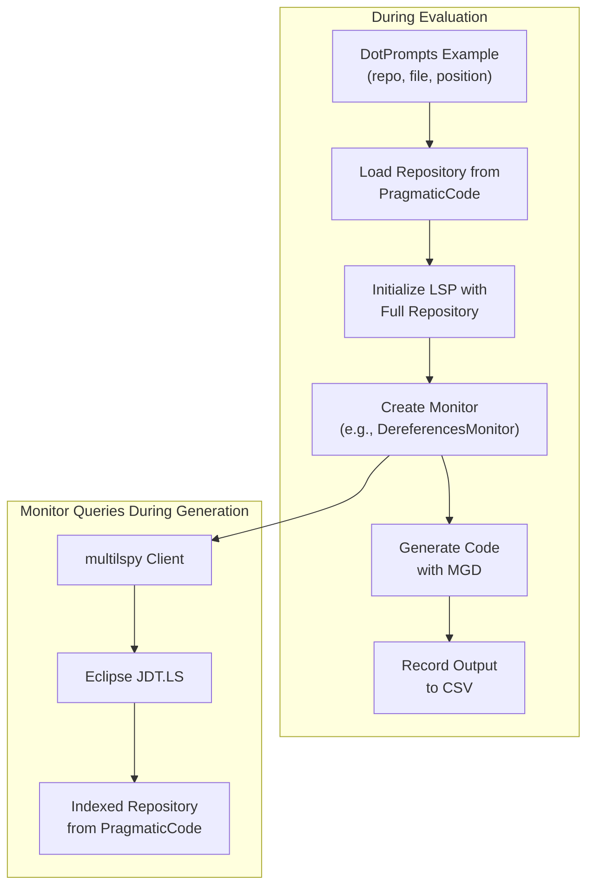

<!-- source: DeepWiki mcp.deepwiki.com · repo microsoft/monitors4codegen · page 5 Datasets and Evaluation · fetched 2026-10-26 -->

# Datasets and Evaluation

<details>
<summary>Relevant source files</summary>

The following files were used as context for generating this wiki page:

- [README.md](README.md)
- [tests/monitor_guided_decoding/test_typestate_monitor_rust.py](tests/monitor_guided_decoding/test_typestate_monitor_rust.py)

</details>


## Purpose and Scope

This page documents the datasets and evaluation infrastructure provided in the monitors4codegen repository. It covers:

- **PragmaticCode**: A dataset of 100 real-world Java repositories (see [5.1](#5.1))
- **DotPrompts**: A benchmark dataset of 10,538 code completion examples (see [5.2](#5.2))
- **Evaluation Pipeline**: Scripts, metrics, and methodologies for evaluating code generation quality (see [5.3](#5.3))

For information about how these datasets are used with Monitor-Guided Decoding, see [Monitor-Guided Decoding](#3). For details on monitor implementations that use these datasets during testing, see [Monitor Implementations](#3.2).

## Dataset Overview

The repository provides two interconnected datasets designed to evaluate Language Models of Code with repository-level context:

| Dataset | Type | Size | Purpose |
|---------|------|------|---------|
| **PragmaticCode** | Java Repositories | 100 repos | Provides full repository context with buildable codebases |
| **DotPrompts** | Completion Examples | 10,538 examples from 1,420 methods | Benchmarks code completion at dereference locations |

### Dataset Statistics



**Sources:** [README.md:25-44]()

---

## PragmaticCode Dataset

### Overview and Characteristics

PragmaticCode is a collection of 100 real-world, open-source Java projects that meet specific criteria:

1. **Buildable**: Each repository includes its complete development environment and dependencies through build systems (Maven, Gradle)
2. **Post-cutoff**: All repositories were released publicly after **March 31, 2022**, ensuring they are not in the training data of models like CodeGen, SantaCoder, and text-davinci-003
3. **Real-world**: Projects are production codebases, not toy examples or academic exercises

### Repository Structure



### Dataset Files

| File | Location | Description |
|------|----------|-------------|
| `repos.csv` | [datasets/PragmaticCode/repos.csv]() | List of all 100 repositories with licenses |
| `fileContentsByRepo.json` | [datasets/PragmaticCode/fileContentsByRepo.json]() | Complete file contents required for inference |
| Repository archives | Zenodo: https://zenodo.org/records/10072088 | Full repository zip files |

### File Contents Structure

The `fileContentsByRepo.json` file provides a nested JSON structure mapping repositories to their source files:

```json
{
  "repository_name": {
    "relative/path/to/file.java": "file contents as string",
    "another/file.java": "..."
  }
}
```

This structure enables the evaluation pipeline to access file contents without requiring the full repository to be cloned locally.

**Sources:** [README.md:25-37]()

---

## DotPrompts Dataset

### Overview and Purpose

DotPrompts is a benchmark dataset derived from PragmaticCode, specifically designed to evaluate code completion at **dereference locations** (positions with the `.` operator in Java). Each example represents a method-level code completion task that requires understanding repository-level context.

### Dataset Characteristics

- **Source**: Extracted from PragmaticCode repositories
- **Size**: 10,538 individual completion examples
- **Methods**: 1,420 unique methods containing dereference locations
- **Language**: Java
- **Focus**: Testing LLM ability to utilize repository context for type-aware completion

### Example Tuple Structure

Each example in DotPrompts is represented as a 5-tuple:

```
(repo, classFileName, methodStartIdx, methodStopIdx, dot_idx)
```

| Field | Type | Description |
|-------|------|-------------|
| `repo` | String | Name of the repository from PragmaticCode |
| `classFileName` | String | Relative path to the Java file |
| `methodStartIdx` | Integer | String index of the opening `{` of the method |
| `methodStopIdx` | Integer | String index of the closing `}` of the method |
| `dot_idx` | Integer | String index of the `.` operator (completion point) |

### Dataset Derivation Process



### Compilation Support

A key feature of DotPrompts is **compilation-based evaluation**. Since all PragmaticCode repositories are buildable:

1. Generated code can be substituted into the original method location
2. The modified repository can be compiled
3. Compilation success/failure provides a strong signal of code correctness

This enables the **Compilation Rate (CR)** metric, which is not available in most code generation benchmarks.

### Dataset File Location

The complete DotPrompts dataset is available at:
- **Path**: [datasets/DotPrompts/dataset.csv]()
- **Format**: CSV with columns matching the tuple structure

**Sources:** [README.md:39-44]()

---

## Evaluation Pipeline

### Overview

The evaluation pipeline takes generated code from language models and computes multiple metrics to assess generation quality. The pipeline supports both baseline LLM generation and MGD-guided generation for comparison.

### Evaluation Flow



### Evaluation Script Usage

The evaluation script `eval_results.py` is invoked as follows:

```bash
python3 eval_results.py <inference_csv> <file_contents_json> <output_directory>
```

**Example**:
```bash
python3 evaluation_scripts/eval_results.py \
    inference_results/dotprompts_results.csv \
    datasets/PragmaticCode/fileContentsByRepo.json \
    results/
```

This command:
1. Reads generated code from `inference_results/dotprompts_results.csv`
2. Loads original file contents from `fileContentsByRepo.json`
3. Creates output directory `results/` with graphs, tables, and `Report.md`

### Evaluation Metrics

The pipeline computes four key metrics:

| Metric | Full Name | Description | Granularity |
|--------|-----------|-------------|-------------|
| **CR** | Compilation Rate | Percentage of generated completions that compile successfully | Method-level |
| **NIM** | Next-Identifier Match | Exact match of the next identifier token | Token-level |
| **ISM** | Identifier-Sequence Match | Whether ground truth identifiers appear as an ordered subsequence | Sequence-level |
| **PM** | Prefix Match | Whether generated code is a prefix of the ground truth | String-level |

#### Compilation Rate (CR)



**Calculation**: CR is the percentage of examples where `compilationSucceeded == 1`

#### Next-Identifier Match (NIM)

Measures whether the **first identifier token** generated matches the ground truth first identifier.

**Example**:
- Ground truth: `builder.setHost("localhost")`
- Generated: `builder.setHost("127.0.0.1")`
- Next identifier: `setHost` ✓ **Match**

#### Identifier-Sequence Match (ISM)

Checks if all ground truth identifiers appear in the generated code in the **same order** (but not necessarily consecutively).

**Example**:
- Ground truth identifiers: `[builder, setHost, setPort]`
- Generated identifiers: `[builder, setHost, extra, setPort, done]`
- ISM: **True** (all ground truth identifiers present in order)

#### Prefix Match (PM)

Determines whether the generated string is a **prefix** of the ground truth string.

**Example**:
- Ground truth: `builder.setHost("localhost").setPort(8080)`
- Generated: `builder.setHost("localhost")`
- PM: **True**

### Inference Results CSV Format

The evaluation pipeline expects inference results in a specific CSV format:

| Column | Type | Description | Example Values |
|--------|------|-------------|----------------|
| `repo` | String | Repository name | `"apache/commons-lang"` |
| `classFileName` | String | Relative path to file | `"src/main/java/Util.java"` |
| `methodStartIdx` | Integer | Method start position | `1234` |
| `methodStopIdx` | Integer | Method end position | `1567` |
| `dot_idx` | Integer | Completion point position | `1345` |
| `configuration` | String | Model configuration identifier | `"SC-MGD"`, `"TD-3"` |
| `temperature` | Float | Sampling temperature | `0.2`, `0.4`, `0.6`, `0.8` |
| `model` | String | Model name | `"bigcode/santacoder"` |
| `context` | String | Decoding strategy | `"autoregressive"`, `"fim"` |
| `prefix` | String | Prompt strategy | `"none"`, `"classExprTypes"`, `"rlpg"` |
| `rlpg_best_rule_name` | String | RLPG rule used | `"in_file#lines#0.5"` |
| `output` | String | Generated code | Multi-line code string |
| `compilationSucceeded` | Integer | Compilation result | `1` (success), `0` (failure) |

### Configuration Naming Convention

Model configurations follow this naming pattern:

```
{MODEL}-{PREFIX}-{STRATEGY}
```

**Examples**:
- `SC-MGD`: SantaCoder with Monitor-Guided Decoding
- `TD-3`: text-davinci-003 baseline
- `CG-6B-MGD`: CodeGen-6B with MGD
- `SC-FIM-classExprTypes`: SantaCoder with Fill-In-the-Middle and classExprTypes prefix

### Sample Test Command

To verify the evaluation pipeline setup, run:

```bash
python3 evaluation_scripts/eval_results.py \
    inference_results/dotprompts_results_sample.csv \
    datasets/PragmaticCode/fileContentsByRepo.json \
    results_sample/
```

This uses the sample dataset at [inference_results/dotprompts_results_sample.csv]() for quick validation.

### Output Structure

The evaluation pipeline generates:

1. **Graphs**: Visual comparisons of metrics across configurations
2. **Tables**: Detailed metric breakdowns by temperature and configuration
3. **Report.md**: Markdown report correlating outputs with paper sections
4. **Raw data**: CSV files with per-example results

### Complete Inference Results

The full inference results for all model configurations reported in the paper are available at:
- **Path**: [inference_results/dotprompts_results.csv]()
- **Storage**: Git LFS (Large File Storage)
- **Size**: Contains 6 samples × 18 configurations × 10,538 examples

**Note**: This file uses Git LFS and may require `git lfs clone` to download properly.

**Sources:** [README.md:46-108](), [README.md:79-93]()

---

## Dataset and Evaluation Integration with MGD

### How Monitors Use Repository Context



Each test in the repository demonstrates this integration:
- Tests in [tests/monitor_guided_decoding/]() use small test repositories
- Evaluation scripts use full PragmaticCode repositories
- Both follow the same pattern: LSP indexing → Monitor creation → MGD generation

### Example: Typestate Monitor Test

The test at [tests/monitor_guided_decoding/test_typestate_monitor_rust.py:25-111]() demonstrates:

1. **Repository setup** (lines 30-34): Configures Rust repository with specific commit
2. **LSP initialization** (line 44): Creates `SyncLanguageServer` for the repository
3. **File buffer creation** (line 50): Sets up `MonitorFileBuffer` at target position
4. **Monitor creation** (line 60): Instantiates `DereferencesMonitor` with tokenizer
5. **MGD generation** (lines 94-100): Uses `MGDLogitsProcessor` with the monitor
6. **Validation** (lines 105-110): Asserts correct typestate-respecting output

This pattern is replicated across all monitor tests and scales to the full evaluation pipeline.

**Sources:** [tests/monitor_guided_decoding/test_typestate_monitor_rust.py:1-111](), [README.md:178-205]()

---

