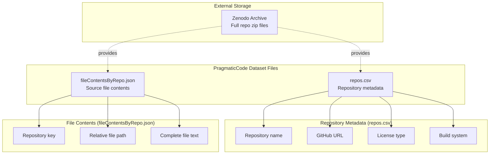
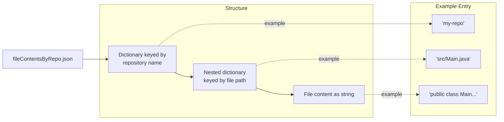
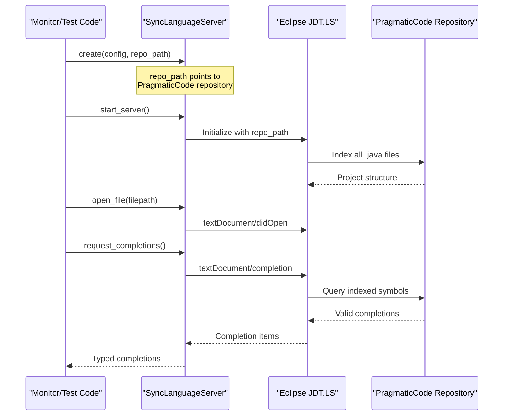
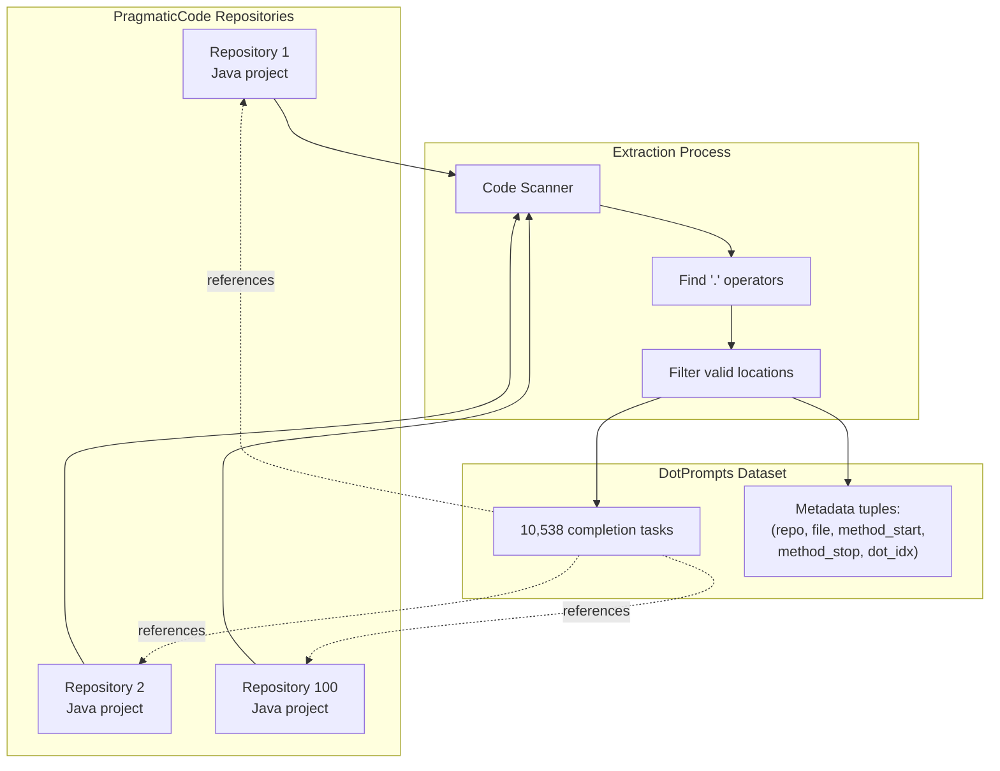
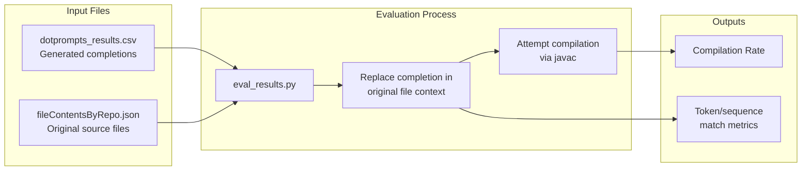

<!-- source: DeepWiki mcp.deepwiki.com · repo microsoft/monitors4codegen · page 5.1 PragmaticCode Dataset · fetched 2026-10-26 -->

# PragmaticCode Dataset

<details>
<summary>Relevant source files</summary>

The following files were used as context for generating this wiki page:

- [README.md](README.md)
- [tests/monitor_guided_decoding/test_typestate_monitor_rust.py](tests/monitor_guided_decoding/test_typestate_monitor_rust.py)

</details>


## Purpose and Scope

This document describes the **PragmaticCode** dataset, a collection of 100 real-world open-source Java repositories used as the foundation for evaluating Monitor-Guided Decoding. PragmaticCode provides complete repository contexts, including source files, build configurations, and dependencies, enabling static analysis via Language Server Protocol and realistic code generation benchmarks.

For information about the derived completion tasks, see [DotPrompts Dataset](#5.2). For evaluation methodologies and metrics, see [Evaluation Metrics and Scripts](#5.3).

---

## Dataset Overview

PragmaticCode serves as a testbed for repository-level code generation and static analysis. Each repository is buildable and contains authentic project structures with dependencies managed through standard build systems (Maven, Gradle).

### Key Statistics

| Metric | Value |
|--------|-------|
| Number of repositories | 100 |
| Programming language | Java |
| Build systems | Maven, Gradle |
| Temporal cutoff | Released after March 31, 2022 |
| Availability | Zenodo + local files |

**Sources:** [README.md:27-37]()

### Design Goals

The dataset was constructed with specific requirements:

1. **Post-training temporal isolation**: All repositories were released after March 31, 2022, ensuring they were not part of the training data for CodeGen, SantaCoder, and text-davinci-003 models
2. **Complete build environments**: Each repository includes all necessary build configurations and dependency specifications
3. **Real-world complexity**: Repositories represent authentic open-source projects with production-quality code
4. **LSP compatibility**: All repositories can be indexed by Eclipse JDT.LS for static analysis

**Sources:** [README.md:34-36]()

---

## Dataset Structure and Files

The PragmaticCode dataset consists of two primary data files organized under the `datasets/PragmaticCode/` directory:



**Dataset File Organization**

**Sources:** [README.md:37-38]()

### repos.csv Format

The `datasets/PragmaticCode/repos.csv` file contains metadata for all 100 repositories:

| Column | Description |
|--------|-------------|
| Repository name | Project identifier |
| GitHub URL | Source repository location |
| License | Open-source license type |
| Commit hash | Specific commit version |
| Build system | Maven or Gradle |

Each row represents a single repository with its corresponding metadata. The file serves as an index for the complete dataset.

**Sources:** [README.md:37]()

### fileContentsByRepo.json Format

The `datasets/PragmaticCode/fileContentsByRepo.json` file stores the actual source code content required for inference and evaluation:



**JSON Structure**

The JSON structure follows this schema:

```
{
  "repository_name": {
    "relative/path/to/file.java": "complete file contents as string",
    "another/path/file.java": "complete file contents as string",
    ...
  },
  ...
}
```

This format enables efficient lookup during evaluation when generated code must be reintegrated into its original file context for compilation checking.

**Sources:** [README.md:37-38](), [README.md:69]()

---

## Repository Selection Criteria

### Temporal Isolation

A critical requirement for PragmaticCode repositories is temporal isolation from LLM training data. All selected repositories were verified to have been:

- Initially released or made public **after March 31, 2022**
- Not part of common training corpora for CodeGen, SantaCoder, and text-davinci-003

This ensures that evaluation results reflect genuine code generation capabilities rather than memorization.

**Sources:** [README.md:35-36]()

### Build System Requirements

Each repository must satisfy:

1. **Compilability**: Complete build configurations that allow successful compilation
2. **Dependency resolution**: All dependencies specified in Maven POM files or Gradle build scripts
3. **Standard structure**: Conventional Java project layout with `src/main/java` directories
4. **LSP indexability**: Eclipse JDT.LS can successfully parse and index the project

**Sources:** [README.md:34-35]()

### License Compliance

Repository licenses are tracked in `repos.csv` to ensure:

- Open-source licensing permits research use
- Proper attribution can be maintained
- Redistribution terms are respected

**Sources:** [README.md:37]()

---

## Data Usage in the System

### Integration with multilspy

PragmaticCode repositories provide the codebase context for `multilspy` language server operations:



**LSP Context Provider**

When monitors query language servers for type information, completions, or definitions, the language server analyzes the full PragmaticCode repository context to provide accurate results.

**Sources:** [README.md:34-35](), [tests/monitor_guided_decoding/test_typestate_monitor_rust.py:44-48]()

### Derivation of DotPrompts Dataset

PragmaticCode serves as the source material for the DotPrompts benchmark dataset:



**Completion Task Extraction**

The DotPrompts dataset identifies dereference locations (positions with the `.` operator) across all repositories, creating completion tasks that test models' ability to generate type-valid member accesses. Each task references back to its source repository in PragmaticCode.

**Sources:** [README.md:39-44]()

### Evaluation Pipeline Integration

The evaluation script `eval_results.py` uses PragmaticCode file contents to verify generated code:



**Compilation Context**

The evaluation pipeline retrieves original file contents from `fileContentsByRepo.json`, replaces the completion region with generated code, and attempts to compile the modified file within its repository context. This process verifies that generated code is not only syntactically correct but also semantically valid within the project.

**Sources:** [README.md:69-72](), [README.md:79-94]()

---

## Accessing the Dataset

### Zenodo Repository

The complete dataset, including full repository zip files, is available at:

**https://zenodo.org/records/10072088**

The Zenodo archive contains:
- All 100 repository zip files
- Complete source trees with build configurations
- Binary dependencies where required

**Sources:** [README.md:37]()

### Local Files

Within the cloned repository, PragmaticCode data is located at:

| File Path | Contents |
|-----------|----------|
| `datasets/PragmaticCode/repos.csv` | Repository metadata table |
| `datasets/PragmaticCode/fileContentsByRepo.json` | Source file contents by repository |

**Note**: The `fileContentsByRepo.json` file may be managed by Git LFS due to its size. Ensure Git LFS is installed when cloning the repository to retrieve the complete file.

**Sources:** [README.md:37-38](), [README.md:98]()

### Usage Example

To access repository file contents programmatically:

```python
import json

# Load file contents
with open('datasets/PragmaticCode/fileContentsByRepo.json', 'r') as f:
    file_contents = json.load(f)

# Access specific file
repo_name = 'example-repo'
file_path = 'src/main/java/Example.java'
content = file_contents[repo_name][file_path]
```

**Sources:** Inferred from [README.md:69](), [README.md:79-94]()

---

## Dataset Role in Monitor-Guided Decoding

PragmaticCode enables the core functionality of Monitor-Guided Decoding by providing:

1. **Repository context for LSP**: Full codebases allow language servers to resolve types, find definitions, and provide accurate completions
2. **Realistic test scenarios**: Complex real-world code tests monitors under authentic conditions
3. **Ground truth compilation**: Buildable repositories enable compilation-based metrics
4. **Temporal validity**: Post-training-cutoff releases ensure models cannot rely on memorization

The dataset's design directly supports the Monitor-Guided Decoding workflow where monitors query language servers about the repository context to constrain generation to semantically valid code.

**Sources:** [README.md:4-12](), [README.md:16-23]()

---

