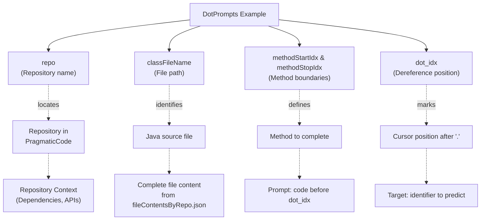
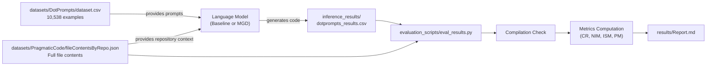
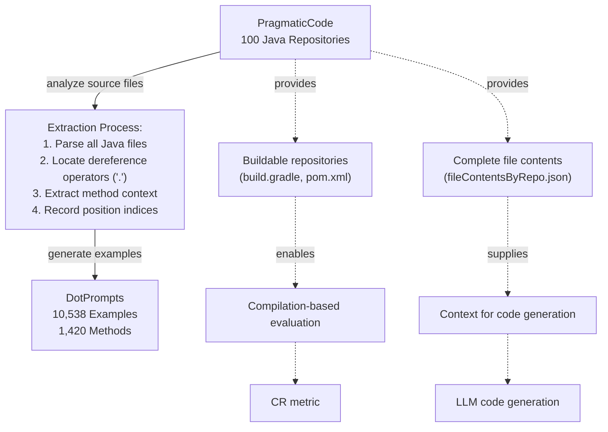
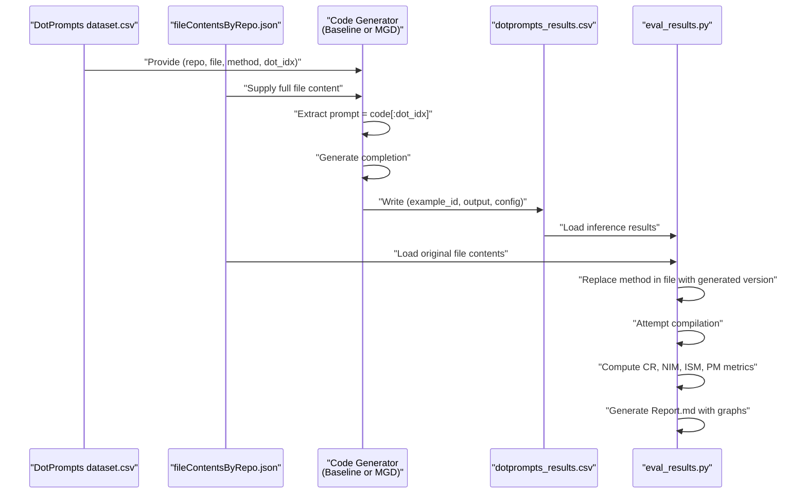

<!-- source: DeepWiki mcp.deepwiki.com · repo microsoft/monitors4codegen · page 5.2 DotPrompts Dataset · fetched 2026-10-26 -->

# DotPrompts Dataset

<details>
<summary>Relevant source files</summary>

The following files were used as context for generating this wiki page:

- [README.md](README.md)
- [tests/monitor_guided_decoding/test_typestate_monitor_rust.py](tests/monitor_guided_decoding/test_typestate_monitor_rust.py)

</details>


This page describes the **DotPrompts** dataset, a benchmark dataset for evaluating Language Models of Code on repository-level context-aware code completion. DotPrompts consists of 10,538 code completion examples derived from real-world Java repositories, specifically focused on testing dereference completions (member access via the "." operator).

For information about the source dataset from which DotPrompts is derived, see [PragmaticCode Dataset](#5.1). For details on how DotPrompts is used in evaluation, see [Evaluation Metrics and Scripts](#5.3).

---

## Overview

DotPrompts is a derived dataset containing code completion tasks extracted from the PragmaticCode repository collection. Each example represents a **dereference location** in Java code—a position immediately following the "." operator where a language model must predict the correct member (field or method) to access on an object.

The dataset is designed to test whether language models can leverage **repository-level context** to generate semantically valid code completions. Since all examples are derived from buildable repositories, DotPrompts supports **compilation-based evaluation** in addition to standard text-matching metrics.

**Sources:** [README.md:39-44]()

---

## Dataset Statistics

The following table summarizes the key statistics of the DotPrompts dataset:

| Metric | Value |
|--------|-------|
| Total number of examples | 10,538 |
| Number of methods containing examples | 1,420 |
| Source repositories (from PragmaticCode) | 100 |
| Programming language | Java |
| Completion type | Dereference (member access) |

**Sources:** [README.md:27-32]()

---

## Dataset Structure

### File Location

The DotPrompts dataset is stored at:
- **Dataset file:** `datasets/DotPrompts/dataset.csv`
- **Repository file contents:** `datasets/PragmaticCode/fileContentsByRepo.json`

**Sources:** [README.md:44](), [README.md:37]()

### Example Tuple Format

Each example in DotPrompts is uniquely identified by a 5-tuple:

```
(repo, classFileName, methodStartIdx, methodStopIdx, dot_idx)
```

| Field | Type | Description |
|-------|------|-------------|
| `repo` | String | Name of the repository from PragmaticCode |
| `classFileName` | String | Relative path to the file containing the method |
| `methodStartIdx` | Integer | String index of the opening `{` of the method |
| `methodStopIdx` | Integer | String index of the closing `}` of the method |
| `dot_idx` | Integer | String index of the `.` operator (dereference point) |

**Sources:** [README.md:44](), [README.md:80-85]()

### Diagram: DotPrompts Example Structure



**Sources:** [README.md:44](), [README.md:80-85]()

---

## Inference Results Format

When DotPrompts is used for model evaluation, inference results are stored in CSV format with additional metadata fields.

### Inference Results CSV Schema

The evaluation pipeline expects the following columns in inference results files:

| Column | Type | Description | Example Values |
|--------|------|-------------|----------------|
| `repo` | String | Repository name | "commons-io" |
| `classFileName` | String | Relative file path | "src/main/java/FileUtils.java" |
| `methodStartIdx` | Integer | Method start position | 1234 |
| `methodStopIdx` | Integer | Method end position | 1567 |
| `dot_idx` | Integer | Dereference position | 1450 |
| `configuration` | String | Model configuration ID | "SC-MGD", "TD-3", "CG-6B-MGD" |
| `temperature` | Float | Sampling temperature | 0.2, 0.4, 0.6, 0.8 |
| `model` | String | Model identifier | "bigcode/santacoder", "text-davinci-003" |
| `context` | String | Decoding strategy | "autoregressive", "fim" |
| `prefix` | String | Prompt strategy | "none", "classExprTypes", "rlpg" |
| `rlpg_best_rule_name` | String/NaN | RLPG rule used | "in_file#lines#0.25" |
| `output` | String | Generated code | Multi-line string |
| `compilationSucceeded` | Integer | Compilation result | 0 (failed), 1 (succeeded) |

**Sources:** [README.md:79-93]()

### Diagram: DotPrompts Data Flow for Evaluation



**Sources:** [README.md:66-77](), [README.md:95-107]()

---

## Dereference Completion Tasks

DotPrompts focuses specifically on **dereference completions**—scenarios where the model must predict the correct member to access on an object. This task requires understanding:

1. **Type information:** The type of the expression before the "."
2. **Available members:** Fields and methods defined on that type
3. **Visibility rules:** Which members are accessible in the current context
4. **Repository context:** Type definitions may be in other files

### Example Scenario

The motivating example from the paper illustrates a typical DotPrompts task:

```
ServerNode.Builder builder = ServerNode.Builder.newServerNode();
builder.█
```

At the cursor position (█), the model must:
- Determine that `builder` has type `ServerNode.Builder`
- Query available methods on `ServerNode.Builder`
- Generate a valid method call (e.g., `builder.setHost(...)`)

Without repository context, models often hallucinate invalid members like `builder.host` or `builder.port` that don't exist in the actual type definition.

**Sources:** [README.md:16-23]()

---

## Relationship to PragmaticCode

DotPrompts is **derived from** the PragmaticCode dataset through an extraction process:



**Sources:** [README.md:25-44]()

Key properties inherited from PragmaticCode:
- All repositories are **buildable** with their complete dependency environments
- Repositories were released after March 31, 2022 (post-training cutoff for evaluated models)
- Complete file contents are available for context provision

---

## Usage in Monitor-Guided Decoding

DotPrompts serves as the primary benchmark for evaluating Monitor-Guided Decoding effectiveness. The dereference focus aligns perfectly with the **DereferencesMonitor**, which ensures type-valid member access during code generation.

### Typical Evaluation Workflow



**Sources:** [README.md:66-77](), [README.md:95-107]()

---

## Evaluation Metrics Supported

DotPrompts examples support four primary evaluation metrics:

| Metric | Abbreviation | Description |
|--------|--------------|-------------|
| **Compilation Rate** | CR | Percentage of generated completions that compile successfully when integrated back into the repository |
| **Next-Identifier Match** | NIM | Exact match of the next identifier token after the dereference operator |
| **Identifier-Sequence Match** | ISM | Generated identifiers appear in correct order as a subsequence of ground truth |
| **Prefix Match** | PM | Generated completion matches ground truth as a string prefix |

All four metrics are computed by the evaluation script when processing DotPrompts results.

**Sources:** [README.md:9](), [README.md:40]()

---

## File References

The DotPrompts dataset involves the following key files in the repository:

| File Path | Description |
|-----------|-------------|
| `datasets/DotPrompts/dataset.csv` | Main dataset file with 10,538 examples |
| `datasets/PragmaticCode/fileContentsByRepo.json` | Complete file contents for all repositories |
| `datasets/PragmaticCode/repos.csv` | List of 100 repositories with licenses |
| `inference_results/dotprompts_results.csv` | Example inference results (via git-lfs) |
| `inference_results/dotprompts_results_sample.csv` | Small sample for testing evaluation pipeline |
| `evaluation_scripts/eval_results.py` | Script to evaluate model outputs |

**Sources:** [README.md:37](), [README.md:44](), [README.md:96-107]()

---

## Data Format Example

The following table shows a conceptual example of a DotPrompts entry:

| Field | Value |
|-------|-------|
| repo | "apache-commons-io" |
| classFileName | "src/main/java/org/apache/commons/io/FileUtils.java" |
| methodStartIdx | 15234 |
| methodStopIdx | 15678 |
| dot_idx | 15456 |

Given this tuple, the evaluation process:
1. Loads the file content from `fileContentsByRepo.json` for "apache-commons-io"
2. Extracts the method from index 15234 to 15678
3. Uses content from 15234 to 15456 as the prompt (ending with ".")
4. Generates a completion after the "."
5. Replaces the method in the full file with the completed version
6. Attempts compilation using the repository's build system

**Sources:** [README.md:80-85]()

---

## Sample Evaluation Command

To evaluate model outputs on DotPrompts, use:

```bash
python3 evaluation_scripts/eval_results.py \
    inference_results/dotprompts_results.csv \
    datasets/PragmaticCode/fileContentsByRepo.json \
    results/
```

This command:
- Reads inference results from `dotprompts_results.csv`
- Loads repository file contents from `fileContentsByRepo.json`
- Outputs evaluation results, graphs, and `Report.md` to `results/` directory

**Sources:** [README.md:66-77](), [README.md:102-107]()

---

