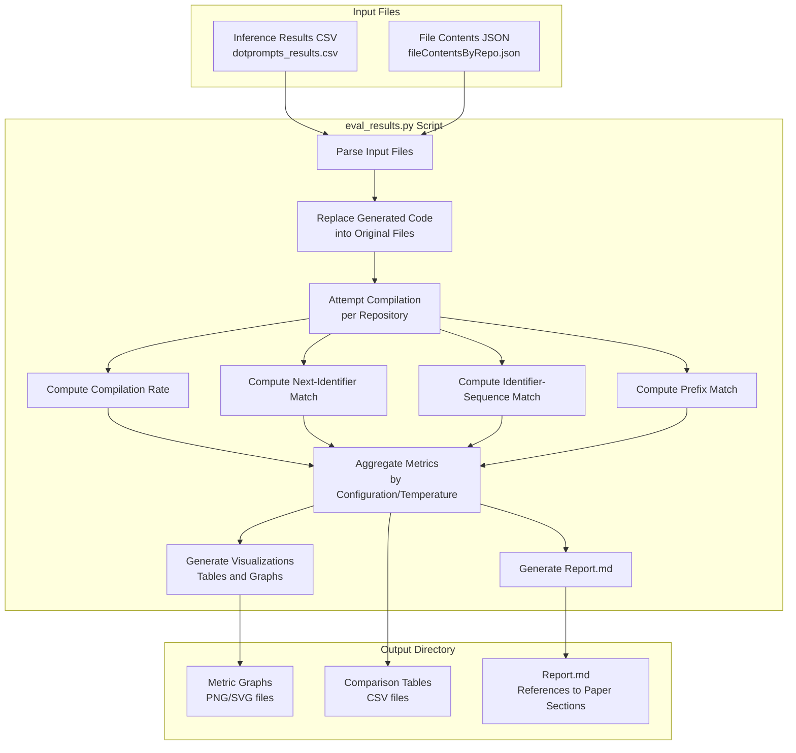
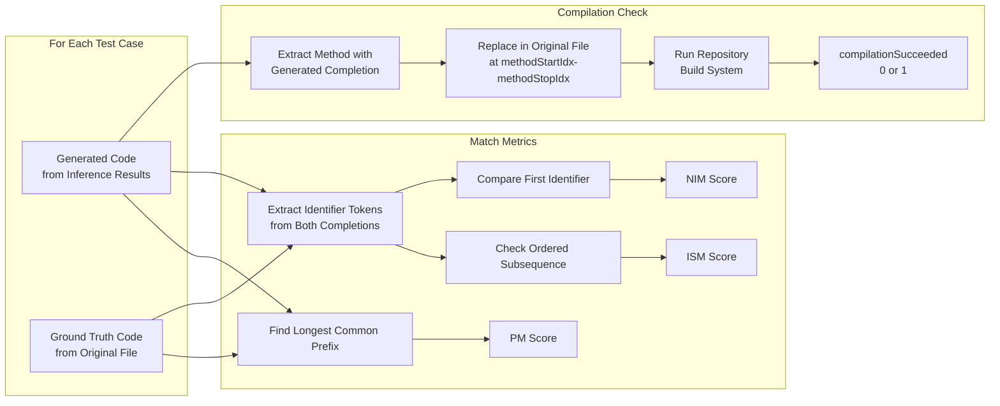
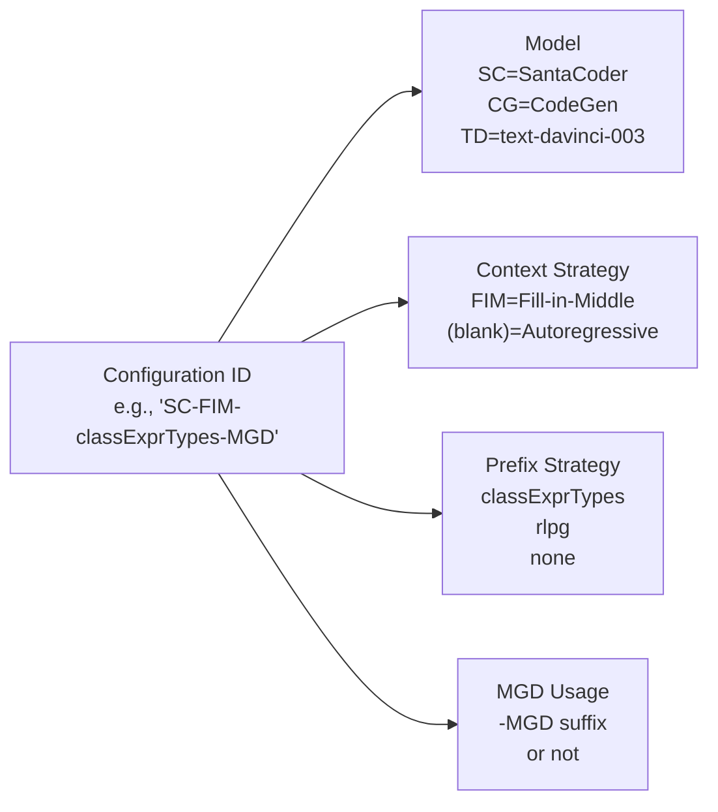
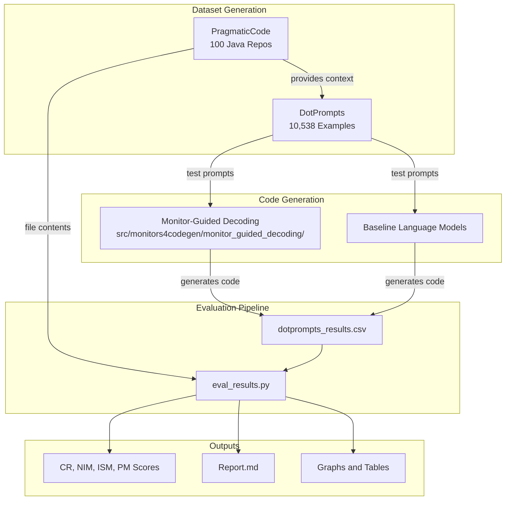

<!-- source: DeepWiki mcp.deepwiki.com · repo microsoft/monitors4codegen · page 5.3 Evaluation Metrics and Scripts · fetched 2026-10-26 -->

# Evaluation Metrics and Scripts

<details>
<summary>Relevant source files</summary>

The following files were used as context for generating this wiki page:

- [README.md](README.md)
- [tests/monitor_guided_decoding/test_typestate_monitor_rust.py](tests/monitor_guided_decoding/test_typestate_monitor_rust.py)

</details>


## Purpose and Scope

This document describes the evaluation infrastructure for assessing the quality of code generated by language models, both with and without Monitor-Guided Decoding. The evaluation pipeline measures four key metrics across generated code samples and produces comprehensive reports with visualizations.

For information about the datasets used as test cases, see [PragmaticCode Dataset](#5.1) and [DotPrompts Dataset](#5.2). For information about the Monitor-Guided Decoding framework that generates the code being evaluated, see [Monitor-Guided Decoding](#3).

**Sources:** [README.md:1-239]()

---

## Evaluation Metrics

The evaluation framework computes four metrics to assess the quality of generated code completions:

| Metric | Abbreviation | Description | Purpose |
|--------|--------------|-------------|---------|
| Compilation Rate | CR | Percentage of generated completions that compile successfully when integrated into the repository | Measures syntactic and semantic correctness |
| Next-Identifier Match | NIM | Exact match of the first generated identifier with ground truth | Token-level accuracy at the completion point |
| Identifier-Sequence Match | ISM | Ordered subsequence match of identifiers in generation vs. ground truth | Measures structural similarity |
| Prefix Match | PM | Longest common prefix between generation and ground truth | Character-level accuracy measurement |

### Compilation Rate (CR)

Compilation Rate measures the percentage of generated code samples that compile successfully when substituted into their original file context within the complete repository. This is the primary metric for assessing real-world usability, as non-compiling code cannot be executed or deployed.

The evaluation script replaces the generated method completion into the original file from PragmaticCode, then attempts compilation using the repository's build system. A binary result (1 for success, 0 for failure) is recorded in the `compilationSucceeded` column.

### Next-Identifier Match (NIM)

NIM evaluates whether the first identifier in the generated completion exactly matches the first identifier in the ground truth completion. For the DotPrompts dataset, this typically measures whether the model correctly predicted the member/method name immediately following a dereference operator (`.`).

### Identifier-Sequence Match (ISM)

ISM extracts all identifiers from both the generated completion and ground truth, then checks if the identifiers in the generation appear in the same order as in the ground truth (as an ordered subsequence). This captures structural correctness even when the exact code differs.

### Prefix Match (PM)

PM computes the longest common prefix between the generated completion and ground truth at the character level. This provides a fine-grained measure of how far into the completion the model generated correct code before diverging.

**Sources:** [README.md:7-10](), [README.md:40-41]()

---

## Evaluation Pipeline Architecture

The following diagram illustrates the complete evaluation pipeline:

### Evaluation Pipeline Data Flow



**Sources:** [README.md:46-77](), [README.md:102-107]()

### Metrics Computation Process



**Sources:** [README.md:7-10](), [README.md:40-41]()

---

## Input File Formats

### Inference Results CSV Format

The evaluation script expects a CSV file with the following columns:

| Column | Description | Example Values |
|--------|-------------|----------------|
| `repo` | Repository name from PragmaticCode | `"Alluxio/alluxio"` |
| `classFileName` | Relative path to file containing test case | `"core/server/master/src/main/java/alluxio/master/file/FileSystemMaster.java"` |
| `methodStartIdx` | String index of method opening `{` | `42567` |
| `methodStopIdx` | String index of method closing `}` | `43891` |
| `dot_idx` | String index of `.` dereference prompt point | `43012` |
| `configuration` | Model configuration identifier | `"SC-MGD"`, `"CG-6B"`, `"TD-3"` |
| `temperature` | Sampling temperature used | `0.2`, `0.4`, `0.6`, `0.8` |
| `model` | Language model name | `"bigcode/santacoder"`, `"Salesforce/codegen-6B-multi"`, `"text-davinci-003"` |
| `context` | Decoding strategy | `"autoregressive"`, `"fim"` |
| `prefix` | Prompt strategy | `"classExprTypes"`, `"none"`, `"rlpg"` |
| `rlpg_best_rule_name` | RLPG prompt rule (if applicable) | `"in_file#lines#0.25"`, `NaN` |
| `output` | Generated code completion | Multi-line string |
| `compilationSucceeded` | Compilation result | `0` or `1` |

The file can contain multiple independently sampled inferences for the same test case with different configurations, temperatures, and random seeds. The evaluation script groups results by configuration and computes aggregate metrics.

**Note:** The CSV may contain multi-line string cells. When viewing in tools like Excel, enable "Word Wrap" for proper display.

**Sources:** [README.md:79-94](), [README.md:100-101]()

### File Contents JSON Format

The `fileContentsByRepo.json` file provides the complete file contents for all files in the PragmaticCode repositories. This enables the evaluation script to reconstruct the original file context for compilation testing.

Structure:
```json
{
  "repository_name": {
    "relative/path/to/file.java": "complete file contents as string",
    "another/file.java": "..."
  }
}
```

The evaluation script uses this to:
1. Retrieve the original file content for each test case
2. Replace the method at `[methodStartIdx, methodStopIdx]` with the generated completion
3. Write the modified file to disk for compilation testing

**Sources:** [README.md:37-38](), [README.md:69-77]()

---

## Running the Evaluation Script

### Command-Line Usage

The evaluation script is invoked from the command line with three arguments:

```bash
python3 eval_results.py <inference_results_csv> <file_contents_json> <output_directory>
```

**Arguments:**
- `<inference_results_csv>`: Path to the inference results CSV file
- `<file_contents_json>`: Path to `fileContentsByRepo.json` from PragmaticCode
- `<output_directory>`: Directory where outputs will be created (created if doesn't exist)

### Example: Testing with Sample Data

To verify the environment setup, run the evaluation on the provided sample dataset:

```bash
python3 evaluation_scripts/eval_results.py \
    inference_results/dotprompts_results_sample.csv \
    datasets/PragmaticCode/fileContentsByRepo.json \
    results_sample/
```

This command uses a small subset of inference results and should complete quickly. If this fails, there may be an issue with the environment setup.

**Sources:** [README.md:66-77]()

### Example: Full Evaluation

To reproduce the results from the paper using all provided inferences:

```bash
python3 evaluation_scripts/eval_results.py \
    inference_results/dotprompts_results.csv \
    datasets/PragmaticCode/fileContentsByRepo.json \
    results/
```

**Note:** The full evaluation processes 10,538 examples × 18 configurations × 6 samples = 1,138,068 individual code generations and may take significant time to complete.

**Sources:** [README.md:102-107]()

### Environment Requirements

The evaluation script requires Python 3.10 or later with dependencies listed in `requirements.txt`. Create a virtual environment and install dependencies:

```bash
# Using venv
python3 -m venv venv_monitors4codegen
source venv_monitors4codegen/bin/activate
pip3 install -r requirements.txt

# Or using conda
conda create -n monitors4codegen python=3.10
conda activate monitors4codegen
pip3 install -r requirements.txt
```

**Sources:** [README.md:47-64]()

---

## Output Structure and Generated Artifacts

### Output Directory Contents

When the evaluation script completes, the output directory contains:

| Artifact | Description |
|----------|-------------|
| `Report.md` | Summary report relating figures to paper sections |
| `*.png` / `*.svg` | Visualization graphs comparing configurations |
| `*_table.csv` | Comparison tables with metric values |
| Intermediate files | Detailed per-configuration results |

### Report Structure

The `Report.md` file provides:
- Overview of evaluated configurations
- References to specific figures and tables
- Mapping of results to sections in the research paper
- Summary statistics for key comparisons (e.g., baseline vs MGD)

### Visualization Graphs

The script generates multiple types of visualizations:

1. **Compilation Rate by Configuration**: Bar charts showing CR for each model configuration
2. **Metric Comparison Tables**: Tables comparing CR, NIM, ISM, PM across configurations
3. **Temperature Sensitivity**: Graphs showing how metrics vary with sampling temperature
4. **Scale Analysis**: Comparisons across different model sizes (350M, 2B, 6B parameters)
5. **MGD vs Baseline**: Side-by-side comparisons highlighting MGD improvements

**Sources:** [README.md:72-73](), [README.md:106-107]()

---

## Configuration Identifiers

The `configuration` column in the inference results uses standardized identifiers that encode multiple experimental parameters:

### Configuration Naming Convention



### Examples:

- `SC-MGD`: SantaCoder with Monitor-Guided Decoding, autoregressive, no special prefix
- `CG-6B`: CodeGen 6B baseline, no MGD
- `SC-FIM-classExprTypes-MGD`: SantaCoder with Fill-in-Middle context, classExprTypes prefix, and MGD
- `TD-3-MGD`: text-davinci-003 with MGD

**Sources:** [README.md:86-91]()

---

## Integration with Other Components

The evaluation infrastructure connects to other repository components:

### Evaluation Context Diagram



**Sources:** [README.md:1-13](), [README.md:102-107]()

---

## Key Findings from Evaluation

The evaluation methodology enables quantitative comparison of different approaches to code generation. As reported in the paper and reproducible through the provided inference results:

- **MGD improves compilation rates by 19-25%** across models of all scales (350M to 175B parameters)
- **No training or fine-tuning required** - MGD constrains generation at inference time only
- **Improvements across all granularities** - from token-level (NIM) to method-level (PM) completions
- **Consistent across temperatures** - benefits observed at multiple sampling temperatures (0.2-0.8)

These results demonstrate that static analysis via Monitor-Guided Decoding can substantially improve code generation quality without model modifications.

**Sources:** [README.md:16-21]()

---

