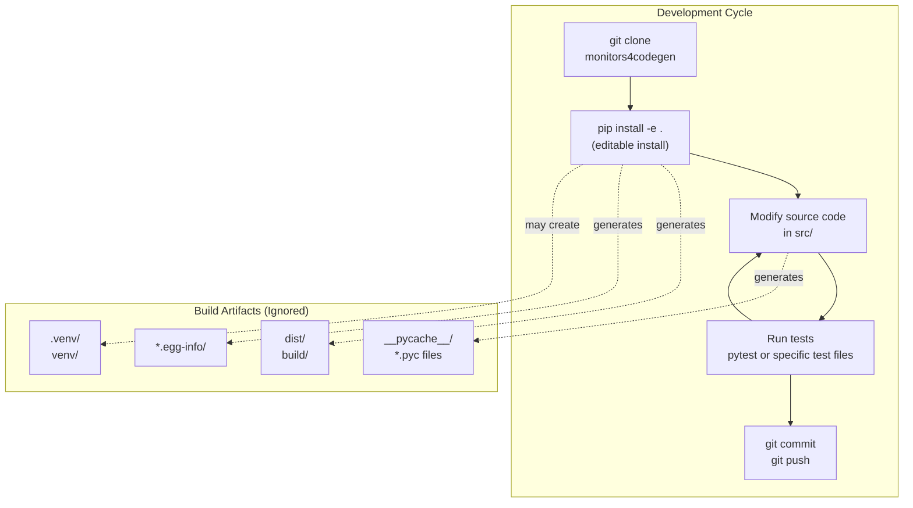
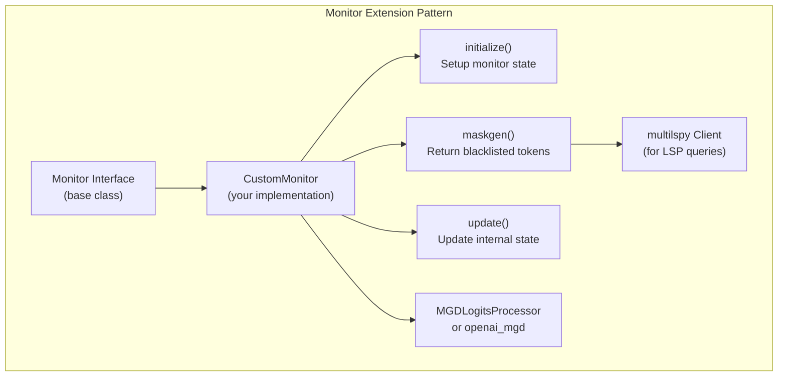
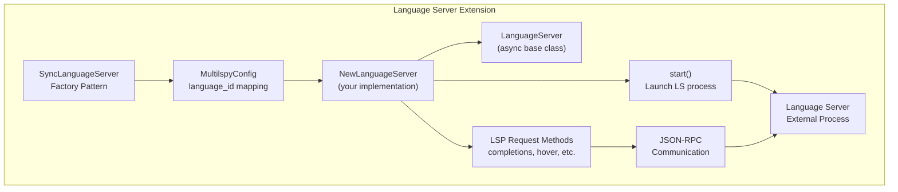
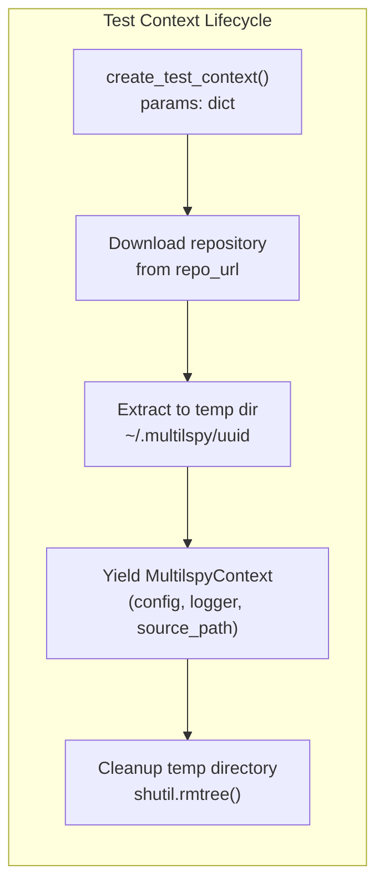
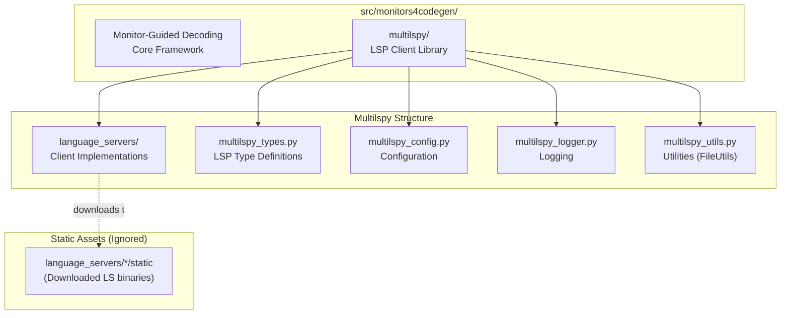

<!-- source: DeepWiki mcp.deepwiki.com · repo microsoft/monitors4codegen · page 6 Development Guide · fetched 2026-10-26 -->

# Development Guide

<details>
<summary>Relevant source files</summary>

The following files were used as context for generating this wiki page:

- [.gitignore](.gitignore)
- [pyproject.toml](pyproject.toml)
- [tests/test_utils.py](tests/test_utils.py)

</details>


## Purpose and Scope

This page provides guidance for developers who want to contribute to the monitors4codegen repository or extend its functionality. It covers development environment setup, build system configuration, dependency management, and architectural patterns for extending the system.

For information about testing infrastructure and running tests, see [Testing](#6.1). For details on the repository structure and build artifacts, see [Project Structure](#6.2).

---

## Development Environment Setup

### Prerequisites

The monitors4codegen project requires:
- **Python**: Version 3.7 or higher [pyproject.toml:14]()
- **Git**: For cloning the repository and managing version control
- **Java Development Kit (JDK)**: Required for Java language server (Eclipse JDT.LS)
- **Rust toolchain**: Required for Rust language server (rust-analyzer)
- **CUDA** (optional): For GPU acceleration with PyTorch models

### Installing in Development Mode

To set up the project for development:

```bash
# Clone the repository
git clone https://github.com/microsoft/monitors4codegen.git
cd monitors4codegen

# Install in editable mode with flit
pip install -e .

# Alternatively, install with pip
pip install -e .
```

The project uses **flit** as its build backend [pyproject.toml:3-4](), which provides a lightweight alternative to setuptools for pure Python packages.

### Verifying CUDA Availability

The `is_cuda_available()` utility function can verify GPU support [tests/test_utils.py:39-50]():

```python
from tests.test_utils import is_cuda_available

if is_cuda_available():
    print("CUDA is available and functional")
else:
    print("CUDA is not available")
```

**Sources:** [pyproject.toml:1-48](), [tests/test_utils.py:39-50]()

---

## Build System and Dependencies

### Build Configuration

The project uses **flit_core** as its build backend [pyproject.toml:2-4](), configured through `pyproject.toml`. This provides:

| Build Component | Configuration | Purpose |
|----------------|---------------|---------|
| Build Backend | flit_core>=3.4 | Lightweight PEP 517 build system |
| Package Discovery | `src/` layout | Clean separation of source and test code |
| Data Files | `include-package-data = true` | Includes non-Python resources |
| Version | 0.0.1 | Current development version |

### Core Dependencies

The project has several categories of dependencies [pyproject.toml:27-37]():

**Language Server Support:**
- `jedi-language-server==0.41.1` - Python LSP server

**Data Validation and Parsing:**
- `pydantic==1.10.5` - Data validation using Python type annotations
- `code-tokenize==0.2.0` - Code tokenization utilities
- `code-ast` (from git) - AST parsing and manipulation

**LLM Integration:**
- `openai==1.3.3` - OpenAI API client
- `torch==1.12.0` - PyTorch for HuggingFace models
- `transformers==4.30.0` - HuggingFace transformers library
- `tiktoken==0.3.3` - OpenAI tokenizer

**Data Structures:**
- `pygtrie==2.5.0` - Trie data structure for efficient prefix operations

### Development Workflow



**Diagram: Development workflow with build artifacts**

The `.gitignore` file excludes common Python build artifacts and development files [.gitignore:1-164](), including:
- Byte-compiled files (`__pycache__/`, `*.pyc`)
- Distribution packages (`dist/`, `*.egg-info/`)
- Virtual environments (`.venv/`, `venv/`)
- IDE configurations (`.vscode/`)
- Language server static files [.gitignore:163]()

**Sources:** [pyproject.toml:1-48](), [.gitignore:1-164]()

---

## Extension Points

The monitors4codegen system provides two primary extension points: adding new monitors and adding new language server clients.

### Adding New Monitors



**Diagram: Monitor extension pattern**

To implement a new monitor:

1. **Inherit from Monitor base class**: Implement the three required methods
   - `initialize(self, text: str, cursor_offset: int)` - Set up initial state
   - `maskgen(self, text: str, cursor_offset: int) -> List[int]` - Return blacklisted token IDs
   - `update(self, text: str)` - Update state after token generation

2. **Use multilspy for LSP queries**: Access language server capabilities
   - `request_completions()` - Get valid identifiers at cursor position
   - `request_hover()` - Get type/signature information
   - `request_symbols()` - Get document structure

3. **Integrate with LLM backends**:
   - For HuggingFace: Pass monitor to `MGDLogitsProcessor`
   - For OpenAI: Pass monitor to `openai_mgd` function

**Example monitor skeleton:**
```python
class CustomMonitor:
    def __init__(self, multilspy_client):
        self.lsp = multilspy_client
        
    def initialize(self, text: str, cursor_offset: int):
        # Set up initial state
        pass
        
    def maskgen(self, text: str, cursor_offset: int) -> List[int]:
        # Query LSP and return blacklisted tokens
        if self._should_constrain(text, cursor_offset):
            valid_completions = self.lsp.request_completions(...)
            # Convert to blacklist
            return self._compute_blacklist(valid_completions)
        return []
        
    def update(self, text: str):
        # Update internal state
        pass
```

### Adding New Language Server Clients



**Diagram: Language server client extension pattern**

To add support for a new language:

1. **Create a language-specific client class**:
   - Inherit from `LanguageServer` base class
   - Implement `start()` method to launch the language server process
   - Specify initialization options and capabilities

2. **Configure in MultilspyConfig**:
   - Add language ID mapping
   - Specify server executable path
   - Define file extensions

3. **Handle language-specific behavior**:
   - Parse LSP responses according to server implementation
   - Map to common `multilspy_types` format
   - Handle any protocol extensions

4. **Add to factory pattern**:
   - Update `SyncLanguageServer` factory to recognize new language
   - Add configuration examples

**Sources:** Architecture derived from system diagrams and Monitor-Guided Decoding design patterns

---

## Test Utilities

The repository provides test utilities for creating isolated test environments and verifying system capabilities.

### Test Context Management

The `create_test_context()` function provides a context manager for test isolation [tests/test_utils.py:14-37]():



**Diagram: Test context lifecycle**

**Usage pattern:**
```python
from tests.test_utils import create_test_context

params = {
    'repo_url': 'https://github.com/owner/repo/',
    'repo_commit': 'commit_hash',
    # ... other config
}

with create_test_context(params) as context:
    # Test code here
    # context.config, context.logger, context.source_directory_path
    # Cleanup happens automatically
```

**Key components:**

| Component | Purpose | Location |
|-----------|---------|----------|
| `MultilspyConfig` | Configuration object | `context.config` |
| `MultilspyLogger` | Logging interface | `context.logger` |
| `source_directory_path` | Extracted repository path | `context.source_directory_path` |
| Temporary directory | `~/.multilspy/{uuid}` | Cleaned up automatically |

### CUDA Verification

The `is_cuda_available()` function verifies GPU functionality [tests/test_utils.py:39-50]():

```python
def is_cuda_available() -> bool:
    if torch.cuda.is_available():
        try:
            t = torch.rand(1).cuda()
            t = t * 2
            return True
        except RuntimeError:
            return False
    return False
```

This function:
1. Checks if PyTorch reports CUDA availability
2. Attempts to create a tensor on GPU and perform an operation
3. Returns `True` only if both checks succeed

**Sources:** [tests/test_utils.py:1-50]()

---

## Code Organization Principles

### Package Structure



**Diagram: Source package organization**

### Key Interfaces

The system is organized around several key interface contracts:

| Interface | Location | Purpose |
|-----------|----------|---------|
| `Monitor` | Monitor base class | Defines `initialize()`, `maskgen()`, `update()` |
| `LanguageServer` | multilspy base | Async LSP communication |
| `SyncLanguageServer` | multilspy wrapper | Synchronous LSP API |
| `MultilspyConfig` | Configuration | Type-safe configuration |
| `FileUtils` | multilspy_utils | Archive download/extraction [tests/test_utils.py:29]() |

### Naming Conventions

The codebase follows these conventions:

- **Module names**: lowercase with underscores (`multilspy_config`, `test_utils`)
- **Class names**: PascalCase (`DereferencesMonitor`, `MultilspyContext`)
- **Function names**: lowercase with underscores (`create_test_context`, `is_cuda_available`)
- **Constants**: UPPERCASE with underscores (from `multilspy_types`)
- **Private members**: Single underscore prefix (`_should_constrain`)

### Ignored Artifacts

The `.gitignore` file explicitly excludes [.gitignore:163]():
```
src/monitors4codegen/multilspy/language_servers/*/static
```

This prevents committing downloaded language server binaries, which are large platform-specific executables fetched at runtime.

**Sources:** [.gitignore:1-164](), [tests/test_utils.py:1-50](), [pyproject.toml:1-48]()

---

## Development Best Practices

### Version Control

- **Feature branches**: Create branches for new features or bug fixes
- **Commit messages**: Use clear, descriptive messages referencing issues when applicable
- **Pull requests**: All changes should go through PR review

### Dependency Management

When adding new dependencies:

1. **Add to pyproject.toml**: Specify exact versions for reproducibility [pyproject.toml:27-37]()
2. **Consider compatibility**: Ensure Python 3.7+ support [pyproject.toml:14]()
3. **Document purpose**: Add inline comments for non-obvious dependencies
4. **Test installation**: Verify clean installation in fresh virtual environment

### Testing Requirements

Before submitting changes:

1. **Run existing tests**: Ensure no regressions
2. **Add new tests**: Cover new functionality
3. **Use test utilities**: Leverage `create_test_context()` for isolation [tests/test_utils.py:14-37]()
4. **Verify GPU code**: Use `is_cuda_available()` for conditional GPU tests [tests/test_utils.py:39-50]()

See [Testing](#6.1) for detailed testing documentation.

### IDE Configuration

The repository excludes IDE-specific configuration [.gitignore:161]():
```
.vscode/
```

Developers should maintain local IDE settings without committing them to the repository.

**Sources:** [pyproject.toml:1-48](), [.gitignore:1-164](), [tests/test_utils.py:1-50]()

---

