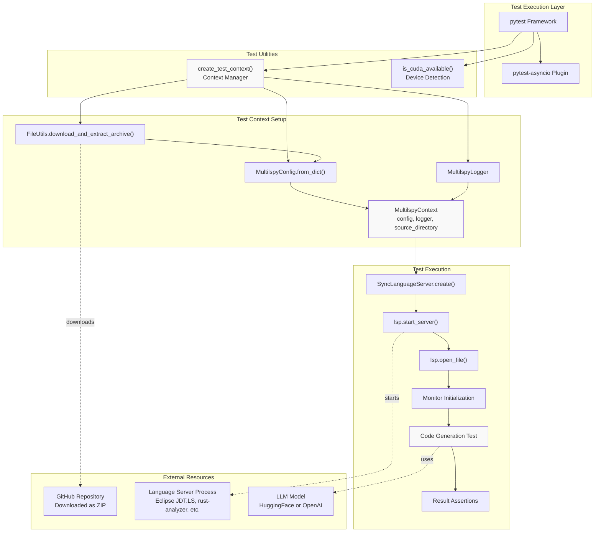
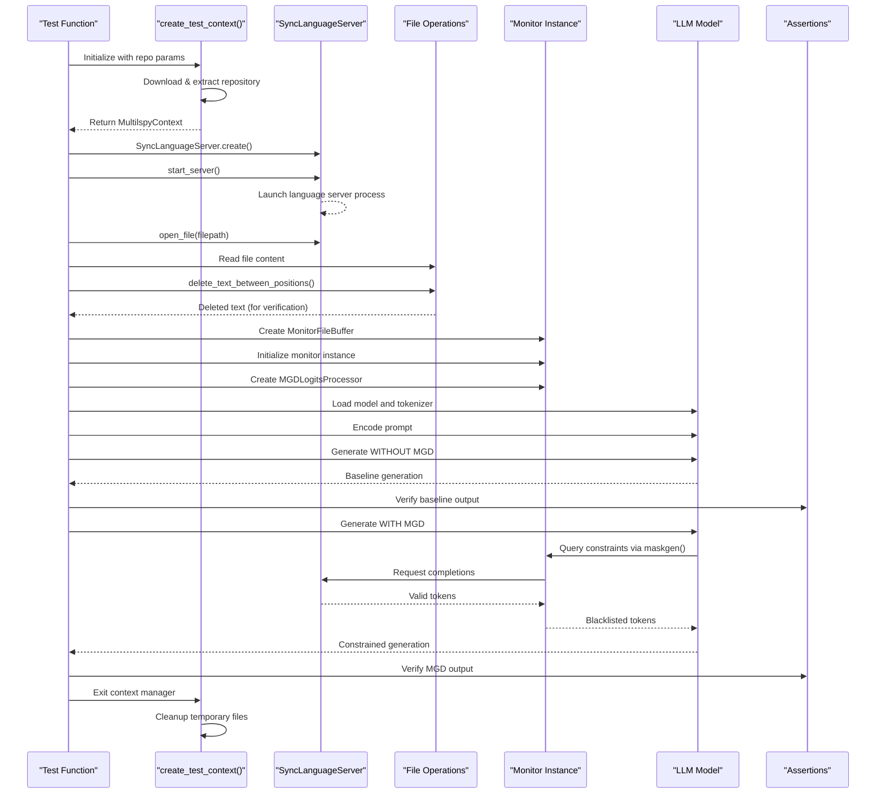
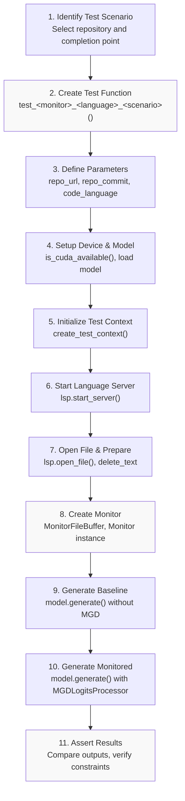

<!-- source: DeepWiki mcp.deepwiki.com · repo microsoft/monitors4codegen · page 6.1 Testing · fetched 2026-10-26 -->

# Testing

<details>
<summary>Relevant source files</summary>

The following files were used as context for generating this wiki page:

- [tests/monitor_guided_decoding/test_dereferences_monitor_java.py](tests/monitor_guided_decoding/test_dereferences_monitor_java.py)
- [tests/test_utils.py](tests/test_utils.py)

</details>


This document describes the testing infrastructure for the monitors4codegen repository, including test utilities, test organization patterns, and guidelines for writing and running tests. The focus is on testing Monitor-Guided Decoding functionality and the multilspy library integration with language servers.

For information about evaluation of generated code on datasets, see [Evaluation Metrics and Scripts](#5.3).

---

## Test Infrastructure Overview

The testing infrastructure supports two primary testing scenarios:

1. **Monitor Testing** - Validating that monitors correctly constrain code generation
2. **Language Server Integration Testing** - Verifying multilspy communication with language servers

Tests use `pytest` with async support (`pytest-asyncio`) and require real repository contexts with active language servers. The infrastructure provides utilities to automatically download, extract, and initialize test repositories.

**Test Infrastructure Architecture**



**Sources:** [tests/test_utils.py:1-50](), [tests/monitor_guided_decoding/test_dereferences_monitor_java.py:1-241]()

---

## Test Utilities

The `tests/test_utils.py` module provides core utilities for test setup and environment detection.

### Test Context Creation

The `create_test_context()` function is a context manager that handles the complete lifecycle of test repository setup:

| Step | Action | Implementation |
|------|--------|----------------|
| 1. Configuration | Create `MultilspyConfig` from parameters | `MultilspyConfig.from_dict(params)` |
| 2. Logging | Initialize logger | `MultilspyLogger()` |
| 3. Directory Setup | Create temporary directory in `~/.multilspy` | Uses `uuid4().hex` for uniqueness |
| 4. Repository Download | Download repository archive from GitHub | `FileUtils.download_and_extract_archive()` |
| 5. Context Creation | Create `MultilspyContext` with paths | Yields context for use in tests |
| 6. Cleanup | Remove temporary directory | `shutil.rmtree()` in finally block |

**Usage Pattern:**

```python
params = {
    "code_language": Language.JAVA,
    "repo_url": "https://github.com/owner/repo/",
    "repo_commit": "abc123def456"
}

with create_test_context(params) as context:
    lsp = SyncLanguageServer.create(context.config, context.logger, context.source_directory)
    # Perform test operations
    # Cleanup happens automatically
```

The context manager ensures proper resource cleanup even if tests fail or raise exceptions.

**Sources:** [tests/test_utils.py:14-37]()

### Device Detection

The `is_cuda_available()` function provides robust CUDA availability checking:

```python
def is_cuda_available() -> bool:
    if torch.cuda.is_available():
        try:
            t = torch.rand(1).cuda()
            t = t * 2
            return True
        except RuntimeError:
            return False
    return False
```

This function not only checks if CUDA is theoretically available but also attempts a simple operation to verify it's actually usable. Tests use this to conditionally select device placement:

```python
device = torch.device('cuda' if is_cuda_available() else 'cpu')
model = AutoModelForCausalLM.from_pretrained("bigcode/santacoder").to(device)
```

**Sources:** [tests/test_utils.py:39-50](), [tests/monitor_guided_decoding/test_dereferences_monitor_java.py:36-40]()

---

## Test Structure and Organization

Tests are organized by functionality and language:

```
tests/
├── monitor_guided_decoding/
│   ├── test_dereferences_monitor_java.py
│   ├── test_numargs_monitor_java.py
│   ├── test_switch_enum_monitor_csharp.py
│   └── ...
├── multilspy/
│   └── (multilspy-specific tests)
├── test_utils.py
└── multilspy_context.py
```

### Test Naming Convention

Test functions follow the pattern:

```
test_<monitor_name>_<language>_<scenario>
```

Examples:
- `test_dereferences_monitor_java_huggingface_models_clickhouse_highlevel_sinker()`
- `test_dereferences_monitor_java_huggingface_models_clickhouse_highlevel_sinker_modified()`

### Test Configuration

Each test specifies its repository context through a parameter dictionary:

| Parameter | Description | Example |
|-----------|-------------|---------|
| `code_language` | Target language enum | `Language.JAVA` |
| `repo_url` | GitHub repository URL (must end with `/`) | `"https://github.com/Index103000/clickhouse-highlevel-sinker/"` |
| `repo_commit` | Specific commit SHA | `"ee31d278918fe5e64669a6840c4d8fb53889e573"` |

**Sources:** [tests/monitor_guided_decoding/test_dereferences_monitor_java.py:29-34]()

---

## Monitor Testing Pattern

The standard pattern for testing monitors involves several phases executed in sequence:

**Monitor Test Execution Flow**



**Sources:** [tests/monitor_guided_decoding/test_dereferences_monitor_java.py:24-97]()

### Phase 1: Test Setup

```python
# 1. Define test parameters
code_language = Language.JAVA
params = {
    "code_language": code_language,
    "repo_url": "https://github.com/Index103000/clickhouse-highlevel-sinker/",
    "repo_commit": "ee31d278918fe5e64669a6840c4d8fb53889e573",
}

# 2. Select device
device = torch.device('cuda' if is_cuda_available() else 'cpu')

# 3. Load model and tokenizer
model = AutoModelForCausalLM.from_pretrained("bigcode/santacoder", trust_remote_code=True).to(device)
tokenizer = AutoTokenizer.from_pretrained("bigcode/santacoder")
```

**Sources:** [tests/monitor_guided_decoding/test_dereferences_monitor_java.py:29-41]()

### Phase 2: Language Server Initialization

```python
with create_test_context(params) as context:
    lsp = SyncLanguageServer.create(context.config, context.logger, context.source_directory)
    filepath = "src/main/java/com/xlvchao/clickhouse/datasource/ClickHouseDataSource.java"
    
    with lsp.start_server():
        with lsp.open_file(filepath):
            # Test operations here
```

The nested context managers ensure proper resource management:
1. `create_test_context` manages repository lifecycle
2. `lsp.start_server()` manages language server process
3. `lsp.open_file()` manages file buffer state

**Sources:** [tests/monitor_guided_decoding/test_dereferences_monitor_java.py:43-49]()

### Phase 3: File Manipulation and Prompt Preparation

```python
# Create file buffer at specific position
filebuffer = MonitorFileBuffer(
    lsp.language_server, 
    filepath, 
    (74, 17),  # start position
    (74, 17),  # end position
    code_language, 
    ""
)

# Delete text to create completion point
deleted_text = filebuffer.lsp.delete_text_between_positions(
    filepath, 
    Position(line=74, character=17), 
    Position(line=78, character=4)
)

# Verify deletion
assert deleted_text == """newServerNode()
                .withIp(arr[0])
                .withPort(Integer.parseInt(arr[1]))
                .build();
    """

# Read file and extract prompt
with open(str(PurePath(context.source_directory, filepath)), "r") as f:
    filecontent = f.read()

pos_idx = TextUtils.get_index_from_line_col(filecontent, 74, 17)
prompt = filecontent[:pos_idx]
assert prompt[-1] == "."  # Verify prompt ends at completion point
```

**Sources:** [tests/monitor_guided_decoding/test_dereferences_monitor_java.py:50-71]()

### Phase 4: Baseline Generation (Without MGD)

```python
# Tokenize prompt (use last 2048-512 tokens to fit context)
prompt_tokenized = tokenizer.encode(prompt, return_tensors="pt")[:, -(2048 - 512):].to(device)

# Generate without constraints
generated_code_without_mgd = model.generate(
    prompt_tokenized, 
    do_sample=False,  # Greedy decoding
    max_new_tokens=30, 
    early_stopping=True
)

generated_code_without_mgd = tokenizer.decode(generated_code_without_mgd[0, -30:])

# Assert baseline behavior
assert generated_code_without_mgd == "builder()\n               .hostAddress(arr[0])..."
```

This establishes what the model generates without monitoring, providing a comparison baseline.

**Sources:** [tests/monitor_guided_decoding/test_dereferences_monitor_java.py:72-81]()

### Phase 5: Monitor-Guided Generation

```python
# Initialize monitor
monitor = DereferencesMonitor(HFTokenizerWrapper(tokenizer), filebuffer)
mgd_logits_processor = MGDLogitsProcessor([monitor], lsp.language_server.server.loop)

# Generate with constraints
logits_processor = LogitsProcessorList([mgd_logits_processor])
generated_code = model.generate(
    prompt_tokenized,
    do_sample=False,
    max_new_tokens=30,
    logits_processor=logits_processor,  # Apply monitor
    early_stopping=True,
)

generated_code = tokenizer.decode(generated_code[0, -30:])

# Assert correct behavior
assert generated_code == "newServerNode()\n               .withIp(arr[0])..."
```

The monitored generation produces different (correct) output compared to the baseline.

**Sources:** [tests/monitor_guided_decoding/test_dereferences_monitor_java.py:62-97]()

### Phase 6: Assertions

Tests verify monitor behavior through multiple assertions:

| Assertion Type | Purpose | Example |
|----------------|---------|---------|
| Deletion verification | Confirm text removed correctly | `assert deleted_text == "expected text"` |
| Prompt verification | Ensure prompt ends at right position | `assert prompt[-1] == "."` |
| Baseline generation | Document unmonitored behavior | `assert generated_code_without_mgd == "..."` |
| Monitored generation | Verify constraint enforcement | `assert generated_code == "..."` |

The key insight is comparing baseline vs. monitored output to demonstrate the monitor's effect.

**Sources:** [tests/monitor_guided_decoding/test_dereferences_monitor_java.py:54-97]()

---

## Writing New Monitor Tests

To add tests for a new monitor, follow this template:

**Step-by-Step Test Implementation**



### Example Test Template

```python
import pytest
import torch
import transformers
from pathlib import PurePath
from monitors4codegen.multilspy.language_server import SyncLanguageServer
from monitors4codegen.multilspy.multilspy_config import Language
from tests.test_utils import create_test_context, is_cuda_available
from transformers import AutoTokenizer, AutoModelForCausalLM
from monitors4codegen.multilspy.multilspy_utils import TextUtils
from monitors4codegen.monitor_guided_decoding.monitors.your_monitor import YourMonitor
from monitors4codegen.monitor_guided_decoding.monitor import MonitorFileBuffer
from monitors4codegen.monitor_guided_decoding.hf_gen import MGDLogitsProcessor
from transformers.generation.utils import LogitsProcessorList
from monitors4codegen.multilspy.multilspy_types import Position
from monitors4codegen.monitor_guided_decoding.tokenizer_wrapper import HFTokenizerWrapper

pytest_plugins = ("pytest_asyncio",)

@pytest.mark.asyncio
async def test_your_monitor_language_scenario() -> None:
    """
    Test description
    """
    # 1. Define parameters
    code_language = Language.YOUR_LANGUAGE
    params = {
        "code_language": code_language,
        "repo_url": "https://github.com/owner/repo/",
        "repo_commit": "commit_sha",
    }

    # 2. Setup device and model
    device = torch.device('cuda' if is_cuda_available() else 'cpu')
    model = AutoModelForCausalLM.from_pretrained("model_name").to(device)
    tokenizer = AutoTokenizer.from_pretrained("model_name")

    # 3. Create test context
    with create_test_context(params) as context:
        lsp = SyncLanguageServer.create(context.config, context.logger, context.source_directory)
        filepath = "path/to/test/file.ext"
        
        # 4. Language server operations
        with lsp.start_server():
            with lsp.open_file(filepath):
                # 5. File manipulation
                filebuffer = MonitorFileBuffer(
                    lsp.language_server, filepath, 
                    (line, char), (line, char), 
                    code_language, ""
                )
                deleted_text = lsp.delete_text_between_positions(
                    filepath, Position(line=start_line, character=start_char),
                    Position(line=end_line, character=end_char)
                )
                
                # 6. Prepare prompt
                with open(str(PurePath(context.source_directory, filepath)), "r") as f:
                    filecontent = f.read()
                pos_idx = TextUtils.get_index_from_line_col(filecontent, line, char)
                prompt = filecontent[:pos_idx]
                prompt_tokenized = tokenizer.encode(prompt, return_tensors="pt").to(device)
                
                # 7. Baseline generation
                generated_without_mgd = model.generate(
                    prompt_tokenized, do_sample=False, max_new_tokens=30
                )
                
                # 8. Monitor setup
                monitor = YourMonitor(HFTokenizerWrapper(tokenizer), filebuffer)
                mgd_processor = MGDLogitsProcessor([monitor], lsp.language_server.server.loop)
                
                # 9. Monitored generation
                logits_processor = LogitsProcessorList([mgd_processor])
                generated_with_mgd = model.generate(
                    prompt_tokenized, do_sample=False, max_new_tokens=30,
                    logits_processor=logits_processor
                )
                
                # 10. Assertions
                assert tokenizer.decode(generated_without_mgd[0, -30:]) == "baseline_output"
                assert tokenizer.decode(generated_with_mgd[0, -30:]) == "monitored_output"
```

**Sources:** [tests/monitor_guided_decoding/test_dereferences_monitor_java.py:24-97]()

### Test Selection Criteria

Choose test scenarios that:

1. **Exercise monitor constraints** - Select code positions where the monitor should activate
2. **Demonstrate improvement** - Baseline should produce incorrect code that monitor fixes
3. **Use realistic repositories** - Real-world code provides authentic contexts
4. **Have verifiable ground truth** - Know what the correct output should be
5. **Run efficiently** - Tests should complete in reasonable time (30 tokens is typical)

**Sources:** [tests/monitor_guided_decoding/test_dereferences_monitor_java.py:25-97]()

---

## Running Tests

### Prerequisites

Install test dependencies:
```bash
pip install pytest pytest-asyncio
```

Ensure language servers are available for the languages being tested (see [Getting Started](#2) for installation).

### Running All Tests

```bash
pytest tests/
```

### Running Specific Test Files

```bash
pytest tests/monitor_guided_decoding/test_dereferences_monitor_java.py
```

### Running Specific Test Functions

```bash
pytest tests/monitor_guided_decoding/test_dereferences_monitor_java.py::test_dereferences_monitor_java_huggingface_models_clickhouse_highlevel_sinker
```

### Running with Verbose Output

```bash
pytest -v tests/
```

### Running with Output Capture Disabled

```bash
pytest -s tests/
```

This allows viewing print statements and debugging output during test execution.

### Test Execution Considerations

| Consideration | Impact | Recommendation |
|---------------|--------|----------------|
| Model downloads | First run downloads multi-GB models | Use a cache directory with sufficient space |
| CUDA availability | Tests run faster on GPU | Tests automatically fall back to CPU |
| Repository downloads | Each test downloads a repository | Tests use `~/.multilspy` as temp directory |
| Language servers | Must be installed and available | Follow setup instructions in [Getting Started](#2) |
| Test duration | Complete test suite may take several minutes | Run specific tests during development |

**Sources:** [tests/monitor_guided_decoding/test_dereferences_monitor_java.py:1-241](), [tests/test_utils.py:1-50]()

---

## Test Data and Cleanup

### Temporary Directory Structure

Tests create temporary directories under `~/.multilspy/`:

```
~/.multilspy/
├── <uuid1>/
│   └── <repo-name-commit>/
│       └── (repository contents)
├── <uuid2>/
│   └── (another test repository)
└── ...
```

Each test execution creates a unique directory using `uuid4().hex` to avoid conflicts between parallel test runs.

### Automatic Cleanup

The `create_test_context()` context manager ensures cleanup even when tests fail:

```python
try:
    # Test operations
    yield MultilspyContext(config, logger, source_directory_path)
finally:
    if os.path.exists(temp_extract_directory):
        shutil.rmtree(temp_extract_directory)
```

This guarantees that temporary directories are removed after test completion.

**Sources:** [tests/test_utils.py:14-37]()

---

## Key Testing Components Reference

### Core Test Classes and Functions

| Component | Location | Purpose |
|-----------|----------|---------|
| `create_test_context()` | [tests/test_utils.py:14-37]() | Creates isolated test environment with repository |
| `is_cuda_available()` | [tests/test_utils.py:39-50]() | Detects CUDA availability for device selection |
| `MultilspyContext` | Referenced in test_utils | Holds config, logger, and source directory |
| `MonitorFileBuffer` | Used in tests | Represents file state for monitoring |
| `MGDLogitsProcessor` | Used in tests | Integrates monitors with HuggingFace generation |

### Test Decorators and Plugins

- `@pytest.mark.asyncio` - Marks async test functions
- `pytest_plugins = ("pytest_asyncio",)` - Enables async test support

### Common Assertions

- File deletion verification: `assert deleted_text == "expected"`
- Prompt position verification: `assert prompt[-1] == "."`  
- Character position verification: `assert filecontent[pos_idx] == "x"`
- Generation output verification: `assert generated_code == "expected code"`

**Sources:** [tests/monitor_guided_decoding/test_dereferences_monitor_java.py:1-241](), [tests/test_utils.py:1-50]()

---

