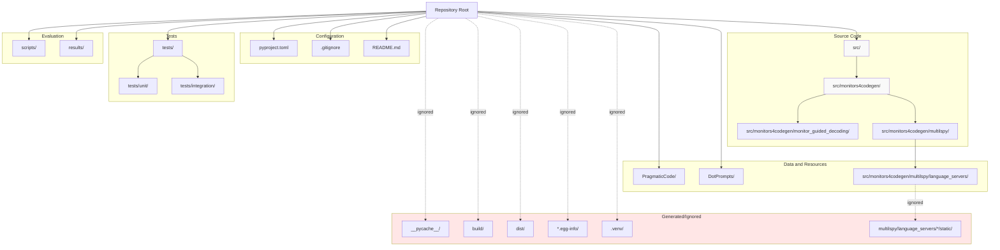
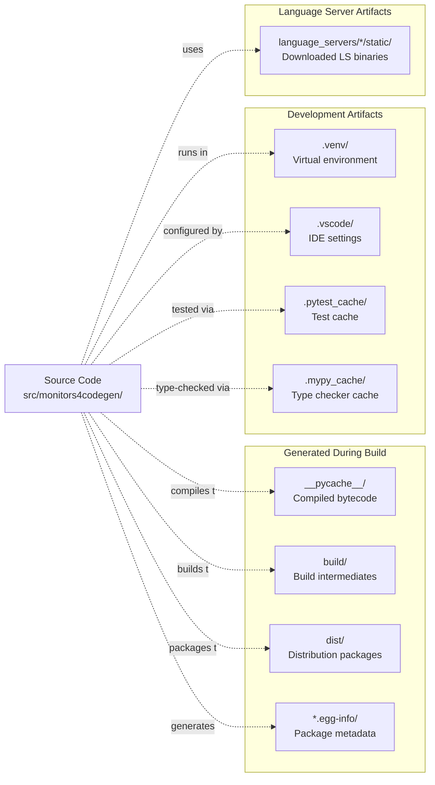
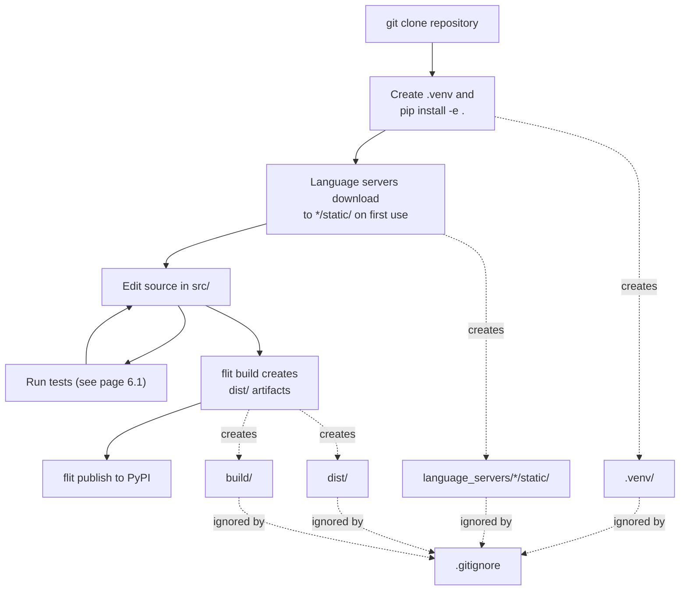

<!-- source: DeepWiki mcp.deepwiki.com · repo microsoft/monitors4codegen · page 6.2 Project Structure · fetched 2026-10-26 -->

# Project Structure

<details>
<summary>Relevant source files</summary>

The following files were used as context for generating this wiki page:

- [.gitignore](.gitignore)
- [pyproject.toml](pyproject.toml)

</details>


This page documents the file and directory organization of the monitors4codegen repository, including the source code layout, build configuration, development artifacts, and resource directories. This information is essential for developers who want to understand where different components are located, how the project is built, and how to set up a development environment.

For information about running tests, see [Testing](#6.1). For details about individual components, refer to [Monitor-Guided Decoding](#3) and [multilspy Library](#4).

---

## Repository Overview

The monitors4codegen repository is organized as a single Python package containing two major subsystems: the **Monitor-Guided Decoding framework** and the **multilspy library**. The project uses `flit_core` as its build backend and follows a modern Python package structure with source code in the `src/` directory.

**Sources:** [pyproject.toml:1-48]()

---

## Directory Structure

The repository follows this high-level organization:



**Sources:** [pyproject.toml:46-47](), [.gitignore:1-164]()

---

## Source Code Organization

The source code is organized under `src/monitors4codegen/` with a clear separation between the Monitor-Guided Decoding framework and the multilspy library:

### Package Structure

```mermaid
graph TB
    M4C["monitors4codegen"]
    
    subgraph "Monitor-Guided Decoding"
        MGD["monitor_guided_decoding/"]
        Monitors["monitor_guided_decoding/monitors/"]
        HFInt["monitor_guided_decoding/hf_gen.py"]
        OpenAIInt["monitor_guided_decoding/openai_mgd.py"]
        TokenWrap["monitor_guided_decoding/tokenizer_wrapper.py"]
    end
    
    subgraph "multilspy Library"
        Multilspy["multilspy/"]
        LSBase["multilspy/language_server.py"]
        SyncLS["multilspy/lsp_protocol_handler/"]
        LSClients["multilspy/language_servers/"]
        Types["multilspy/multilspy_types.py"]
        Config["multilspy/multilspy_config.py"]
        Utils["multilspy/multilspy_utils.py"]
        Logger["multilspy/multilspy_logger.py"]
    end
    
    subgraph "Monitor Implementations"
        DerMon["monitors/dereferences_monitor.py"]
        NumMon["monitors/numargs_monitor.py"]
        SwitchMon["monitors/switch_enum_monitor.py"]
        ClassMon["monitors/class_instantiation_monitor.py"]
        TSMon["monitors/typestate_monitor.py"]
        JointMon["monitors/joint_monitor.py"]
    end
    
    subgraph "Language Server Clients"
        Java["language_servers/java/"]
        Rust["language_servers/rust/"]
        CSharp["language_servers/csharp/"]
        Python["language_servers/python/"]
    end
    
    M4C --> MGD
    M4C --> Multilspy
    
    MGD --> Monitors
    MGD --> HFInt
    MGD --> OpenAIInt
    MGD --> TokenWrap
    
    Monitors --> DerMon
    Monitors --> NumMon
    Monitors --> SwitchMon
    Monitors --> ClassMon
    Monitors --> TSMon
    Monitors --> JointMon
    
    Multilspy --> LSBase
    Multilspy --> SyncLS
    Multilspy --> LSClients
    Multilspy --> Types
    Multilspy --> Config
    Multilspy --> Utils
    Multilspy --> Logger
    
    LSClients --> Java
    LSClients --> Rust
    LSClients --> CSharp
    LSClients --> Python
```



**Sources:** [pyproject.toml:46-47]()

### Key Source Files

| Path | Purpose |
|------|---------|
| `src/monitors4codegen/monitor_guided_decoding/hf_gen.py` | HuggingFace integration with `MGDLogitsProcessor` class |
| `src/monitors4codegen/monitor_guided_decoding/openai_mgd.py` | OpenAI API integration with custom generation loop |
| `src/monitors4codegen/monitor_guided_decoding/tokenizer_wrapper.py` | Unified tokenizer interface for different LLM backends |
| `src/monitors4codegen/multilspy/language_server.py` | Core `LanguageServer` and `SyncLanguageServer` classes |
| `src/monitors4codegen/multilspy/multilspy_types.py` | LSP type definitions and constants |
| `src/monitors4codegen/multilspy/multilspy_config.py` | Configuration classes for language servers |

**Sources:** Based on the repository architecture described in the high-level diagrams

---

## Build System and Configuration

The project uses `flit_core` as its build backend, configured through `pyproject.toml`:

### Build Configuration

| Setting | Value | Purpose |
|---------|-------|---------|
| Build system | `flit_core>=3.4` | Modern Python build backend |
| Package name | `monitors4codegen` | PyPI package name |
| Version | `0.0.1` | Current pre-alpha version |
| Python requirement | `>=3.7` | Minimum Python version |
| Source directory | `src/` | Package source location |

**Sources:** [pyproject.toml:2-4](), [pyproject.toml:7-8](), [pyproject.toml:14](), [pyproject.toml:46-47]()

### Package Dependencies

The project has several key dependencies defined in `pyproject.toml`:

**Core Dependencies:**
- `jedi-language-server==0.41.1` - Python LSP server backend
- `pydantic==1.10.5` - Data validation and settings management
- `code-tokenize==0.2.0` - Code tokenization utilities
- `code-ast` - Abstract syntax tree utilities (from git)

**LLM Integration:**
- `openai==1.3.3` - OpenAI API client
- `torch==1.12.0` - PyTorch for HuggingFace models
- `transformers==4.30.0` - HuggingFace transformers library
- `tiktoken==0.3.3` - OpenAI tokenizer

**Utility Libraries:**
- `pygtrie==2.5.0` - Trie data structure for token processing

**Sources:** [pyproject.toml:27-37]()

---

## Development Environment Setup

### Installation from Source

To set up a development environment:

1. **Clone the repository:**
   ```bash
   git clone https://github.com/microsoft/monitors4codegen
   cd monitors4codegen
   ```

2. **Create a virtual environment:**
   ```bash
   python -m venv .venv
   source .venv/bin/activate  # On Windows: .venv\Scripts\activate
   ```

3. **Install in editable mode:**
   ```bash
   pip install -e .
   ```

The `-e` flag installs the package in editable mode, allowing you to modify source code without reinstalling.

### Language Server Setup

Each language server client requires its corresponding language server to be installed:

| Language | Server | Installation Location |
|----------|--------|----------------------|
| Java | Eclipse JDT.LS | Downloaded automatically to `language_servers/java/static/` |
| Rust | rust-analyzer | System-wide via `rustup component add rust-analyzer` |
| C# | OmniSharp | Downloaded automatically to `language_servers/csharp/static/` |
| Python | Jedi | Installed via pip as dependency |

**Note:** The `static/` directories for language servers are ignored by git as specified in `.gitignore`.

**Sources:** [.gitignore:163]()

---

## Build Artifacts and Generated Files

The following files and directories are generated during development and excluded from version control:

### Python Build Artifacts



**Sources:** [.gitignore:1-164]()

### Ignored Files by Category

| Category | Patterns | Purpose |
|----------|----------|---------|
| Python bytecode | `__pycache__/`, `*.pyc`, `*.pyo` | Compiled Python files |
| Build artifacts | `build/`, `dist/`, `*.egg-info/` | Package build outputs |
| Virtual environments | `.venv/`, `venv/`, `env/` | Isolated Python environments |
| IDE settings | `.vscode/`, `.idea/` | Editor-specific configurations |
| Test artifacts | `.pytest_cache/`, `.coverage` | Test run caches and coverage data |
| Type checking | `.mypy_cache/`, `.pytype/` | Type checker caches |
| Language servers | `multilspy/language_servers/*/static` | Downloaded language server binaries |

**Sources:** [.gitignore:1-164]()

---

## Data and Resource Directories

The repository includes directories for datasets, evaluation results, and language server resources:

### Dataset Directories

- **`PragmaticCode/`** - Contains the PragmaticCode dataset with 100 Java repositories and file contents (see [PragmaticCode Dataset](#5.1))
- **`DotPrompts/`** - Contains the derived DotPrompts dataset with 10,538 completion examples (see [DotPrompts Dataset](#5.2))

### Language Server Resources

- **`src/monitors4codegen/multilspy/language_servers/`** - Contains language-specific client implementations
  - `java/` - Eclipse JDT.LS client with `static/` for downloaded binaries
  - `rust/` - rust-analyzer client
  - `csharp/` - OmniSharp client with `static/` for downloaded binaries
  - `python/` - Jedi client (no static downloads needed)

**Note:** The `static/` subdirectories are automatically created when language servers are initialized and are excluded from version control.

**Sources:** [.gitignore:163]()

### Evaluation and Results

- **`scripts/`** - Contains evaluation scripts like `eval_results.py`
- **`results/`** - Stores generated code completion results and evaluation metrics

---

## Package Distribution

The package is configured for distribution to PyPI with the following metadata:

| Field | Value |
|-------|-------|
| Package name | `monitors4codegen` |
| Version | `0.0.1` |
| Status | Pre-Alpha (Development Status 2) |
| Homepage | https://github.com/microsoft/monitors4codegen |
| Bug tracker | https://github.com/microsoft/monitors4codegen/issues |
| License | (See repository LICENSE file) |

The package supports multiple programming languages as indicated by its classifiers:
- Programming Language :: C#
- Programming Language :: Java
- Programming Language :: Python
- Programming Language :: Rust

**Sources:** [pyproject.toml:6-25](), [pyproject.toml:39-41]()

---

## Development Workflow Summary



**Sources:** [pyproject.toml:2-4](), [.gitignore:1-164]()