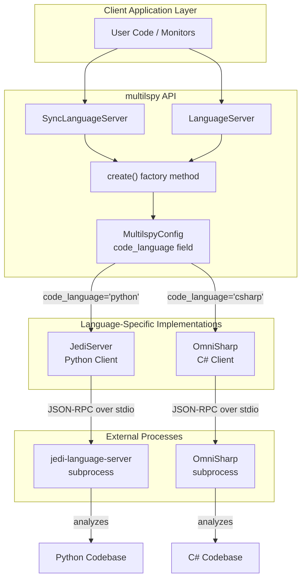
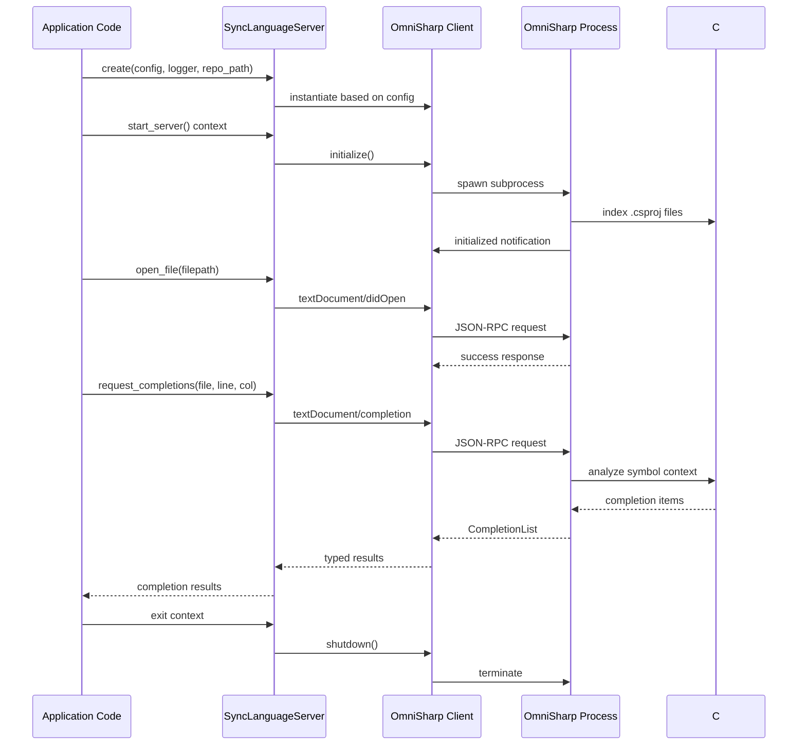
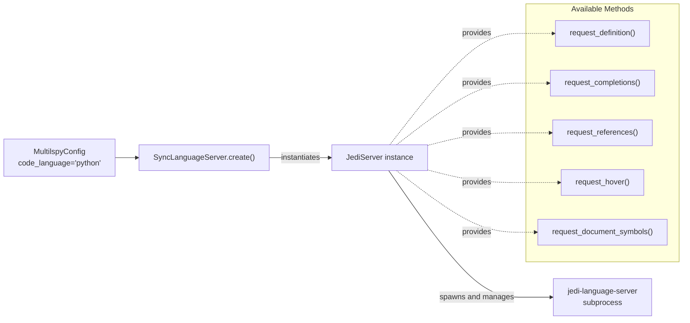
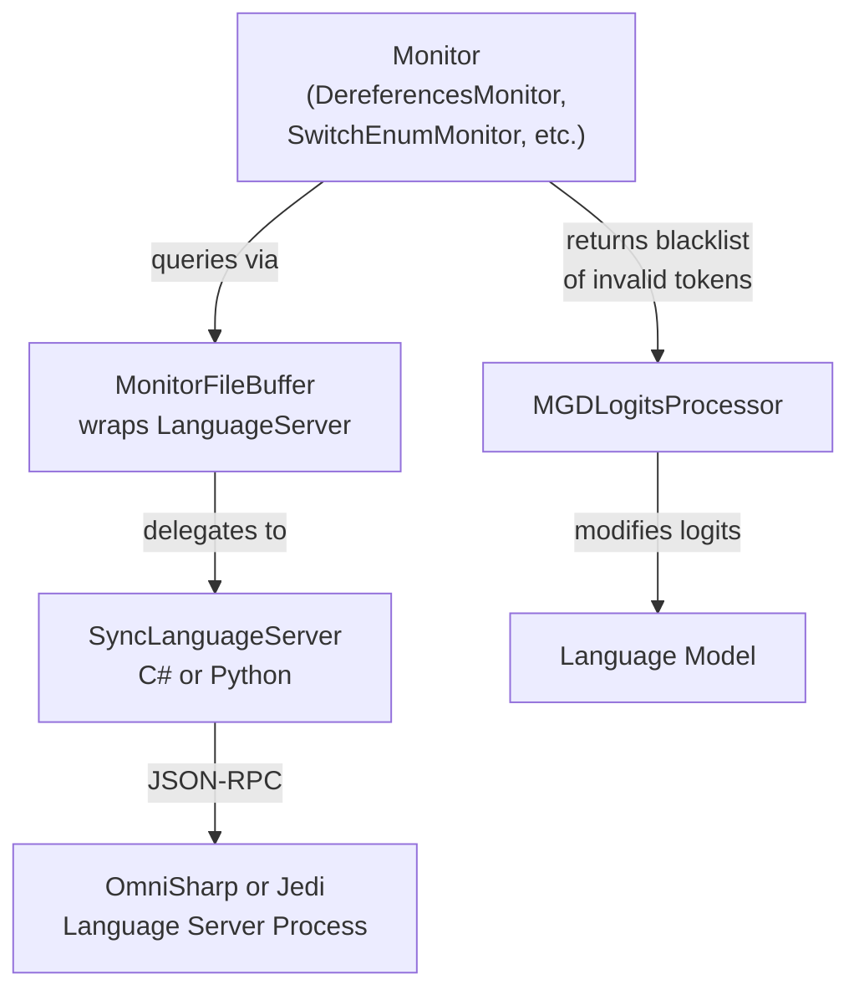

<!-- source: DeepWiki mcp.deepwiki.com · repo microsoft/monitors4codegen · extra page C# and Python Clients · fetched 2026-10-26 -->

# C# and Python Clients

<details>
<summary>Relevant source files</summary>

The following files were used as context for generating this wiki page:

- [README.md](README.md)
- [tests/monitor_guided_decoding/test_switchenum_monitor_csharp.py](tests/monitor_guided_decoding/test_switchenum_monitor_csharp.py)
- [tests/monitor_guided_decoding/test_typestate_monitor_rust.py](tests/monitor_guided_decoding/test_typestate_monitor_rust.py)

</details>


## Purpose and Scope

This document covers the language-specific LSP client implementations for C# and Python within the multilspy library. It explains how to configure and use the OmniSharp language server for C# codebases and the Jedi language server for Python codebases. For information about Java and Rust clients, see [Java (Eclipse JDT.LS)](#4.3.1) and [Rust (rust-analyzer)](#4.3.2). For general multilspy architecture and core concepts, see [Core Architecture](#4.1).

**Sources:** [README.md:1-239]()

---

## Overview

The multilspy library provides unified access to language servers for both C# and Python through a common API interface. The library abstracts the complexity of setting up and communicating with:

- **OmniSharp** for C# static analysis
- **Jedi Language Server** for Python static analysis

Both clients implement the same `LanguageServer` interface, enabling language-agnostic code that works identically across different programming languages. The clients handle language-specific initialization parameters, process lifecycle management, and JSON-RPC communication with their respective server processes.

| Language | Language Server | Client Class | Configuration Key |
|----------|----------------|--------------|-------------------|
| C# | OmniSharp | `OmniSharp` | `"csharp"` |
| Python | Jedi Language Server | `JediServer` | `"python"` |

**Sources:** [README.md:111-122](), [README.md:133-138]()

---

## Client Architecture

The following diagram illustrates how C# and Python clients fit into the multilspy architecture:



**Diagram: C# and Python Client Instantiation**

The `SyncLanguageServer.create()` factory method inspects the `code_language` field in the configuration and instantiates the appropriate language-specific client. Both clients communicate with their respective language server processes via JSON-RPC over standard input/output streams.

**Sources:** [README.md:133-159]()

---

## C# Client (OmniSharp)

### Configuration

The C# client is configured by setting `code_language` to `"csharp"` in the `MultilspyConfig`:

```python
from multilspy.multilspy_config import MultilspyConfig, Language

config = MultilspyConfig.from_dict({
    "code_language": "csharp"  # or Language.CSHARP
})
```

For repository-based testing and analysis, additional parameters can be specified:

| Parameter | Type | Description |
|-----------|------|-------------|
| `code_language` | `str` or `Language` enum | Must be `"csharp"` or `Language.CSHARP` |
| `repo_url` | `str` (optional) | URL of the C# repository to clone |
| `repo_commit` | `str` (optional) | Specific commit SHA to checkout |

**Sources:** [tests/monitor_guided_decoding/test_switchenum_monitor_csharp.py:30-35]()

### Initialization and Usage

The following sequence shows the typical lifecycle of the C# client:



**Diagram: C# Client Request Lifecycle**

**Sources:** [tests/monitor_guided_decoding/test_switchenum_monitor_csharp.py:44-46](), [README.md:139-158]()

### C# Code Example

The following example demonstrates using the C# client with the Ryujinx repository:

```python
from monitors4codegen.multilspy.language_server import SyncLanguageServer
from monitors4codegen.multilspy.multilspy_config import Language
from monitors4codegen.multilspy.multilspy_types import Position

params = {
    "code_language": Language.CSHARP,
    "repo_url": "https://github.com/Ryujinx/Ryujinx/",
    "repo_commit": "e768a54f17b390c3ac10904c7909e3bef020edbd"
}

lsp = SyncLanguageServer.create(config, logger, source_directory)
with lsp.start_server():
    filepath = "src/ARMeilleure/CodeGen/Arm64/CodeGenerator.cs"
    with lsp.open_file(filepath):
        # Delete text between positions
        deleted = lsp.delete_text_between_positions(
            filepath,
            Position(line=1369, character=21),
            Position(line=1385, character=8)
        )
        
        # Request completions at cursor position
        completions = lsp.request_completions(filepath, 1369, 21)
```

**Sources:** [tests/monitor_guided_decoding/test_switchenum_monitor_csharp.py:26-53]()

### C#-Specific Capabilities

The OmniSharp language server provides several C#-specific capabilities:

| Capability | LSP Method | Use Case |
|------------|------------|----------|
| Enum member completions | `textDocument/completion` | Resolving valid enum constants in switch statements |
| Class symbol lookup | `textDocument/documentSymbol` | Finding class definitions for instantiation |
| Method signature info | `textDocument/hover` | Determining parameter types and counts |
| Type information | `textDocument/completion` | Resolving member access on typed expressions |

The `SwitchEnumMonitor` implementation specifically leverages OmniSharp's ability to provide enum member completions within switch-case statements. When the monitor detects a `case` keyword in a switch statement, it queries OmniSharp for valid enum members and constrains code generation to only those valid options.

**Sources:** [tests/monitor_guided_decoding/test_switchenum_monitor_csharp.py:78-79](), [README.md:198-199]()

---

## Python Client (Jedi)

### Configuration

The Python client is configured by setting `code_language` to `"python"` in the `MultilspyConfig`:

```python
from multilspy.multilspy_config import MultilspyConfig, Language

config = MultilspyConfig.from_dict({
    "code_language": "python"  # or Language.PYTHON
})
```

The configuration structure is identical to other language clients:

| Parameter | Type | Description |
|-----------|------|-------------|
| `code_language` | `str` or `Language` enum | Must be `"python"` or `Language.PYTHON` |
| `repo_url` | `str` (optional) | URL of the Python repository to clone |
| `repo_commit` | `str` (optional) | Specific commit SHA to checkout |

**Sources:** [README.md:137]()

### Initialization and Usage

The Python client follows the same initialization pattern as other language servers:



**Diagram: Python Client Component Structure**

**Sources:** [README.md:133-159]()

### Python Code Example

The Python client usage follows the standard multilspy API pattern:

```python
from monitors4codegen.multilspy.language_server import SyncLanguageServer
from monitors4codegen.multilspy.multilspy_config import MultilspyConfig

config = MultilspyConfig.from_dict({"code_language": "python"})
lsp = SyncLanguageServer.create(config, logger, "/path/to/python/project")

with lsp.start_server():
    filepath = "src/module.py"
    with lsp.open_file(filepath):
        # Request type-based completions
        completions = lsp.request_completions(filepath, line=10, character=5)
        
        # Find symbol definition
        definition = lsp.request_definition(filepath, line=15, character=8)
        
        # Get hover information
        hover_info = lsp.request_hover(filepath, line=20, character=12)
```

The Jedi language server provides intelligent Python-specific completions, including:
- Module and package imports
- Class members and methods
- Function parameters and return types
- Variable types inferred from assignments

**Sources:** [README.md:139-158]()

### Python-Specific Capabilities

The Jedi language server provides Python-specific static analysis features:

| Capability | Description | Example Use Case |
|------------|-------------|------------------|
| Dynamic type inference | Infers types from assignments and function returns | Completing method calls on dynamically-typed variables |
| Import resolution | Resolves imports across packages and modules | Finding definitions in third-party libraries |
| Docstring parsing | Extracts type hints from docstrings | Providing signature information for untyped functions |
| Virtual environment support | Analyzes code within specific Python environments | Supporting project-specific dependencies |

While the repository focuses on Java, Rust, and C# examples for Monitor-Guided Decoding, the Python client provides the same LSP capabilities and can be used with the `DereferencesMonitor` to ensure type-valid member access in Python code generation.

**Sources:** [README.md:111-122](), [README.md:190]()

---

## Language Server Comparison

The following table compares key characteristics of the C# and Python language server implementations:

| Aspect | C# (OmniSharp) | Python (Jedi) |
|--------|----------------|---------------|
| **Server Implementation** | OmniSharp (C#/.NET) | jedi-language-server (Python) |
| **Build System Support** | .csproj, .sln files | setup.py, requirements.txt, pyproject.toml |
| **Type System** | Static, strongly-typed | Dynamic with optional type hints |
| **Initialization Time** | Moderate (parses project files) | Fast (dynamic analysis) |
| **Completion Accuracy** | High (static type information) | Good (inferred types) |
| **Cross-file Analysis** | Full project context | Full project context |
| **External Dependencies** | NuGet packages | pip/conda packages |

**Sources:** [README.md:111-122]()

---

## Common Usage Patterns

Both C# and Python clients support identical API methods, enabling language-agnostic code:

### File Operations

```python
# Works identically for both C# and Python
with lsp.open_file(filepath):
    # File is opened in the language server's buffer
    # All subsequent operations use the in-memory buffer
    
    # Delete text between positions
    deleted = lsp.delete_text_between_positions(
        filepath, 
        Position(line=10, character=0), 
        Position(line=15, character=0)
    )
    
    # File automatically closed when context exits
```

**Sources:** [tests/monitor_guided_decoding/test_switchenum_monitor_csharp.py:48-53]()

### LSP Request Methods

Both clients support the standard LSP request methods documented in [LSP Request Methods](#4.2):

| Method | Purpose |
|--------|---------|
| `request_definition()` | Find where a symbol is defined |
| `request_references()` | Find all usages of a symbol |
| `request_completions()` | Get valid completions at a position |
| `request_hover()` | Get type and documentation information |
| `request_document_symbols()` | Get all symbols defined in a file |

**Sources:** [README.md:116-122](), [README.md:141-157]()

### Integration with Monitor-Guided Decoding

Both C# and Python clients can be used with monitors to constrain code generation:



**Diagram: Monitor Integration with C# and Python Clients**

The `MonitorFileBuffer` class wraps a language server instance and provides a consistent interface for monitors to query static analysis results, regardless of whether the underlying server is OmniSharp, Jedi, or another language server.

**Sources:** [tests/monitor_guided_decoding/test_switchenum_monitor_csharp.py:71-79](), [README.md:178-186]()

---

## Async API Support

Both C# and Python clients support asynchronous operation through the `LanguageServer` class (as opposed to `SyncLanguageServer`):

```python
from monitors4codegen.multilspy import LanguageServer

lsp = LanguageServer.create(config, logger, repo_path)
async with lsp.start_server():
    result = await lsp.request_definition(filepath, line, character)
    completions = await lsp.request_completions(filepath, line, character)
```

The async API is useful when:
- Integrating with async frameworks (e.g., asyncio-based web servers)
- Performing concurrent LSP queries across multiple files
- Building non-blocking tools and services

**Sources:** [README.md:161-171]()

---

## Testing and Examples

The repository includes comprehensive tests demonstrating C# and Python client usage:

| Test File | Language | Purpose |
|-----------|----------|---------|
| `tests/monitor_guided_decoding/test_switchenum_monitor_csharp.py` | C# | Demonstrates OmniSharp client with SwitchEnumMonitor |
| `tests/multilspy/test_multilspy_*.py` | Multiple | Tests basic LSP operations for each language |

To run tests for a specific language:

```bash
# C# tests
pytest tests/multilspy -k csharp

# Python tests  
pytest tests/multilspy -k python
```

**Sources:** [tests/monitor_guided_decoding/test_switchenum_monitor_csharp.py:1-191](), [README.md:173-176]()

---

## Migration Note

The multilspy library has been migrated to a standalone repository at [microsoft/multilspy](https://github.com/microsoft/multilspy). The most current implementation, documentation, and examples for C# and Python clients can be found there. The version in this repository (`monitors4codegen`) represents the original implementation used for the Monitor-Guided Decoding research.

**Sources:** [README.md:14](), [README.md:110]()

---

