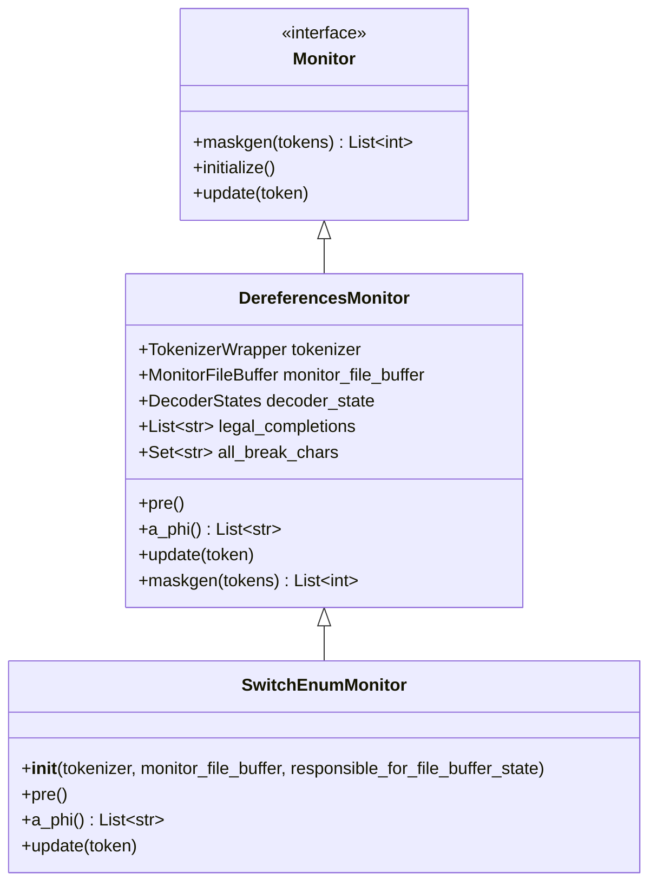
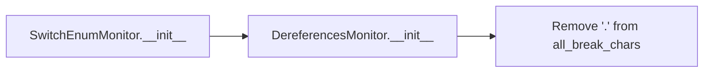
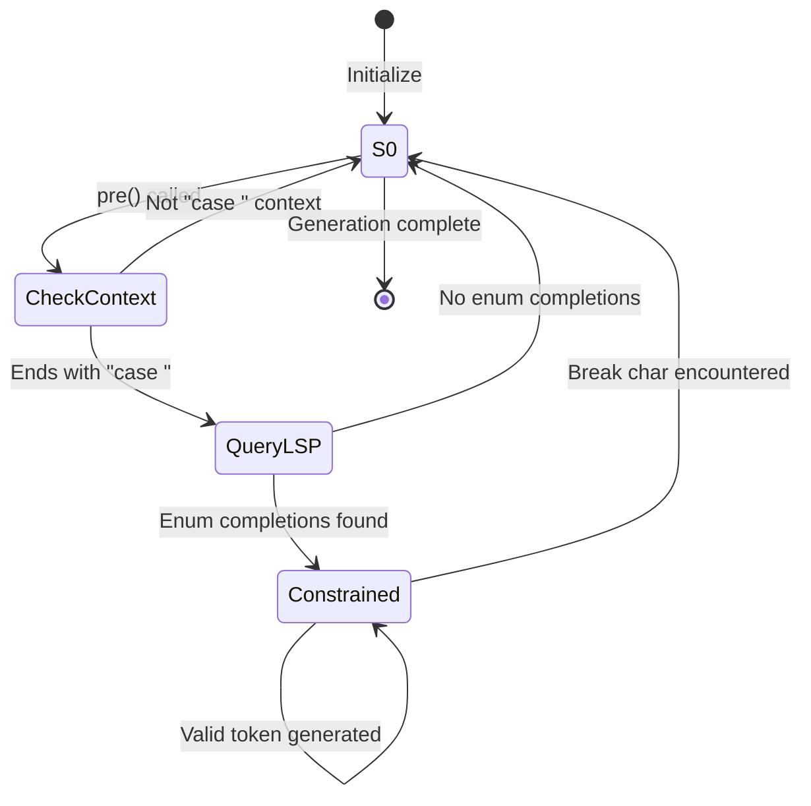
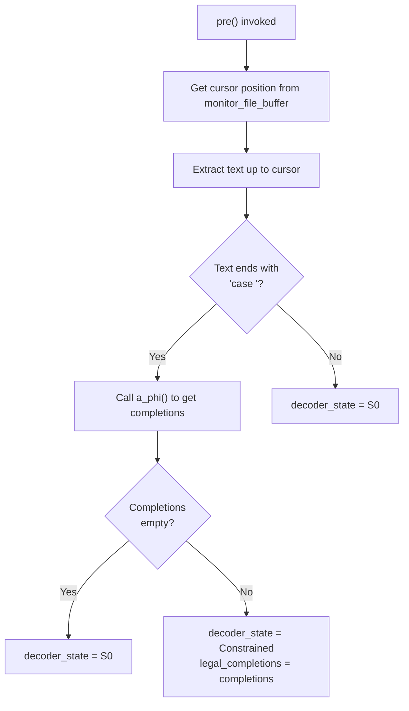
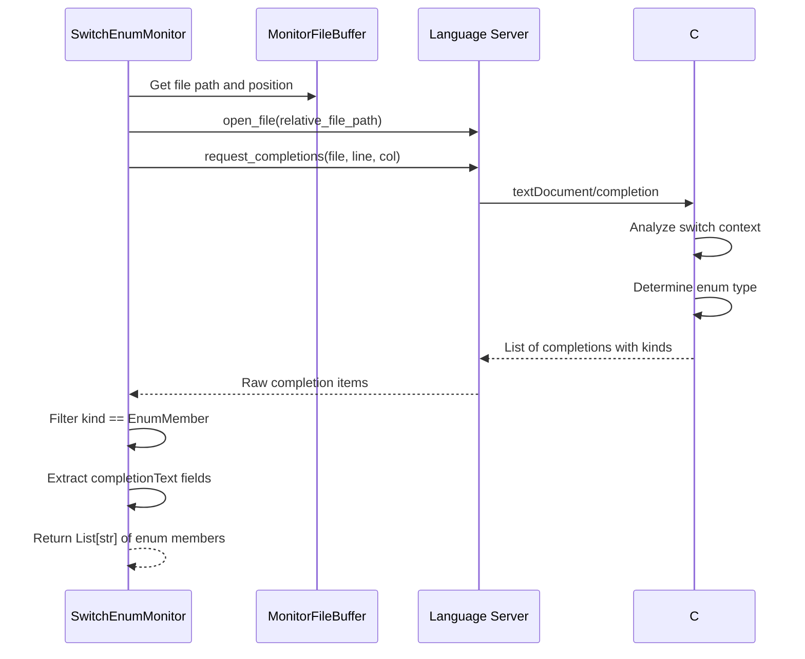
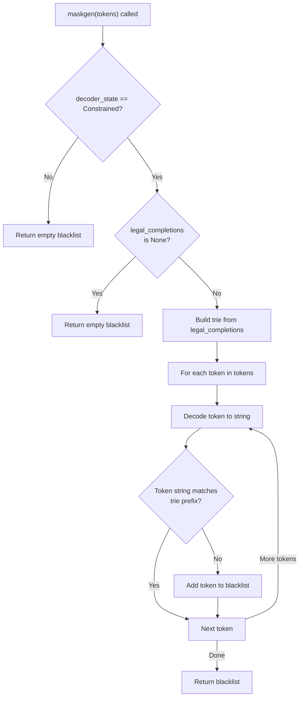
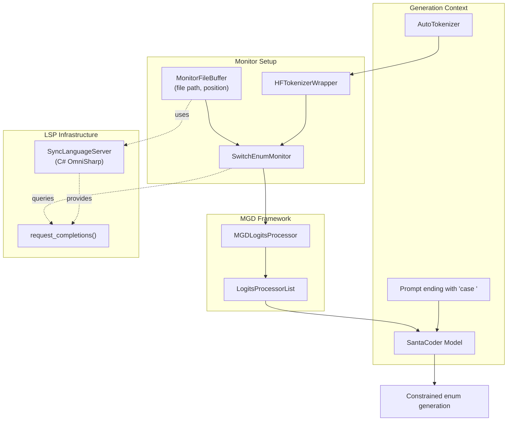

<!-- source: DeepWiki mcp.deepwiki.com · repo microsoft/monitors4codegen · extra page SwitchEnumMonitor · fetched 2026-10-26 -->

# SwitchEnumMonitor

<details>
<summary>Relevant source files</summary>

The following files were used as context for generating this wiki page:

- [requirements.txt](requirements.txt)
- [src/monitors4codegen/monitor_guided_decoding/monitors/switch_enum_monitor.py](src/monitors4codegen/monitor_guided_decoding/monitors/switch_enum_monitor.py)
- [tests/monitor_guided_decoding/test_switchenum_monitor_csharp.py](tests/monitor_guided_decoding/test_switchenum_monitor_csharp.py)

</details>


## Purpose and Scope

The `SwitchEnumMonitor` is a specialized monitor implementation that constrains language model code generation to produce only valid enum members in switch case statements. When the monitor detects that the model is generating a case label in a switch statement (specifically, when "case " is typed), it queries the Language Server Protocol (LSP) to retrieve the valid enum members for that context and masks out all other tokens, ensuring the model can only generate semantically correct enum values.

This monitor is part of the Monitor-Guided Decoding framework (see [3](#3)) and is primarily designed for C# code generation, though its architecture could support other languages with similar switch-enum patterns. For information about other monitor implementations, see [Monitor Implementations](#3.2). For details about the parent class it extends, see [DereferencesMonitor](#3.2.1).

---

## Overview

The `SwitchEnumMonitor` prevents common errors where language models generate invalid or hallucinated enum values in switch statements. Without this monitor, models may produce syntactically valid but semantically incorrect code, such as non-existent enum members or incorrect enum types.

**Key Capabilities:**
- Detects when code generation reaches a `case ` statement within a switch block
- Queries LSP for valid enum member completions at the current cursor position
- Filters completions to only include items of kind `EnumMember`
- Masks out all tokens that don't correspond to valid enum members
- Automatically deactivates when a breaking character is encountered

**Sources:** [src/monitors4codegen/monitor_guided_decoding/monitors/switch_enum_monitor.py:1-80]()

---

## Architecture

### Class Hierarchy



The `SwitchEnumMonitor` inherits from `DereferencesMonitor`, reusing much of its state machine logic and token masking infrastructure. The key difference is the activation condition and the set of break characters.

**Sources:** [src/monitors4codegen/monitor_guided_decoding/monitors/switch_enum_monitor.py:12-19]()

---

## Initialization and Configuration

### Constructor

The `SwitchEnumMonitor` constructor accepts three parameters:

| Parameter | Type | Description |
|-----------|------|-------------|
| `tokenizer` | `TokenizerWrapper` | Wrapper around the LLM's tokenizer for token-string conversions |
| `monitor_file_buffer` | `MonitorFileBuffer` | Manages file state and LSP communication |
| `responsible_for_file_buffer_state` | `bool` | Whether this monitor should update the file buffer (default: `True`) |

**Key Modification:** Upon initialization, the monitor removes `'.'` from the inherited `all_break_chars` set. This is critical because enum members in languages like C# often contain dots (e.g., `AccessSize.Byte`), and these should not trigger deactivation.



**Sources:** [src/monitors4codegen/monitor_guided_decoding/monitors/switch_enum_monitor.py:17-19]()

---

## Monitoring Lifecycle

The `SwitchEnumMonitor` follows a state-based monitoring lifecycle with three key methods:

### State Diagram



**Sources:** [src/monitors4codegen/monitor_guided_decoding/monitors/switch_enum_monitor.py:21-41]()

---

### pre() Method - Context Detection

The `pre()` method is called before each token generation to determine if the monitor should activate.

**Detection Logic:**
1. Gets the current cursor position from `monitor_file_buffer.current_lc`
2. Extracts all text before the cursor
3. Checks if the text ends with the exact string `"case "`
4. If match found, calls `a_phi()` to retrieve enum completions
5. Sets state to `DecoderStates.Constrained` if completions exist, otherwise `DecoderStates.S0`



**Sources:** [src/monitors4codegen/monitor_guided_decoding/monitors/switch_enum_monitor.py:21-41]()

---

### a_phi() Method - LSP Query

The `a_phi()` method queries the LSP to retrieve valid enum member completions.

**Process:**
1. Opens the file via `monitor_file_buffer.lsp.open_file()`
2. Requests completions at the current line and column using `request_completions()`
3. Filters completions to only include items with `kind == CompletionItemKind.EnumMember`
4. Extracts the `completionText` field from each matching completion
5. Returns the list of valid enum member strings



**Sources:** [src/monitors4codegen/monitor_guided_decoding/monitors/switch_enum_monitor.py:43-57]()

---

### update() Method - State Updates

The `update()` method is called after each token is generated to update the monitor's state.

**Behavior:**
1. If `responsible_for_file_buffer_state` is `True`, appends the generated token to the file buffer
2. If in `DecoderStates.Constrained`:
   - Checks if any break character is present in the generated token
   - If found, transitions to `DecoderStates.S0` and clears `legal_completions`
   - Otherwise, filters `legal_completions` to only those that start with the generated token prefix
3. In other states, no action is taken

| State | Generated Token Contains Break Char | Action |
|-------|-------------------------------------|--------|
| `Constrained` | Yes | Transition to `S0`, clear completions |
| `Constrained` | No | Filter completions by prefix match |
| `S0` | N/A | No action |

**Sources:** [src/monitors4codegen/monitor_guided_decoding/monitors/switch_enum_monitor.py:59-80]()

---

## Token Masking Behavior

The `SwitchEnumMonitor` inherits the `maskgen()` method from `DereferencesMonitor`, which implements the core token masking logic.

### Masking Algorithm



When in `Constrained` state with valid `legal_completions`, the monitor creates a trie of valid completion strings and blacklists any token whose decoded string representation doesn't match a prefix in the trie.

**Sources:** [src/monitors4codegen/monitor_guided_decoding/monitors/dereferences_monitor.py]() (inherited method)

---

## Usage Example

### Test Case: C# Switch Statement with AccessSize Enum

The following example demonstrates the monitor's effectiveness using the Ryujinx C# repository.

**Test Setup:**
- Repository: `https://github.com/Ryujinx/Ryujinx/`
- File: `src/ARMeilleure/CodeGen/Arm64/CodeGenerator.cs`
- Context: Switch statement on `AccessSize` enum at line 1369

**Code Context:**
```csharp
// Text before cursor ends with:
switch (access) 
{
    case 
    // ^ cursor position - need to generate enum member
```

**Without Monitor (Baseline):**
The model generates invalid case labels starting with numeric literals:
```
1:
    context.Assembler.Stb(result, ...);
    break;
case 2:
    context.Assembler.Stw(result, ...);
```

**With SwitchEnumMonitor:**
The model generates valid `AccessSize` enum members:
```
AccessSize.Byte:
    context.Assembler.Staxrb(actual, address);
    break;
case AccessSize.Hword:
    context.Assembler.Staxrh(actual, address);
```

**Sources:** [tests/monitor_guided_decoding/test_switchenum_monitor_csharp.py:26-115]()

---

## Integration with MGD Pipeline

### Component Interactions



**Initialization Code Pattern:**
```python
# Setup (from test file)
filebuffer = MonitorFileBuffer(
    lsp.language_server,
    "src/ARMeilleure/CodeGen/Arm64/CodeGenerator.cs",
    (1369, 21),  # start position
    (1369, 21),  # end position
    Language.CSHARP
)

monitor = SwitchEnumMonitor(
    HFTokenizerWrapper(tokenizer),
    filebuffer
)

mgd_logits_processor = MGDLogitsProcessor(
    [monitor],
    lsp.language_server.server.loop
)

# Use during generation
logits_processor = LogitsProcessorList([mgd_logits_processor])
generated_code = model.generate(
    prompt_tokenized,
    do_sample=False,
    max_new_tokens=100,
    logits_processor=logits_processor
)
```

**Sources:** [tests/monitor_guided_decoding/test_switchenum_monitor_csharp.py:71-108]()

---

## Key Differences from DereferencesMonitor

The `SwitchEnumMonitor` modifies its parent class behavior in two key ways:

| Aspect | DereferencesMonitor | SwitchEnumMonitor |
|--------|---------------------|-------------------|
| **Activation Trigger** | Text ends with `'.'` | Text ends with `"case "` |
| **Break Characters** | Includes `'.'` | Excludes `'.'` (allows qualified names) |
| **Completion Filter** | All completion types | Only `EnumMember` kind |
| **Typical Use Case** | Member access (`obj.member`) | Switch case labels (`case Enum.Value:`) |

The removal of `'.'` from break characters is essential because C# enum members are often qualified (e.g., `AccessSize.Byte`), and the dot should not terminate the constrained state.

**Sources:** [src/monitors4codegen/monitor_guided_decoding/monitors/switch_enum_monitor.py:19](), [src/monitors4codegen/monitor_guided_decoding/monitors/switch_enum_monitor.py:54]()

---

## Supported Languages

The `SwitchEnumMonitor` is primarily tested and validated for **C#** code generation, as evidenced by the test suite which uses:
- C# repository: Ryujinx
- C# language server: OmniSharp
- C#-specific enum patterns

The monitor's architecture could theoretically support other languages with similar switch-enum patterns (e.g., Java, TypeScript), but would require:
1. LSP server support for `CompletionItemKind.EnumMember`
2. Similar syntactic patterns (switch statements with case labels)
3. Language-specific testing and validation

**Sources:** [tests/monitor_guided_decoding/test_switchenum_monitor_csharp.py:30-34]()

---

## Limitations and Considerations

### Current Limitations

1. **Activation Pattern:** Currently only detects exact `"case "` suffix. More sophisticated detection could check for the broader `switch.*case` pattern (noted in TODO comment).

2. **Language Support:** Only validated for C#. Other languages may have different enum syntax or LSP response formats.

3. **Whitespace Sensitivity:** The detection relies on exact match of `"case "` including the trailing space, which could miss valid contexts with different whitespace.

4. **LSP Dependency:** Requires a functioning LSP server that correctly identifies enum members in switch contexts.

### Future Improvements

The code includes a TODO comment suggesting potential enhancement:
```python
# TODO: pre can be improved by checking for r"switch.*case",
# and obtaining completions, and then prefixing a whitespace
```

This would enable more robust detection of switch-case contexts even when the cursor isn't immediately after `"case "`.

**Sources:** [src/monitors4codegen/monitor_guided_decoding/monitors/switch_enum_monitor.py:31]()

---

## File Structure Reference

The `SwitchEnumMonitor` implementation consists of:

| File Path | Purpose | Lines |
|-----------|---------|-------|
| [src/monitors4codegen/monitor_guided_decoding/monitors/switch_enum_monitor.py]() | Main implementation | 1-80 |
| [tests/monitor_guided_decoding/test_switchenum_monitor_csharp.py]() | C# integration tests | 1-191 |

**Dependencies:**
- [monitors4codegen.monitor_guided_decoding.monitors.dereferences_monitor]() - Parent class
- [monitors4codegen.monitor_guided_decoding.monitor]() - `MonitorFileBuffer`
- [monitors4codegen.multilspy.multilspy_types]() - `CompletionItemKind.EnumMember`
- [monitors4codegen.multilspy.multilspy_utils]() - `TextUtils`

**Sources:** [src/monitors4codegen/monitor_guided_decoding/monitors/switch_enum_monitor.py:1-11]()

---

