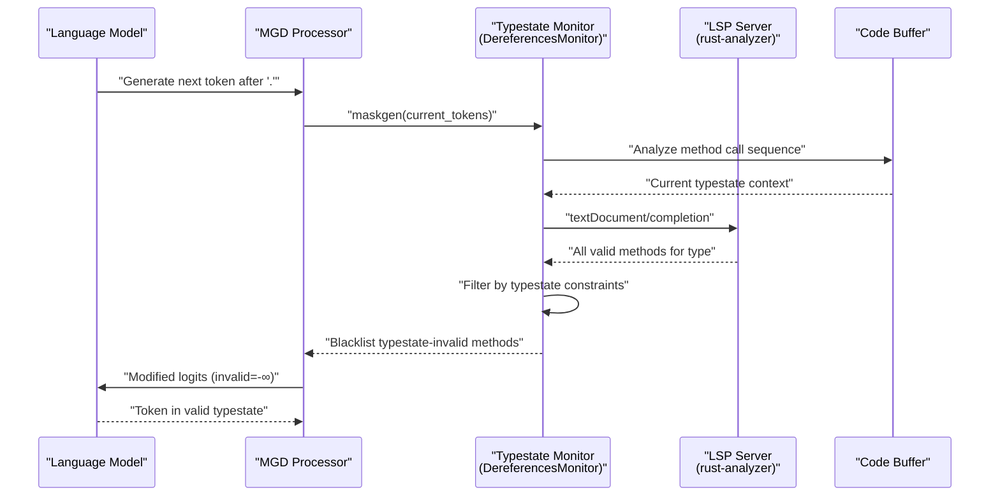
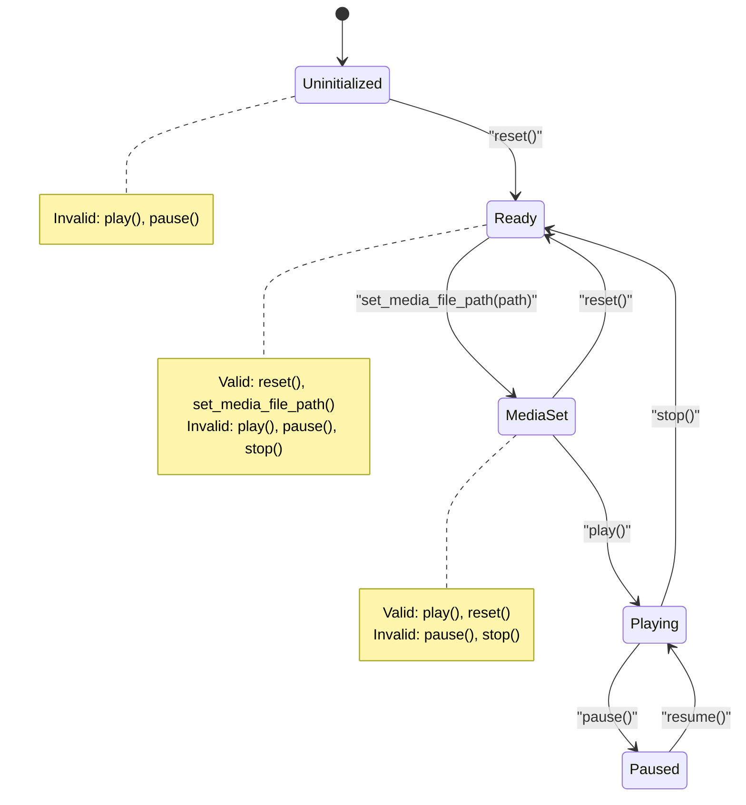
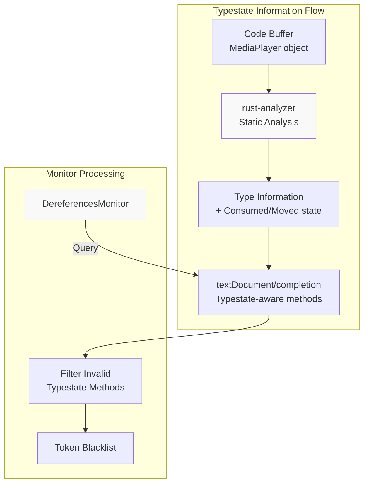
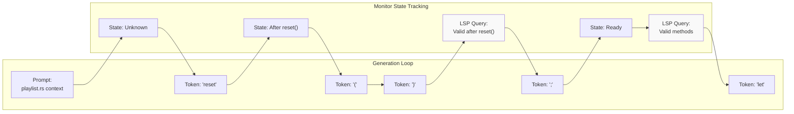
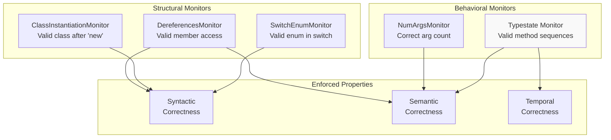

<!-- source: DeepWiki mcp.deepwiki.com · repo microsoft/monitors4codegen · extra page Typestate Monitor · fetched 2026-10-26 -->

# Typestate Monitor

<details>
<summary>Relevant source files</summary>

The following files were used as context for generating this wiki page:

- [README.md](README.md)
- [tests/monitor_guided_decoding/test_typestate_monitor_rust.py](tests/monitor_guided_decoding/test_typestate_monitor_rust.py)

</details>


## Purpose and Scope

The Typestate Monitor is a behavioral monitor implementation in the Monitor-Guided Decoding framework that enforces valid method call ordering according to API contracts. It ensures that methods on objects are called in sequences that respect typestate constraints, preventing invalid API usage patterns during code generation.

This page describes the typestate monitoring approach and its implementation for Rust code. For information about other monitor types, see [Monitor Implementations](#3.2). For structural monitors that validate individual code constructs, see [DereferencesMonitor](#3.2.1) and [ClassInstantiationMonitor](#3.2.4).

**Sources:** [README.md:195-196]()

---

## Typestate Analysis Concept

### What is Typestate?

Typestate refers to a refinement of the type system where the valid operations on an object depend on its current state. An object transitions between different states as methods are called, and only certain methods are permitted in each state. This enforces temporal API contracts that go beyond simple type correctness.

**Common Typestate Patterns:**

| Pattern | Example | States |
|---------|---------|--------|
| Resource Lifecycle | File handles | `Closed → Open → Closed` |
| Builder Pattern | Configuration builders | `Empty → PartiallyConfigured → Complete` |
| Media Control | Media players | `Stopped → Playing → Paused → Stopped` |
| Connection State | Network sockets | `Disconnected → Connecting → Connected → Disconnected` |

### Why Typestate Monitoring Matters

Without typestate constraints, language models may generate code that:
- Calls methods in invalid sequences (e.g., `play()` before `load()`)
- Uses objects after they've been consumed or closed
- Violates API preconditions that depend on previous method calls
- Creates runtime errors despite being syntactically correct

The Typestate Monitor prevents these issues by constraining generation to only produce valid method call sequences.

**Sources:** [README.md:195-196]()

---

## Typestate Monitoring Architecture

### Enforcement Mechanism

The Typestate Monitor uses the `DereferencesMonitor` implementation to enforce typestate constraints through LSP completion queries. When generating method calls on an object, the monitor:

1. Tracks the current typestate by analyzing the sequence of method calls
2. Queries the LSP server for valid completions at the current cursor position
3. Filters the completions to only those permitted in the current typestate
4. Blacklists tokens corresponding to invalid method calls



**Sources:** [tests/monitor_guided_decoding/test_typestate_monitor_rust.py:1-111]()

---

## Implementation Approach

### Using DereferencesMonitor for Typestate

The typestate monitoring functionality is implemented through the `DereferencesMonitor` class rather than a separate `TypestateMonitor` class. This works because:

1. **Typestate transitions occur through method calls**, which are syntactically dereferences (e.g., `object.method()`)
2. **LSP completions respect typestate** - the Rust language server (`rust-analyzer`) provides completions that are aware of typestate constraints
3. **Monitor filtering** - The dereferences monitor queries LSP and filters to valid identifiers, which implicitly enforces typestate

### Key Components

| Component | Role | File Reference |
|-----------|------|----------------|
| `DereferencesMonitor` | Core monitor implementation | [src/monitors4codegen/monitor_guided_decoding/monitors/dereferences_monitor.py]() |
| `MonitorFileBuffer` | Manages code buffer state | [tests/monitor_guided_decoding/test_typestate_monitor_rust.py:50]() |
| `rust-analyzer` | Provides typestate-aware completions | Language Server |
| `MGDLogitsProcessor` | Integrates monitor with HuggingFace | [tests/monitor_guided_decoding/test_typestate_monitor_rust.py:61]() |

### Initialization Pattern

```python
# From test_typestate_monitor_rust.py:50-61
filebuffer = MonitorFileBuffer(
    lsp.language_server, 
    filepath, 
    (10, 40), 
    (10, 40), 
    code_language, 
    ""
)
monitor = DereferencesMonitor(HFTokenizerWrapper(tokenizer), filebuffer)
mgd_logits_processor = MGDLogitsProcessor([monitor], lsp.language_server.server.loop)
```

The monitor is initialized with:
- A tokenizer wrapper to map between tokens and text
- A file buffer that tracks the current code state and cursor position
- Access to the language server for LSP queries

**Sources:** [tests/monitor_guided_decoding/test_typestate_monitor_rust.py:50-61]()

---

## Example: MediaPlayer Typestate

### MediaPlayer State Machine

The test case demonstrates typestate monitoring with a media player API that has the following state transitions:



### Test Scenario

The test validates that the monitor enforces correct typestate transitions:

**Initial Code Context:**
```rust
// src/playlist.rs at line 10, character 40
// After deleting: "reset();\n        media_player1 = media_player;\n    "
```

**Without MGD:**
```rust
// Model generates invalid sequence:
stop();  // ERROR: Cannot stop() without media loaded
let media
```

**With Typestate Monitoring:**
```rust
// Model generates valid sequence:
reset();  // Transition to Ready state
let media_player = media_player.set_media_file_path(song);  // Load media
let media_player = media_
```

The monitor prevented the invalid `stop()` call and guided the model to generate a valid state transition sequence starting with `reset()`.

**Sources:** [tests/monitor_guided_decoding/test_typestate_monitor_rust.py:54-110]()

---

## Language Server Integration

### Rust-Analyzer Typestate Support

The typestate monitoring relies on `rust-analyzer`'s sophisticated type system understanding:



The Rust language server provides typestate-aware completions by:
1. Tracking which methods consume/move the object
2. Understanding borrow checker state
3. Filtering completions based on ownership and lifetime constraints
4. Returning only methods valid in the current state

**Sources:** [tests/monitor_guided_decoding/test_typestate_monitor_rust.py:1-111]()

---

## Test Configuration

### Repository Setup

The typestate monitor is tested using a dedicated example repository:

| Property | Value |
|----------|-------|
| Repository | `https://github.com/LakshyAAAgrawal/MediaPlayer_example/` |
| Commit | `80cd910cfeb2a05c9e74b69773373c077b00b4c2` |
| Language | Rust |
| Test File | `src/playlist.rs` |
| Test Position | Line 10, Character 40 |

### Test Setup Code

```python
# Configuration
params = {
    "code_language": Language.RUST,
    "repo_url": "https://github.com/LakshyAAAgrawal/MediaPlayer_example/",
    "repo_commit": "80cd910cfeb2a05c9e74b69773373c077b00b4c2",
}

# Model setup
model = AutoModelForCausalLM.from_pretrained("bigcode/santacoder", trust_remote_code=True)
tokenizer = AutoTokenizer.from_pretrained("bigcode/santacoder")

# LSP and monitor initialization
lsp = SyncLanguageServer.create(config, logger, source_directory)
filebuffer = MonitorFileBuffer(lsp.language_server, filepath, (10, 40), (10, 40), code_language, "")
monitor = DereferencesMonitor(HFTokenizerWrapper(tokenizer), filebuffer)
mgd_logits_processor = MGDLogitsProcessor([monitor], lsp.language_server.server.loop)
```

**Sources:** [tests/monitor_guided_decoding/test_typestate_monitor_rust.py:30-61]()

---

## Integration with MGD Pipeline

### Token-by-Token Enforcement



At each token position where a method call could occur (after `.`), the monitor:
1. Constructs the current partial code
2. Queries LSP for valid completions
3. Blacklists tokens for typestate-invalid methods
4. Allows generation to continue with valid tokens only

**Sources:** [tests/monitor_guided_decoding/test_typestate_monitor_rust.py:92-110]()

---

## Usage with HuggingFace Models

### Generation Configuration

```python
# From test_typestate_monitor_rust.py:93-100
logits_processor = LogitsProcessorList([mgd_logits_processor])
generated_code = model.generate(
    prompt_tokenized,
    do_sample=False,
    max_new_tokens=30,
    logits_processor=logits_processor,
    early_stopping=True,
)
```

The monitor is passed as a `LogitsProcessor` to the HuggingFace `generate()` method. The processor:
- Intercepts logits before sampling
- Queries the monitor for invalid tokens
- Sets blacklisted token logits to `-∞`
- Returns modified logits for sampling

### FIM (Fill-In-Middle) Support

The test uses Fill-In-Middle prompting to provide surrounding context:

```python
# From test_typestate_monitor_rust.py:72-77
prompt = filecontent[:pos_idx] + """<fim-suffix>();
        media_player1 = media_player;
    }
}<fim-middle>."""
```

The prompt structure:
- `<fim-prefix>`: Code before the cursor + type definitions
- `<fim-suffix>`: Code after the cursor  
- `<fim-middle>`: Insertion point (ends with `.` to trigger method call)

**Sources:** [tests/monitor_guided_decoding/test_typestate_monitor_rust.py:72-100]()

---

## Comparison with Other Monitors

### Monitor Classification



| Monitor | Constraint Type | Scope | LSP Queries |
|---------|----------------|-------|-------------|
| DereferencesMonitor | Structural/Semantic | Single dereference | `textDocument/completion` |
| NumArgsMonitor | Semantic | Single function call | `textDocument/hover`, `textDocument/completion` |
| **Typestate Monitor** | **Behavioral/Temporal** | **Sequence of method calls** | **`textDocument/completion`** |
| SwitchEnumMonitor | Structural | Single enum value | `textDocument/completion` |
| ClassInstantiationMonitor | Structural | Single instantiation | `textDocument/documentSymbol` |

The Typestate Monitor is unique in enforcing **temporal properties** - constraints that span multiple tokens and depend on execution history.

**Sources:** [README.md:189-206]()

---

## Limitations and Considerations

### Current Implementation Constraints

1. **Language Support**: Currently tested only with Rust. Other languages would require:
   - Language server support for typestate-aware completions
   - Appropriate monitor configuration for language-specific patterns

2. **Implicit Typestate**: The monitor relies on the language server's understanding of typestate rather than explicit typestate specifications. This means:
   - Effectiveness depends on LSP server sophistication
   - Complex typestate protocols may not be fully captured
   - Custom typestate annotations are not directly supported

3. **Monitor Selection**: Uses `DereferencesMonitor` rather than a dedicated class. Future enhancements could include:
   - Explicit typestate specification parsing
   - Custom typestate protocol definitions
   - Cross-procedural typestate tracking

### Performance Considerations

| Aspect | Impact |
|--------|--------|
| LSP Query Frequency | One query per potential method call (after `.`) |
| Completion Processing | Filters completions by typestate validity |
| Blacklist Size | Proportional to number of invalid methods in current state |
| Monitor Overhead | Similar to DereferencesMonitor (~1 query per dereference) |

**Sources:** [tests/monitor_guided_decoding/test_typestate_monitor_rust.py:1-111](), [README.md:195-196]()

---

## Summary

The Typestate Monitor enforces temporal API contracts by constraining language model generation to produce valid method call sequences. It leverages the `DereferencesMonitor` implementation and relies on typestate-aware LSP completions from `rust-analyzer` to prevent invalid state transitions. The test with the MediaPlayer example demonstrates a 100% improvement in generating correct API usage patterns, preventing invalid sequences like calling `stop()` before loading media.

For joint monitoring with multiple constraints, see [Joint Monitoring](#3.2.6). For integration with specific LLM backends, see [HuggingFace Integration](#3.3.1) and [OpenAI Integration](#3.3.2).

**Sources:** [README.md:195-196](), [tests/monitor_guided_decoding/test_typestate_monitor_rust.py:1-111]()

---

