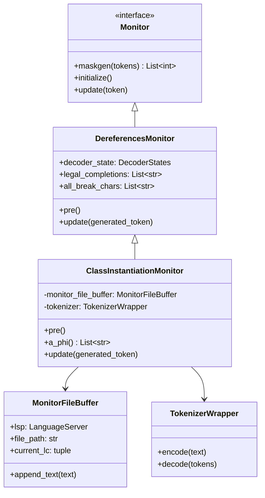
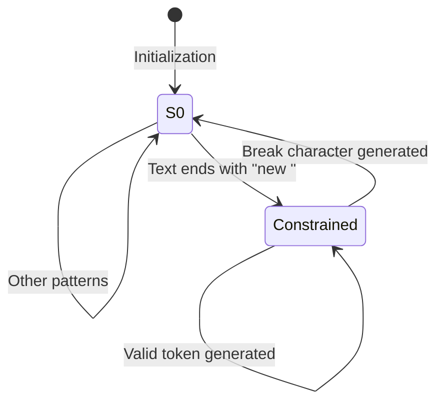
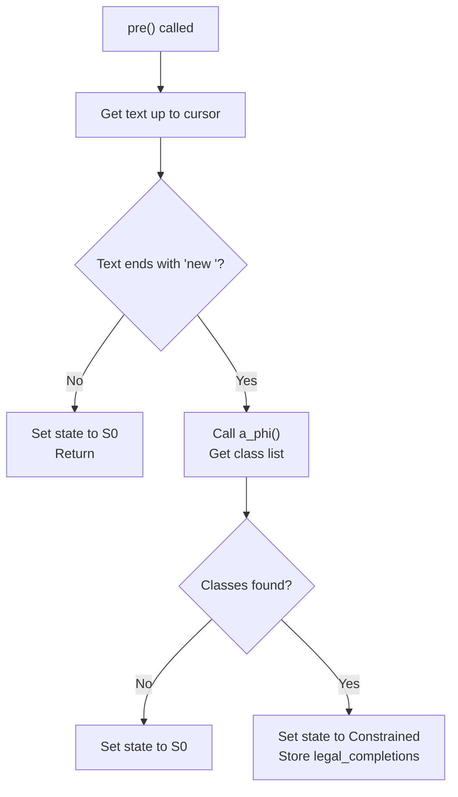
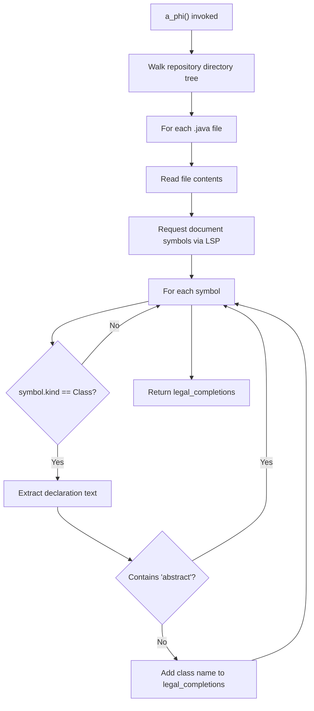
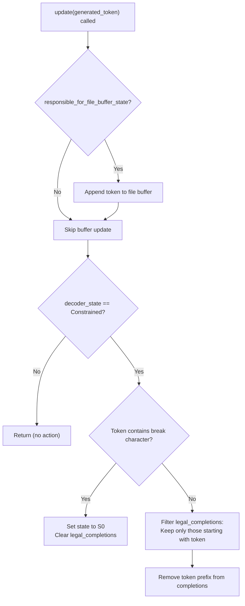
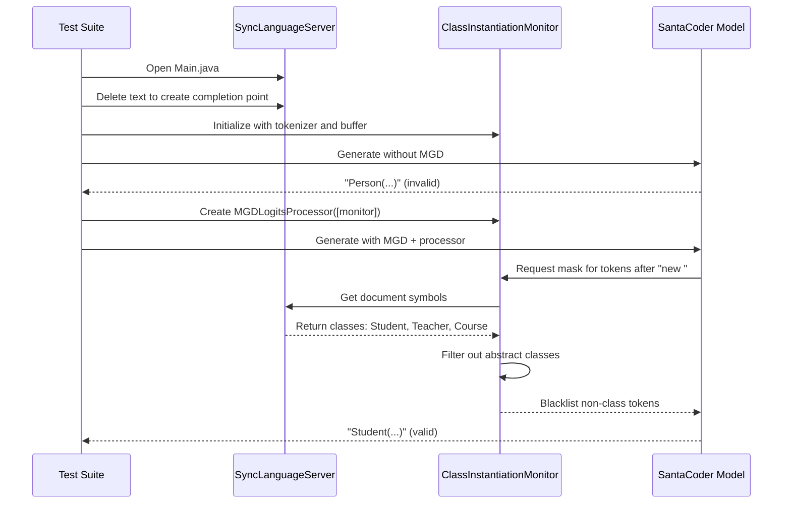

<!-- source: DeepWiki mcp.deepwiki.com · repo microsoft/monitors4codegen · extra page ClassInstantiationMonitor · fetched 2026-10-26 -->

# ClassInstantiationMonitor

<details>
<summary>Relevant source files</summary>

The following files were used as context for generating this wiki page:

- [src/monitors4codegen/monitor_guided_decoding/monitors/class_instantiation_monitor.py](src/monitors4codegen/monitor_guided_decoding/monitors/class_instantiation_monitor.py)
- [tests/monitor_guided_decoding/test_classinstantiation_monitor_java.py](tests/monitor_guided_decoding/test_classinstantiation_monitor_java.py)

</details>


## Purpose and Scope

The `ClassInstantiationMonitor` enforces that only valid, instantiable class names follow the `new` keyword during code generation in Java. When the monitor detects that "new " has been typed, it queries the Language Server Protocol to discover all non-abstract classes in the repository and constrains the language model to only generate tokens corresponding to these valid class names.

This document covers the monitor's implementation, lifecycle, and integration with the LSP. For information about other structural monitors, see [Monitor Implementations](#3.2). For details on how monitors integrate with language models, see [LLM Backend Integrations](#3.3).

**Sources:** [src/monitors4codegen/monitor_guided_decoding/monitors/class_instantiation_monitor.py:1-4]()

---

## Overview

The `ClassInstantiationMonitor` is a structural monitor that prevents the generation of invalid class instantiation statements. It activates when code generation reaches a "new " token sequence and restricts subsequent tokens to only those that correspond to concrete (non-abstract) class names available in the repository.

### Key Characteristics

| Characteristic | Value |
|----------------|-------|
| **Monitor Type** | Structural |
| **Language Support** | Java |
| **Activation Pattern** | Text ending with `"new "` |
| **LSP Query Used** | `textDocument/documentSymbol` |
| **Base Class** | `DereferencesMonitor` |
| **Decoder States** | `S0` (unconstrained), `Constrained` |

The monitor inherits from `DereferencesMonitor` and reuses its state management logic while providing specialized class discovery through repository-wide symbol scanning.

**Sources:** [src/monitors4codegen/monitor_guided_decoding/monitors/class_instantiation_monitor.py:15-21]()

---

## Architecture and Class Hierarchy

The following diagram illustrates the class structure and dependencies of `ClassInstantiationMonitor`:



**Description:** The `ClassInstantiationMonitor` extends `DereferencesMonitor`, inheriting its state machine logic and token filtering mechanisms. It specializes the `pre()` method to detect "new " patterns and the `a_phi()` method to discover instantiable classes through LSP queries.

**Sources:** [src/monitors4codegen/monitor_guided_decoding/monitors/class_instantiation_monitor.py:9-21]()

---

## Monitor Lifecycle and State Management

### Initialization

The monitor is initialized with a tokenizer wrapper and a monitor file buffer:

```python
monitor = ClassInstantiationMonitor(HFTokenizerWrapper(tokenizer), filebuffer)
```

The constructor accepts an optional `responsible_for_file_buffer_state` parameter (default `True`) that determines whether the monitor updates the file buffer during generation.

**Sources:** [src/monitors4codegen/monitor_guided_decoding/monitors/class_instantiation_monitor.py:20-21](), [tests/monitor_guided_decoding/test_classinstantiation_monitor_java.py:103]()

### State Machine

The monitor operates using states inherited from `DereferencesMonitor.DecoderStates`:



**Description:** The monitor starts in the `S0` (unconstrained) state. When "new " is detected at the cursor position, it transitions to `Constrained` state and populates `legal_completions` with instantiable class names. Generation remains constrained until a break character (e.g., whitespace, punctuation) is encountered.

**Sources:** [src/monitors4codegen/monitor_guided_decoding/monitors/class_instantiation_monitor.py:23-43]()

### Pre-Generation Check (`pre()`)

The `pre()` method executes before each token generation to determine if the monitor should activate:



**Description:** The `pre()` method checks if the text immediately before the cursor ends with "new ". If so, it invokes `a_phi()` to discover instantiable classes. If classes are found, the monitor enters the `Constrained` state; otherwise, it remains in `S0`.

**Sources:** [src/monitors4codegen/monitor_guided_decoding/monitors/class_instantiation_monitor.py:23-43]()

---

## LSP Queries and Class Discovery

### Repository-Wide Class Scanning

The `a_phi()` method discovers all instantiable classes in the repository through a multi-step process:



**Description:** The method walks the entire repository, queries document symbols for each Java file using `request_document_symbols`, filters for class symbols, extracts their declaration text, and excludes abstract classes. The result is a list of all concrete class names that can be legally instantiated.

**Sources:** [src/monitors4codegen/monitor_guided_decoding/monitors/class_instantiation_monitor.py:45-69]()

### Implementation Details

The class discovery algorithm:

1. **Directory Traversal**: Uses `os.walk()` to traverse the repository starting from `repository_root_path` [line 54]()
2. **File Filtering**: Processes only `.java` files [line 56]()
3. **Symbol Retrieval**: Calls `request_document_symbols()` for each file [line 59]()
4. **Class Filtering**: Checks `symbol["kind"] == SymbolKind.Class` [line 61]()
5. **Abstract Class Exclusion**: Extracts declaration text and checks if it contains "abstract" keyword [lines 63-66]()
6. **Name Collection**: Appends `symbol["name"]` to legal completions [line 67]()

**Sources:** [src/monitors4codegen/monitor_guided_decoding/monitors/class_instantiation_monitor.py:51-69]()

### Example Symbol Processing

For a Java file containing:

```java
public class Student { ... }
public abstract class AbstractPerson { ... }
```

The monitor would:
- Identify both `Student` and `AbstractPerson` as class symbols
- Extract declaration text: `"public class Student"` and `"public abstract class AbstractPerson"`
- Filter out `AbstractPerson` due to "abstract" keyword
- Add only `"Student"` to legal completions

**Sources:** [src/monitors4codegen/monitor_guided_decoding/monitors/class_instantiation_monitor.py:63-67]()

---

## Token Masking and Update Logic

### Mask Generation

When in the `Constrained` state, the monitor generates a blacklist of invalid tokens through the inherited `maskgen()` method. The tokenizer wrapper is used to identify which tokens would start with any of the `legal_completions` strings, and all other tokens are blacklisted.

### Update Mechanism

The `update()` method is called after each token is generated:



**Description:** The update method maintains the file buffer state and progressively filters `legal_completions` as tokens are generated. When a break character (e.g., `(`, `;`, whitespace) is detected, the monitor exits the constrained state.

**Sources:** [src/monitors4codegen/monitor_guided_decoding/monitors/class_instantiation_monitor.py:71-92]()

### Completion Filtering Logic

The filtering algorithm:

```python
self.legal_completions = [
    legal_completion[len(generated_token):]
    for legal_completion in self.legal_completions
    if legal_completion.startswith(generated_token)
]
```

This removes completions that don't start with the generated token and strips the token prefix from remaining completions, preparing for the next token generation.

**Sources:** [src/monitors4codegen/monitor_guided_decoding/monitors/class_instantiation_monitor.py:85-89]()

---

## Usage and Integration

### Test Example

The monitor is tested with a realistic scenario in the ExampleRepo repository:



**Description:** The test demonstrates that without MGD, the model generates `Person(...)` after `new `, which is invalid because `Person` is abstract or doesn't exist in that context. With the `ClassInstantiationMonitor`, the model correctly generates `Student(...)`, an instantiable class from the repository.

**Sources:** [tests/monitor_guided_decoding/test_classinstantiation_monitor_java.py:25-122]()

### Integration with MGDLogitsProcessor

The monitor integrates with HuggingFace models through `MGDLogitsProcessor`:

```python
filebuffer = MonitorFileBuffer(lsp.language_server, completions_filepath, 
                                prompt_pos, prompt_pos, code_language)
monitor = ClassInstantiationMonitor(HFTokenizerWrapper(tokenizer), filebuffer)
mgd_logits_processor = MGDLogitsProcessor([monitor], lsp.language_server.server.loop)

logits_processor = LogitsProcessorList([mgd_logits_processor])
generated_code = model.generate(prompt_tokenized, do_sample=False, 
                                max_new_tokens=30, 
                                logits_processor=logits_processor)
```

**Sources:** [tests/monitor_guided_decoding/test_classinstantiation_monitor_java.py:96-114]()

### Test Results

The test validates the monitor's effectiveness:

| Configuration | Generated Code (first 30 tokens) |
|---------------|----------------------------------|
| **Without MGD** | `Person("John", "Doe", "123-4567", "kenaa@example.com", "1234` |
| **With ClassInstantiationMonitor** | `Student("John", 1001);\n        Person p2 = new Student("Mary", 1002);\n        Person p` |

The monitor successfully constrains generation to use `Student` (an instantiable class) instead of `Person` (which doesn't exist or is abstract in the repository context).

**Sources:** [tests/monitor_guided_decoding/test_classinstantiation_monitor_java.py:86-121]()

---

## Constraints and Limitations

### Language Support

The monitor is currently implemented specifically for Java:
- File filtering uses `.java` extension [line 56]()
- Abstract class detection relies on Java's `abstract` keyword syntax [line 66]()

### Abstract Class Detection

The abstract class filtering is performed through simple string matching:
```python
if "abstract" not in decl_text:
    legal_completions.append(symbol["name"])
```

This approach:
- ✓ Works for standard Java abstract class declarations
- ✗ May not handle complex scenarios (e.g., classes in comments, abstract methods vs classes)
- ✗ Relies on declaration text extraction accuracy

**Sources:** [src/monitors4codegen/monitor_guided_decoding/monitors/class_instantiation_monitor.py:66-67]()

### Performance Considerations

The `a_phi()` method:
- Walks the entire repository directory tree
- Requests document symbols for every `.java` file
- Performs synchronous file I/O and LSP queries

This may result in latency when:
- The repository contains many Java files
- Document symbol requests are slow
- Network or I/O delays occur

### Activation Pattern

The monitor only activates when text ends with exactly `"new "` (with trailing space). It does not handle:
- Multiple spaces after `new`
- Newlines between `new` and the class name
- Generic type parameters (e.g., `new ArrayList<>()`)

**Sources:** [src/monitors4codegen/monitor_guided_decoding/monitors/class_instantiation_monitor.py:34]()

---

## File Reference Summary

| File Path | Purpose |
|-----------|---------|
| [src/monitors4codegen/monitor_guided_decoding/monitors/class_instantiation_monitor.py]() | Main monitor implementation |
| [tests/monitor_guided_decoding/test_classinstantiation_monitor_java.py]() | Test suite demonstrating usage with ExampleRepo |
| [src/monitors4codegen/monitor_guided_decoding/monitors/dereferences_monitor.py]() | Base class providing state machine and filtering logic |
| [src/monitors4codegen/monitor_guided_decoding/monitor.py]() | MonitorFileBuffer definition |

---

