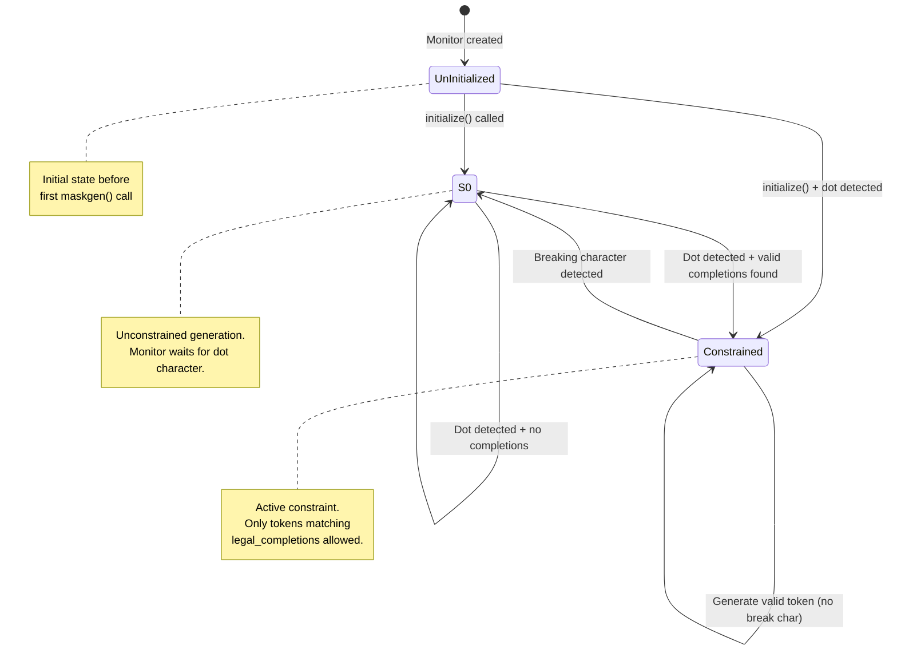
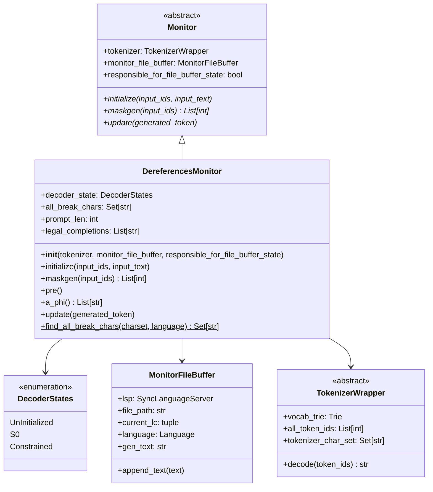
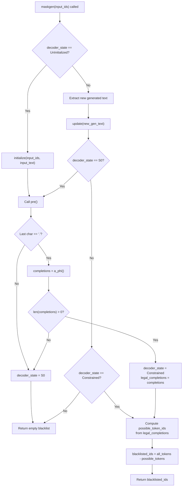
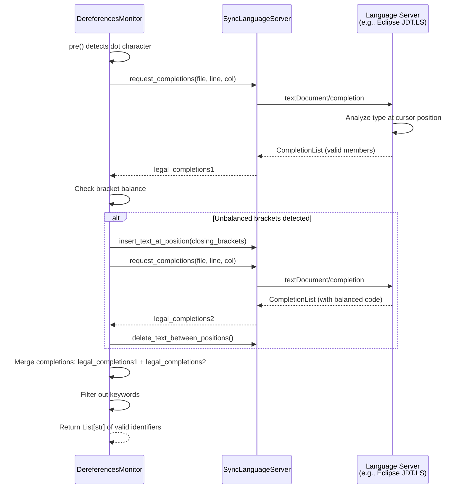
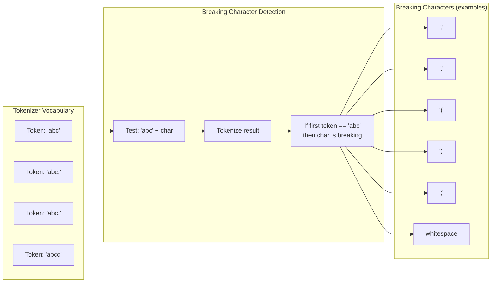
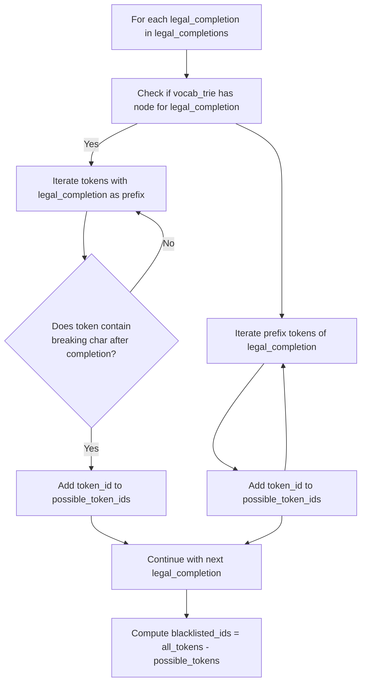
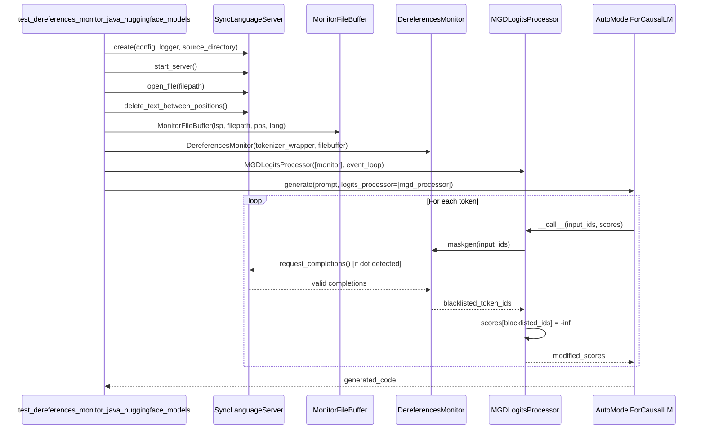
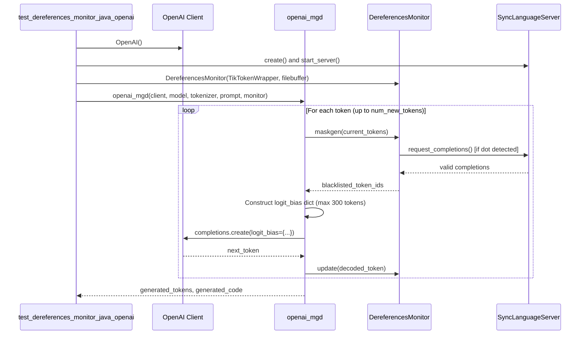

<!-- source: DeepWiki mcp.deepwiki.com · repo microsoft/monitors4codegen · extra page DereferencesMonitor · fetched 2026-10-26 -->

# DereferencesMonitor

<details>
<summary>Relevant source files</summary>

The following files were used as context for generating this wiki page:

- [src/monitors4codegen/monitor_guided_decoding/monitors/dereferences_monitor.py](src/monitors4codegen/monitor_guided_decoding/monitors/dereferences_monitor.py)
- [tests/monitor_guided_decoding/test_dereferences_monitor_java.py](tests/monitor_guided_decoding/test_dereferences_monitor_java.py)
- [tests/monitor_guided_decoding/test_dereferences_monitor_java_openai.py](tests/monitor_guided_decoding/test_dereferences_monitor_java_openai.py)

</details>


## Purpose and Scope

The `DereferencesMonitor` enforces type-valid identifier dereferencing during code generation, ensuring that when a language model generates code containing member access patterns (e.g., `object.member`), the generated member is semantically valid according to the type system. This monitor is particularly effective for languages with static typing such as Java, Rust, and potentially Python.

For information about other monitor types, see [Monitor Implementations](#3.2). For the broader Monitor-Guided Decoding framework, see [Monitor-Guided Decoding](#3).

---

## Overview

The `DereferencesMonitor` addresses a common problem in neural code generation: language models often generate syntactically plausible but semantically invalid member accesses. For example, given code like `serverNode.`, a model might generate `serverNode.invalidMethod()` when `invalidMethod` is not a member of the `serverNode` type.

The monitor intervenes at generation time by:
1. Detecting when a dot (`.`) character appears in the generated code
2. Querying the Language Server Protocol (LSP) to determine valid completions at that cursor position
3. Constraining the language model to only generate tokens that correspond to valid members

**Key Characteristics:**
- **Language Support**: Primarily Java (tested extensively), with potential for Rust and Python
- **LSP Queries**: Uses `textDocument/completion` requests
- **Constraint Scope**: Applies only after dot operators, minimal overhead otherwise
- **State-Based**: Uses a finite state machine to track when constraints should apply

Sources: [src/monitors4codegen/monitor_guided_decoding/monitors/dereferences_monitor.py:1-245]()

---

## Architecture

### State Machine

The `DereferencesMonitor` operates as a finite state machine with three states defined in the `DecoderStates` enum:



**State Descriptions:**

| State | Description | Actions |
|-------|-------------|---------|
| `UnInitialized` | Monitor has been created but not yet invoked | None |
| `S0` | Unconstrained generation, monitoring for dot operators | Returns empty blacklist |
| `Constrained` | Active constraint after detecting a dot | Returns blacklist of invalid tokens |

Sources: [src/monitors4codegen/monitor_guided_decoding/monitors/dereferences_monitor.py:20-28](), [src/monitors4codegen/monitor_guided_decoding/monitors/dereferences_monitor.py:77-89]()

### Class Structure



Sources: [src/monitors4codegen/monitor_guided_decoding/monitors/dereferences_monitor.py:30-36](), [src/monitors4codegen/monitor_guided_decoding/monitors/dereferences_monitor.py:20-28]()

---

## Implementation Details

### Token Masking Algorithm

The core constraint mechanism is implemented in the `maskgen()` method, which is invoked for every token to be generated. The algorithm flow:



**Key Steps:**

1. **Initialization (first call only)**: Records prompt length and checks for initial constraint via `pre()`
2. **Update**: Processes newly generated text and updates internal state
3. **Pre-check**: Determines if a dot operator was just generated
4. **Constraint Application**: If in `Constrained` state, computes valid token set

Sources: [src/monitors4codegen/monitor_guided_decoding/monitors/dereferences_monitor.py:91-146]()

### LSP Integration via a_phi()

The `a_phi()` method performs static analysis to determine valid completions:



**Bracket Balancing Logic:**

The monitor implements sophisticated bracket balancing to handle incomplete code contexts. When the cursor position has unbalanced brackets (e.g., more opening than closing), the monitor:

1. Inserts temporary closing brackets
2. Re-queries the LSP for completions in the now-balanced context
3. Deletes the temporary brackets
4. Merges both completion sets

This ensures the LSP can properly analyze types even in syntactically incomplete code.

Sources: [src/monitors4codegen/monitor_guided_decoding/monitors/dereferences_monitor.py:148-221]()

### Breaking Characters

The monitor uses "breaking characters" to determine when a constrained identifier has ended:



The `find_all_break_chars()` static method identifies characters that, when appended to an identifier, cause it to be tokenized separately. This is language-dependent and tokenizer-dependent.

**Usage in Constraint:**

When in `Constrained` state, the monitor allows tokens that:
1. Are prefixes of valid completions
2. Match a valid completion followed by a breaking character (e.g., `method(` when `method` is valid)

Sources: [src/monitors4codegen/monitor_guided_decoding/monitors/dereferences_monitor.py:44-57](), [src/monitors4codegen/monitor_guided_decoding/monitors/dereferences_monitor.py:131-141]()

### Token Matching Strategy



The monitor uses a trie data structure (`vocab_trie`) to efficiently:
- Find all tokens that are prefixes of valid completions
- Find tokens that contain a valid completion followed by breaking characters

Sources: [src/monitors4codegen/monitor_guided_decoding/monitors/dereferences_monitor.py:129-142]()

---

## Usage Examples

### HuggingFace Models Integration

Example from test suite demonstrating usage with SantaCoder model:



**Code Example:**

The test at [tests/monitor_guided_decoding/test_dereferences_monitor_java.py:25-97]() demonstrates:

```python
# Setup: Create LSP, file buffer, and monitor
filebuffer = MonitorFileBuffer(lsp.language_server, filepath, (74, 17), (74, 17), code_language, "")
monitor = DereferencesMonitor(HFTokenizerWrapper(tokenizer), filebuffer)
mgd_logits_processor = MGDLogitsProcessor([monitor], lsp.language_server.server.loop)

# Generation with constraint
logits_processor = LogitsProcessorList([mgd_logits_processor])
generated_code = model.generate(
    prompt_tokenized,
    do_sample=False,
    max_new_tokens=30,
    logits_processor=logits_processor,
    early_stopping=True,
)
```

**Result Comparison:**

| Generation Mode | Output |
|----------------|---------|
| Without MGD | `builder()\n.hostAddress(arr[0])\n.port(Integer.parseInt(arr[1]))\n.build();` |
| With DereferencesMonitor | `newServerNode()\n.withIp(arr[0])\n.withPort(Integer.parseInt(arr[1]))\n.build();` |

The monitor correctly constrains generation to use the valid `newServerNode()` method instead of the invalid `builder()` method.

Sources: [tests/monitor_guided_decoding/test_dereferences_monitor_java.py:25-97](), [tests/monitor_guided_decoding/test_dereferences_monitor_java.py:74-97]()

### OpenAI Models Integration

Example demonstrating usage with OpenAI's text-davinci-003:



**Code Example:**

From [tests/monitor_guided_decoding/test_dereferences_monitor_java_openai.py:23-108]():

```python
# Setup with TikToken tokenizer for OpenAI
encoding = tiktoken.encoding_for_model("text-davinci-003")
tokenizer = TikTokenWrapper(encoding)

filebuffer = MonitorFileBuffer(lsp.language_server, filepath, (74, 17), (74, 17), code_language)
monitor = DereferencesMonitor(tokenizer, filebuffer)

# Generation using openai_mgd function
gen_tokens, generated_code = openai_mgd(
    client=client,
    model=OpenAI_Models.TD3,
    tokenizer=tokenizer,
    prompt_tokenized=prompt_tokenized,
    temp=0,
    top_p=0.95,
    monitor=monitor,
    num_new_tokens=30,
)
```

Sources: [tests/monitor_guided_decoding/test_dereferences_monitor_java_openai.py:23-108]()

---

## Real-World Test Cases

The test suite uses the `clickhouse-highlevel-sinker` repository to demonstrate real-world effectiveness:

### Test Case 1: Builder Pattern Correction

**Context**: `ClickHouseDataSource.java`, line 74, after `serverNodes.add(ClickHouseServerNode.`

| Without Monitor | With Monitor |
|----------------|--------------|
| `builder()` (invalid method) | `newServerNode()` (correct factory method) |

The language server correctly identifies that `ClickHouseServerNode` does not have a `builder()` method but does have a `newServerNode()` factory method.

Sources: [tests/monitor_guided_decoding/test_dereferences_monitor_java.py:25-97]()

### Test Case 2: Method Chaining

**Context**: Modified repository with custom `withIpPort()` method

**Prompt ends with**: `.withIpPort(`

| Without Monitor | With Monitor |
|----------------|--------------|
| `arr[0])` followed by invalid continuation | `arr[0])` followed by valid method chain |

The monitor ensures subsequent method calls in the builder chain are also valid.

Sources: [tests/monitor_guided_decoding/test_dereferences_monitor_java.py:100-240]()

---

## Configuration and Parameters

### Constructor Parameters

The `DereferencesMonitor` constructor accepts:

| Parameter | Type | Description |
|-----------|------|-------------|
| `tokenizer` | `TokenizerWrapper` | Wrapper around HuggingFace or TikToken tokenizer |
| `monitor_file_buffer` | `MonitorFileBuffer` | Manages file state and LSP communication |
| `responsible_for_file_buffer_state` | `bool` | Whether this monitor should update file buffer (default: `True`) |

Sources: [src/monitors4codegen/monitor_guided_decoding/monitors/dereferences_monitor.py:35-36]()

### Internal State Variables

| Variable | Type | Description |
|----------|------|-------------|
| `decoder_state` | `DecoderStates` | Current state machine state |
| `all_break_chars` | `Set[str]` | Characters that terminate identifiers |
| `prompt_len` | `int` | Length of initial prompt in tokens |
| `legal_completions` | `List[str]` | Valid identifiers when in `Constrained` state |

Sources: [src/monitors4codegen/monitor_guided_decoding/monitors/dereferences_monitor.py:37-42]()

---

## Performance Considerations

### When Constraints Apply

The monitor has minimal overhead when:
- No dot operator is present in generated code
- The cursor position is not immediately after a dot

Heavy LSP queries only occur:
- When a dot is detected in `pre()` method
- Once per constraint activation (cached in `legal_completions`)

### LSP Query Optimization

The monitor makes at most 2 LSP completion requests per dot operator:
1. Initial request at cursor position
2. Optional second request with balanced brackets (if needed)

Both requests are asynchronous and do not block unless using `SyncLanguageServer`.

Sources: [src/monitors4codegen/monitor_guided_decoding/monitors/dereferences_monitor.py:148-221]()

---

## Limitations and Edge Cases

### Language-Specific Behavior

1. **Java**: Fully tested and supported
2. **Rust**: Potentially supported but limited testing
3. **Python**: Dynamic typing may reduce effectiveness
4. **C#**: Not explicitly tested in provided codebase

### Known Limitations

1. **Keyword Filtering**: Keywords are filtered out from completions [src/monitors4codegen/monitor_guided_decoding/monitors/dereferences_monitor.py:163]() but may sometimes be valid (e.g., `class` as property name in some languages)

2. **Tokenizer Dependence**: Breaking character detection is tokenizer-specific; different tokenizers may produce different results

3. **Incomplete Code**: While bracket balancing helps, extremely malformed code may still produce incomplete LSP results

4. **Chain Length**: No inherent limit on method chain length, but LSP performance may degrade with very complex expressions

Sources: [src/monitors4codegen/monitor_guided_decoding/monitors/dereferences_monitor.py:1-245]()

---

