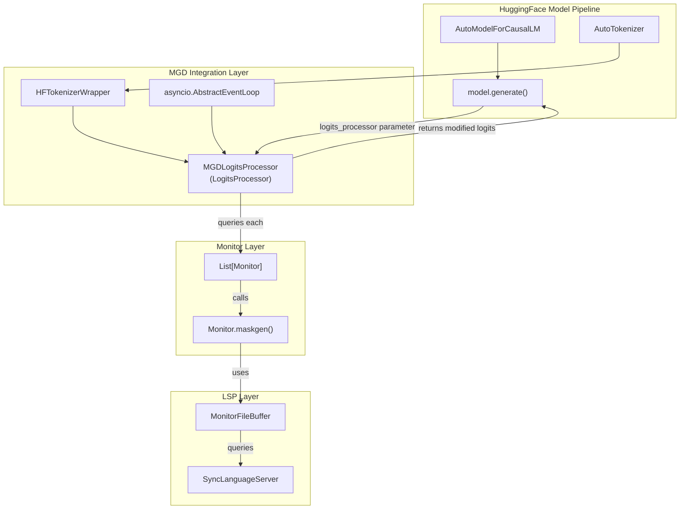
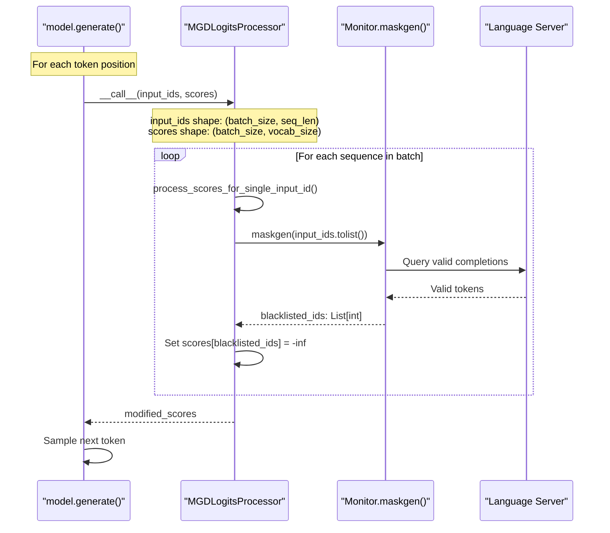
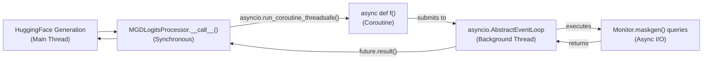
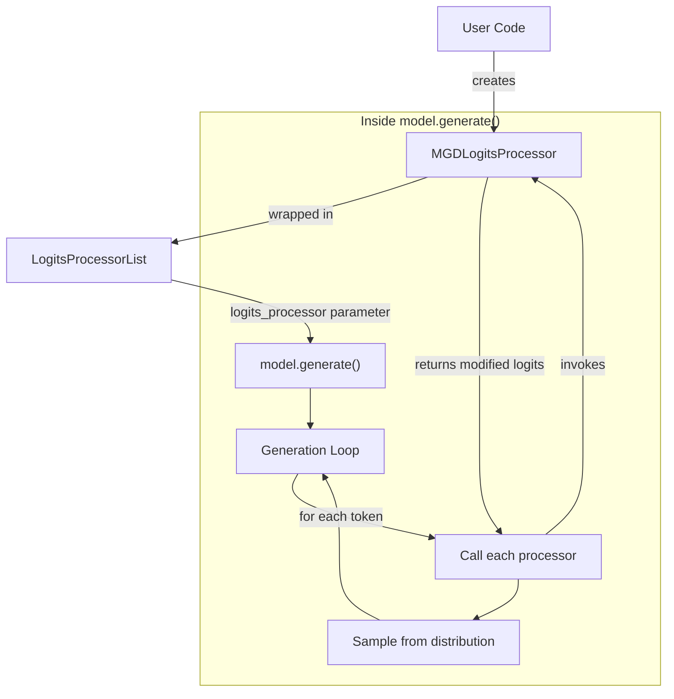
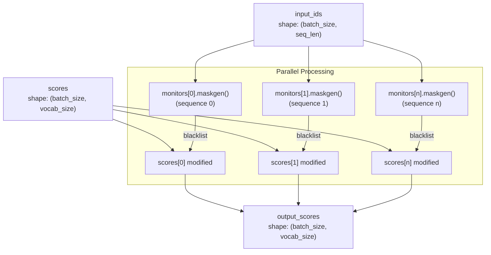
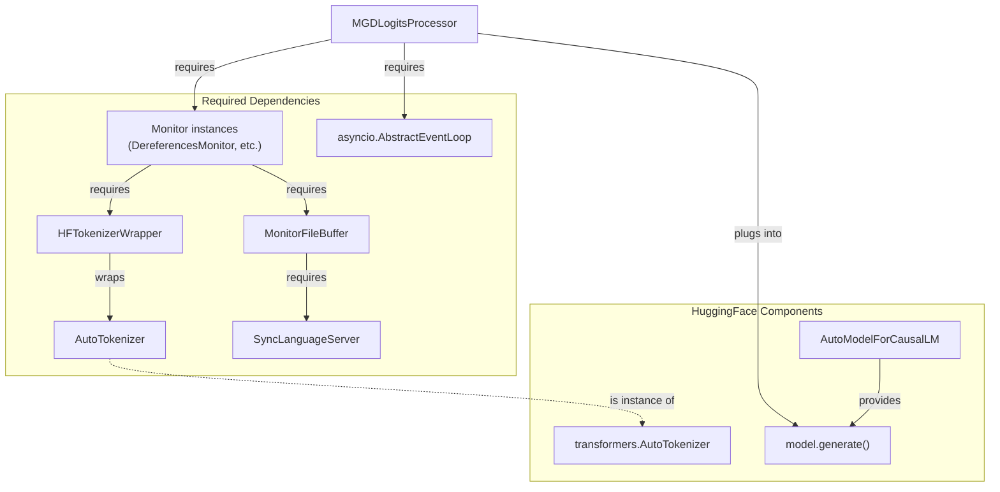

<!-- source: DeepWiki mcp.deepwiki.com · repo microsoft/monitors4codegen · extra page HuggingFace Integration · fetched 2026-10-26 -->

# HuggingFace Integration

<details>
<summary>Relevant source files</summary>

The following files were used as context for generating this wiki page:

- [src/monitors4codegen/monitor_guided_decoding/hf_gen.py](src/monitors4codegen/monitor_guided_decoding/hf_gen.py)
- [tests/monitor_guided_decoding/test_dereferences_monitor_java.py](tests/monitor_guided_decoding/test_dereferences_monitor_java.py)

</details>


## Purpose and Scope

This page explains how Monitor-Guided Decoding integrates with HuggingFace transformers models through the `MGDLogitsProcessor` class. It covers the architecture, token masking mechanism, and usage patterns for applying monitors to HuggingFace language models during code generation.

For integration with OpenAI models, see [OpenAI Integration](#3.3.2). For general monitor concepts, see [Core Concepts](#3.1).

---

## Architecture Overview

The HuggingFace integration is implemented through `MGDLogitsProcessor`, which extends the `LogitsProcessor` interface from the `transformers` library. This design allows monitors to seamlessly integrate with HuggingFace's standard generation pipeline by modifying token logits before sampling.



**Sources:** [src/monitors4codegen/monitor_guided_decoding/hf_gen.py:1-66](), [tests/monitor_guided_decoding/test_dereferences_monitor_java.py:1-241]()

---

## MGDLogitsProcessor Class

The `MGDLogitsProcessor` class is the core component that bridges HuggingFace models with the monitoring framework.

### Class Structure

| Component | Type | Purpose |
|-----------|------|---------|
| `monitors` | `List[Monitor]` | List of monitor instances to apply during generation |
| `loop` | `AbstractEventLoop` | Event loop for asynchronous monitor queries |

**Key Methods:**

| Method | Parameters | Returns | Description |
|--------|-----------|---------|-------------|
| `__init__` | `monitors: List[Monitor]`<br/>`loop: Union[None, AbstractEventLoop]` | `None` | Initializes processor with monitors and event loop |
| `__call__` | `input_ids: torch.LongTensor`<br/>`scores: torch.FloatTensor` | `torch.FloatTensor` | Called by HuggingFace during generation; modifies logits |
| `process_scores_for_single_input_id` | `segment_idx: int`<br/>`input_ids: torch.LongTensor`<br/>`scores: torch.FloatTensor` | `torch.FloatTensor` | Processes logits for a single sequence |

**Sources:** [src/monitors4codegen/monitor_guided_decoding/hf_gen.py:13-66]()

---

## Token Masking Mechanism

The logits processor implements token masking by setting the scores of blacklisted tokens to negative infinity, effectively preventing their selection during sampling.



The masking logic is implemented at [src/monitors4codegen/monitor_guided_decoding/hf_gen.py:36-42]():

```python
blacklisted_ids: List[int] = await self.monitors[segment_idx].maskgen(input_ids.tolist())
output_scores: torch.FloatTensor = torch.where(
    torch.tensor([True if i in blacklisted_ids else False for i in range(scores.shape[0])]).to(scores.device),
    float("-inf") * torch.ones(scores.shape[0]).to(scores.device),
    scores,
).to(scores)
```

**Sources:** [src/monitors4codegen/monitor_guided_decoding/hf_gen.py:30-42]()

---

## Event Loop Handling

Since monitors perform asynchronous LSP queries, `MGDLogitsProcessor` manages an event loop to handle concurrent monitor operations.

### Synchronization Strategy

The processor uses `asyncio.run_coroutine_threadsafe()` to execute asynchronous monitor queries from the synchronous HuggingFace generation context:



Implementation at [src/monitors4codegen/monitor_guided_decoding/hf_gen.py:54-65]():

| Step | Code Component | Purpose |
|------|---------------|---------|
| 1 | `async def f()` | Creates coroutine that gathers monitor results |
| 2 | `asyncio.gather(*new_score_coroutines)` | Executes all monitor queries concurrently |
| 3 | `asyncio.run_coroutine_threadsafe()` | Submits coroutine to event loop |
| 4 | `future.result()` | Blocks until all monitors complete |
| 5 | `torch.stack(results)` | Combines modified scores into tensor |

**Sources:** [src/monitors4codegen/monitor_guided_decoding/hf_gen.py:44-65]()

---

## Usage Example

### Basic Setup

The following example demonstrates setting up MGD with HuggingFace models for Java code generation with the `DereferencesMonitor`:

```python
# Model and tokenizer initialization
model = AutoModelForCausalLM.from_pretrained("bigcode/santacoder", trust_remote_code=True).to(device)
tokenizer = AutoTokenizer.from_pretrained("bigcode/santacoder")

# Language server and file buffer setup
lsp = SyncLanguageServer.create(config, logger, source_directory)
with lsp.start_server():
    with lsp.open_file(filepath):
        filebuffer = MonitorFileBuffer(lsp.language_server, filepath, cursor_pos, cursor_pos, Language.JAVA, "")
        
        # Monitor and processor initialization
        monitor = DereferencesMonitor(HFTokenizerWrapper(tokenizer), filebuffer)
        mgd_logits_processor = MGDLogitsProcessor([monitor], lsp.language_server.server.loop)
        
        # Generation with MGD
        logits_processor = LogitsProcessorList([mgd_logits_processor])
        generated_code = model.generate(
            prompt_tokenized,
            do_sample=False,
            max_new_tokens=30,
            logits_processor=logits_processor,
            early_stopping=True
        )
```

**Sources:** [tests/monitor_guided_decoding/test_dereferences_monitor_java.py:38-97]()

---

## Integration with HuggingFace generate()

### LogitsProcessorList Configuration

`MGDLogitsProcessor` is passed to `model.generate()` via the `logits_processor` parameter, which accepts a `LogitsProcessorList`:



### Generation Parameters

| Parameter | Recommended Value | Purpose |
|-----------|------------------|---------|
| `logits_processor` | `LogitsProcessorList([mgd_logits_processor])` | Applies monitor constraints |
| `do_sample` | `False` or `True` | Greedy decoding recommended for determinism |
| `max_new_tokens` | Task-dependent | Controls generation length |
| `early_stopping` | `True` | Stops at natural completion points |

**Sources:** [tests/monitor_guided_decoding/test_dereferences_monitor_java.py:84-91]()

---

## Multi-Monitor Support

`MGDLogitsProcessor` supports multiple monitors operating simultaneously. Each monitor in the list corresponds to a sequence in the batch:

### Batch Processing



**Assertion Requirements:**

- `input_ids.shape[0]` must equal `len(self.monitors)`
- Each monitor processes one sequence independently

**Sources:** [src/monitors4codegen/monitor_guided_decoding/hf_gen.py:50-60]()

---

## Comparison: With vs Without MGD

The test suite demonstrates the effectiveness of MGD by comparing generation with and without the logits processor:

### Example from Test Suite

| Configuration | Generated Code | Correctness |
|--------------|----------------|-------------|
| **Without MGD** | `.builder()`<br/>`.hostAddress(arr[0])` | ❌ Invalid method names |
| **With MGD** | `.newServerNode()`<br/>`.withIp(arr[0])` | ✅ Valid LSP-verified methods |

The test at [tests/monitor_guided_decoding/test_dereferences_monitor_java.py:74-97]() shows:

1. **Baseline generation** (lines 74-81): Produces syntactically plausible but semantically invalid method calls
2. **MGD generation** (lines 84-97): Produces only methods that exist according to the language server

**Sources:** [tests/monitor_guided_decoding/test_dereferences_monitor_java.py:25-97]()

---

## Component Dependencies

The HuggingFace integration requires several components to work together:



**Initialization Order:**

1. Initialize `AutoModelForCausalLM` and `AutoTokenizer`
2. Create `SyncLanguageServer` and open files
3. Create `MonitorFileBuffer` with file context
4. Wrap tokenizer in `HFTokenizerWrapper`
5. Initialize monitor instances with wrapper and file buffer
6. Create `MGDLogitsProcessor` with monitors and event loop
7. Pass processor to `model.generate()`

**Sources:** [tests/monitor_guided_decoding/test_dereferences_monitor_java.py:38-97](), [src/monitors4codegen/monitor_guided_decoding/hf_gen.py:20-26]()

---

