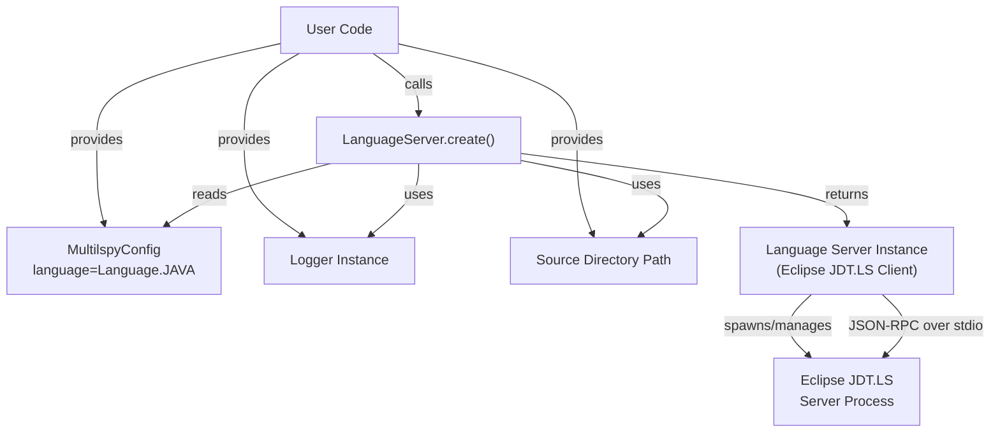
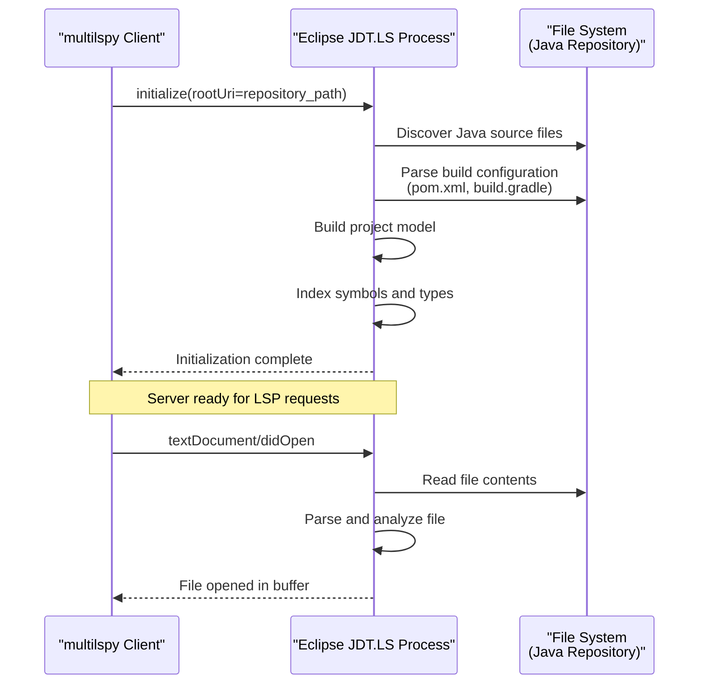
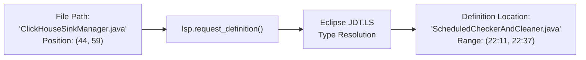
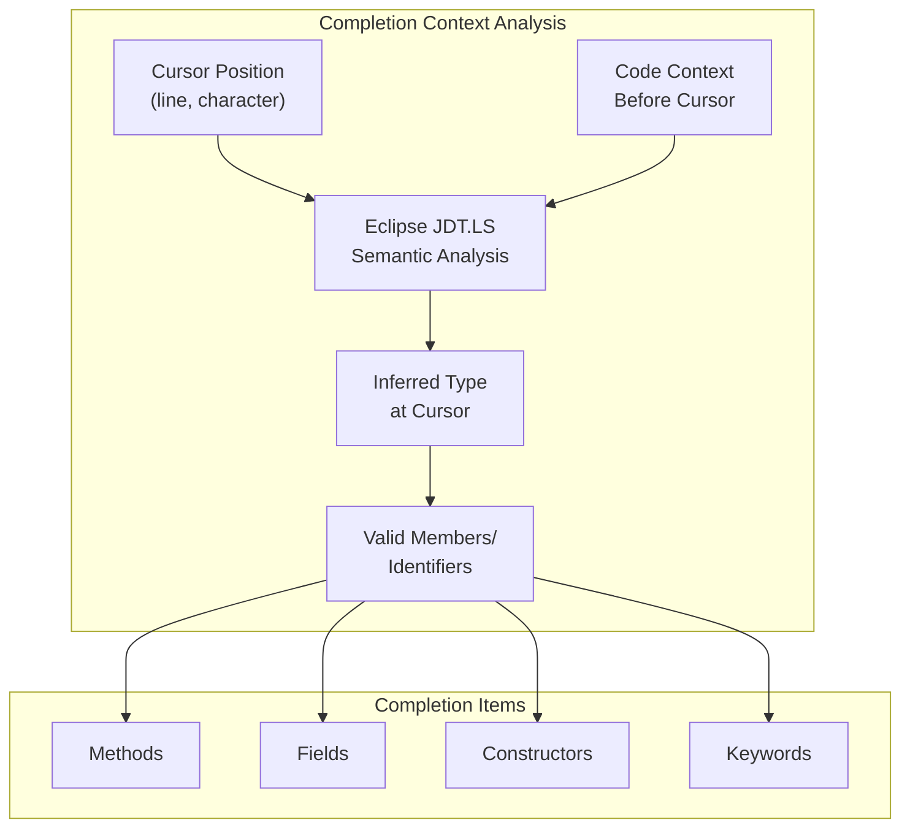
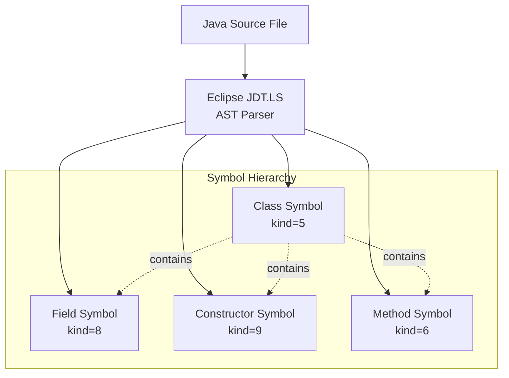
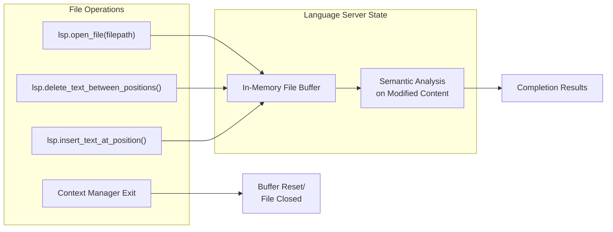
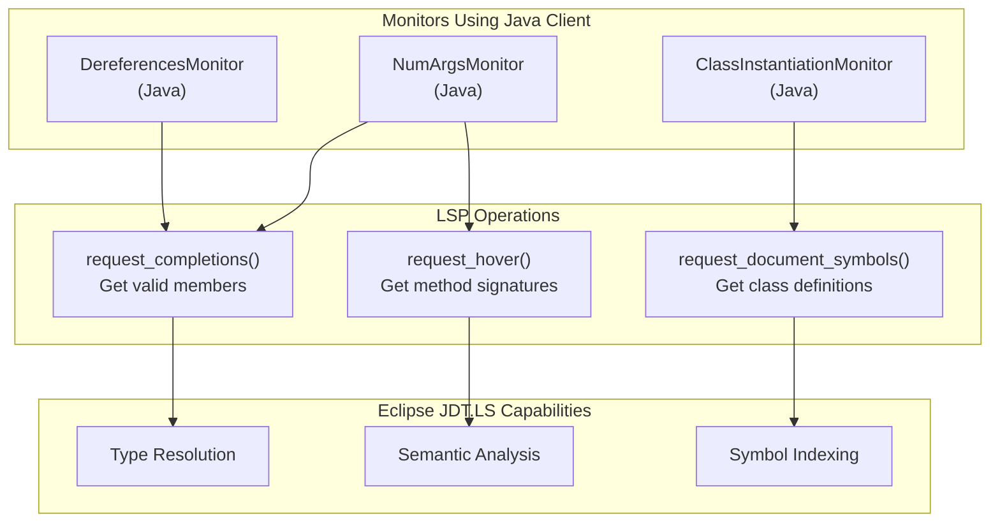

<!-- source: DeepWiki mcp.deepwiki.com · repo microsoft/monitors4codegen · extra page Java (Eclipse JDT.LS) · fetched 2026-10-26 -->

# Java (Eclipse JDT.LS)

<details>
<summary>Relevant source files</summary>

The following files were used as context for generating this wiki page:

- [tests/multilspy/test_multilspy_java.py](tests/multilspy/test_multilspy_java.py)

</details>


This document describes the Java language server client implementation in multilspy, which uses **Eclipse JDT.LS** (Eclipse Java Development Tools Language Server) as the underlying language server. This page covers the client's initialization, configuration, supported LSP operations, and usage patterns specific to Java codebases.

For information about the general multilspy architecture and factory pattern, see [Core Architecture](#4.1). For documentation on the LSP request methods themselves, see [LSP Request Methods](#4.2).

---

## Eclipse JDT.LS Overview

Eclipse JDT.LS is the language server implementation used for Java support in multilspy. It provides comprehensive static analysis capabilities including:

- Type resolution and inference
- Symbol definitions and references
- Code completion with method signatures
- Document symbols (classes, methods, fields, constructors)
- Hover information with type signatures
- Semantic understanding of Java language constructs

The multilspy library abstracts the complexity of starting, configuring, and communicating with the Eclipse JDT.LS process through a unified interface.

**Sources:** [tests/multilspy/test_multilspy_java.py:1-427]()

---

## Client Instantiation

The Java language server client is instantiated using the `LanguageServer.create()` factory method with `Language.JAVA` as the language parameter:



### Initialization Pattern

```python
from monitors4codegen.multilspy import LanguageServer
from monitors4codegen.multilspy.multilspy_config import Language

# Create configuration with Language.JAVA
config = create_config(code_language=Language.JAVA, ...)

# Instantiate the Java language server client
lsp = LanguageServer.create(config, logger, source_directory)

# Start the server process and perform operations
async with lsp.start_server():
    # All LSP operations must occur within this context
    result = await lsp.request_completions(filepath, line, character)
```

The server process is managed through an asynchronous context manager (`start_server()`). The Eclipse JDT.LS process is spawned when entering the context and terminated when exiting.

**Sources:** [tests/multilspy/test_multilspy_java.py:19-31](), [tests/multilspy/test_multilspy_java.py:151-162]()

---

## Repository Context Management

Eclipse JDT.LS requires access to the complete repository structure to perform accurate type resolution and semantic analysis. The language server indexes the codebase when initialized:



The test suite demonstrates this with real Java repositories:

| Repository | Commit | Usage in Tests |
|------------|--------|----------------|
| `clickhouse-highlevel-sinker` | `ee31d278918fe5e64669a6840c4d8fb53889e573` | Testing definitions, references, completions |
| `clickhouse-highlevel-sinker` (modified) | `5775fd7a67e7b60998e1614cf44a8a1fc3190ab0` | Testing hover, method signatures |
| `ExampleRepo` | `f3762fd55a457ff9c6b0bf3b266de2b203a766ab` | Testing document symbols |

**Sources:** [tests/multilspy/test_multilspy_java.py:20-24](), [tests/multilspy/test_multilspy_java.py:152-156](), [tests/multilspy/test_multilspy_java.py:216-220]()

---

## Supported LSP Operations

### Definition Requests

The `request_definition()` method resolves the definition location of a symbol at a given position:



**Example Usage:**
```python
filepath = "src/main/java/com/xlvchao/clickhouse/component/ClickHouseSinkManager.java"
result = await lsp.request_definition(filepath, line=44, character=59)
# Returns: [{'relativePath': '...', 'range': {...}}]
```

**Sources:** [tests/multilspy/test_multilspy_java.py:32-44]()

---

### Reference Requests

The `request_references()` method finds all locations where a symbol is referenced:

```python
filepath = "src/main/java/com/xlvchao/clickhouse/component/ClickHouseSinkManager.java"
result = await lsp.request_references(filepath, line=82, character=27)
# Returns list of reference locations with range information
```

Each result contains:
- `relativePath`: File path relative to repository root
- `absolutePath`: Absolute file system path
- `uri`: File URI
- `range`: Position range with start/end line and character offsets

**Sources:** [tests/multilspy/test_multilspy_java.py:67-95]()

---

### Completion Requests

The `request_completions()` method provides context-aware code completions at a cursor position. This is particularly useful for Monitor-Guided Decoding to constrain token generation.



**Example: Method Completion After Dot**
```python
filepath = "src/main/java/com/xlvchao/clickhouse/datasource/ClickHouseDataSource.java"
with lsp.open_file(filepath):
    # Delete text to position cursor after method call
    lsp.delete_text_between_positions(
        filepath,
        Position(line=75, character=17),
        Position(line=78, character=4)
    )
    # Request completions at the position
    completions = await lsp.request_completions(filepath, 75, 17)
    # Returns: ['build', 'equals', 'getClass', 'hashCode', 'toString', 
    #           'withIp', 'withPort', 'notify', 'notifyAll', 'wait', ...]
```

**Example: Constructor Completion**
```python
with lsp.open_file(filepath):
    completions = await lsp.request_completions(filepath, 136, 23)
    constructors = [c for c in completions if c["kind"] == CompletionItemKind.Constructor]
    # Returns: ['ClickHouseSinkBuffer']
```

Each completion item contains:
- `completionText`: The text to insert
- `detail`: Additional information (e.g., method signature)
- `kind`: Completion item kind (method, constructor, field, etc.)

**Sources:** [tests/multilspy/test_multilspy_java.py:97-144](), [tests/multilspy/test_multilspy_java.py:163-208]()

---

### Document Symbol Requests

The `request_document_symbols()` method retrieves all symbols (classes, methods, fields, constructors) defined in a file:



**Example: Person.java Symbols**
```python
filepath = "Person.java"
result = await lsp.request_document_symbols(filepath)
# Returns:
# [
#   {"name": "Person", "kind": 5, "range": {...}, "detail": ""},
#   {"name": "name", "kind": 8, "range": {...}, "detail": ""},
#   {"name": "Person(String)", "kind": 9, "range": {...}, "detail": ""},
#   {"name": "getName()", "kind": 6, "range": {...}, "detail": " : String"}
# ]
```

Symbol kinds follow the LSP specification:
- `5`: Class
- `6`: Method
- `8`: Field
- `9`: Constructor

Each symbol includes:
- `name`: Symbol name (with parameter types for methods/constructors)
- `kind`: Symbol kind identifier
- `range`: Full range of the symbol definition
- `selectionRange`: Range of the symbol's name identifier
- `detail`: Additional type information (e.g., return type for methods)

**Sources:** [tests/multilspy/test_multilspy_java.py:211-347]()

---

### Hover Requests

The `request_hover()` method retrieves type information and signatures for the symbol at a cursor position:

```python
filepath = "src/main/java/com/xlvchao/clickhouse/datasource/ClickHouseDataSource.java"
with lsp.open_file(filepath):
    result = await lsp.request_hover(filepath, line=75, character=27)
    # Returns:
    # {
    #     "contents": {
    #         "language": "java",
    #         "value": "Builder com.xlvchao.clickhouse.datasource.ServerNode.Builder.withIpPort(String ip, Integer port)"
    #     }
    # }
```

The hover information includes:
- Full qualified method signature
- Parameter types
- Return type
- Syntax highlighting language hint

This is particularly useful for the `NumArgsMonitor` to determine function arity.

**Sources:** [tests/multilspy/test_multilspy_java.py:350-387]()

---

### Completion with Method Signatures

Completions can include detailed method signatures in the `detail` field:

```python
result = await lsp.request_completions(filepath, 75, 27)
# Returns:
# [
#     {
#         "completionText": "withIpPort",
#         "detail": "Builder.withIpPort(String ip, Integer port) : Builder",
#         "kind": 2
#     }
# ]
```

The `detail` field format: `ReturnType.methodName(ParameterType1 param1, ParameterType2 param2) : ReturnType`

Completion item kinds:
- `2`: Method
- `8`: Field
- `9`: Constructor

**Sources:** [tests/multilspy/test_multilspy_java.py:390-426]()

---

## File Buffer Management

The Java language server client provides file buffer manipulation methods for testing and monitor implementations:



**Usage Pattern:**
```python
filepath = "ClickHouseDataSource.java"
with lsp.open_file(filepath):
    # File is opened in LSP buffer
    deleted_text = lsp.delete_text_between_positions(
        filepath,
        Position(line=74, character=17),
        Position(line=78, character=4)
    )
    # Modified buffer state is used for LSP queries
    completions = await lsp.request_completions(filepath, 74, 17)
    # File is automatically closed when exiting context
```

The `delete_text_between_positions()` method:
- Takes start and end `Position` objects
- Removes text in the specified range
- Returns the deleted text string
- Updates the language server's file buffer
- Subsequent LSP queries operate on the modified buffer

**Sources:** [tests/multilspy/test_multilspy_java.py:98-108](), [tests/multilspy/test_multilspy_java.py:369-378]()

---

## Integration with Monitor-Guided Decoding

The Java language server client is the foundation for Java-specific monitors in the Monitor-Guided Decoding framework:



### DereferencesMonitor Usage

After detecting a dot (`.`) in the generated code, the monitor requests completions to determine valid members of the inferred type:

```python
# After generating "object."
completions = await lsp.request_completions(filepath, line, character)
valid_members = [c["completionText"] for c in completions]
# Use valid_members to constrain next token generation
```

### NumArgsMonitor Usage

The monitor uses hover requests to extract method signatures and determine parameter counts:

```python
# After detecting a method call
hover_result = await lsp.request_hover(filepath, line, character)
signature = hover_result["contents"]["value"]
# Parse signature to extract parameter count
```

### ClassInstantiationMonitor Usage

After detecting the `new` keyword, the monitor requests document symbols to find valid class names:

```python
symbols = await lsp.request_document_symbols(filepath)
classes = [s["name"] for s in symbols if s["kind"] == 5]
# Use classes to constrain next token generation
```

**Sources:** [tests/multilspy/test_multilspy_java.py:97-144](), [tests/multilspy/test_multilspy_java.py:380-387](), [tests/multilspy/test_multilspy_java.py:228-286]()

---

## Common Usage Patterns

### Pattern 1: Type-Safe Member Access

```python
async with lsp.start_server():
    with lsp.open_file(filepath):
        # Position cursor after object reference
        lsp.delete_text_between_positions(filepath, start_pos, end_pos)
        
        # Get valid members for the inferred type
        completions = await lsp.request_completions(filepath, line, char)
        
        # Filter by completion kind if needed
        methods = [c for c in completions if c["kind"] == CompletionItemKind.Method]
        fields = [c for c in completions if c["kind"] == CompletionItemKind.Field]
```

### Pattern 2: Method Signature Extraction

```python
async with lsp.start_server():
    with lsp.open_file(filepath):
        # Position cursor on method name
        hover_info = await lsp.request_hover(filepath, line, char)
        
        # Extract signature from hover contents
        signature = hover_info["contents"]["value"]
        # Parse signature to get parameter types and count
```

### Pattern 3: Symbol Discovery

```python
async with lsp.start_server():
    # Get all symbols in a file
    symbols = await lsp.request_document_symbols(filepath)
    
    # Filter by symbol kind
    classes = [s for s in symbols if s["kind"] == 5]
    methods = [s for s in symbols if s["kind"] == 6]
    constructors = [s for s in symbols if s["kind"] == 9]
```

**Sources:** [tests/multilspy/test_multilspy_java.py:98-144](), [tests/multilspy/test_multilspy_java.py:367-387](), [tests/multilspy/test_multilspy_java.py:211-287]()

---

## Configuration and Requirements

### Repository Structure

Eclipse JDT.LS works best with properly structured Java projects:
- Standard Maven layout (`src/main/java`, `src/test/java`)
- Gradle project structure
- Build configuration files (`pom.xml`, `build.gradle`)

### Initialization Time

The language server requires time to:
1. Parse build configuration
2. Resolve dependencies
3. Index source files
4. Build semantic model

Tests use real repositories with complete project structures to ensure accurate type resolution.

### File Path Handling

All file paths are specified relative to the repository root:
- Use `PurePath` for cross-platform compatibility
- Paths use forward slashes in the multilspy API
- The language server handles platform-specific path conversion

**Sources:** [tests/multilspy/test_multilspy_java.py:32-33](), [tests/multilspy/test_multilspy_java.py:97-98]()

---

## Summary

The Java language server client in multilspy provides comprehensive static analysis capabilities through Eclipse JDT.LS:

| Capability | LSP Method | Use Case |
|------------|-----------|----------|
| Definition Resolution | `textDocument/definition` | Find where symbols are defined |
| Reference Finding | `textDocument/references` | Find all usages of a symbol |
| Code Completion | `textDocument/completion` | Type-safe member access, Monitor-Guided Decoding |
| Symbol Discovery | `textDocument/documentSymbol` | Find classes, methods, fields in a file |
| Type Information | `textDocument/hover` | Extract method signatures, parameter types |

The client is designed to integrate seamlessly with the Monitor-Guided Decoding framework, providing the semantic information needed to constrain code generation to syntactically and semantically valid Java code.

**Sources:** [tests/multilspy/test_multilspy_java.py:1-427]()

---

