<!-- source: DeepWiki mcp.deepwiki.com · repo microsoft/monitors4codegen · extra page NumArgsMonitor · fetched 2026-10-26 -->

# NumArgsMonitor

<details>
<summary>Relevant source files</summary>

The following files were used as context for generating this wiki page:

- [src/monitors4codegen/monitor_guided_decoding/monitors/numargs_monitor.py](src/monitors4codegen/monitor_guided_decoding/monitors/numargs_monitor.py)
- [tests/monitor_guided_decoding/test_joint_monitors.py](tests/monitor_guided_decoding/test_joint_monitors.py)
- [tests/monitor_guided_decoding/test_numargs_monitor_java.py](tests/monitor_guided_decoding/test_numargs_monitor_java.py)

</details>


## Purpose and Scope

The `NumArgsMonitor` (implemented as `NumMethodArgumentsMonitor`) ensures that language models generate the correct number of arguments when calling methods or functions during code generation. This monitor prevents common errors where the model generates too few or too many arguments, or prematurely closes a method call with `)` before all required arguments have been provided.

For information about other structural monitors that ensure syntactic correctness, see [DereferencesMonitor](#3.2.1) for type-valid member access and [ClassInstantiationMonitor](#3.2.4) for valid class instantiation. For an overview of all monitor types, see [Monitor Implementations](#3.2).

**Sources**: [src/monitors4codegen/monitor_guided_decoding/monitors/numargs_monitor.py:1-3]()

---

## Overview

The `NumArgsMonitor` operates by detecting when a method call begins (indicated by an opening parenthesis `(`) and then constraining token generation to ensure the correct number of arguments are provided before allowing the method call to close. The monitor maintains a stack of open method calls, enabling it to handle nested function calls correctly.

The monitor uses the Language Server Protocol (LSP) to query function signatures and determine the expected number of arguments at the point where a method call is opened. It then tracks argument count as generation progresses, using commas as delimiters between arguments, and prevents the generation of closing parentheses `)` until all required arguments have been supplied.

### High-Level Operation Flow

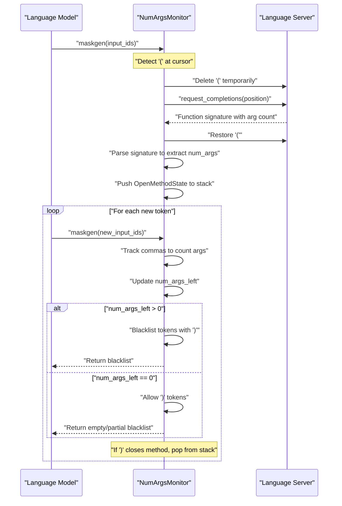

**Sources**: [src/monitors4codegen/monitor_guided_decoding/monitors/numargs_monitor.py:36-287]()

---

## Architecture and Components

### Core Classes and Data Structures

The monitor implementation consists of three primary components:

| Component | Type | Purpose |
|-----------|------|---------|
| `NumMethodArgumentsMonitor` | Class | Main monitor implementation that enforces argument count constraints |
| `DecoderStates` | Enum | Tracks the lifecycle state of the monitor |
| `OpenMethodState` | Dataclass | Stores information about each open method call |

#### Decoder States

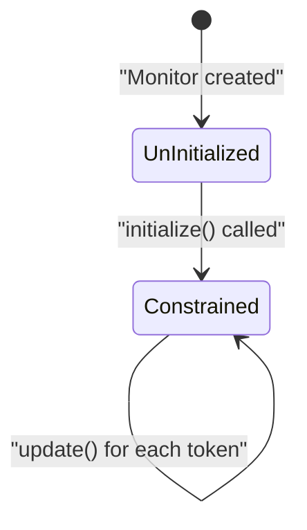

**Sources**: [src/monitors4codegen/monitor_guided_decoding/monitors/numargs_monitor.py:17-25]()

#### OpenMethodState Structure

The `OpenMethodState` dataclass maintains state for each open method call:

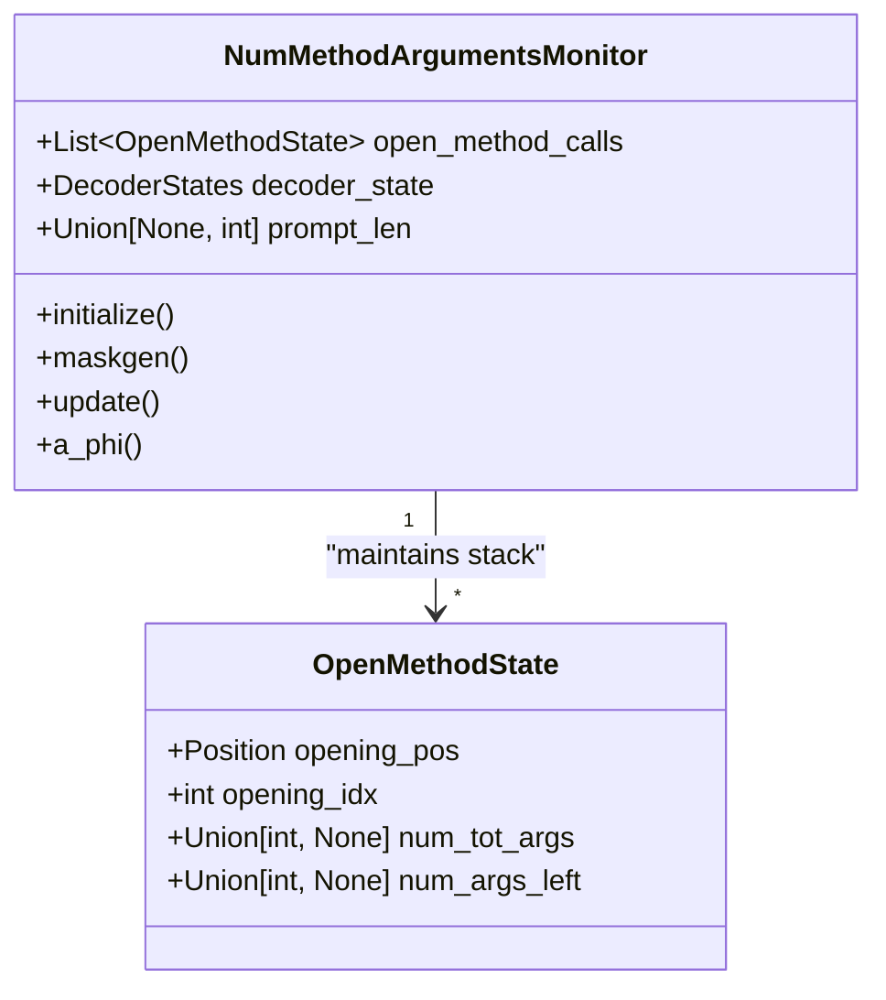

| Field | Type | Description |
|-------|------|-------------|
| `opening_pos` | `Position` | Line and character position where `(` appears |
| `opening_idx` | `int` | Character index in file buffer where `(` appears |
| `num_tot_args` | `Union[int, None]` | Total expected arguments (None if unknown/overloaded) |
| `num_args_left` | `Union[int, None]` | Remaining arguments to generate (None if unknown) |

**Sources**: [src/monitors4codegen/monitor_guided_decoding/monitors/numargs_monitor.py:26-35](), [src/monitors4codegen/monitor_guided_decoding/monitors/numargs_monitor.py:36-50]()

---

## Initialization and State Management

### Monitor Initialization

The `NumMethodArgumentsMonitor` constructor accepts three parameters:

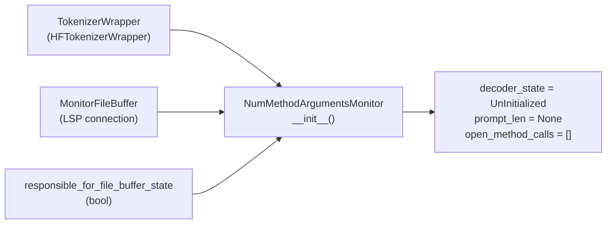

When `initialize()` is called for the first time:

1. Sets `prompt_len` to track the boundary between prompt and generated text
2. Calls `pre()` to check if cursor is at an opening parenthesis
3. Transitions state to `DecoderStates.Constrained`

**Sources**: [src/monitors4codegen/monitor_guided_decoding/monitors/numargs_monitor.py:41-58]()

### The pre() Method: Detecting Method Openings

The `pre()` method is called to detect when a new method call begins:

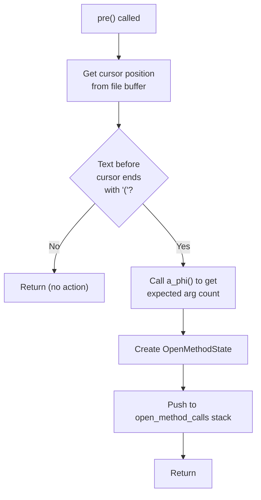

**Sources**: [src/monitors4codegen/monitor_guided_decoding/monitors/numargs_monitor.py:59-101]()

---

## LSP Integration: Function Signature Querying

### The a_phi() Method

The `a_phi()` method determines the number of arguments a function expects by querying the language server:

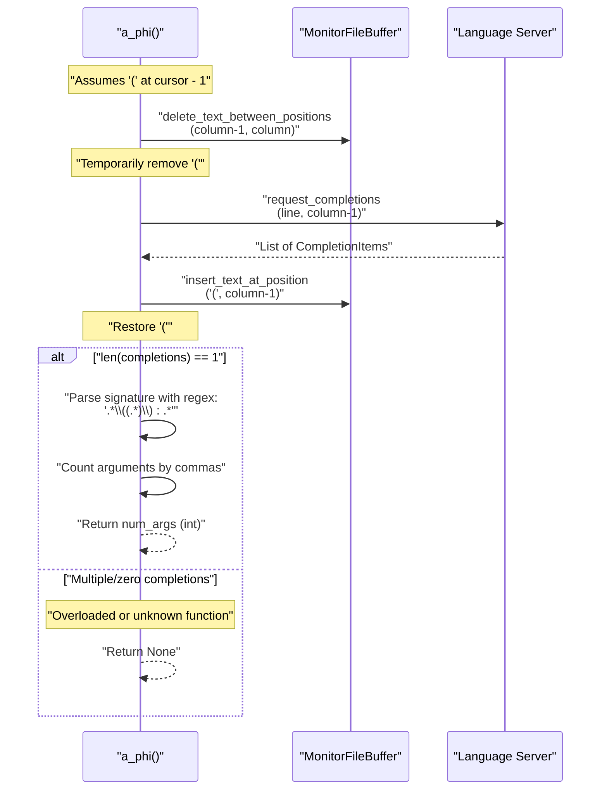

The method uses the following algorithm to extract argument count:

1. **Temporarily remove the opening parenthesis** to position the cursor before the `(` for completion
2. **Request completions** from LSP at this position to get the function signature
3. **Restore the parenthesis** to maintain file buffer integrity
4. **Parse the signature** using regex pattern `.*\((.*)\) : .*` to extract the argument list
5. **Count arguments** by splitting on commas (empty string = 0 args, no comma = 1 arg, n commas = n+1 args)

**Note**: If multiple completions are returned (indicating overloaded methods), the monitor returns `None` and cannot enforce strict argument counting for that method call.

**Sources**: [src/monitors4codegen/monitor_guided_decoding/monitors/numargs_monitor.py:166-216]()

---

## Token Masking Logic

### The maskgen() Method

The `maskgen()` method is called for each token to be generated and returns a list of token IDs to blacklist:

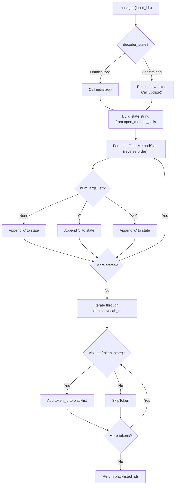

The **state string** encodes the argument status of open method calls:
- `'o'` (open) = method still needs more arguments
- `'c'` (closeable) = method has received all arguments or count is unknown

For example:
- `"oo"` = 2 nested methods both need more arguments
- `"oc"` = outer method needs args, inner method is closeable
- `"co"` = outer method is closeable, inner method needs args

**Sources**: [src/monitors4codegen/monitor_guided_decoding/monitors/numargs_monitor.py:121-164]()

### The violates() Method

The `violates()` method determines if a token would violate the current constraint:

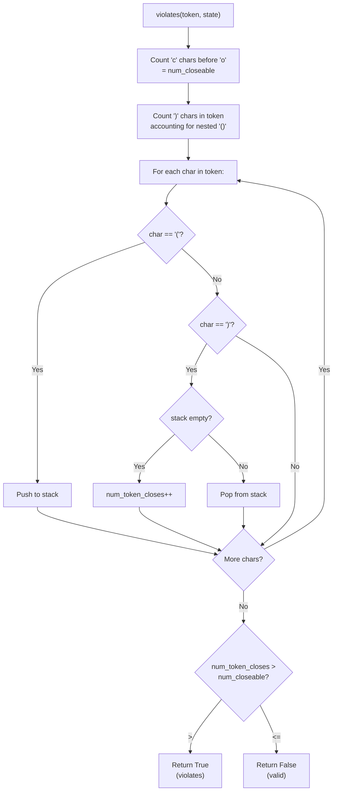

This method counts how many method calls a token would close (ignoring nested pairs) and compares against how many methods are allowed to be closed based on the state.

**Sources**: [src/monitors4codegen/monitor_guided_decoding/monitors/numargs_monitor.py:102-119]()

---

## Update Logic and Argument Tracking

### The update() Method

When a new token is generated, `update()` processes it character by character:

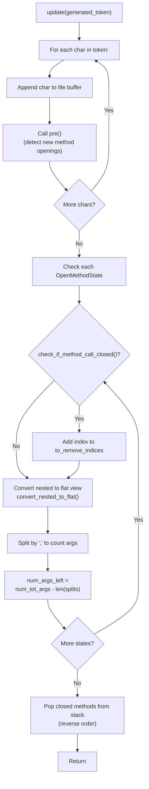

**Sources**: [src/monitors4codegen/monitor_guided_decoding/monitors/numargs_monitor.py:260-287]()

### Helper Methods

#### convert_nested_to_flat()

This method flattens nested method calls to simplify argument counting:

| Input | Output | Explanation |
|-------|--------|-------------|
| `"a, b"` | `"., ."` | Two arguments at current level |
| `"a, func(x, y), b"` | `"., ., ."` | Three arguments (nested call treated as single arg) |
| `"func(x), g(y, z)"` | `"., ."` | Two arguments (both are function calls) |

The algorithm replaces:
- Opening/closing parentheses `(` `)` → `.`
- Commas at depth > 0 → `.`
- Non-whitespace characters → `.`
- Top-level commas remain as `,`

This enables the monitor to count arguments at the current nesting level by simply counting comma-separated segments.

**Sources**: [src/monitors4codegen/monitor_guided_decoding/monitors/numargs_monitor.py:218-239]()

#### check_if_method_call_closed()

Determines if a method call starting with `(` has been closed by a matching `)`:

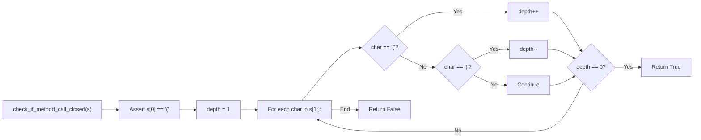

**Sources**: [src/monitors4codegen/monitor_guided_decoding/monitors/numargs_monitor.py:241-258]()

---

## Usage Example

### Java Method Call with NumArgsMonitor

The following example demonstrates how `NumArgsMonitor` constrains generation for a Java method call:

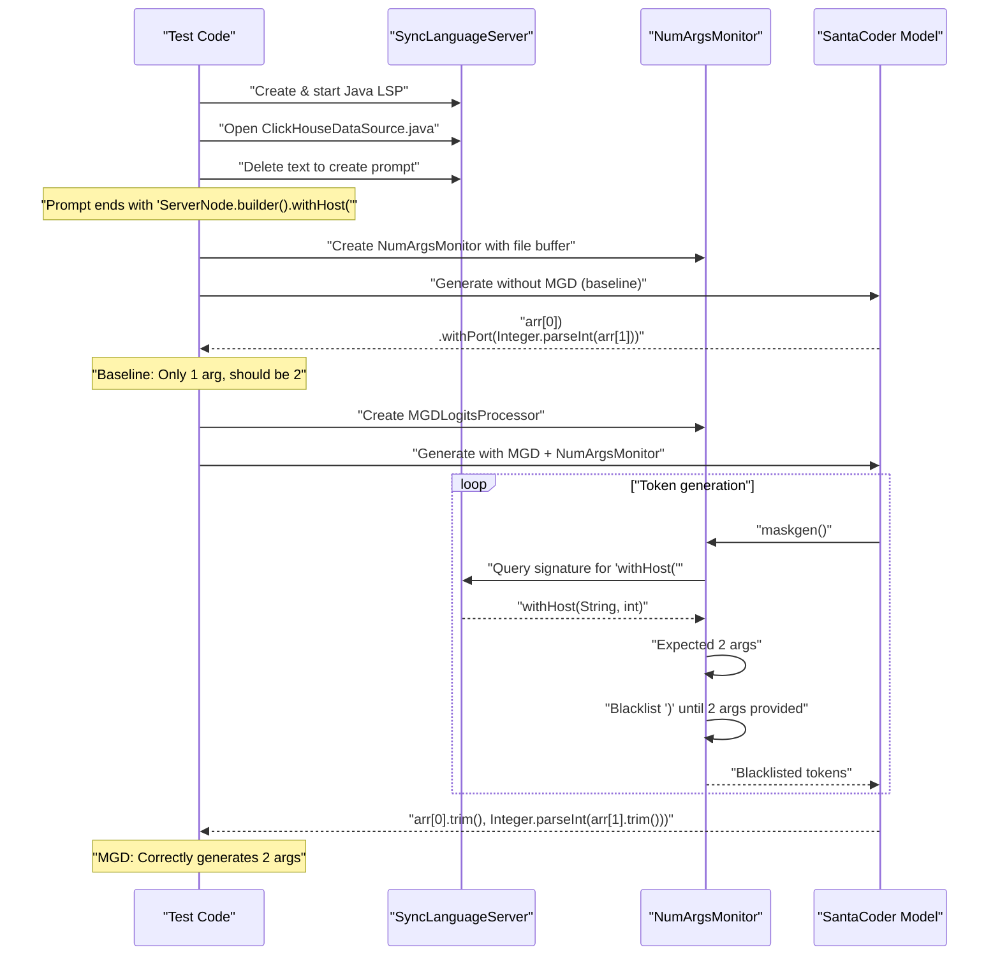

**Test Implementation Reference**:
- Test class: [tests/monitor_guided_decoding/test_numargs_monitor_java.py:25-106]()
- Repository: `clickhouse-highlevel-sinker`
- File: `src/main/java/com/xlvchao/clickhouse/datasource/ClickHouseDataSource.java`
- Context: The method `withHost()` requires 2 arguments (hostname and port), but without MGD the model only generates 1

**Sources**: [tests/monitor_guided_decoding/test_numargs_monitor_java.py:1-107]()

---

## Integration with Other Monitors

The `NumArgsMonitor` can operate simultaneously with other monitors through joint monitoring. Multiple monitors combine their blacklists, with the union of all blacklisted tokens being masked from the model.

### Example: Joint Monitoring with DereferencesMonitor

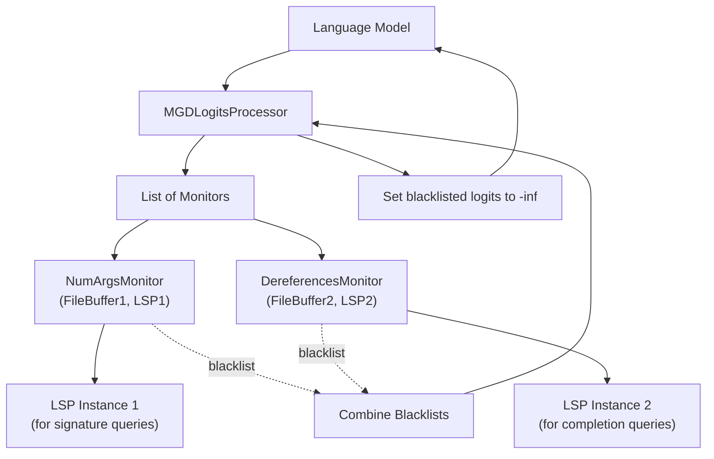

**Important**: Each monitor requires its own `MonitorFileBuffer` with separate LSP connections to avoid state conflicts when querying the language server.

**Sources**: [tests/monitor_guided_decoding/test_joint_monitors.py:83-101]()

---

## Limitations and Edge Cases

### Overloaded Methods

When a method has multiple overloads with different argument counts, the LSP returns multiple completion items. In this case, `a_phi()` returns `None` and the monitor cannot enforce strict argument count constraints:

```
State: num_tot_args = None, num_args_left = None
Effect: State string contains 'c' (closeable) at all times
Result: Monitor does not restrict closing parentheses
```

**Sources**: [src/monitors4codegen/monitor_guided_decoding/monitors/numargs_monitor.py:199-201]()

### Variable Argument Functions

The current implementation does not handle variadic functions (e.g., Java's `String.format(String, Object...)`). These are treated similarly to overloaded methods where the exact argument count cannot be determined.

### Nested Method Calls

The monitor correctly handles nested method calls by:
1. Maintaining a stack of `OpenMethodState` objects
2. Using `convert_nested_to_flat()` to count arguments at each nesting level independently
3. Tracking opening/closing parentheses to determine when nested calls complete

**Sources**: [src/monitors4codegen/monitor_guided_decoding/monitors/numargs_monitor.py:218-239](), [src/monitors4codegen/monitor_guided_decoding/monitors/numargs_monitor.py:46-49]()

---

## Implementation Files

| File Path | Description |
|-----------|-------------|
| `src/monitors4codegen/monitor_guided_decoding/monitors/numargs_monitor.py` | Main implementation of `NumMethodArgumentsMonitor` |
| `tests/monitor_guided_decoding/test_numargs_monitor_java.py` | Java-specific test cases |
| `tests/monitor_guided_decoding/test_joint_monitors.py` | Tests for joint monitoring with multiple monitors |

**Sources**: [src/monitors4codegen/monitor_guided_decoding/monitors/numargs_monitor.py:1-287](), [tests/monitor_guided_decoding/test_numargs_monitor_java.py:1-107](), [tests/monitor_guided_decoding/test_joint_monitors.py:1-138]()

---

